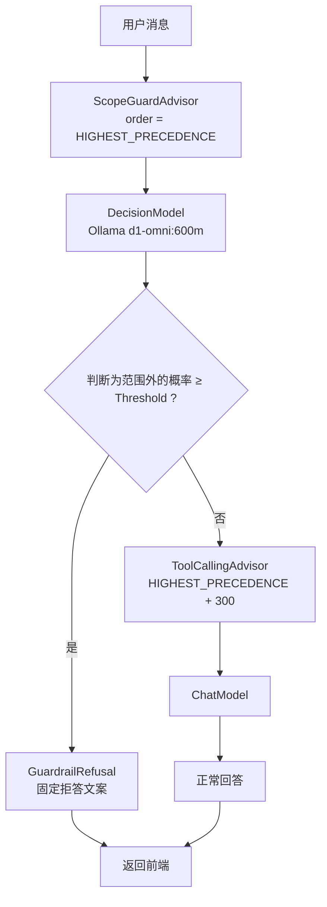
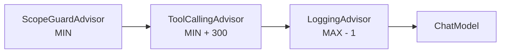

# AI 对话输入范围门禁设计

> 状态：设计待实现（2026-11-27）；影响服务 `jotang-ai`

## 1. 背景与目标

**现象**

用户问“火锅还是烤肉”，AI 给出了选餐建议。这类问题与校园知识库、平台笔记无关，属于服务范围外。

**现有实现的问题**

| 问题 | 说明 |
|---|---|
| `ChatPrompt.SYSTEM` 缺少范围约束 | 只有通用行为约束，模型按通用助手行为回答；本次补一条兜底（§5.5） |
| 只靠 prompt 不可靠 | 指令遵循是概率性的；“我很急”这类施压会提高顺从率 |
| 没有服务端短路 | 范围外问题也会走完整的主模型 + 工具调用，白花钱 |

**目标**

| 目标 | 判定 |
|---|---|
| 范围外问题在进入主模型前拦截 | 不产生主模型调用与工具调用 |
| 返回固定拒答文案 | 文案由服务端定义，不让模型自由发挥 |
| 支持多轮追问 | “那第二条呢”沿用前文校园话题时放行 |
| 能抓住话题切换 | 聊完奖学金后突然问火锅，仍能拦住 |
| 故障可降级 | 判定模型不可用时放行，聊天不中断 |
| 不影响其他模型调用 | 摘要、图片转写、评测基线不受影响 |

**非目标**

- 输出合规检查（回答生成后再判一次）
- 流式回答撤回 / `replace` 事件
- 关键词黑名单、embedding 分类器、微调分类模型
- 多实例一致性、监控告警

## 2. 方案选择

### 2.1 分类方式

| 方案 | 拦截时机 | 效果 | 问题 | 结论 |
|---|---|---|---|---|
| 只改 prompt | 无 | 降低但会漏 | 概率性；施压/换说法就破 | 不作为门禁；保留为兜底 |
| 关键词黑名单 | 输入 | 差 | 误杀“食堂”“校园周边”，易绕过 | 不采用 |
| 检索门控（检索不到就拒答） | 输入 | 差 | 把“范围内没资料”误判成“范围外” | 不采用 |
| Chat 模型分类（输出 JSON） | 输入 | 好 | 要写 prompt、解析 JSON、处理格式漂移 | 可用但不选 |
| **DecisionModel + Advisor** | 输入 | 好 | 需要本地 Ollama | **采用** |

选 DecisionModel 的理由：

- 官方定位就是 guardrails，输出是结构化的 Choice/YesNo + 概率；
- 不需要解析自由文本，不需要约束 JSON 格式；
- 600M 小模型本地跑，延迟和成本都低；
- 与 Advisor 的短路机制天然契合。

## 3. 总体设计



**在 Advisor 链中的位置**


门禁放在 `HIGHEST_PRECEDENCE`，位于工具循环外侧，同一条用户消息只判一次。

## 4. 判定策略

### 4.1 输入构造

用 `fields`，不用整段 `conversation`：

| 字段 | 内容 | 截断 |
|---|---|---|
| `latest_message` | 当前用户消息 | 不截断（`ChatRequest` 已限长） |
| `recent_context` | 最近 6 条 user/assistant 消息，拼成“用户：… / 助手：…” | 每条 200 字 |

不传 system prompt，不传工具返回内容。理由：600M 小模型对长上下文和无关信息敏感，输入越聚焦越稳。

### 4.2 问题与判定

```java
YesNoQuestion.builder()
    .text("latest_message 是否明确属于服务范围之外？")
    .whenYes("......")
    .whenNo("......")
    .build()
```

判定规则：

| 结果 | 动作 | 理由 |
|---|---|---|
| `P(范围外) >= threshold` | 拦截 | 只拦明确的 |
| `P(范围外) < threshold` | 放行 | 含 0.5 附近的未决；交给主模型 prompt 兜底 |
| 服务端未返回 `noul`（按 0 处理） | 放行 | 概率不可用时不冒险拦截(fail-open) |

> 阈值按评测结果调整。放行后由 `ChatPrompt.SYSTEM` 的范围约束兜底。

### 4.3 拒答文案

服务端常量，模型不参与生成：

```
这个问题不在我的服务范围内。
我可以帮你查阅平台上的笔记，以及回答学校相关事务。
```

用 `GuardrailRefusal.generation(text)` 包装，而不是普通 `AssistantMessage`：

- `finishReason = guardrailRefusal`，下游结构化输出组件不会误解析；
- Spring AI 自带的 `SafeGuardAdvisor` 就是这么做的。

### 4.4 多轮与话题切换

| 场景 | 历史 | 当前消息 | 判定 |
|---|---|---|---|
| 首次问火锅 | 空 | “火锅还是烤肉” | OUT |
| 追问 | “推免对综测有什么要求” / 助手回答 | “那第二条呢” | IN |
| 话题切换 | 多轮奖学金讨论 | “晚上吃火锅还是烤肉” | OUT |
| 问候 | 空 | “你好” | IN |
| 能力询问 | 空 | “你能做什么” | IN |
| 范围内但没资料 | 空 | “图书馆几点开门” | IN（交给主模型说没有） |

每条消息都判，不能只判首条，也不能只按会话判一次。

## 5. 实现设计

### 5.1 新增类

| 文件 | 作用 |
|---|---|
| `jotang-ai/.../chat/advisor/ScopeGuardAdvisor.java` | 输入门禁 Advisor |

### 5.2 ScopeGuardAdvisor 骨架

```java
@Slf4j
@Component
public class ScopeGuardAdvisor implements CallAdvisor, StreamAdvisor {

    public static final String REFUSAL = """
            这个问题不在我的服务范围内。
            我可以帮你查阅平台上的笔记，以及回答学校相关事务。""";

    private static final int RECENT_MESSAGES = 6;
    private static final int SNIPPET_LENGTH = 200;
    private static final double OUT_OF_SCOPE_THRESHOLD = 0.8;

    private final DecisionModel decisionModel;

    public ScopeGuardAdvisor(@Qualifier("ollamaDecisionModel") DecisionModel decisionModel) {
        this.decisionModel = decisionModel;
    }

    @Override
    public String getName() {
        return "ScopeGuardAdvisor";
    }

    @Override
    public int getOrder() {
        return Ordered.HIGHEST_PRECEDENCE;
    }

    @Override
    public ChatClientResponse adviseCall(ChatClientRequest request, CallAdvisorChain chain) {
        return outOfScope(request) ? refusal(request) : chain.nextCall(request);
    }

    @Override
    public Flux<ChatClientResponse> adviseStream(ChatClientRequest request, StreamAdvisorChain chain) {
        return outOfScope(request) ? Flux.just(refusal(request)) : chain.nextStream(request);
    }

    private boolean outOfScope(ChatClientRequest request) {
        try {
            String latest = request.prompt().getUserMessage().getText();
            if (latest == null || latest.isBlank()) {
                return false;
            }
            Map<String, Object> input = new LinkedHashMap<>();
            input.put("latest_message", latest);
            input.put("recent_context", recentTranscript(request));

            DecisionResponse response = decisionModel.call(DecisionPrompt.builder()
                    .fields(input)
                    .question("scope", YesNoQuestion.builder()
                            .text("latest_message 是否明确属于服务范围之外？")
                            .whenYes("...")
                            .whenNo("...")
                            .build())
                    .build());

            return response.getYesNo("scope").getProbability() >= OUT_OF_SCOPE_THRESHOLD;
        } catch (RuntimeException e) {
            log.warn("范围判定失败，放行本轮：{}", e.toString());
            return false;
        }
    }

    private ChatClientResponse refusal(ChatClientRequest request) {
        return ChatClientResponse.builder()
                .chatResponse(ChatResponse.builder()
                        .generations(List.of(GuardrailRefusal.generation(REFUSAL)))
                        .build())
                .context(request.context())
                .build();
    }

    private static String recentTranscript(ChatClientRequest request) {
        List<Message> messages = request.prompt().getInstructions();
        int from = Math.max(0, messages.size() - RECENT_MESSAGES - 1);
        StringBuilder transcript = new StringBuilder();
        for (int i = from; i < messages.size() - 1; i++) {
            Message message = messages.get(i);
            if (message instanceof UserMessage user) {
                transcript.append("用户：").append(truncate(user.getText())).append('\n');
            } else if (message instanceof AssistantMessage assistant) {
                transcript.append("助手：").append(truncate(assistant.getText())).append('\n');
            }
        }
        return transcript.toString();
    }

    private static String truncate(String text) {
        return text.length() <= SNIPPET_LENGTH ? text : text.substring(0, SNIPPET_LENGTH);
    }
}
```

### 5.3 接入点

`LlmClient` 只给多轮对话的两个方法挂 advisor：

| 方法 | 使用方 | 是否挂门禁 |
|---|---|---|
| `chat(system, history, user, tools...)` | `ChatService.ask` | **是** |
| `streamChat(system, history, user, tools...)` | `ChatService.stream` | **是** |
| `chat(system, history, user, options, tools...)` | `ChatService.answerForEval` | 否（保持评测基线） |
| `chat(system, user)` | `SummaryService` | 否（摘要不是对话） |
| `chatWithImage(...)` | `SummaryService` / `NoteReadTool` | 否 |

```java
public LlmClient(ChatClient chatClient, ScopeGuardAdvisor scopeGuardAdvisor) {
    this.chatClient = chatClient;
    this.scopeGuardAdvisor = scopeGuardAdvisor;
}

public String chat(String systemPrompt, List<LlmMessage> history, String userMessage, Object... tools) {
    ChatClient.ChatClientRequestSpec spec = chatClient.prompt()
            .system(systemPrompt)
            .messages(conversation(history, userMessage))
            .advisors(scopeGuardAdvisor);
    if (tools.length > 0) {
        spec = spec.tools(tools);
    }
    return text(spec.call().content());
}
```

流式方法同样加 `.advisors(scopeGuardAdvisor)`。

**不要**在 `AiModuleConfig` 里用 `defaultAdvisors(scopeGuardAdvisor)`：那会同时拦摘要和图片转写。

### 5.4 与现有流程的关系

| 现有逻辑 | 变化 |
|---|---|
| `ChatService.chat` 的 `rateLimiter.acquire` | 不变；门禁在 acquire 之后，范围外消息也计额度 |
| 落库 `conversationStore.appendTurn` | 不变；拒答作为普通 assistant 消息落库 |
| 流式 `start / delta / done` 协议 | 不变；拒答走一个 delta |
| `answerForEval` | 不变；不挂门禁 |

范围外这一轮也会落库，刷新后用户能看到拒答；下一轮判定时，这段拒答会出现在 `recent_context` 里。

### 5.5 SYSTEM prompt 兜底

门禁只拦“明确范围外且高概率”，漏放和门禁故障都会落到主模型，所以 `ChatPrompt.SYSTEM` 补一条范围约束：

```text
1. 只服务电子科技大学校园事务与平台笔记；无关问题直接回复“这个问题不在我的服务范围内”，不要给出建议或继续展开；
```

它不替代门禁：prompt 是概率性的，只负责兜住门禁放行的那部分。

## 6. 配置与依赖

### 6.1 pom

`jotang-ai/pom.xml` 新增：

```xml
<dependency>
    <groupId>org.springframework.ai</groupId>
    <artifactId>spring-ai-starter-model-ollama</artifactId>
</dependency>
```

### 6.2 Nacos 配置

`deploy/nacos/config/ai-service.yaml` 的 `spring.ai` 下新增：

```yaml
spring:
  ai:
    model:
      decision: ollama
    ollama:
      base-url: ${OLLAMA_BASE_URL:http://localhost:11434}
      decision:
        model: ${OLLAMA_DECISION_MODEL:d1-omni:600m}
```

`spring.ai.model.decision` 必须显式写：OpenAI starter 的默认值是 `openai`，Ollama starter 的默认值是 `ollama`，两个 starter 同时在 classpath 上不写会冲突。

### 6.3 Ollama

| 项 | 值 |
|---|---|
| 版本 | **0.40.4+**（`d1-omni:600m` 的模型配置要求；`/v1/systemone` 端点） |
| 模型 | `d1-omni:600m` |
| 地址 | `http://localhost:11434` |
| 校验 | `ollama show d1-omni:600m` 的 capabilities 含 `decision` |

Docker Compose 追加：

```yaml
  ollama:
    image: ollama/ollama:${OLLAMA_VERSION:-0.40.5}
    container_name: jotang-ollama
    restart: unless-stopped
    ports:
      - "127.0.0.1:11434:11434"
    volumes:
      - ollama-data:/root/.ollama
```

并在文件末尾的 `volumes:` 下追加 `ollama-data:`。

```powershell
docker pull ollama/ollama:0.40.5
docker compose up -d ollama
docker exec -it jotang-ollama ollama pull d1-omni:600m
```

如果 `d1-omni:600m` 拉不到，Ollama 当前的 decision 模型是 `nimble`，把 `OLLAMA_DECISION_MODEL` 改成 `nimble` 即可；Spring AI 只是把模型名透传给 `/v1/systemone`。

## 7. 失败与降级

| 场景 | 行为 | 日志 |
|---|---|---|
| Ollama 未启动 / 连接失败 | 放行；默认重试 2 次后放弃，每轮约多等 1.5–2s | WARN |
| DecisionModel 超时 | 放行；同样受默认重试影响 | WARN |
| `P(范围外) < 0.8`（含 0.5 附近的未决） | 放行 | INFO，记录概率 |
| 服务端未返回 `noul`（按 0 处理） | 放行 | INFO，记录概率 |
| `P(范围外) >= 0.8` | 拒答 | INFO，记录截断后的消息和概率 |
| 主模型调用失败 | 原有 `AI_UNAVAILABLE` | ERROR |

原则：**门禁故障不能把聊天打死**。放行后还有主模型 prompt 兜底。

> **已知代价（本期不处理）**：`SystemOneClient` 默认重试 2 次、退避 500ms + 1s，且连接异常属于可重试。Ollama 未启动时，每条消息在放行前会多等约 1.5–2 秒；Ollama 卡住时，超时由客户端决定，autoconfig 没有暴露重试/超时配置。后续可自定义 `DecisionModel` Bean（`NO_RETRY_POLICY` + 短超时），或在 advisor 里加失败熔断，也可用 `CompletableFuture.orTimeout` 先兜住首 token。

## 8. 评测

### 8.1 用例


### 8.2 指标


## 9. 交付步骤

| # | 事项 | 验证 |
|---|---|---|
| 1 | 起 Ollama，pull `d1-omni:600m` | `ollama show` 有 `decision` |
| 2 | pom + Nacos 配置 | 应用启动，`DecisionModel` Bean 唯一 |
| 3 | 新增 `ScopeGuardAdvisor`；`ChatPrompt.SYSTEM` 补范围约束 | 单元测试：OUT 短路、IN 放行、异常放行 |
| 4 | `LlmClient` 两个方法挂 advisor | 手测：火锅被拦、推免放行、追问放行 |
| 5 | 回归 | 摘要、图片转写、评测接口不受影响 |
| 6 | 评测用例 + 阈值调优 | 误杀率、漏放率达标 |

手测清单：

- “火锅还是烤肉” → 固定拒答；
- “推免对综测有什么要求” → 正常回答；
- 先问推免，再问“那第二条呢” → 正常回答；
- “你好” → 正常回答；
- 上传图片生成摘要 → 正常；
- `answerForEval` → 行为不变，无门禁；
- 停掉 Ollama → 仍能正常回答（放行，首 token 慢约 1.5–2s）。

## 10. 风险与待定

| 风险 | 影响 | 应对 |
|---|---|---|
| `d1-omni:600m` 中文判定不准 | 误杀或漏放 | 先评测；不行换 `d1-omni:2b`（`OllamaDecisionOptions` 按次覆盖模型） |
| DecisionModel 概率未校准 | 阈值不可直接复用 | 用 `scope_cases` 调阈值 |
| 正常路径增加 100~300ms 首 token 延迟（模型已加载） | 体验 | 可接受；后续可换更小模型或缓存 |
| Ollama 未启动时门禁重试 | 每条消息首 token 多约 1.5–2s | 本期接受，见 §7 |
| Ollama 成为本地新依赖 | 启动成本 | 失败开放；启动文档补充 |
| 旧镜像（<0.40.4） | 不支持 `/v1/systemone`，DecisionModel 调用失败 | 统一用 0.40.5 镜像 |
| `GuardrailRefusal` 标记在 `LlmClient.text()` 处丢失 | 无法区分拒答与普通回答 | 本期不影响；需要时让 `LlmClient` 返回 `ChatResponse` |
| `chat.advisor` 被 `infrastructure.llm` 依赖 | 分层方向 | AI 服务例外允许；或后续抽 chat-only `ChatClient` |

## 11. 后续迭代

- 输出合规检查（非流式）；
- 流式 `replace` 事件；
- 把检索 hits 传入门禁，做 grounding 检查；
- 用评测数据决定是否换 2b 模型。
