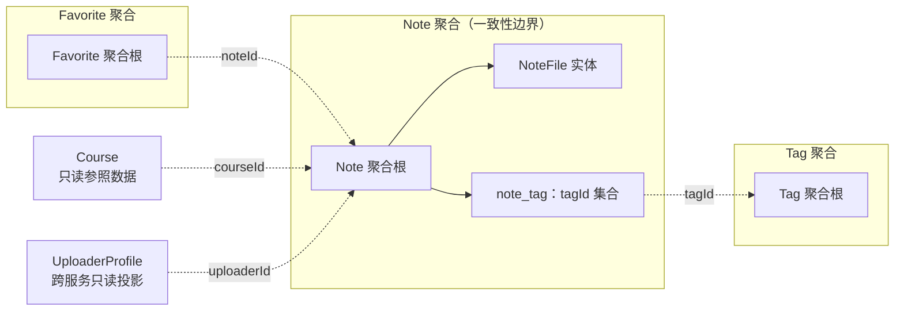
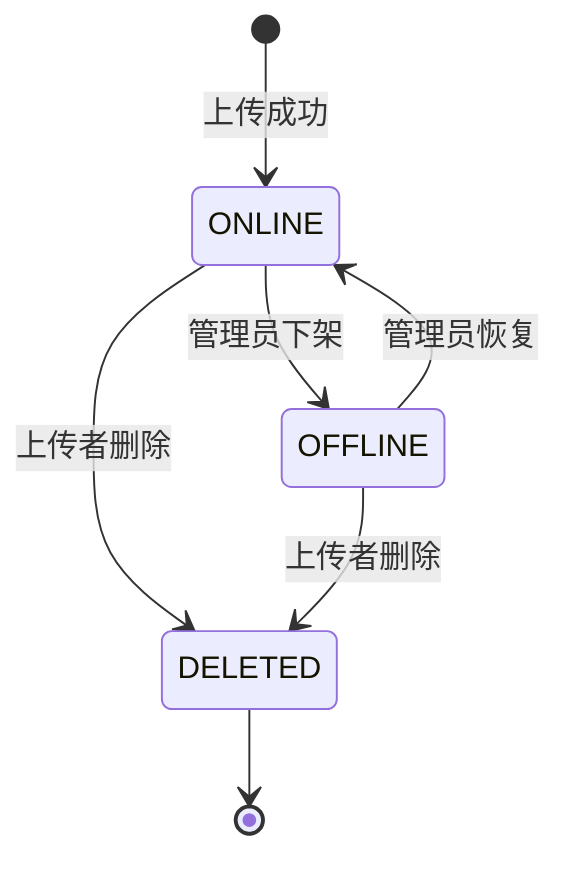
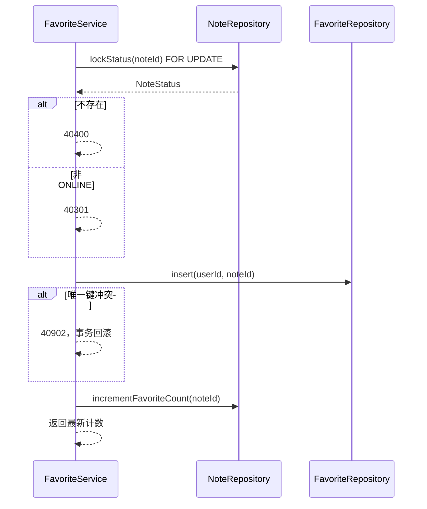
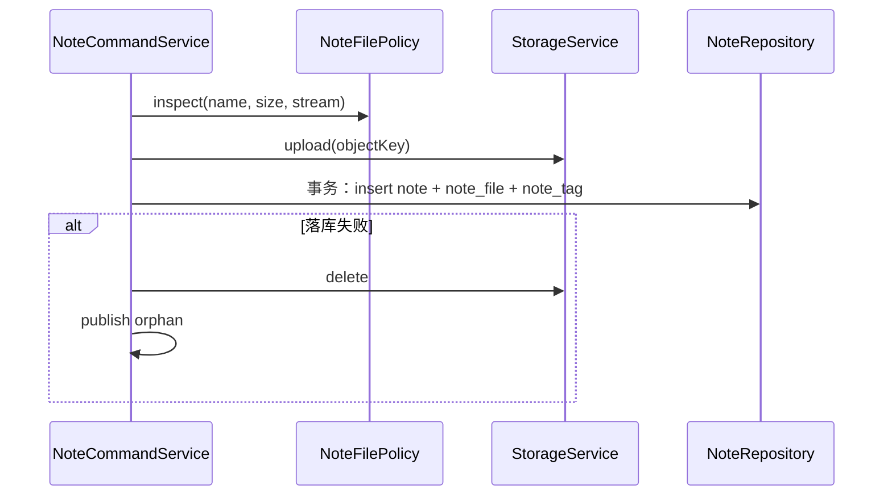
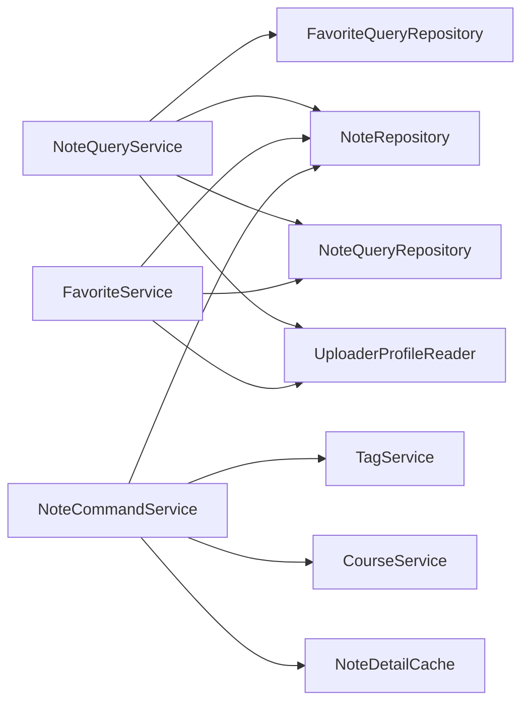

# note 服务 DDD 重构

> 目标：把 note 服务从「大 Service + 贫血 PO」改成聚合驱动的结构，公开 API/JSON 不变。

## 1. 约束

| 约束 | 说明 |
|---|---|
| API/JSON 不变 | 重构只改内部结构，前端契约不动 |
| 表结构不变 | 不新增列、不引乐观锁 version |
| 领域异常 | 继续抛 `BusinessException` + `FieldViolation`，不引领域异常翻译层 |
| 技术栈 | 不引入新框架，沿用 MyBatis-Plus / Redis / Feign / OSS |
| 外部语义 | 保留现有锁顺序、缓存 TTL、OSS 补偿、软删除、幂等行为 |

## 2. 现状问题

| 问题 | 位置 |
|---|---|
| 领域实体是 MyBatis-Plus PO，public setter | `Note` / `NoteFile` / `Favorite` / `Course` / `Tag` |
| 领域层依赖 Spring | `NoteFilePolicy`、`NoteStateMachine` 上的 `@Component` |
| 应用端口泄漏框架与 DTO | `NoteDataAccess` 返回 `IPage`，参数/返回值是 application DTO |
| HTTP 模型放应用层 | `NoteUploadRequest` 含 `MultipartFile` |
| 单类承担全部用例 | `NoteService` 915 行 |
| 模块间绕循环依赖 | `NoteService → FavoriteService`，`FavoriteService → NoteDataAccess` |
| 无领域单测 | `jotang-note` 下没有 `src/test` |

## 3. 聚合划分

### 3.1 聚合总览



### 3.2 聚合根职责

| 聚合根 | 聚合内 | 不变量 | 事务边界 |
|---|---|---|---|
| `Note` | `NoteFile`、`note_tag` | 标题/简介/教师长度；课程必须存在；状态迁移；仅上传者可编辑/删除；可见性；附件上传后不可换；删除幂等 | `note` + `note_file` + `note_tag` |
| `Favorite` | 自身 | `(userId, noteId)` 唯一；仅 ONLINE 可收藏；取消幂等；笔记软删除后收藏关系保留 | `favorite` + `note.favorite_count` |
| `Tag` | 自身 | 名称唯一且 ≤32 字符；按名 find-or-create | `tag` 自身；`note_tag` 归 `Note` |
| `Course` | 无 | 预置只读，不允许写 | 无 |
| `UploaderProfile` | 无 | 跨服务只读投影，不是聚合 | 无 |

### 3.3 状态与可见性



| 状态 | 列表 | 详情页 | 下载/收藏 | 编辑 | 我的上传 | 收藏列表 |
|---|---|---|---|---|---|---|
| ONLINE | 可见 | 正常 | 允许 | 允许 | 正常 | 正常 |
| OFFLINE | 不可见 | 仅本人/管理员可看 | 禁止 | 允许（改完仍是下架状态） | 可见并标注 | 占位"已下架" |
| DELETED | 不可见 | 所有人不可见 | 禁止 | 禁止 | 不可见 | 占位"已删除" |

### 3.4 聚合根草案

**Note**

| 字段 | 类型 |
|---|---|
| `id` | `Long` |
| `uploaderId` | `Long` |
| `courseId` | `CourseId` |
| `title` / `summary` / `teacher` | `NoteTitle` / `NoteSummary` / `TeacherName` |
| `status` | `NoteStatus` |
| `viewCount` / `downloadCount` / `favoriteCount` | `long`（只读快照，写走仓储原子更新） |
| `createdAt` / `updatedAt` / `deletedAt` | `LocalDateTime` |
| `file` | `NoteFile`（一份笔记一个） |
| `tagIds` | `Set<Long>` |

| 方法 | 职责 |
|---|---|
| `static upload(...)` | 创建，状态 `ONLINE` |
| `static reconstitute(...)` | 从持久化恢复 |
| `changeMetadata(editorId, title, summary, teacher, courseId, tagIds)` | 编辑；校验归属；`DELETED` 拒绝；标签全量替换 |
| `delete(editorId)` | 软删除；校验归属；已删除幂等 |
| `offline()` / `restore()` | 管理员迁移；同状态幂等；`DELETED` 报 40301 |
| `ensureUploader(userId)` | 非本人 40300 |
| `ensureVisibleTo(viewerId, isAdmin)` | 详情可见性；`DELETED` 或越权 `OFFLINE` 报 40301 |
| `ensureEditable()` | 已删除报 40301 |
| `isOnline()` / `isDeleted()` | 状态判断 |

**NoteFile**

| 字段 | 类型 |
|---|---|
| `storageKey` | `StorageKey` |
| `originalName` | `OriginalFileName` |
| `size` | `FileSize` |
| `contentType` | `ContentType` |
| `isPurged` | `boolean` |

| 方法 | 职责 |
|---|---|
| `static attach(...)` | 上传时创建 |
| `markPurged()` | 对象已物理清理，幂等 |

**Favorite**

| 字段 | 类型 |
|---|---|
| `id` | `Long` |
| `userId` / `noteId` | `Long` |
| `createdAt` | `LocalDateTime` |

| 方法 | 职责 |
|---|---|
| `static create(userId, noteId)` | 非空校验 |

### 3.5 共享领域判定

`NoteAccessPolicy`（无状态领域服务，无 Spring）收口所有「状态 + 身份」判定：

| 方法 | 使用方 |
|---|---|
| `requireUploader(uploaderId, viewerId)` | 编辑、删除 |
| `requireEditable(status)` | 编辑 |
| `requireVisible(status, uploaderId, viewerId, isAdmin)` | 详情 |
| `requireOnline(status)` | 收藏、预览、正文、内部读附件 |
| `requireNotDeleted(status)` | 管理员上下架（删除本身是幂等的，不经过它） |

写侧 `Note` 的 `ensureUploader` / `ensureVisibleTo` / `ensureEditable` 委托它；读侧 `NoteQueryService` 直接用快照里的 `status` + `uploaderId` 调它，**不为了一次鉴权去加载完整聚合**。

## 4. 关键用例的事务与锁

| 用例 | 事务内 | 锁顺序 | 事务外 |
|---|---|---|---|
| 上传 | 插入 `note` + `note_file` + `note_tag` | 无 | 先传 OSS；失败补偿删除/投递孤儿消息 |
| 编辑 | 锁 note → 校验课程/标签 → 改元数据 + 全量替换标签 | `note` | 提交后失效详情缓存 |
| 删除 | 锁 note → 校验归属 → `DELETED` | `note` | 提交后失效详情缓存 |
| 管理员上下架 | 锁 note → 状态迁移 | `note` | 提交后失效详情缓存 |
| 收藏 | 锁 note → 校验 ONLINE → 插 favorite → 计数 +1 | `note` → `favorite` | — |
| 取消收藏 | 锁 note → 删 favorite → 计数 -1 | `note` → `favorite` | — |
| 孤儿清理 | 逐条 `is_purged=1` | 无 | OSS 删除在事务外 |

### 标签解析的事务位置

`TagService.resolveIds` 可能创建 `tag` 行，这是另一个聚合的写：

| 用例 | 事务位置 | 后果 |
|---|---|---|
| 上传 | 事务外 | 上传失败时新标签仍保留（现状） |
| 编辑 | 事务内 | 编辑回滚时新标签一起回滚（现状） |

本次保持现状，不把两者统一——上传的事务里有 OSS 补偿窗口，编辑没有。

### 收藏的锁序



**固定 `note → favorite` 的加锁顺序**，与现有实现一致，避免收藏/取消收藏并发时死锁。

### 上传的补偿



## 5. 读写分离

写侧加载聚合，读侧走投影。列表页不为了一页 20 条加载 20 个完整聚合。

| 端口 | 职责 | 返回 |
|---|---|---|
| `NoteRepository` | 聚合加载/保存、状态迁移、计数原子更新 | `Note` / `NoteStatus` / `long` |
| `NoteQueryRepository` | 详情、列表、我的上传、内部检索、附件位置、待清理 | 读模型 / `PageSlice<T>` |
| `FavoriteRepository` | 收藏插入/删除 | `Favorite` / `boolean` |
| `FavoriteQueryRepository` | 我的收藏、批量收藏态 | 读模型 / `Set<Long>` |
| `NoteDetailCache` | 详情缓存（含负缓存） | `NoteDetailView` |
| `UploaderProfileReader` | 跨服务上传者资料 | `Map<Long, UploaderProfile>` |

`PageSlice<T>` 取代 `IPage` 穿透：

```java
// domain/shared/PageSlice.java
public record PageSlice<T>(List<T> items, long total) {}
```

应用层再包装成 `PageResult<T>`（带 page/size），接口层包装成 `PageResponse<T>`。

### 5.1 仓储方法草案

```java
// 写侧：以聚合为单位
public interface NoteRepository {
    Optional<Note> findById(Long id);              // 加载 note + file + tagIds
    Optional<Note> findByIdForUpdate(Long id);     // 行锁 + 完整聚合
    Optional<NoteStatus> lockStatus(Long id);      // 收藏路径的轻量锁
    void insert(Note note);                        // 回填 id
    void saveMetadata(Note note);                  // title/summary/teacher/course_id + updated_at
    void replaceTags(Long noteId, Set<Long> tagIds);
    void saveStatus(Note note);                    // status + deleted_at
    void markFilePurged(Long noteId);
    int incrementViewCount(Long noteId, NoteStatus onlyWhen);
    int incrementFavoriteCount(Long noteId);
    int decrementFavoriteCount(Long noteId);
    long favoriteCount(Long noteId);
}

// 读侧：只返回投影
public interface NoteQueryRepository {
    Optional<NoteDetailSnapshot> findDetail(Long noteId);
    List<NoteTagSnapshot> findTags(Long noteId);
    List<NoteTagSnapshot> findTagsByNoteIds(Collection<Long> noteIds);
    PageSlice<NoteListSnapshot> findPage(NoteListCriteria criteria);
    PageSlice<MyNoteSnapshot> findMine(Long uploaderId, int page, int size);
    Optional<NoteFileOwnershipSnapshot> findFileOwnership(Long noteId);
    List<PendingPurgeSnapshot> findPendingPurge(NoteStatus status, int limit);
    List<NoteSearchSnapshot> findOnlineByExactTitle(String title, int limit);
}
```

`findById` 加载完整聚合（`note` + `note_file` + `note_tag`）；收藏路径只用 `lockStatus` + `NoteAccessPolicy.requireOnline(status)`，不为此加载完整聚合，这是明确记录的性能例外。

`NoteDetailCache` 是应用层关注点，但为守住「application 不建 port 包」的约定，接口放 `domain/note`，Redis 实现在 `infrastructure/cache`。

## 6. 目标包结构

```text
com.wlf.note
├── domain
│   ├── note
│   │   ├── Note.java                     # 聚合根
│   │   ├── NoteFile.java                 # 实体
│   │   ├── NoteStatus.java               # 状态 + 迁移
│   │   ├── PreviewMode.java
│   │   ├── FileDecision.java
│   │   ├── NoteFilePolicy.java           # 领域服务，无 Spring
│   │   ├── NoteAccessPolicy.java         # 状态 + 身份判定，无 Spring
│   │   ├── NoteRepository.java
│   │   ├── NoteQueryRepository.java
│   │   ├── NoteDetailCache.java
│   │   ├── NoteSort.java
│   │   ├── model/                        # NoteTitle / NoteSummary / TeacherName / CourseId
│   │   │                                 # StorageKey / OriginalFileName / FileSize / ContentType
│   │   └── query/                        # NoteDetailSnapshot / NoteDetailView / NoteListSnapshot
│   │                                     # NoteTagSnapshot / NoteFileOwnershipSnapshot
│   │                                     # PendingPurgeSnapshot / NoteSearchSnapshot / NoteListCriteria
│   ├── favorite
│   │   ├── Favorite.java
│   │   ├── FavoriteRepository.java
│   │   ├── FavoriteQueryRepository.java
│   │   └── query/                        # FavoriteItemSnapshot
│   ├── catalog
│   │   ├── Course.java
│   │   ├── CourseRepository.java
│   │   ├── Tag.java
│   │   ├── TagRepository.java
│   │   └── model/TagName.java
│   ├── uploader
│   │   ├── UploaderProfile.java
│   │   └── UploaderProfileReader.java
│   └── shared
│       └── PageSlice.java
├── application
│   ├── command/                          # UploadNoteCommand / UpdateNoteCommand / ...
│   ├── query/                            # NoteListQuery / MyNoteListQuery / ...
│   ├── result/                           # NoteDetailResult / PageResult / ...
│   └── service/                          # NoteCommandService / NoteQueryService / ...
├── infrastructure
│   ├── persistence
│   │   ├── po/                           # NotePO / NoteFilePO / FavoritePO / ...
│   │   ├── converter/                    # NoteConverter / ...
│   │   ├── mapper/                       # BaseMapper<PO> + XML
│   │   └── repository/                   # NoteRepositoryImpl / NoteQueryRepositoryImpl / ...
│   ├── cache/RedisNoteDetailCache.java
│   └── client/user/                      # Feign 适配 UploaderProfileReader
└── interfaces
    ├── web
    │   ├── dto/                          # NoteUploadRequest / NoteDetailResponse / ...
    │   ├── assembler/                    # NoteAssembler / MultipartUploadedFile / ...
    │   └── *Controller.java
    ├── internal
    │   ├── dto/
    │   ├── assembler/
    │   └── NoteInternalController.java
    └── scheduler/OrphanObjectSweeper.java
```

### 6.1 组合根

`../../jotang-note-app/src/main/java/com/wlf/note/config/NoteDomainConfig.java`：

```java
@Configuration
public class NoteDomainConfig {
    @Bean
    public NoteFilePolicy noteFilePolicy() {
        return new NoteFilePolicy();
    }
}
```

这是本次唯一需要从领域层收回的 Bean。`NoteStateMachine` 合并后不再需要装配。

## 7. 应用服务拆分

| 应用服务 | 用例 | 依赖 |
|---|---|---|
| `NoteCommandService` | 上传、编辑、删除、管理员上下架 | `NoteRepository`、`NoteDetailCache`、`CourseService`、`TagService`、`NoteFilePolicy`、`StorageService`、`OrphanObjectPublisher`、事务管理器 |
| `NoteQueryService` | 详情、列表、我的上传、预览、正文、内部检索/附件 | `NoteQueryRepository`、`NoteRepository`（浏览量原子自增）、`NoteDetailCache`、`FavoriteQueryRepository`、`UploaderProfileReader`、`StorageService` |
| `FavoriteService` | 收藏、取消收藏、我的收藏 | `FavoriteRepository`、`FavoriteQueryRepository`、`NoteRepository`、`NoteQueryRepository`、`UploaderProfileReader`、`StorageService` |
| `CourseService` | 课程查询/存在性 | `CourseRepository` |
| `TagService` | 标签候选、按名解析/创建 | `TagRepository` |
| `PurgeService` | 孤儿对象对账 | `NoteQueryRepository`、`NoteRepository`、`StorageService` |

`OrphanObjectSweeper` 是入站定时适配器，放 `interfaces/scheduler`，只负责调度，不承载业务。

依赖方向：



`NoteQueryService` 不依赖 `FavoriteService`，`FavoriteService` 不依赖 `NoteQueryService`，避免再次成环。

## 8. 待确认决策

| # | 决策 | 建议 |
|---|---|---|
| 1 | 读侧是否单独 `NoteQueryRepository` | **是**。列表/详情直接读投影，不加载完整聚合 |
| 2 | `UserProfileReader` / `NoteDetailCache` 放哪 | `UserProfileReader` 放 `domain/uploader`；`NoteDetailCache` 放 `domain/note`；`application` 不再建 `port` 包 |
| 3 | `NoteStateMachine` 去留 | **合并进 `Note` / `NoteStatus`**。`Note.offline()` / `restore()` / `delete()` 内聚迁移规则 |
| 4 | 计数列如何维护 | 保留 `SET x = x ± 1` 的定向更新；`Note` 中的计数只读，不参与读改写 |
| 5 | 时间戳 | 先保留数据库 `NOW()`，不引入应用时钟 |
| 6 | 收藏后详情缓存的 `favorite_count` 陈旧 | 现状最长 10 分钟。建议作为**独立小修**，不混进本次结构重构 |
| 7 | 分页类型 | 领域 `PageSlice<T>`、应用 `PageResult<T>`、接口 `PageResponse<T>` |

> 决策 3 的边界：`Note.offline()` / `restore()` / `delete()` 只覆盖现有可达路径。当前状态机在非法迁移时抛 `IllegalStateException`（最终 50000），但应用层已先处理了 DELETED 与同状态两种情况，所以合并后**可达路径的响应不变**。

## 9. 实施切片

| 阶段 | 内容 | 验证 |
|---|---|---|
| 0 | 冻结 API/JSON、错误码、幂等语义 | 现有接口冒烟 |
| 1 | 本聚合分析稿 | 评审通过 |
| 2 | 值对象 + `NoteFile` + `Note` 聚合根 + 状态迁移 | 领域单测 |
| 3 | PO/Converter/Repository；写侧聚合仓储 + 读侧查询仓储 | 编译 + 冒烟 |
| 4 | 拆应用服务，Command/Query/Result，事务边界归位 | 编译 + 冒烟 |
| 5 | 接口层 DTO/Assembler/UploadedFile，内部接口 | 编译 + 冒烟 |
| 6 | 删除旧 port/DTO、去 Spring/MP 注解、组合根、文档 | 全量测试 + 冒烟 |

## 10. 测试清单

| 类型 | 内容 |
|---|---|
| 值对象 | 标题 1/128/129；简介 512；教师 64；标签名 32；存储键格式；文件大小上限 |
| `Note` | 上传默认 ONLINE；编辑拒绝 DELETED；删除幂等/归属；下架/恢复；可见性矩阵 |
| `NoteFile` | 附件字段校验；`markPurged()` |
| `Favorite` | userId/noteId 非空；仅 ONLINE 可收藏由应用服务校验 |
| `NoteStatus` | 迁移表；DELETED 终态 |
| 应用服务 | 上传补偿；编辑标签全量替换；收藏重复/取消幂等；对账 |
| Assembler/Converter | Request ↔ Command、Result ↔ Response、PO ↔ 领域对象 |

## 11. 实现状态（2026-11-24）

- 聚合、值对象、仓储、应用服务、接口层已按本文落地。
- `domain` 已无 Spring / MyBatis-Plus 注解。
- 已知未做：
  - 收藏 / 取消收藏不失效详情缓存，`favoriteCount` 最长陈旧 10 分钟。
  - 未引入乐观锁 `version`，仍用定向列更新 + 行锁。
