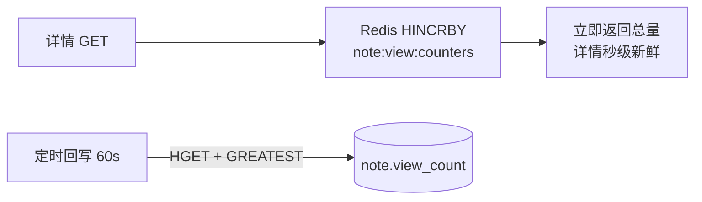
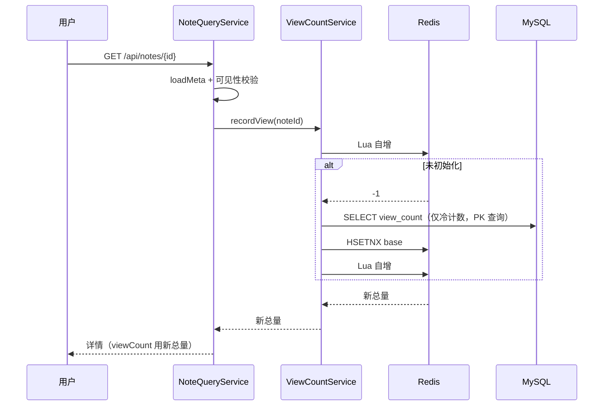
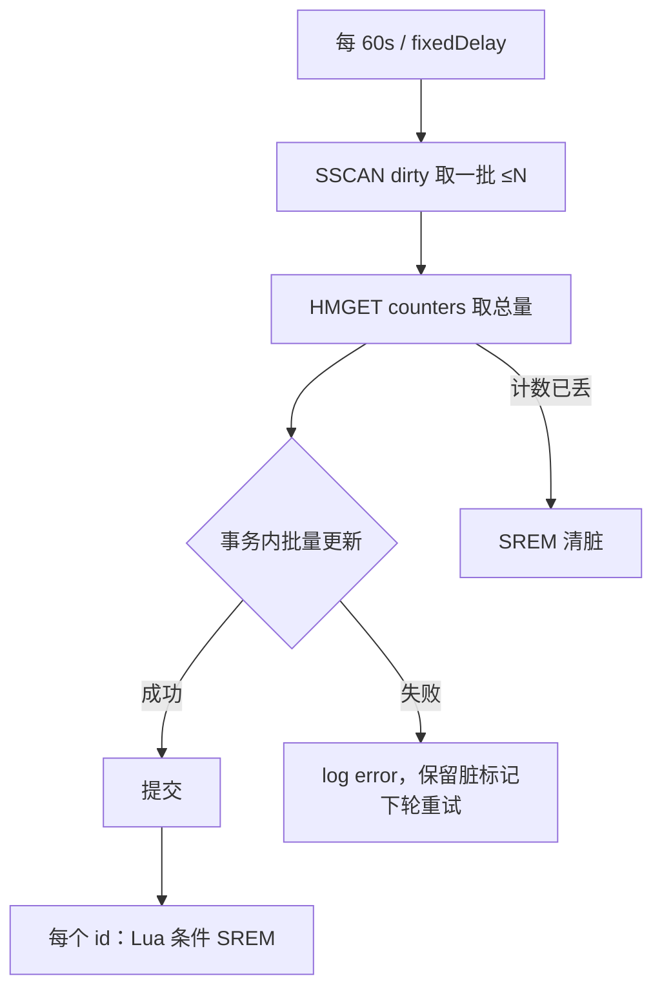

# 浏览量计数缓存设计

> 状态：Step 1 / Step 2 已实现（2026-11-25），Step 3 未做；影响服务 `jotang-note`

## 1. 背景与目标

**现状**

| 项 | 现状 | 位置 |
|---|---|---|
| 详情缓存 | `note:meta:{id}`，整份快照，TTL 10min，负缓存 1min | `RedisNoteDetailCache` |
| 浏览量 | 每次详情 GET 同步 `UPDATE note SET view_count + 1` | `NoteQueryService.java:92`、`NoteMapper.java:73` |
| 展示值 | 来自缓存快照，最多滞后 10min | `NoteQueryService.java:206` |
| 列表 / HOT_VIEW | 直读 `note.view_count` | `NoteMapper.xml` |

**问题**：缓存只挡读、不挡写；热点笔记每次打开都产生行锁与 `idx_status_view` 维护；展示值陈旧。

**目标**

| 目标 | 判定 |
|---|---|
| 详情路径 0 次计数写库 | MySQL 不再按浏览逐条 UPDATE |
| 详情展示实时 | 与 Redis 计数一致，含本次浏览 |
| 回写可恢复 | 重复执行、进程崩溃都不会重复计数 |

**非目标**：缓存击穿 / 雪崩、浏览量去重、`favorite_count`、`download_count`。

## 2. 方案决策：Redis 存绝对总量



| | 增量方案 | **绝对总量（采用）** |
|---|---|---|
| 回写 SQL | `view_count + delta` | `view_count = GREATEST(view_count, total)` |
| 重复回写 | 重复计数 | 幂等，无副作用 |
| 回写失败 | 需回滚增量 | 保留脏标记，下轮重试 |
| 崩溃窗口 | 取走增量后崩 = 丢；写库未重置 = 重 | 仅 Redis 丢数据时丢失 |
| 并发 / 多实例 | 需版本控制 | `GREATEST` + 条件清脏天然安全 |

代价：展示值来源于 Redis，Redis 丢数据时可能短暂回落（§7）。

## 3. 数据结构

| Key | 类型 | 内容 | TTL |
|---|---|---|---|
| `note:view:counters` | HASH | `noteId → 累计浏览量`（展示权威值） | 无 |
| `note:view:dirty` | SET | 待回写的 noteId | 无 |

- 计数器是展示源，不能过期；容量 ≈ 被浏览过的笔记数。
- 与 `note:meta:{id}` 分开：读缓存可丢，计数聚合不可丢。

```lua
-- 记一次浏览；未初始化返回 -1，不创建字段
if redis.call('HEXISTS', KEYS[1], ARGV[1]) == 0 then return -1 end
local total = redis.call('HINCRBY', KEYS[1], ARGV[1], 1)
redis.call('SADD', KEYS[2], ARGV[1])
return total
```

```lua
-- 回写成功后清脏：计数变过就不清，避免抹掉回写期间的新浏览
local cur = redis.call('HGET', KEYS[1], ARGV[1])
if not cur or tonumber(cur) == tonumber(ARGV[2]) then
  redis.call('SREM', KEYS[2], ARGV[1])
  return 1
end
return 0
```

初始化：`HSETNX counters noteId base`，`base` 取 DB 的 `view_count`。

## 4. 写路径



规则：
- 仅 `ONLINE` 计数；本人 / 管理员看 `OFFLINE` 不计数。
- 冷计数初始化以 DB 为准，不用可能过期的详情快照。
- Redis 故障：本次浏览不计数，打 WARN，页面照常返回快照值；**不回退写 DB**（避免双口径分叉）。
- 返回的总量直接作为详情响应的 `viewCount`，顺带修掉 10 分钟滞后。

## 5. 读路径与展示口径

| 入口 | 数值来源 | 滞后 |
|---|---|---|
| 详情 | Redis 总量（含本次） | 实时 |
| 详情（Redis 不可用 / 未初始化） | 详情缓存快照 | ≤ 10 分钟 |
| 列表 / 我的 / 收藏 / 管理台 | `note.view_count` | ≤ 回写周期 |
| `HOT_VIEW` 排序 | `note.view_count` | ≤ 回写周期 |

列表本轮不合并 Redis：排序只能用 DB 列，合并会造成「展示数字比排序依据新」的错位。

## 6. 定时回写



```sql
UPDATE note SET view_count = GREATEST(view_count, #{total}) WHERE id = #{id}
```

```xml
<!-- 批量版 -->
UPDATE note
SET view_count = GREATEST(view_count, CASE id
  <foreach collection="totals" index="id" item="t">WHEN #{id} THEN #{t}</foreach>
END)
WHERE id IN (<foreach collection="totals" index="id" item="t">#{id}</foreach>)
```

- 回写不 evict 详情缓存：详情展示已不依赖快照中的 `viewCount`。
- Redis 中计数已丢失的脏 id 一并 SREM，避免脏集合永久残留。
- 调度线程池配 2：慢的 purge 不会顶住 60s 一轮的回写。
- 应用关停时监听 `ContextClosedEvent` 补回写一批（早于 Redis 连接工厂的 `SmartLifecycle#stop`）；仍超出一批的计数留在 Redis，Redis 不持久化时随之丢失。

## 7. 一致性与故障

| 时点 | 结果 |
|---|---|
| Redis 自增失败 | 本次浏览丢失，页面正常，WARN |
| DB 回写失败 | 脏标记保留，下轮重试，幂等 |
| DB 成功、清脏前崩 | 下轮重写同值，无副作用 |
| 清脏瞬间又来浏览 | Lua 比对总量，变化则不清 |
| Redis 重启（当前无持久化） | 未回写的 ≤1 个周期浏览丢失；首次浏览从 DB 重建，展示可能短暂回落 |
| 回写与浏览并发 | DB 只增不减；已进总量的增量不丢 |
| 多实例 | `GREATEST` + 条件清脏兼容；本项目单实例 |

**已同步的两处既有约定**

1. `../../docker-compose.yml` 的 Redis 注释改为「读缓存 + 浏览量聚合，最坏丢一个回写周期」，不为计数加持久化。
2. `SchedulingConfig` 的三个任务共用 `spring.task.scheduling.pool.size=2`，purge 不会顶住 60s 回写。

## 8. 代码落点

| 层 | 文件 | 改动 |
|---|---|---|
| domain | `domain/note/ViewCountBuffer.java` | 新增端口，沿用 `NoteDetailCache` 的放法 |
| application | `application/service/ViewCountService.java` | 新增：记录 / 初始化 / 回写编排 |
| application | `NoteQueryService.detail` | 改调 `ViewCountService` |
| infrastructure | `infrastructure/cache/RedisViewCountBuffer.java` | 新增：Lua + `StringRedisTemplate` |
| infrastructure | `NoteQueryRepository` / `NoteRepository` / `Impl` / `NoteMapper(.xml)` | `findViewCount`、`saveViewCounts` |
| interfaces | `interfaces/scheduler/ViewCountFlusher.java` | 新增：只调度，仿 `OrphanObjectSweeper` |
| config | `../../deploy/nacos/config/jotang-note.yaml` | 开关与节奏 |

```java
public interface ViewCountBuffer {
    Long increment(Long noteId);                       // null = 未初始化
    void initializeIfAbsent(Long noteId, long base);
    List<Long> dirtyNoteIds(int limit);
    Map<Long, Long> totals(Collection<Long> noteIds);
    boolean clearIfUnchanged(Long noteId, long writtenTotal);
    void discard(Collection<Long> noteIds);            // 计数已丢的脏 id
}
```

## 9. 配置与验证

```yaml
jotang:
  view:
    flush:
      enabled: true
      initial-delay: 30s
      fixed-delay: 60s
      batch-size: 200
```

| 层级 | 内容 |
|---|---|
| 单测（fake buffer + fake repo） | 初始化、Redis 失败降级、回写幂等、回写中并发浏览不清脏、DB 失败保留脏标记 |
| 手工 | 刷新详情看 `HGET note:view:counters {id}` 递增而 DB 不动；60s 后追平；重启应用脏集合仍在；重启 Redis 后从 DB 重建 |

## 10. 范围外与未决项

| # | 事项 | 建议 |
|---|---|---|
| 1 | Redis 故障时丢浏览计数，还是回退写 DB | 推荐丢，保单一口径 |
| 2 | 列表合并 Redis 总量（一次 HMGET） | 本轮不做，等排序也迁 Redis |
| 3 | 浏览量去重（刷新 / 同用户重复） | 在自增前加 `SET note:view:seen:{id}:{userId} NX EX 30m`，属语义变更，单独拍板 |
| 4 | ~~`FavoriteService` 变更收藏数不 evict 详情缓存~~ | 已修复（2026-11-25），事务提交后 evict |
| 5 | `download_count` 全仓无自增点，`HOT_DOWNLOAD` 恒按 id 兜底 | 先定「下载」触发点 |
| 6 | 缓存击穿、固定 TTL 雪崩 | 已记于 `../未来方向.md` 技术待优化项 |

## 11. 实施顺序

1. **Step 1**：端口 + Redis 适配器 + 记录 / 初始化 + 详情展示 + 定时回写 + 单测。（已完成）
2. **Step 2**：调度线程池、关停补一次回写、compose 注释、文档同步。（已完成）
3. **Step 3（可选）**：去重、列表合并、收藏数缓存修复（已提前完成）、下载计数。
