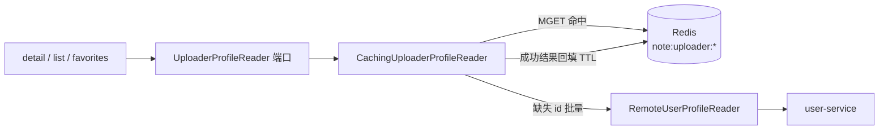

# 上传者资料缓存设计

> 状态：Step 1（Redis cache-aside）已实现（2026-11-25）；事件失效未做；影响服务 `jotang-note`

## 1. 背景与目标

| 项 | 现状 | 位置 |
|---|---|---|
| 详情 | 每次按上传者 id 单查 | `NoteQueryService.java:103` |
| 列表 / 下架列表 / 收藏 | 每次翻页按去重 id 批量查 | `NoteQueryService.java:270`、`:319`、`FavoriteService.java:175` |
| 数据来源 | Feign 批量接口 → user-service 查库 | `RemoteUserProfileReader` |

问题：昵称 / 头像 / 学院读多写少，却每次跨服务查。

| 目标 | 判定 |
|---|---|
| 命中后 0 次 Feign | 缓存全命中时不再出现 `/internal/users/batch` |
| 陈旧有上界 | ≤ TTL（默认 10min） |
| 缓存故障不影响请求 | Redis 读写失败只回源 / 不回填 |

非目标：秒级失效、负缓存、本地 L1、击穿保护。

## 2. 方案

note 侧 cache-aside，逐 userId 单键：

| Key | Value | TTL |
|---|---|---|
| `note:uploader:{userId}` | `UploaderProfile`（JSON） | 10min |

- `note:` 前缀：这是 note 侧投影，user-service 将来自建缓存不撞 key、不撞形状。
- 逐 id 单键：批量 MGET、单条详情单 GET，也为后续按用户删 key 留路。



应用层 `NoteQueryService` / `FavoriteService` 不改，仍依赖端口，装配时拿到装饰器。

## 3. 读路径与降级

| 场景 | 行为 |
|---|---|
| 全部命中 | 直接返回，0 次 Feign |
| 部分命中 | 只把缺失 id 发给 Feign，合并后回填 |
| Feign 失败 | 返回已命中部分，缺失的上传者字段留空；不回填 |
| user-service 未返回某个 id | 不写负缓存，下次仍回源 |
| Redis 读失败 | 当作全部未命中，回源 |
| Redis 写失败 | 打 WARN，本次结果照常返回 |

Feign 失败的降级比改造前更好：改造前一次故障整页头像昵称为空，现在已缓存部分仍可展示。

## 4. 一致性

- 资料变更（昵称 / 学院 / 头像）不主动删 key，靠 TTL 收敛，最长滞后 10min。
- 缓存存的是 `avatarKey` 而非 URL；换头像即换对象键，滞后只影响展示哪个头像，不会 404。

## 5. 代码落点

| 层 | 文件 |
|---|---|
| domain | `domain/uploader/UploaderProfileCache.java`（新端口） |
| infrastructure | `infrastructure/cache/RedisUploaderProfileCache.java` |
| infrastructure | `infrastructure/client/user/CachingUploaderProfileReader.java`（唯一实现端口的装饰器） |
| infrastructure | `RemoteUserProfileReader.java`：只负责 Feign，不实现端口 |
| config | `deploy/nacos/config/jotang-note.yaml`：`jotang.uploader.cache.ttl` |

## 6. 配置

```yaml
jotang:
  uploader:
    cache:
      ttl: 10m
```

## 7. 验证

| 层级 | 内容 |
|---|---|
| 单测 `CachingUploaderProfileReaderTest` | 全命中不调远程、只请求缺失 id、远端失败返回命中部分且不回填、缓存读写失败降级、空输入 |
| 手工 | 连续刷新列表，`MONITOR` 只在首次出现 `/internal/users/batch`；`TTL note:uploader:{id}` ≈ 600s；改资料后 ≤10min 生效 |

## 8. 未决项

| # | 事项 | 建议 |
|---|---|---|
| 1 | 事件失效 | user-service 在改资料 / 换头像后发 `user.profile.changed`，note 消费后删 key，把滞后降到秒级；消息契约与交换机归属需单独设计 |
| 2 | 负缓存 | 当前没有删除用户的路径，不做 |
| 3 | 击穿 | 单 key 过期瞬间并发回源，量级可忽略；要做可加互斥或逻辑过期 |
| 4 | 本地 L1 | 单实例部署，回环 Redis 延迟已足够低，不做 |
