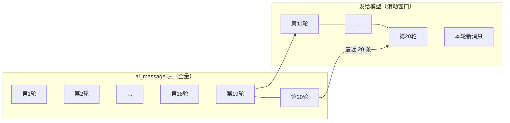
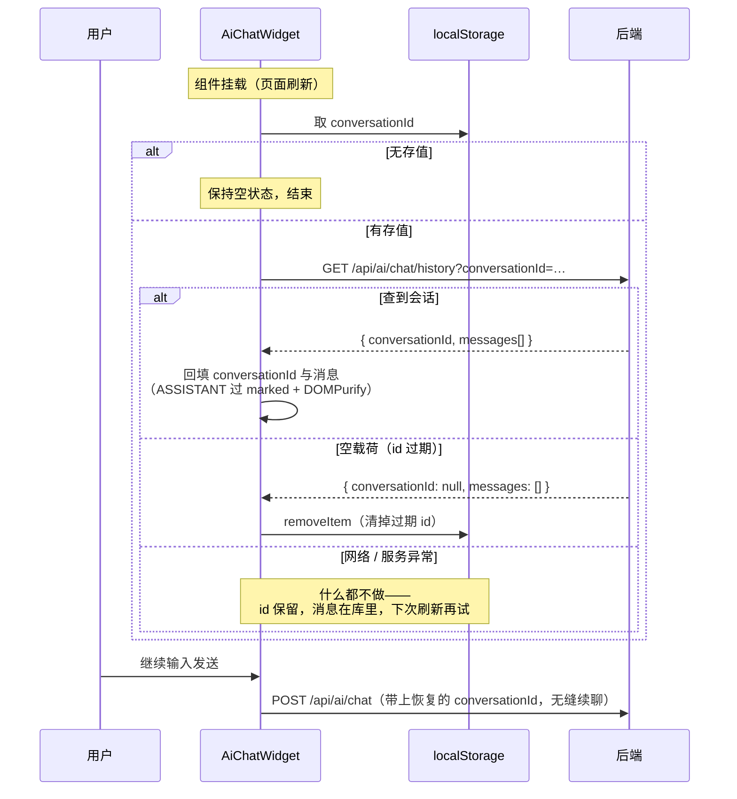

# 计划：AI 对话会话恢复与上下文裁剪

> **状态**：待实施 · **关联**：《对话与笔记检索》`POST /api/ai/chat`、《概要设计》§5.9、§8.4 已知限制
> **改动性质**：对话功能增强，不改既有接口契约（`/api/ai/chat` 的请求响应不变）

---

## 1. 背景与要解决的两个问题

### 1.1 刷新丢会话

当前 `conversationId` 只存在于前端组件的内存 ref 里（`AiChatWidget.vue`）：

- 路由切换、面板收起 → 组件挂在 `MainLayout` 不卸载，会话保留；
- **页面刷新 / 关闭标签页** → ref 丢失 → 下一条消息自动开新会话。

旧会话记录仍完整躺在 `ai_message` 表里，但前端没有恢复入口，成了永远不可达的「孤儿数据」。用户的诉求：**刷新后继承最近一次会话**。

### 1.2 长会话撑爆上下文

当前 `AiService#ask()` 把该会话的**全量历史**重发给模型。用户一直不点「新对话」的话：

1. **成本线性上涨**：第 N 轮请求的输入是前 N−1 轮的总和；
2. **撑爆模型上下文窗口**：超限后模型调用直接报错 → 50300，且刷新恢复回来的正是这个永久坏掉的会话。

这是硬故障，必须防。持久化本身不是瓶颈（`ai_message` 每行几百字节），瓶颈在重发。

---

## 2. 方案选型（已拍板）

### 2.1 刷新恢复：ID 本地存 + 后端历史接口

| 方案 | 做法 | 结论 |
|---|---|---|
| **A. localStorage 存 conversationId + 新增历史查询接口** | 刷新后凭本地 id 从库里拉回历史渲染 | **选定**。消息显示与库内数据一致；后端改动约 40 行 |
| B. 纯前端缓存 | conversationId 和消息列表都存 localStorage | 弃。显示的是本地快照，与库可能不一致，还占本地空间 |
| C. 后端记最近会话 | 按用户最新一条消息定位最近会话 | 弃。换浏览器能继承是优点，但手动「新对话」后刷新会被拉回旧会话，需要额外的状态清除机制，改动最大 |

选 A 的关键理由：**手动「新对话」的语义天然被保留**——`reset()` 清掉 localStorage 即可，服务端无状态，不需要同步清除动作。

### 2.2 长会话：滑动窗口裁剪

| 方案 | 做法 | 结论 |
|---|---|---|
| **A. 滑动窗口** | 后端只把最近 20 条消息发给模型（10 轮问答），界面与库里照常全量 | **选定**。会话可无限聊，单次请求成本有上界，无 UX 打断 |
| B. 轮数上限强制新会话 | 达到上限后端拒绝继续 | 弃。彻底但打断体验 |
| C. 只提示不限制 | 超阈值前端提示「建议开新对话」 | 弃。用户无视提示就撞上硬故障，治标不治本 |

---

## 3. 接口设计：`GET /api/ai/chat/history`

### 3.1 请求

```
GET /api/ai/chat/history?conversationId=3f1a0b7c-…
Authorization: Bearer <jwt>
```

### 3.2 响应

成功（HTTP 200）：

```json
{
  "code": 0,
  "message": "ok",
  "data": {
    "conversationId": "3f1a0b7c-…",
    "messages": [
      { "role": "USER", "content": "…" },
      { "role": "ASSISTANT", "content": "…" }
    ]
  }
}
```

`messages` 按 `id` 正序（与 `loadHistory` 现有排序一致），只带 `(role, content)`，与对话链路「不带时间戳保前缀缓存」的约定同理——前端渲染也不需要更多字段。

### 3.3 关键决策：查不到回空载荷，不报 40400

`data.conversationId` 为 `null`、`messages` 为 `[]` 表示「无可恢复的会话」。**id 留空、id 查不到（换浏览器、清库）都走这个形态。**

不沿用 `chat()` 的 40400，两个原因：

1. **语义不同**：`chat()` 收到无效会话 id 说明调用方有 bug 或在篡改，是异常；恢复场景里「本地存的 id 过期了」是**预期内的常态**，常态不该走错误通道。
2. **UX 后果**：http 层对 40400 会弹全局错误提示（不在 `FORM_LEVEL_CODES` 里），页面一刷新就弹「资源不存在」不可接受。

归属校验与取历史仍是同一次查询（条件带 `user_id`），别人的会话查出来是空 → 空载荷，不区分「不存在」与「不是你的」。

**不限频**：纯读、无模型调用，不消耗对话额度。

---

## 4. 滑动窗口设计

### 4.1 规则

`AiService` 新增常量 `MAX_CONTEXT_MESSAGES = 20`（10 轮问答）。`ask()` 组装 messages 时：

```java
List<AiMessage> window = history.size() > MAX_CONTEXT_MESSAGES
        ? history.subList(history.size() - MAX_CONTEXT_MESSAGES, history.size())
        : history;
```

三条边界一次说清：

| 层 | 行为 |
|---|---|
| 模型 | 只看最近 20 条 + 本轮新消息 |
| 界面 | 照常**全量**显示历史（恢复接口返回全量） |
| 数据库 | 照常全量落库，一行不删 |

### 4.2 与前缀缓存的关系

`ask()` 现有注释指出：历史只带 `(role, content)`、不带每轮都变的字段，是为了前缀缓存命中。窗口的引入对缓存的影响是**分段**的：

- **未超限时**（绝大多数会话的常态）：前缀逐轮只增不变，缓存照常命中，行为与现状完全一致；
- **超限后**：窗口每轮滑动一位，前缀从滑动点开始失效，缓存不再命中——这是「有界的单次成本」换「无界的故障风险」的自觉代价。20 条 × 单条最长 2000 字符，最坏输入仍有上界，不会击穿模型上下文。



界面上第 1~10 轮照常显示，只是不再参与模型计算。

---

## 5. 前端行为设计（`AiChatWidget.vue`）

### 5.1 本地持久化键

```
const STORAGE_KEY = 'ai-chat:conversation-id'
```

只存 conversationId 一个值，不存消息（消息以库为准）。

### 5.2 三个写入时机

| 时机 | 动作 |
|---|---|
| `send()` 成功拿到响应 | `setItem(STORAGE_KEY, res.conversationId)`（新会话首轮即持久化） |
| `reset()` 手动新对话 | `removeItem(STORAGE_KEY)`（下一条消息开新会话，刷新后也不会被拉回来） |
| 恢复时发现 id 查不到 | `removeItem(STORAGE_KEY)`（清掉过期 id，避免每次刷新空查一遍） |

### 5.3 恢复流程



两个实现细节：

- **渲染路径与发送路径同源**：助手消息恢复时走同一条 `marked.parse` + `DOMPurify.sanitize`，不另起炉灶；
- **不与用户抢输入**：恢复是异步的，若用户手快在恢复完成前已发出消息（`messages` 非空），放弃回填显示，避免拿旧会话的展示覆盖新会话的气泡。

---

## 6. 改动清单

| 层 | 文件 | 改动 |
|---|---|---|
| DTO | `ai/dto/AiChatHistoryResponse.java`（**新增**） | record：`conversationId` + `messages`（嵌套 `Message(role, content)`），含 `empty()` 静态工厂 |
| 业务层 | `ai/AiService.java` | 新增 `history(userId, conversationId)`：空白 / 查不到 → 空载荷，否则按正序映射；`ask()` 加滑动窗口（`MAX_CONTEXT_MESSAGES = 20`） |
| 接口层 | `ai/AiController.java` | 新增 `GET /api/ai/chat/history`（登录即达，走 `anyRequest().authenticated()`） |
| 注释同步 | `entity/AiMessage.java` | 类注释「不做裁剪」已过时，改为指向 `AiService` 的窗口常量 |
| 类型 | `frontend/src/api/types.ts` | 新增 `AiChatHistoryResponse` / `AiChatHistoryMessage` |
| API | `frontend/src/api/ai.ts` | 新增 `history(conversationId)` |
| 组件 | `frontend/src/components/AiChatWidget.vue` | `STORAGE_KEY` 常量；`onMounted` 恢复；`send()` 成功持久化；`reset()` 清除 |

不动的部分：`/api/ai/chat` 契约、`ai_message` 表结构、限频器、`schema.sql`（无迁移）。

---

## 7. 测试计划

### 7.1 后端单测（沿用现有命名风格）

| 测试类 | 用例 | 钉住的契约 |
|---|---|---|
| `AiServiceTest` | `historyReturnsRowsInOrderForOwner` | 正序回显，只带 `(role, content)` |
| | `historyBlankIdReturnsEmptyPayload` | id 留空 → 空载荷，不打 DB |
| | `historyUnknownOrForeignIdReturnsEmptyPayload` | 查不到 / 别人的 → 空载荷，**不是 40400** |
| | `askTrimsHistoryToTheWindowWhenOverLimit` | 25 条历史只发最近 20 条 |
| | `askKeepsWholeHistoryWhenUnderLimit` | 不足 20 条一条不裁（钉住「常态不回归」） |
| | `askAppendsNewMessageAfterTheWindow` | 窗口切片后新消息仍在最后 |
| `AiControllerTest` | `historyReturnsEmptyPayloadShape` / `historyRequiresAuthentication` | 空载荷的 JSON 形态、40100 |

### 7.2 前端验证

- `vue-tsc` 类型检查 + `npm run build`；
- 手工清单：对话两轮 → 刷新 → 历史恢复且可续聊；点「新对话」→ 发一条 → 刷新 → 是新会话（旧会话不被拉回）；手改 localStorage 为随机 UUID → 刷新 → 空状态且键被清掉；停掉后端 → 刷新 → 控制台有失败但 id 未被清。

### 7.3 已知不覆盖

- 真实模型下「窗口裁剪后回答质量」无法自动化验证（与 §2.5 注入措辞同类，只能实测）；
- 前端恢复与发送的竞态用手工验证，不写自动化。

---

## 8. 已知限制与 V2 展望

| 项 | 说明 |
|---|---|
| 跨设备不继承 | id 在浏览器本地，换浏览器 / 设备拿不到进行中的会话（方案 C 可解但代价见 §2.1，V2 再议） |
| 显示历史无分页 | 恢复接口返回全量；单会话消息数预期在几十条量级，量级变大再做「加载更早」 |
| 孤儿会话仍在库里 | 无会话列表入口的历史记录不可达但占存储，V2 做会话列表时一并处理 |
| 窗口 20 条是估值 | 与限频 30 次/小时同性质：先定一个有依据的保守值，跑了真实流量再调 |
