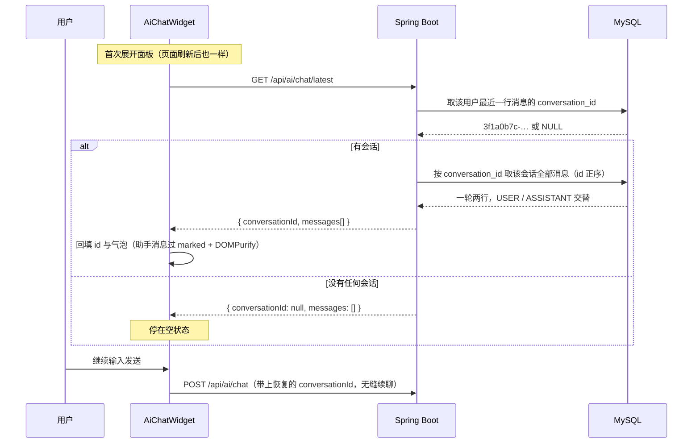

# 功能说明：AI 对话会话恢复与上下文裁剪

> **接口**：`GET /api/ai/chat/latest` · **模块**：`ai`
> **相关设计**：《概要设计》§5.9 接口、§3.2 表结构要点（`ai_message` 的两个索引）、§7 待确认项（窗口 40 是估值）

---

## 1. 功能描述

两件事，都归到「AI 对话的会话管理」名下：

1. **会话恢复**：打开 AI 面板时自动接回该用户**最近一次**会话，上下文不因刷新页面而断掉；
2. **上下文裁剪**：送模型的上下文过一道滑动窗口，最多 **40 条消息**（20 轮问答），单次请求的成本与体积有上界。

### 1.1 请求

```
GET /api/ai/chat/latest
Authorization: Bearer <jwt>
```

**没有请求参数**——「谁的会话」「哪一段」都由 token 里的 `userId` 与「最近」这个定义决定，不接受调用方指定，也就没有越权读别人会话的入口。

### 1.2 处理流程



发送链路本身不变：`POST /api/ai/chat` 收到 `conversationId` 后照样查一次 `loadHistory`，把历史拼进 prompt。

### 1.3 响应

成功（HTTP 200）：

```json
{
  "code": 0,
  "message": "ok",
  "data": {
    "conversationId": "3f1a0b7c-9d2e-4a51-8c60-7b4f2e1d0a33",
    "messages": [
      { "role": "USER", "content": "帮我解释一下拉格朗日中值定理" },
      { "role": "ASSISTANT", "content": "它是罗尔定理的推广：…" }
    ]
  }
}
```

**无可恢复的会话时 `data` 是空载荷**，状态码仍是 200：

```json
{ "code": 0, "message": "ok", "data": { "conversationId": null, "messages": [] } }
```

`messages` 按 `id` 正序，与 `loadHistory` 的排序一致；只带 `(role, content)`，不带时间戳、不带序号——与对话链路「每轮都变的字段不进 prompt」同一条理由，前端渲染也不需要更多字段。

### 1.4 涉及文件

| 层 | 文件 | 职责 |
|---|---|---|
| 接口层 | `ai/AiController.java` | `GET /api/ai/chat/latest`，登录即达 |
| 业务层 | `ai/AiService.java` | `history(userId)`；常量 `MAX_CONTEXT_MESSAGES = 40` 与 `ask()` 里的窗口切片 |
| 数据层 | `ai/AiMessageMapper.java` | `selectLatestConversationId(userId)`（`@Select` 单列投影） |
| DTO | `ai/dto/AiChatHistoryResponse.java` | 出参 record，含嵌套 `Message(role, content)` 与 `empty()` |
| 前端 | `api/ai.ts`、`api/types.ts` | `aiApi.latest()` 与对应类型 |
| 前端 | `components/AiChatWidget.vue` | `resume()`、`watch(open)` 触发、恢复期的占位气泡 |

---

## 2. 核心逻辑及说明

### 2.1 为什么恢复走服务端，而不是把 id 存 localStorage

| 方案 | 做法 | 结论 |
|---|---|---|
| **A. 服务端按用户查最近会话** | `latest` 接口按 token 里的 `userId` 定位最近一段会话 | **选定** |
| B. localStorage 存 conversationId | 只存 id，刷新后凭它拉历史 | 弃。换浏览器 / 换设备 / 清了站点数据就拿不回来，而这两种场景在「换台电脑接着看」时很常见 |
| C. 纯前端缓存消息列表 | id 与消息都存本地 | 弃。显示的是本地快照，与库可能不一致，还占本地空间 |

选定 A 的直接依据是 `ai_message` 本来就带 `user_id`，且建表时已经为这个用途留了索引（`schema.sql` 的 `idx_user_created (user_id, created_at)`，注释写的就是「将来的会话列表」）。**不需要新增任何表**：`conversationId` 仍然只是消息行上的一个冗余列。

### 2.2 查询为什么是 `ORDER BY created_at DESC, id DESC`

```sql
SELECT conversation_id FROM ai_message
WHERE user_id = #{userId}
ORDER BY created_at DESC, id DESC
LIMIT 1
```

两点：

- **只投影 `conversation_id`**。用 `Wrappers.lambdaQuery().last("LIMIT 1")` 取整行也能拿到，但那会为拿一个 36 字符的 id 把该行的 `TEXT content`（最长 2000 字）一并读回堆里。与 `NoteMapper#selectFavoriteCount` 是同一条理由。
- **`id` 这个次级排序不能省**。`created_at` 是 `DATETIME` 秒精度，同一轮问答的两行必然同秒，只按 `created_at` 排的话「最近」在秒内是不确定的。两列同向倒序，正好走 `idx_user_created` 的反向扫描，无 filesort。

### 2.3 查不到为什么回空载荷而不是 40400

`chat()` 收到无效会话 id 时报 40400，恢复接口**不沿用**它：

1. **语义不同**：`chat()` 的 40400 意思是「调用方给了个无效 id」，那是 bug 或篡改，是异常；而恢复场景里「这个用户还没有任何会话」是**预期内的常态**（新用户、或者头一回用对话功能）。
2. **UX 后果**：前端 http 层对 40400 会弹全局错误提示（它不在 `FORM_LEVEL_CODES` 里），页面一打开就弹「资源不存在」不可接受。

归属校验与取历史仍是同一次查询（条件里带 `user_id`），别人的会话查出来是空 → 同样是空载荷，不区分「不存在」与「不是你的」。

另外，`history()` 里还兜了一层：拿到的 id 在两次查询之间被删掉（`rows` 为空）时，也回空载荷，而不是回一个「发出去就 40400」的 id。

**不限频**：纯读、没有模型调用，不消耗对话额度。

### 2.4 窗口为什么是 40 条，以及它对三层各意味着什么

没有窗口时，第 N 轮请求的输入是前 N−1 轮的总和：

- **成本线性上涨**：用户一直不点「新对话」就一直涨；
- **撑爆模型上下文窗口**：超限后调用直接报错 → 50300，而且刷新恢复回来的正是这个永久坏掉的会话。

所以「持久化」和「滑动窗口」是配套的——只做前者，反倒把那个坏会话变得更可达。

| 层 | 行为 |
|---|---|
| 模型 | 只看最近 40 条 + 本轮新消息 |
| 界面 | 全量显示（恢复接口返回全量） |
| 数据库 | 全量落库，一行不删 |

**40 取偶数是有用的**：一轮问答固定落两行，历史长度恒为偶数，从这里减一个偶数后的切片起点必然落在 USER 行上，不会出现「上下文从助手的半句说起」。这一点由 `askWindowStartsOnAUserMessage` 钉住。

### 2.5 窗口与前缀缓存的关系

`ask()` 原本有一条约定：历史只带 `(role, content)`、不带每轮都变的字段，为的是让 DeepSeek 的前缀缓存（按「从 token 0 起逐字相同的公共前缀」命中）不被截断。窗口的引入对这个约定的影响是**分段**的：

- **未超限时**（绝大多数会话的常态）：前缀逐轮只增不变，缓存照常命中，与没有窗口时**完全一致**；
- **超限后**：窗口每轮滑动一位，前缀从滑动点开始失效，缓存不再命中。

这是拿「有界的单次成本」换掉「无界的故障风险」的自觉代价。40 条 × 单条最长 2000 字符，最坏输入仍有上界。

### 2.6 前端为什么挂在「首次展开面板」而不是 `onMounted`

`AiChatWidget` 挂在 `MainLayout` 里，**每个页面都会加载它**。而 http 层对失败会弹全局提示，于是：

- 挂 `onMounted` → 从不用 AI 的用户在翻页时也可能吃到一条与自己无关的报错；
- 挂首次展开 → 提示只出现在用户主动打开面板的那一刻，也正合「打开对话界面时自动对接最近一次会话」。

`resumeAttempted` 保证本次页面生命周期内只请求一次，反复开关面板不会重复打接口。

### 2.7 两处交叉处理的细节

- **渲染与发送同源**：助手消息恢复时走 `send()` 那条同款的 `marked.parse` + `DOMPurify.sanitize`，不另起炉灶。
- **不与用户抢输入**：恢复是异步的，若用户手快、在响应回来之前已经自己发出了消息（`messages` 非空），放弃回填——否则旧会话的展示会盖掉刚发出去的气泡，`conversationId` 也会被覆盖回旧会话。

---

## 3. 已知限制

| 项 | 说明 |
|---|---|
| 「新对话」后立刻刷新会被拉回旧会话 | 点「新对话」只是清空本地，服务端无状态。此时新会话还不存在，「最近一次会话」的定义只能是旧的。要消除它就得在本地存「我已开新会话」的标记，那等于把方案 B 又请回来。**接受这个边界**；发出第一条消息之后就正常了 |
| 恢复返回全量历史、无分页 | 单会话消息数预期在几十条量级，量级变大再做「加载更早」 |
| 更早的会话仍不可达 | 库里更早的会话没有列表入口，做会话列表时一并处理 |
| 窗口 40 条是估值 | 与限频 30 次/小时同性质：先定一个有据的保守值，跑了真实流量再调（§7 待确认项） |
| 恢复失败不自动重试 | 失败后本次页面生命周期内不再重试（避免每次展开面板都失败并重弹提示），刷新页面可重试。此时用户直接发消息会开一段新会话——不丢数据，只是不是想接的那段 |

---

## 4. 测试过程与结果

### 4.1 运行前置

| 项 | 值 |
|---|---|
| JDK | 21（`java.specification.version=21`） |
| 数据库 | **本机 MySQL 8.x**，测试激活 `local` profile，连 `application-local.yaml` 的库 |
| Redis | 全套测试需要（详情缓存的相关用例），本机 6379 要有实例 |
| 建表与初始数据 | 随应用启动自动执行 `schema.sql` + `data.sql`（均幂等）。**本次无 schema 变更，无迁移** |
| 网络 / AI API Key | **都不需要**——新增用例全程 mock 模型与 mapper |
| 前端 | `npm run build`（`vue-tsc -b && vite build`）做类型检查 |

### 4.2 结果

```
Tests run: 500, Failures: 0, Errors: 0, Skipped: 0
BUILD SUCCESS
```

前端 `npm run build`：`vue-tsc` 类型检查通过，构建成功。

**与本功能直接相关的 10 条（全部为新增），全部通过**：

| 测试类 | 用例数 | 覆盖层次 |
|---|---|---|
| `AiServiceTest` | 7 | 编排：最近会话定位、空载荷的两种来源、窗口切片的边界 |
| `AiControllerTest` | 3（另扩了 1 条既有用例） | HTTP 层：鉴权、响应信封、空载荷的 JSON 形态、身份取自 token |

### 4.3 用例明细

**A. 会话恢复（`AiServiceTest` + `AiControllerTest`）**

| 分组 | 用例 | 验证的规则 |
|---|---|---|
| 取最近会话 | `historyReturnsLatestConversationInOrder` | 回显会话 id，消息按正序、只带 `(role, content)` |
| | `historyReturnsEmptyPayloadWhenUserHasNoConversation` | 无会话 → 空载荷，且**不再发第二条查询**（能提前判定） |
| | `historyReturnsEmptyPayloadWhenConversationVanished` | 拿到的 id 已查不出行 → 空载荷，**不是 40400** |
| HTTP 层 | `latestReturnsHistoryInTheCommonEnvelope` | 统一信封、字段名与顺序 |
| | `latestReturnsEmptyPayloadWhenThereIsNothingToResume` | 空载荷的形态钉死：`conversationId` 为 `null`、`messages` 为空数组、状态码 200、业务码 0 |
| | `latestReadsTheSessionOfTheTokenOwner` | 读谁的会话由 token 决定，不由请求参数决定 |
| 鉴权 | `allEndpointsRequireLogin`（扩充） | 新增端点同样匿名不可打（40100） |

**B. 上下文窗口（`AiServiceTest`）**

| 分组 | 用例 | 验证的规则 |
|---|---|---|
| 裁剪 | `askSendsOnlyTheWindowWhenHistoryIsOverLimit` | 50 条（25 轮）只发最近 40 条 + 本轮新消息 |
| 不回归 | `askKeepsWholeHistoryWhenUnderLimit` | 恰好 40 条一条不裁——钉住「未超限时的行为与改动前完全一致」 |
| 边界 | `askWindowStartsOnAUserMessage` | 切片首条是 `UserMessage`，不会从助手的半句说起 |
| 顺序 | `askAppendsNewMessageAfterTheWindow` | 切片之后本轮新消息仍在最后 |

### 4.4 未覆盖的部分（如实记录）

- **窗口裁剪后的回答质量**：模型不再记得被裁掉的旧轮次，这一点只能靠真实对话体感，无法自动化验证。与「prompt 措辞」同类，属于必须实测的那一档。
- **前端恢复与发送的竞态**（§2.7 第二条）用手工验证，不写自动化——它靠的是「响应回来时 `messages` 是否为空」这个时序，组件测试要模拟真实点击节奏反而失真。
- **`latest` 在真实数据上的索引走向**：`ORDER BY created_at DESC, id DESC LIMIT 1` 预期走 `idx_user_created` 的反向扫描，**未用 `EXPLAIN` 实测过**。数据量起来后值得复核一次，看是否出现 filesort。

### 4.5 手工验证清单

1. 对话两轮 → 刷新 → 展开面板即恢复历史，且能接着上一轮继续聊；
2. 点「新对话」→ 立刻刷新 → 旧会话被拉回（§3 第一条，预期内）；再发一条 → 刷新 → 回到新会话；
3. 换一个浏览器 / 清掉站点数据后登录 → 仍能恢复——这是本方案相对 localStorage 的收益，必须实测到；
4. 造一个 45 条以上的会话 → 界面显示全量，后端送模型的只有最近 40 条；
5. 停掉后端 → 首次展开面板 → 有失败提示但界面仍可用，此时发消息会开一段新会话。
