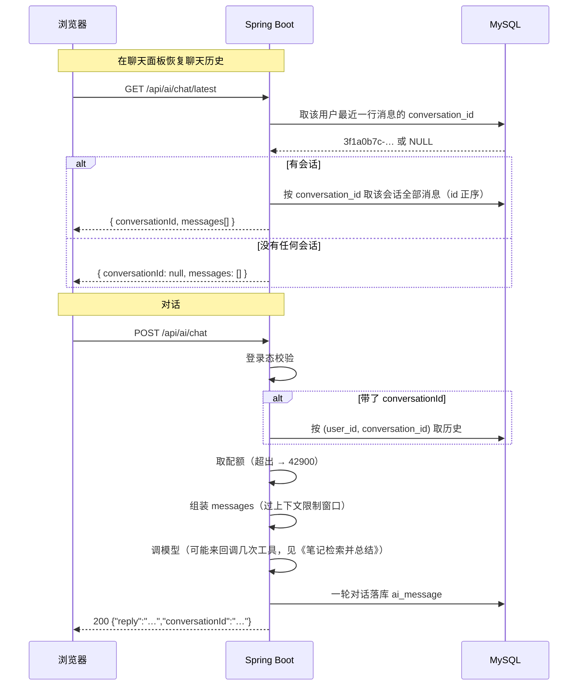
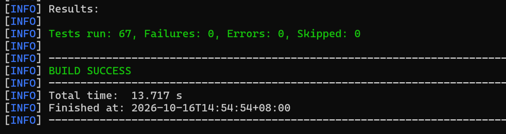

# 功能说明：AI 对话会话管理

> **接口**：`POST /api/ai/chat` · `GET /api/ai/chat/latest` · **模块**：`ai`


---

## 1. 功能描述

1. 一问一答。不带 `conversationId` 就开一段新会话，带上就续聊；
2. **持久化**：消息落库 `ai_message`，一轮问答两行（USER / ASSISTANT）。
3. **恢复**：每次打开面板时自动接回该用户**最近一次**会话。
4. **裁剪**：送模型的上下文过一道滑动窗口，最多 **40 条消息**（20 轮问答）
5. **限额**：按用户限频，超出报 `42900`，与自动审生成摘要的额度分开算。

### 1.1 请求

```
POST /api/ai/chat
Authorization: Bearer <jwt>
Content-Type: application/json

{ "message": "帮我解释一下拉格朗日中值定理", 
  "conversationId": "3f1a0b7c-…" }
```


```
GET /api/ai/chat/latest
Authorization: Bearer <jwt>
```

### 1.2 处理流程



### 1.3 响应与错误码

`chat` 成功（HTTP 200）：

```json
{ "code": 0, "message": "ok", "data": { "reply": "它是罗尔定理的推广：…", "conversationId": "3f1a0b7c-…" } }
```

`latest` 成功（HTTP 200）：

```json
{
  "code": 0,
  "message": "ok",
  "data": {
    "conversationId": "3f1a0b7c-9d2e-4a51-8c60-7b4f2e1d0a33",
    "messages": [
      { "role": "USER", "content": "帮我解释一下拉格朗日中值定理" },
      { "role": "ASSISTANT", "content": "它是罗尔定理的推广：…" }
    ]
  }
}
```

**无可恢复的会话时 `data` 是空载荷**，状态码仍是 200：

```json
{ "code": 0, "message": "ok", "data": { "conversationId": null, "messages": [] } }
```

| code | 场景 |
|---|---|
| 40001 | `message` 为空 / 超过 2000 字符、`conversationId` 超过 36 字符 |
| 40400 | `chat` 带了 `conversationId` 却查不到该会话（别人的会话也走这里，不区分）。**`latest` 永不回 40400** |
| 42900 | 超出每用户对话额度（§2.8） |
| 50300 | 上游超时、连不上、返回错误，**以及模型报回一个不存在的工具名** |
| 40100 | 未登录 |

### 1.4 涉及文件

| 层 | 文件 |
|---|---|
| 接口层 | `ai/AiController.java` · `ai/dto/AiChatRequest.java` · `ai/dto/AiChatResponse.java` · `ai/dto/AiChatHistoryResponse.java` |
| 业务层 | `ai/AiService.java`（`chat` / `history` / `ask` / `loadHistory` / `appendTurn`，与摘要共用该类） |
| 数据层 | `ai/AiMessageMapper.java` · `entity/AiMessage.java` · `ai/AiMessageRole.java` |
| 限频 | `ai/AiRateLimiter.java`（实例在 `config/AiConfig.java` 里装配，与摘要那个**各持一个**） |
| 前端 | `api/ai.ts` · `api/types.ts` · `components/AiChatWidget.vue` |

---

## 2. 核心逻辑及说明

### 2.1 一轮对话，同一次事务

```java
private void appendTurn(Long userId, String conversationId, String message, String reply) {
        transactionTemplate.executeWithoutResult(status -> {
            aiMessageMapper.insert(rowOf(userId, conversationId, AiMessageRole.USER, message));
            aiMessageMapper.insert(rowOf(userId, conversationId, AiMessageRole.ASSISTANT, reply));
        });
    }
```
分开落的话，模型失败就会在历史里留下一条没有回复的孤行，用户重试后上下文里就多出一句重复的话。所以模型调用失败时一条消息都不落，用户重试即干净重放。

### 2.2 历史重放：只带 `(role, content)`

`loadHistory` 按 `id` 正序取该会话的全部行，`ask()` 把它们逐条转成模型消息。
**不带时间戳、不带序号、不带 `id`**——任何每轮都变的字段都会让前缀缓存从那里断掉。

同理，工具对象虽然每请求 `new` 一个，但参数 schema 由方法签名推导、`@Tool` 的 name/description 是编译期常量，所以 tool 定义逐字节相同，也不打穿前缀缓存.

**工具调用的中间轮不落库**：模型可能来回调好几次工具，但 `ai_message` 里只有用户那一句和最终回答。

### 2.3 上下文滑动窗口与前缀缓存

当前规定上下文窗口 40 条。

- **未超限时**（绝大多数会话的常态）：前缀逐轮只增不变，缓存照常命中；
- **超限后**：窗口每轮滑动一位，前缀从滑动点开始失效，缓存不再命中。

这样做的局限就是，超限后全部缓存直接失效。（以后需要考虑如何在滑动后复用缓存）


### 2.4 限频

- 超出限频报 `42900`，默认30 次/小时/用户。
- 取配额在 `40400` 之后、调模型之前。不该为失败的调用扣掉一个名额。
- **计数单位是一轮问答而不是一次调用**，虽然按调用数计费才准确，但一轮对话内部到底发生几次调用，要等它结束才知道。当前只是做限频，没有记账，将来若要做计费系统，就需要换做更精细的统计。
- **摘要与对话各持一个 `AiRateLimiter` 实例，用的是同一个 `requireSlot`，各算各的额度。** 两者的花费不在一个层级（一轮对话有多次模型调用）。
```java
@Bean
public AiRateLimiter aiSummaryRateLimiter() {   
    return new AiRateLimiter(20, Duration.ofHours(1), "生成");
}
@Bean
public AiRateLimiter aiChatRateLimiter() {      
    return new AiRateLimiter(30, Duration.ofHours(1), "对话");
}
```
```java
@Qualifier("aiSummaryRateLimiter") AiRateLimiter summaryRateLimiter,  
@Qualifier("aiChatRateLimiter") AiRateLimiter chatRateLimiter          
```
```java
```java
public void requireSlot(Long userId) {
    Instant now = Instant.now();
    windows.compute(userId, (key, existing) -> {
        Window base = (existing == null || existing.isExpired(now)) ? Window.fresh(now) : existing;
        if (base.count() >= MAX_REQUESTS) {
            throw new BusinessException(ErrorCode.AI_RATE_LIMITED, "生成过于频繁，请 %d 分钟后再试".formatted(…));
        }
        return new Window(base.count() + 1, base.windowStart());
    });
}
```
---

### 2.5 已知限制

| 项 | 说明 |
|---|---|
| 更早的会话不可达 | 库里更早的会话没有列表入口，做会话列表时一并处理。库里的孤儿会话占存储 |
| 窗口 40 条是估值 | 与限频 30 次/小时同性质 |
| 恢复失败不自动重试 | 失败后本次页面生命周期内不再重试（避免每次展开面板都失败并重弹提示），刷新页面可重试|

---

## 3. 测试过程与结果

### 3.1 运行前置

| 项 | 值 |
|---|---|
| JDK | 21（`java.specification.version=21`） |
| 数据库 | **本机 MySQL 8.x**，测试激活 `local` profile，连 `application-local.yaml` 的库 |
| Redis | 本功能不需要 |
| 建表与初始数据 | 随应用启动自动执行 `schema.sql` + `data.sql`（均幂等）。**本轮无 schema 变更，无迁移** |
| 网络 / AI API Key | **都不需要**——相关用例全程 mock 模型与 mapper |
| 前端 | `npm run build`（`vue-tsc -b && vite build`）做类型检查 |

### 3.2 用例覆盖层次

| 测试类 | 用例数 | 覆盖层次 |
|---|---|---|
| `AiServiceTest`（对话 / 恢复 / 窗口相关） | 20 | 编排：新会话与续聊、**指令在 system 段而用户的话在 messages 段**、挂上笔记工具、额度取在**调模型之前**（被拒的那轮不落库）、历史按「旧 user、旧 assistant、新 user」逐条重放且**不带时间戳**、陌生会话 **40400 且零花费**、模型失败时**一条消息都不落**、上游失败转 50300（文案是对话版）、模型回 null 给空回答、首尾空白裁掉；`latest` 的三种形态（有会话 / 新用户 / 会话并发消失）；窗口 40 条的裁剪、**起点落在 USER 行**、本轮新消息排在最后（模型、mapper、存储全 mock） |
| `AiControllerTest`（对话 / 恢复相关） | 10 | HTTP 层：路由与参数绑定、`userId` 取自 JWT 而非请求参数、`message` 空白 / 缺席与 `conversationId` 超长的 **40001 且带字段名**、陌生会话 40400、上游 50300、两个端点的响应形状与**空载荷的 JSON 形态**（起真库，`AiService` 换 mock） |
| `AiMessageMapperTest` | 4 | 列映射与查询隔离：`conversation_id` 映射错会让取历史**安静地返回空**、按 `id` 正序、归属写进 SQL 条件（换个人查是零行）、同一人的两段会话互不串（**起真库**，`@Transactional` 回滚） |
| `AiRateLimiterTest` | 6 | 限频器单元：额度边界、**被拒的不消耗额度**、按 `userId` 隔离、**两个实例各算各的**、被拒文案的主语来自装配（该类与摘要共用，摘要那侧的用法也在里面） |

> 这套件里**一次真实的工具调用都没有发生过**。


### 3.3 运行命令与结果

```bash
./mvnw test -Dtest=AiServiceTest,AiControllerTest,AiMessageMapperTest,AiRateLimiterTest
```




### 3.4 手工验证清单

1. 对话两轮 → 刷新 → 展开面板即恢复历史，且能接着上一轮继续聊；
2. 点「新对话」→ 立刻刷新 → 旧会话被拉回（§3 第一条，预期内）；再发一条 → 刷新 → 回到新会话；
3. 换一个浏览器 / 清掉站点数据后登录 → 仍能恢复

