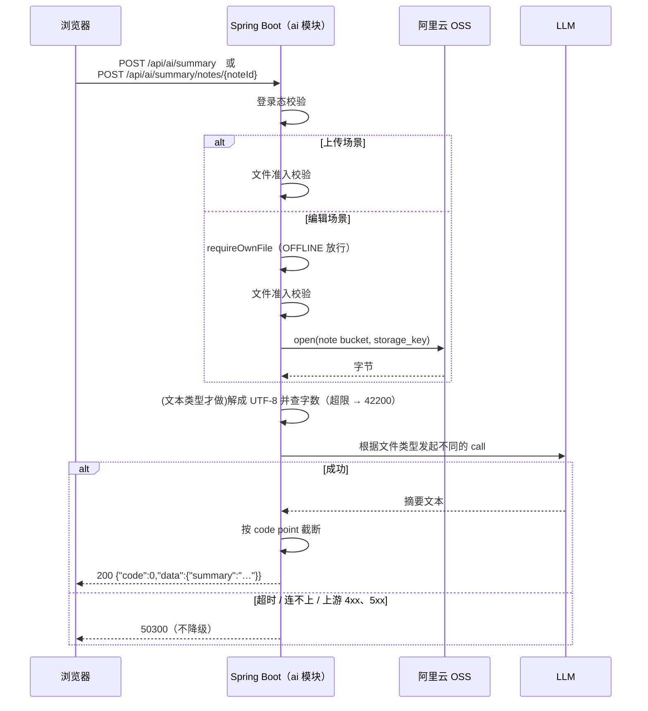
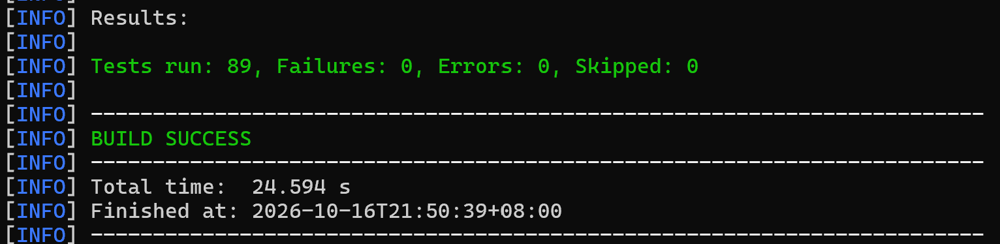

# 功能说明：AI 自动生成摘要

> **接口**：`POST /api/ai/summary` · `POST /api/ai/summary/notes/{noteId}` · **模块**：`ai`（主）+ `note`（编辑场景读附件）+ `storage`（读 OSS）

***

## 1. 功能描述

上传或编辑笔记时，用户点“自动生成摘要”，服务端把笔记的附件交给模型，换回一段摘要文本自动填进简介输入框，用户可改、可弃，本功能不写任何库表。

### 1.1 请求

**上传场景**

```
POST /api/ai/summary
Authorization: Bearer <jwt>
Content-Type: multipart/form-data

file=@板书.png
title=高数期中复习        （可选）
teacher=张老师            （可选）
```

**编辑场景**

```
POST /api/ai/summary/notes/123?title=高数期中复习&teacher=张老师
Authorization: Bearer <jwt>
```

### 1.2 处理流程



### 1.3 响应

成功（HTTP 200）：

```json
{ "code": 0, "message": "ok", "data": { "summary": "这是一份高数期中复习提纲，覆盖极限与导数。" } }
```

| code                  | 场景                                                                             |
| --------------------- | ------------------------------------------------------------------------------ |
| 40001                 | 没选文件（`data` 带字段明细 `field: file`）                                               |
| 42200                 | 类型不在白名单；图片超过 10MB 或扩展名与魔数不符；正文超过 2 万字 |
| 42900                 | 调用过于频繁（按用户限频）                                                                  |
| 50300                 | 上游超时、连不上、返回错误                                                                  |
| 40300 / 40301 / 40400 | 编辑场景：非本人 / 笔记已删除 / 笔记不存在                                                       |

### 1.4 涉及文件

| 层    | 文件                                                                                                                                |
| ---- | --------------------------------------------------------------------------------------------------------------------------------- |
| 接口层  | `ai/AiController.java` · `ai/dto/AiSummaryRequest.java` · `ai/dto/AiSummaryResponse.java`                                         |
| 业务层  | `ai/AiService.java`（与对话接口共用）                                                                                                      |
| 准入策略 | `ai/AiSummaryFilePolicy.java` · `common/FileMagic.java`（魔数共用）                                                                     |
| 正文封装 | `ai/UntrustedContent.java`（信封锁标，与对话的 `NoteTools` 共用）                                                                              |
| 限频   | `ai/AiRateLimiter.java`（实例在 `AiConfig` 里装配，摘要与对话各持一个）                                                                             |
| 配置   | `config/AiConfig.java` · `application.yaml` 的 `spring.ai.*`（§7.1）                                                                 |
| 上游依赖 | `note/NoteService.java#requireOwnFile` · `note/NoteMapper.xml#selectFileOwnership` · `storage/StorageService.java#open`（后三者仅编辑场景） |
| 错误码  | `common/ErrorCode.java`（`42900` / `50300`）                                                                                        |

***

## 2. 核心逻辑及说明

### 2.1 两条链路的差异：文件从哪来

```java
// 上传场景：收 multipart
@PostMapping("/api/ai/summary")
public ApiResponse<AiSummaryResponse> summarizeUpload(
    @AuthenticationPrincipal AuthenticatedUser user,
    @Valid @ModelAttribute AiSummaryRequest request) { … }

// 编辑场景：按 id 自取
@PostMapping("/api/ai/summary/notes/{noteId}")                   
public ApiResponse<AiSummaryResponse> summarizeNote(
    @AuthenticationPrincipal AuthenticatedUser user,
    @PathVariable Long noteId,
    @RequestParam(required = false) String title,
    @RequestParam(required = false) String teacher) { … }
```

- **上传时对象还不存在**——文件只在前端手上。所以只能收 multipart。
- **编辑时对象已经在 OSS**，服务端自己读回来，前端不必重传。

> `title` / `teacher` 在两条链路里都是**可选的上下文**，被拼进 prompt、帮模型判断这张图讲的是什么。编辑场景由前端按表单当前值传，而不是取库里存的，因为用户很可能刚改过标题、还没保存就点了“摘要生成”。

### 2.2 准入

这是本项目第三条「扩展名 + 魔数」的准入链路（另两条：`NoteFilePolicy` 管笔记附件、`AvatarFilePolicy` 管头像）。共用 `common/FileMagic`。
> 每个模块中都有对应的 FilePolicy 类，重复代码较多。需要优化？

**与另两条链路不同，本策略不产出决策记录**：那两条的记录带 `extension`，是为了拼 OSS 对象键；AI 这一趟唯一要返回的是 MIME 类型字符串。

**`magic == null`** **就是「这一档是纯文本」**，不另设一份文本类型清单。这个判据同时被三处使用：`inspect` 决定要不要读文件头、公开的 `isText(contentType)` 决定走哪条链路、对话的 `NoteTools` 也拿它判「能不能当文本直读」。两份清单的话，将来往表里加一种文本类型时漏改其中一份，就会把一个 md 当成图片去读文件头。

### 2.3 限频

见 "会话管理.md" 限频小节

### 2.4 一次模型调用：prompt 分段、回程截断

```java
private String summarize(Payload payload, String title, String teacher) {
    return payload.isText()
            ? summarizeText(payload, title, teacher)      // 只 spec.text(…)，不调 media
            : summarizeImage(payload, title, teacher);    // spec.text(…).media(mime, 图片)
}
```

两条支线给的是两段不同的 system 指令。指令放** **`system`** **段、用户可控的标题与教师放** **`user`** **段。

> 这不是完备的提示注入防御

**回程按 code point 截断到 512**：

```java
private static String truncate(String text) {
    String trimmed = text.strip();
    if (trimmed.codePointCount(0, trimmed.length()) <= MAX_SUMMARY_LENGTH) {
        return trimmed;
    }
    return trimmed.substring(0, trimmed.offsetByCodePoints(0, MAX_SUMMARY_LENGTH));
}
```

prompt 里已经要求模型不超过 512 字，但**不能指望模型守约**。
（提示词方面需要优化；或者让模型再压缩一次？）

## 3. 测试过程与结果

### 3.1 运行前置

| 项          | 值                                                                           |
| ---------- | --------------------------------------------------------------------------- |
| JDK        | 21（`java.specification.version=21`）                                         |
| 数据库        | **本机 MySQL 8.0**，测试激活 `local` profile，连 `application-local.yaml` 的库         |
| 建表与初始数据    | 随应用启动自动执行 `schema.sql` + `data.sql`（均幂等）                                    |
| 网络         | **自动套件不需要**——模型全程是 mock。
| AI API Key | **自动套件不需要**。`application.yaml` 给的是带空默认值的占位符 `${JOTANG_AI_API_KEY:}`，不配也照常启动 |

### 3.2 用例覆盖层次

| 测试类 | 用例数 | 覆盖层次 |
| --- | --- | --- |
| `AiSummaryFilePolicyTest` | 20 | 准入判定与分档（纯单元）：白名单与 MIME 归一（jpg / jpeg 都归成 `image/jpeg`）、`md` → `text/markdown` 而 `markdown` 不在白名单、扩展名与魔数必须一致（含 RIFF 头但不是 WEBP 那种半对的情况）、10MB 上界含、文本的两道闸、`requireSummarizable`（编辑场景唯一的判据，含 `content_type` 为 `null` 不抛 NPE）、`isText` 与 `requireWithinLimit` |
| `AiServiceTest`（摘要部分） | 19 | 编排：**本地就能判、不该白花一次计费的几种情形**（类型不支持、落库 `content_type` 认不出来、图片超尺寸、正文超长；编辑场景那几条同时断言 **OSS 未打开**）、**以服务端判定的 MIME 交给模型**、图片进 `media` 而文本进 `text`、正文包在信封里且标记只出现一次、校验不过**不消耗配额**、上游失败一律 50300（文本路径那条钉的是「解码与长度判定不在 50300 的 catch 里」）、回程按 **code point** 截到 512 |
| `AiControllerTest`（摘要部分） | 7 | HTTP 层：`userId` 取自 JWT 而非请求参数、两条路由与参数绑定（编辑场景的 `title` / `teacher` 可缺）、没选文件是**带字段名 `file` 的 40001**、50300 ↔ 503 且 `data` 为 `null`、42900 ↔ 429（起真库，`AiService` 换 mock） |
| `AiRateLimiterTest` | 6 | 限频器单元：额度边界、被拒的不消耗额度、按 `userId` 隔离、两个实例各算各的 |
| `NoteFileAccessServiceTest` | 6 | 编辑场景的前置判门（起真库，`@Transactional` 回滚）：`storage_key` / `size` / `content_type` 三列映射、OFFLINE 仍可读、已删除 40301、非本人 40300、不存在 40400。**它单独存在的理由是列映射**——`AiServiceTest` 把 note 层整个 mock 掉，`selectFileOwnership` 那条 SQL 一次都不会执行，而 `size` 映射不上只会安静地让「先拦后读」失效 |

> 这套件里**一次真实的模型调用都没有发生过**


### 3.3 运行命令与结果

```bash
./mvnw test -Dtest=AiSummaryFilePolicyTest,AiServiceTest,AiControllerTest,AiRateLimiterTest,NoteFileAccessServiceTest
```


89 = 上表五个类之和（19 与 7 只是 `AiServiceTest` 39 条、`AiControllerTest` 18 条里属于摘要的那部分，余下是对话，见《会话管理》§3.2）。

### 3.4 真实调用（AI执行，2026-10-15）

| # | 场景         | 请求                               | 结果                                                          | 耗时        |
| - | ---------- | -------------------------------- | ----------------------------------------------------------- | --------- |
| 1 | 上传 · md    | 1473 字节的《线性代数期中复习提纲》             | 200，摘要被截到 **恰好 512** code point                             | 4.79s     |
| 2 | 上传 · md 超长 | 20026 字节（**超过 2 万字但远低于字节预筛**）    | **422 / 42200「笔记正文超过 20000 字」**，模型零调用                       | **0.02s** |
| 3 | 编辑 · md    | 同上文件先上传成笔记（id 900001028）再按 id 摘要 | 200，320 字（**真从 OSS 读回**）                                    | 4.48s     |
| 4 | 上传 · png   | 手工生成的白底板书图（900×420）              | 200，161 字，模型**确实读到了图**：复述出「夹逼准则 / 洛必达法则 / 换元法 / 中值定理的证明题必考」 | 2.47s     |

**三条实测结论：**

1. **模型不守 512 字的约，回程截断不是摆设。** 第 1 次模型写了约 590 字，是服务端把它切到 512 的——prompt 里那句「控制在 %d 个字符以内」按不住它。**但截断是硬切**：末句断在半路（实测末尾是「……判断能否对」）。这是本轮留下的一个已知粗糙处，要么把 prompt 的措辞收紧，要么改成回退到最近的句读再切，**本轮没做**。
2. **两道闸的分工在真实链路上成立。** 第 2 次那个 20026 字节的 md：字节数远小于 `MAX_TEXT_BYTES`（8 万），是被 code point 计数拦下的，且 0.02 秒返回、一次计费都没花——这正是单测里 `textLongerThanTheCharLimitIsRejectedEvenUnderTheByteLimit` 要钉的性质，只是这次是端到端跑的。
3. **图片那条路没被这次重构碰坏。** `spec.text(...).media(...)` 改成经 `callModel` 组装之后，多模态输入仍然有效（第 4 次能复述出图里的具体内容，不是编的）。

**未测到的**：真实费用没计量。
