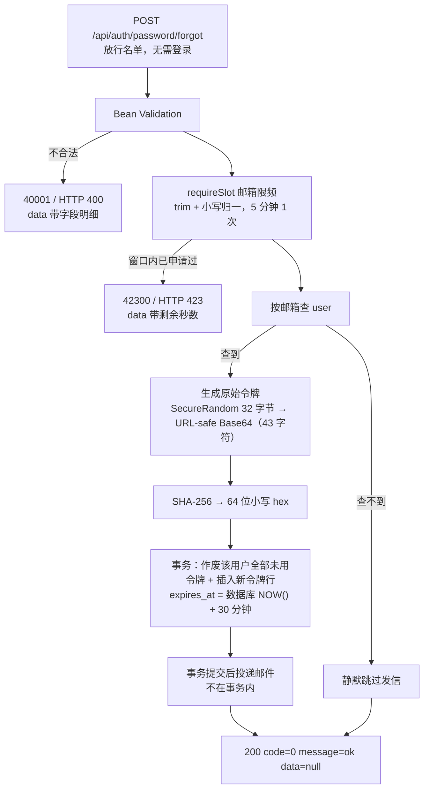
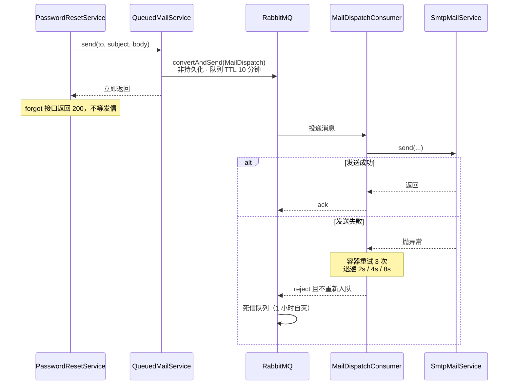
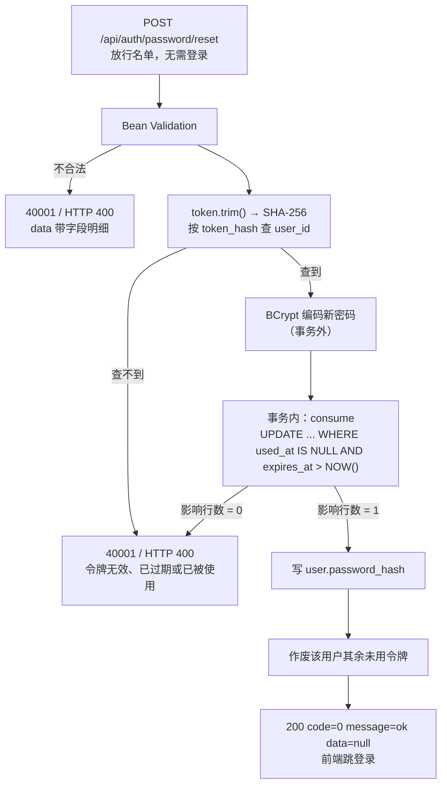
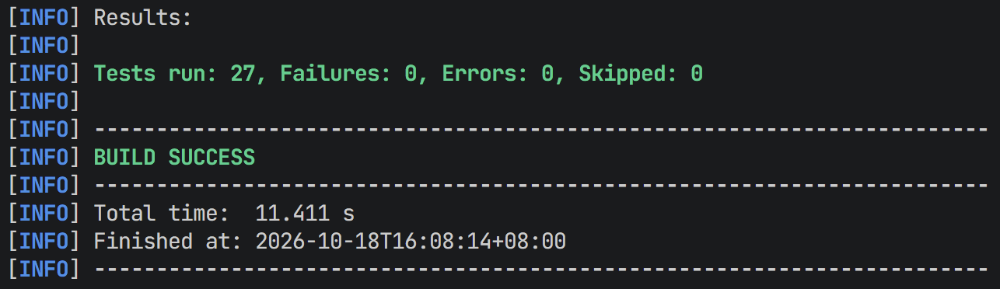
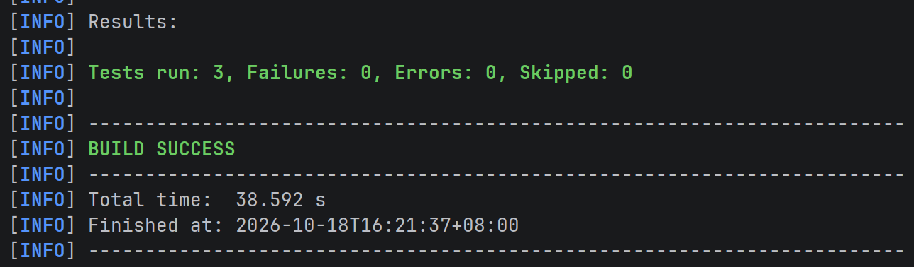
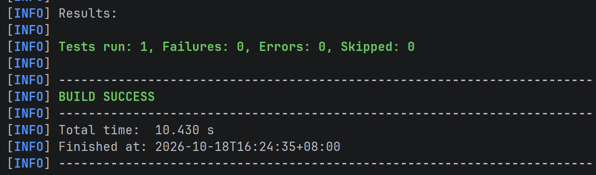

# 功能说明：密码找回

> **接口**：`POST /api/auth/password/forgot` · `POST /api/auth/password/reset` · **模块**：`auth`（主）+ `mail`（发信）+ `common`（统一响应）

***

## 1. 功能描述

密码找回由两个公开接口（无需登录）串成一条链路：

1. **申请**：用户在 `/forgot-password` 提交注册邮箱，服务端签发一枚一次性、30 分钟有效的重置令牌，把**原始令牌**拼进链接用邮件发出去，库里只留它的 SHA-256。
2. **重置**：用户点开邮件里的 `/reset-password?token=...` 设置新密码，令牌在校验通过的同一条语句里被消费掉，随后跳回登录页。

### 1.1 请求

两个接口都接收 JSON：

```
POST /api/auth/password/forgot
Content-Type: application/json

{"email": "zhangsan@example.com"}
```

```
POST /api/auth/password/reset
Content-Type: application/json

{"token": "kQ7...（邮件链接里那串，43 字符）", "newPassword": "Passw0rd!23"}
```

### 1.2 处理流程

**申请重置**


**投递邮件**（`jotang.mail.mode=queue`）



`mode=smtp` 时跳过队列，`PasswordResetService` 直接同步调用 `SmtpMailService`

**重置密码**



### 1.3 响应

成功与两个接口的错误响应都走统一结构：

```json
{
  "code": 0,
  "message": "ok",
  "data": null
}
```

| 场景 | HTTP | code | data |
| --- | --- | --- | --- |
| 成功（含邮箱不存在） | 200 | 0 | `null` |
| 字段校验不通过 | 400 | 40001 | 字段明细数组 |
| 同一邮箱 5 分钟内重复申请 | 423 | 42300 | 剩余秒数 |
| 令牌无效 / 已过期 / 已使用 | 400 | 40001 | `null` |

**字段校验失败：**

```json
{
  "code": 40001,
  "message": "参数校验失败",
  "data": [
    { "field": "email", "message": "邮箱格式不正确" }
  ]
}
```

**限频（HTTP 423）：**

```json
{
  "code": 42300,
  "message": "重置邮件发送过于频繁，请 5 分钟后重试",
  "data": 297
}
```

**令牌无效（HTTP 400）：**

```json
{
  "code": 40001,
  "message": "重置链接无效、已过期或已被使用（若收到多封邮件，请使用最新的一封）",
  "data": null
}
```

### 1.4 涉及文件

| 层 | 文件 |
| --- | --- |
| 接口层 | `auth/AuthController.java` · `auth/dto/ForgotPasswordRequest.java` · `auth/dto/ResetPasswordRequest.java` · `config/SecurityConfig.java`（两个接口在放行名单） |
| 业务层 | `auth/PasswordResetService.java` |
| 限频 | `auth/PasswordResetRateLimiter.java` |
| 邮件内容 | `auth/PasswordResetMailContent.java`（纯函数：主题 / 链接 / 正文） |
| 发信 | `mail/MailService.java` · `mail/SmtpMailService.java` · `mail/QueuedMailService.java` · `mail/MailDispatchConsumer.java` · `mail/MailDispatch.java` · `config/RabbitConfig.java` |
| 持久层 | `auth/PasswordResetTokenMapper.java` · `entity/PasswordResetToken.java` |
| 表定义 | `resources/schema.sql` 的 `password_reset_token` |

***

## 2. 核心逻辑及说明

### 2.1 一次性消费：成败由一条条件 UPDATE 的影响行数决定

`PasswordResetTokenMapper#consume`：
```java
transactionTemplate.executeWithoutResult(status -> {
    if (tokenMapper.consume(tokenHash) == 0) {
        throw invalidToken();
    }
    userMapper.update(......);
});
```

```sql
UPDATE password_reset_token
SET used_at = NOW()
WHERE token_hash = #{tokenHash}
  AND used_at IS NULL
  AND expires_at > NOW()
```

两个条件都写在 `WHERE` 里，**不是先查出来判断、再更新**。两个并发请求拿着同一个令牌同时打进来时，InnoDB 会给匹配到的那一行加行锁，只有一条能改到 1 行，另一条得到 0 行。天然抗重放，不需要任何额外的锁。
>在先查后更新的场景下，若攻击者后落库，用户这边明明收到了200，以为找回账号，但实际生效的是攻击者设的密码。


### 2.2 只存 SHA-256，不用 BCrypt

令牌是 `SecureRandom` 的 **32 字节**（256 位）随机数。这个熵让「猜」不成立，也让「拿到哈希后离线爆破」不成立——所以存哈希只需要一个快的摘要：**SHA-256**。

用 BCrypt 在这里是错的方向：它刻意慢，是给**低熵口令**抗离线爆破用的。用在这里换不到任何安全性，只会让每一次校验都多等几十毫秒——而校验发生在**尚未证明身份**的请求上。

同理，令牌生成**不复用 `JwtTokenProvider`**：那边是 HMAC 签名密钥体系，这边是一次性随机数。共用一个 `SecureRandom` 没问题，但把两者当成同一种「令牌」会让生命周期、存储方式、失效规则混在一起——它们的规则一条都不相同。

### 2.3 防枚举：响应相同；耗时在 `mode=queue` 下接近

这个接口不登录就能调。若邮箱不存在与命中时有差别，任何人都能拿它当这个邮箱在本站注册过吗的探测器。未命中分支因此**静默返回**。  

但光有响应相同还不够。命中分支若能靠耗时被认出来，枚举一样成立——而时间侧信道比响应体差异更隐蔽，掐表就行。**这就是引入消息队列的主要动机**（不是嫌 SMTP 慢）：收益不在性能上，而在一个不写出来就会被忽略的安全属性上。

| 模式 | 命中分支的额外开销 | 时间侧信道 |
| --- | --- | --- |
| `queue`（生产应为这个） | 写库 + 投一条消息 | 差距被压到毫秒级，**更难利用**——注意不是「不可利用」 |
| `smtp` | 同步等一次 SMTP 往返（几百毫秒） | 存在 |

`smtp` 在这条路径上是弱的，所以**生产必须设 `jotang.mail.mode=queue`**。启动横幅（两条 INFO）是提醒。

### 2.4 发信在事务提交之后

```java
transactionTemplate.executeWithoutResult(status -> {
            tokenMapper.invalidateAllUnused(......);
            tokenMapper.insertToken(......);
        });

sendQuietly(user.getEmail(), rawToken);
```

- **网络调用不跨事务边界**。上传（OSS 传输在事务外）和删除（不碰 OSS）都定过这条规矩。一次被挂住的 SMTP 不该让 `password_reset_token` 的行锁陪着它等。
- 作废旧令牌与插入新令牌必须在一个事务里，否则会短暂存在两个有效令牌。

代价是一个窄窗口：**令牌已入库、邮件却没发出**。

它被接受是因为用户重试一次 `/forgot` 就会作废旧令牌、发新的。但若把发信放进事务，问题会变成**邮件发出去了,令牌却回滚了**，那才是用户无论怎么做都修不好的状态。

### 2.5 不物理删除旧令牌

重新申请或改密成功后，旧令牌都是为其 `used_at` 赋值，而不是将其 `DELETE`：
- 物理删除会把“谁在什么时候申请过”和"这次重置确实发生过"这两层痕迹一并抹掉；

### 2.6 消费失败：重试、死信

失败处置全部由配置表达（`application.yaml`）
- **`default-requeue-rejected: false` **（Spring 默认 `true`）。`true` 的后果是同一条失败消息无退避地反复重投：队列深度永不下降、消费线程被它占死。
- **`max-retries: 3`**: 1 次初始 + 3 次重试，退避 2s/4s/8s，最坏占住消费者约14秒。
- **消费端幂等天然满足，所以不做去重**：重复投递（成功发完信，但ack之前出事）的后果是用户收到两封一模一样的邮件，而令牌是一次性的，两封信指向同一个令牌，且令牌是一次性的，点哪封都一样。

***

## 3. 测试过程与结果

### 3.1 运行前置

| 项 | 值 |
| --- | --- |
| JDK | 21 |
| 数据库 | **本机 MySQL 8.0**，测试激活 `local` profile，连 `application-local.yaml` 的库 |
| 建表与初始数据 | 随应用启动自动执行 `schema.sql` + `data.sql`（均幂等） |
| 发信 | 默认套件用 `@MockitoBean` 把 `MailService` 换成 mock，**不需要 SMTP 授权码** |
| RabbitMQ | 仅 `@Tag("mq")` 的用例需要（根目录 `docker compose up -d`） |
| 网络 | 默认套件**不需要** |

> 默认套件的 `jotang.mail.mode` 仍是 `queue`，上下文启动时 `@RabbitListener` 会尝试连 Broker；未启动 RabbitMQ 时只会周期性打印连接失败日志，不影响用例结果。

### 3.2 用例覆盖层次

| 测试类 | 用例数 | 标签 | 覆盖层次 |
| --- | --- | --- | --- |
| `PasswordResetControllerTest` | 7 | — | HTTP 层：字段校验、未注册邮箱的响应形状与不发信、限频 42300、未知令牌 40001、完整「申请 → 从邮件取令牌 → 重置 → 新密码可通过 BCrypt 校验」 |
| `PasswordResetServiceTest` | 8 | — | 业务层（真库 + mock 发信）：明文令牌哈希与库中 `token_hash` 一致、重发作废旧令牌、令牌一次性、过期拒绝、未知令牌拒绝、改密后作废其余令牌 |
| `PasswordResetRateLimiterTest` | 5 | — | 限频器纯单元：首次放行、窗口内拒绝、`data` 带剩余秒数、邮箱维度隔离、大小写与空白归一 |
| `PasswordResetMailContentTest` | 4 | — | 邮件内容纯函数：链接原样拼接（不做 URL 编码）、正文含链接与有效期、主题非空 |
| `QueuedMailServiceTest` | 3 | — | 队列投递单元：交换机 / 路由键、`NON_PERSISTENT`、Broker 异常原样外抛 |
| `MailDispatchMqTest` | 3 | `mq` | 真实 Broker：正常消费并调用 SMTP、重试耗尽（1 次初始 + 3 次重试 = 4 次）后进死信、非法 JSON 消息进死信 |
| `SmtpMailServiceTest` | 1 | `mail` | 真实 SMTP：向发件人自己的邮箱发一封自测邮件 |

- 默认套件共 **27** 个用例。`mq` / `mail` 两组由 pom 的 `excludedGroups` 默认排除，需要外部依赖时单独运行。

### 3.3 运行命令与结果

```bash
mvnw test "-Dtest=PasswordResetControllerTest,PasswordResetServiceTest,PasswordResetRateLimiterTest,PasswordResetMailContentTest,QueuedMailServiceTest"
```



需要外部依赖的两组(需要 `docker compose up -d`) ：

```bash
mvnw test -DexcludedGroups= "-Dtest=MailDispatchMqTest"
```


```bash
mvnw test -DexcludedGroups= -Dgroups=mail
```



### 3.4 未覆盖的部分

1. **限频窗口翻篇后的恢复没有测试。** `PasswordResetRateLimiter` 用 `Instant.now()` 硬编码时钟、没有可注入的缝；5 分钟窗口过去后重新放行的路径未验证。要补得先给限频器注入 `Clock`，属生产代码改动，故留待后续。
2. **同一令牌的并发消费没有测试。** 抗重放由条件 UPDATE 与 InnoDB 行锁保证，但当前没有「两个线程同时 `reset` 同一个令牌、只允许一个成功」的并发用例。
3. **时间侧信道没有量化验证。** `queue` 模式把命中分支的额外开销压到「写库 + 投一条消息」，但没有用实测数据对比 `queue` / `smtp` 两种模式下两条分支的耗时差。

