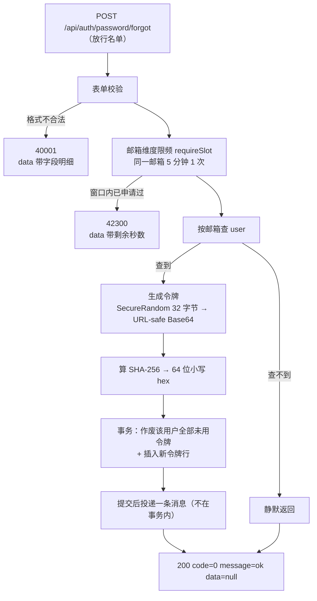
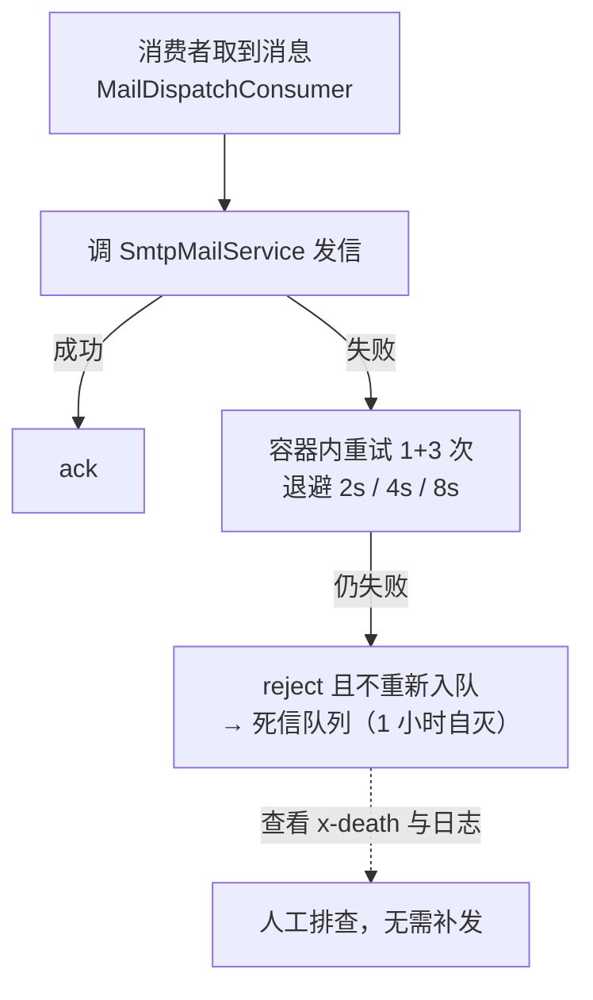
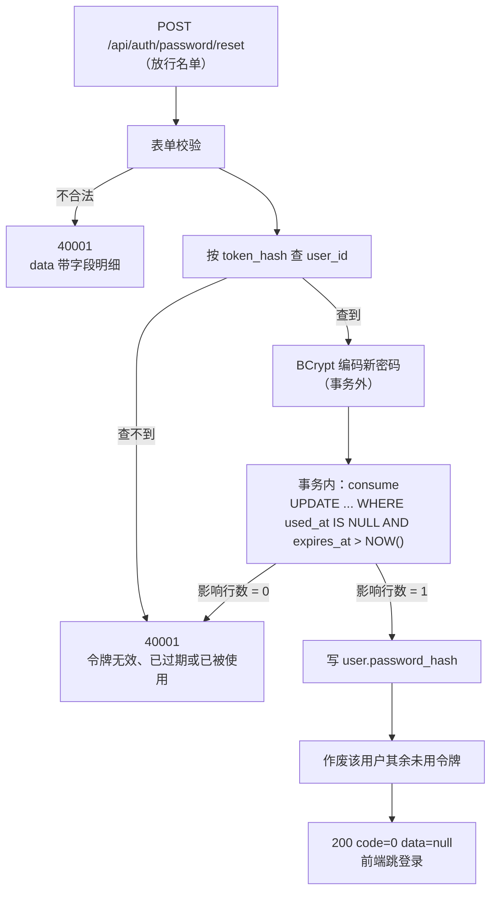

# 功能说明：密码找回

> **接口**：`POST /api/auth/password/forgot` · `POST /api/auth/password/reset` · **模块**：`auth`（主）+ `mail`（发信）+ `common`（统一响应）
> **相关设计**：《概要设计》§6.6 密码找回（D6）、§6.3 登录限频（含找回接口限频）、§3.2 表 `password_reset_token`、§5.7 统一错误码

***

## 1. 功能描述

忘记密码的用户提交注册邮箱，服务端签发一枚**一次性、30 分钟有效**的重置令牌，把 **原始令牌** 拼进链接用邮件发出去，库里只留它的 **SHA-256**。用户点开链接设置新密码，令牌在校验通过的同一条语句里被消费掉。

### 1.1 请求

```
POST /api/auth/password/forgot
Content-Type: application/json

{"email": "zhangsan@example.com"}
```
```
POST /api/auth/password/reset
Content-Type: application/json

{"token": "kQ7...（邮件链接里那串，43 字符）", "newPassword": "Passw0rd!23"}
```

### 1.2 处理流程








### 1.3 响应

```json
{
  "code": 0,
  "message": "ok",
  "data": null
}
```

**限频（HTTP 423）：**

```json
{
  "code": 42300,
  "message": "重置邮件发送过于频繁，请 5 分钟后重试",
  "data": 287
}
```

**令牌无效（HTTP 400）：**

```json
{
  "code": 40001,
  "message": "重置链接无效、已过期或已被使用（若收到多封邮件，请使用最新的一封）",
  "data": null
}
```

### 1.4 涉及文件

| 层 | 文件 |
| --- | --- |
| 接口层 | `auth/AuthController.java` · `auth/dto/ForgotPasswordRequest.java` · `auth/dto/ResetPasswordRequest.java` |
| 业务层 | `auth/PasswordResetService.java` |
| 限频 | `auth/PasswordResetRateLimiter.java` |
| 邮件内容 | `auth/PasswordResetMailContent.java`（纯函数） |
| 发信 | `mail/MailService.java` · `mail/SmtpMailService.java` · `mail/QueuedMailService.java` · `mail/MailDispatchConsumer.java` · `mail/MailDispatch.java` · `config/RabbitConfig.java` |
| 持久层 | `auth/PasswordResetTokenMapper.java` · `entity/PasswordResetToken.java` |
| 表定义 | `resources/schema.sql` 的 `password_reset_token` |

***

## 2. 核心逻辑及说明

### 2.1 一次性消费：成败由一条条件 UPDATE 的影响行数决定

`PasswordResetTokenMapper#consume`：
```java
transactionTemplate.executeWithoutResult(status -> {
    if (tokenMapper.consume(tokenHash) == 0) {
        throw invalidToken();
    }
    userMapper.update(......);
});
```

```sql
UPDATE password_reset_token
SET used_at = NOW()
WHERE token_hash = #{tokenHash}
  AND used_at IS NULL
  AND expires_at > NOW()
```

两个条件都写在 `WHERE` 里，**不是先查出来判断、再更新**。两个并发请求拿着同一个令牌同时打进来时，InnoDB 会给匹配到的那一行加行锁，只有一条能改到 1 行，另一条得到 0 行。天然抗重放，不需要任何额外的锁。
>在先查后更新的场景下，若攻击者后落库，用户这边明明收到了200，以为找回账号，但实际生效的是攻击者设的密码。


### 2.2 只存 SHA-256，不用 BCrypt

令牌是 `SecureRandom` 的 **32 字节**（256 位）随机数。这个熵让「猜」不成立，也让「拿到哈希后离线爆破」不成立——所以存哈希只需要一个快的摘要：**SHA-256**。

用 BCrypt 在这里是错的方向：它刻意慢，是给**低熵口令**抗离线爆破用的。用在这里换不到任何安全性，只会让每一次校验都多等几十毫秒——而校验发生在**尚未证明身份**的请求上。

同理，令牌生成**不复用 `JwtTokenProvider`**：那边是 HMAC 签名密钥体系，这边是一次性随机数。共用一个 `SecureRandom` 没问题，但把两者当成同一种「令牌」会让生命周期、存储方式、失效规则混在一起——它们的规则一条都不相同。

### 2.3 防枚举：响应相同；耗时在 `mode=queue` 下接近

这个接口不登录就能调。若邮箱不存在与命中时有差别，任何人都能拿它当这个邮箱在本站注册过吗的探测器。未命中分支因此**静默返回**。  

但光有响应相同还不够。命中分支若能靠耗时被认出来，枚举一样成立——而时间侧信道比响应体差异更隐蔽，掐表就行。**这就是引入消息队列的主要动机**（不是嫌 SMTP 慢）：收益不在性能上，而在一个不写出来就会被忽略的安全属性上。

| 模式 | 命中分支的额外开销 | 时间侧信道 |
| --- | --- | --- |
| `queue`（生产应为这个） | 写库 + 投一条消息 | 差距被压到毫秒级，**更难利用**——注意不是「不可利用」 |
| `smtp`（**默认**） | 同步等一次 SMTP 往返（几百毫秒） | 存在 |

默认取 `smtp` 是为了新克隆的仓库不装任何中间件就能跑测试，代价就是默认配置在这一点上是弱的。**生产必须设 `jotang.mail.mode=queue`**。启动横幅（两条 INFO）是提醒。

### 2.4 发信在事务提交之后

```java
transactionTemplate.executeWithoutResult(status -> {
            tokenMapper.invalidateAllUnused(......);
            tokenMapper.insertToken(......);
        });

sendQuietly(user.getEmail(), rawToken);
```

- **网络调用不跨事务边界**。上传（OSS 传输在事务外）和删除（不碰 OSS）都定过这条规矩。一次被挂住的 SMTP 不该让 `password_reset_token` 的行锁陪着它等。
- 作废旧令牌与插入新令牌必须在一个事务里，否则会短暂存在两个有效令牌。

代价是一个窄窗口：**令牌已入库、邮件却没发出**。

它被接受是因为用户重试一次 `/forgot` 就会作废旧令牌、发新的。但若把发信放进事务，问题会变成**邮件发出去了,令牌却回滚了**，那才是用户无论怎么做都修不好的状态。


### 2.8 不物理删除旧令牌

重新申请或改密成功后，旧令牌都是为其 `used_at` 赋值，而不是将其 `DELETE`：
- 物理删除会把“谁在什么时候申请过”和"这次重置确实发生过"这两层痕迹一并抹掉；


### 2.10 异步化的接缝开在哪里：`MailService`

`PasswordResetService` 持有的是 `MailService` 接口，**不是 `JavaMailSender`、也不是任何一个具体实现**。发信是「同步直发」还是「投一条消息」，收拢在接口的实现上：

| `jotang.mail.mode` | `MailService` 解析到 | 行为 |
| --- | --- | --- |
| `smtp`（默认） | `SmtpMailService` | 同步发，调用方等它发完 |
| `queue` | `QueuedMailService`（`@Primary`） | 投一条 `MailDispatch` 就返回 |

**这个抽象是这次改动唯一需要付出的设计成本，回报是 `PasswordResetService` 一行都没改。** 它也是验收标准：`PasswordResetServiceTest` 在异步化前后**一字未动**——它 `@MockitoBean MailService`，根本不关心背后是谁。若哪天有人为了加异步去改业务类，说明接缝开错了位置。

`SmtpMailService` **始终是 Bean**（消费者要用它去发信），所以两种模式下都只有一个实现能按接口解析出来：`smtp` 时唯一的候选就是它，`queue` 时 `@Primary` 指向 `QueuedMailService`。不依赖 Bean 名字典序这类隐性规则。


### 2.12 消费失败：重试、死信

失败处置全部由配置表达（`application.yaml`）
- **`default-requeue-rejected: false` 必须显式设**（Spring 默认 `true`）。`true` 的后果是同一条失败消息无退避地反复重投：队列深度永不下降、消费线程被它占死。
- **`max-retries: 3`**: 1 次初始 + 3 次重试，退避 2s/4s/8s，最坏占住消费者约14秒。
- **消费端幂等天然满足，所以不做去重**：重复投递（成功发完信，但ack之前出事）的后果是用户收到两封一模一样的邮件，而令牌是一次性的，两封信指向同一个令牌，点哪封都一样。

### 2.13 明文令牌现在也存在于 Broker 里

邮件正文必须含明文令牌，而正文成了消息载荷——于是那串明文在 Broker 里也有一份。这与 D6「只存 SHA-256、明文只出现在邮件链接里」有真实张力，四层缓解与各自的边界见《概要设计》§6.6.2。最要紧的一句：**唯一真正的硬边界是「5672 / 15672 不对公网开放」**，消息非持久化与两个 TTL 只是把窗口缩小到最长 70 分钟。

***

## 4. 测试过程与结果

### 4.1 运行前置

| 项 | 值 |
| --- | --- |
| JDK | 21（`java.specification.version=21`） |
| 数据库 | **本机 MySQL 8.x**，测试激活 `local` profile |
| 建表与初始数据 | 随应用启动自动执行 `schema.sql` + `data.sql`（均幂等） |
| 网络 | **不需要**。本功能的全部用例都把 `MailService` 换成了 mock |
| SMTP 凭据 | 不需要。只有 `@Tag("mail")` 的真发信用例才要（见下） |
| RabbitMQ | **默认不需要**。`jotang.mail.mode` 默认 `smtp`，队列相关的 Bean 一个都不注册；只有 `@Tag("mq")` 的用例要 Broker |

### 4.2 结果

默认套件（`oss` / `mail` / `mq` 三个标签按 pom 的 `excludedGroups` 排除）：

```
Tests run: 356, Failures: 0, Errors: 0, Skipped: 0
BUILD SUCCESS（exit code 0）
```

（2026-10-10 全量运行；其中 `PasswordReset*Test` 24 条。）**日志里零条 RabbitMQ 连接记录**——这是「默认模式完全不碰中间件」的直接证据。

真打 Broker 的那一层：

```
Tests run: 3, Failures: 0, Errors: 0, Skipped: 0
BUILD SUCCESS（exit code 0）
```

真发一封邮件（`spring.mail.*` 配好之后）：

```
Tests run: 1, Failures: 0, Errors: 0, Skipped: 0
BUILD SUCCESS（exit code 0）
```

```bash
# 本功能（不需要任何中间件）
./mvnw test -Dtest='PasswordReset*Test'

# 队列链路（需要 docker compose up -d；凭据来自 .env，见 application.yaml 的说明）
set -a; . ./.env; set +a
./mvnw test -DexcludedGroups= -Dgroups=mq

# 真发一封邮件（需要 application-local.yaml 里配好 SMTP 授权码）
./mvnw test -DexcludedGroups= -Dgroups=mail
```

### 4.3 用例明细

| 测试类 | 用例数 | 实际覆盖 |
| --- | --- | --- |
| `PasswordResetRateLimiterTest` | 5 | 首次放行；窗口内第二次 42300；被拒时 `data` 带剩余秒数且落在 (0, 300]；按邮箱隔离；**大小写与空白变体共用同一名额** |
| `PasswordResetMailContentTest` | 4 | 链接原样拼接明文令牌；**URL-safe 字母表的 `-` `_` 不被二次编码**；正文含链接与 TTL 文案；主题非空 |
| `PasswordResetServiceTest` | 8 | 令牌行的哈希等于邮件里那串明文的 SHA-256、`used_at` 为空、`expires_at` 落在 30 分钟附近；重新申请作废旧令牌（未消费行恰好剩 1）；未注册邮箱静默且不发信；重置改掉 `password_hash` 并消费令牌；同一令牌第二次 40001 且密码不再变；过期令牌 40001；未知令牌 40001；改密后其余令牌一并作废 |
| `PasswordResetControllerTest` | 7 | 未注册邮箱的响应形状（`code=0` / `message="ok"` / `data=null`）且不发信；邮箱格式不合法 40001；**未注册邮箱也会被 42300 限住**；空令牌 40001；过短新密码 40001；未知令牌 40001；走 HTTP 的完整链路（申请 → 从 mock 收到的邮件里取令牌 → 重置 → 新密码 `matches` 通过） |
| `RabbitConfigTest`（纯单测，无注解） | 5 | **队列上挂着死信交换机与死信路由键**（少了它们，「重试耗尽」就从「进死信队列」变成「丢消息」）；工作队列与死信队列各有 TTL；转换器的类型优先级是 `INFERRED`；四个拓扑名互不冲突 |
| `QueuedMailServiceTest`（纯单测，mock `RabbitTemplate`） | 3 | 投递用的是 `RabbitConfig` 里那两个常量（把拓扑名笔误钉死）；消息是**非持久化**的（明文令牌不落 Broker 磁盘）；**AMQP 异常原样外抛**（否则调用方的降级永远走不到） |
| `MailDispatchMqTest`（`@Tag("mq")`，**真打 Broker**） | 3 | 正常消息被消费并交给 SMTP；**重试耗尽后落进死信队列**（断言 `x-death` 的 `reason=rejected`，并数出 SMTP 恰好被调 4 次 = 1 次初始 + 3 次重试）；非法 JSON 的消息也进死信队列且一封都不发 |
| `SmtpMailServiceTest`（`@Tag("mail")`，**真发一封**） | 1 | SMTP 主机 / 端口 / SSL / 授权码 / 发件人这一整条链路。**已跑通**（2026-10-10）：认证与投递均成功，收件人是发件账号自己。它一次性排掉了四类配错——主机名、端口与 SSL 开关不匹配、授权码失效、发件人与认证账号不一致 |

两处刻意的设计：

- **`PasswordResetServiceTest` 里的 SHA-256 是独立重算的**，不复用生产代码那个私有方法。要验的是一条对外契约（「发出去的那串明文，哈希之后等于库里那串」），两边共用实现的话，这段逻辑被改错时会一起错、用例照样绿——而它恰恰是最需要盯住的一条。
- **每个用例用自己的邮箱**。`PasswordResetRateLimiter` 是单例 Bean、状态活在 Spring 上下文里，共用邮箱的第二个用例会先撞 42300。

### 4.4 未覆盖的部分（如实记录）

1. **「两条分支耗时相近」没有任何自动化断言。** 异步化之后它们在**设计上**做同样多的活（查一次内存 + 写库 + 投一条消息），但这一条靠的是「两边代码形状一致」，没有用例钉住，也不该有用例——计时断言本身极不稳定，跑在 CI 上只会变成随机红。**这是个只靠 code review 与人工推理维持的性质。**
2. **窗口翻篇（5 分钟后恢复）无用例。** 限频器没有可注入的时钟，与 `AiRateLimiterTest` 的处理一致——那里也明说不假装验证窗口翻篇。翻篇行为由 `Window#isExpired` 的形状决定。
3. **「提交后投递」的时序在测试里观察不到。** 测试类是 `@Transactional`，`PasswordResetService` 的 `TransactionTemplate` 会**加入**测试那层事务，所以 `mailService.send(...)` 被调用时外层事务还没提交。若哪天有人把发信/投递挪进事务内，本套用例**照样全绿**——而这正是《概要设计》§6.6.1 花了一节论证不该做的事。
4. **真发一封邮件只验了「本机这一份配置」。** `SmtpMailServiceTest` 已跑通（2026-10-10），排掉了主机名、端口与 SSL 开关不匹配、授权码失效、发件人与认证账号不一致这四类错误。但**它验的是 `application-local.yaml` 里那一份值**——生产由环境变量注入的是**另一份**（不同的主机、账号、授权码），那一份至今没有任何东西验证过。这个用例真正的价值是给出了「怎么验」的方法，而不是「验过了」。
5. **`mode=queue` 下「业务 → 投递 → 消费 → 发信」的端到端没有单条用例。** 两半各自被覆盖了：`PasswordResetServiceTest` 用 mock 验业务侧确实调了 `MailService`，`MailDispatchMqTest` 验队列侧确实消费并发信；中间的接缝是一行 `convertAndSend`。把它串起来的用例要求同时有真库、真 Broker 与 mock 的 SMTP，代价大于收益。
6. **Broker 不可达时的降级没有用例。** `QueuedMailService` 抛异常、`PasswordResetService#sendQuietly` 咽掉并记日志——这条路径靠代码阅读保证（`QueuedMailServiceTest` 只验到「异常确实抛出来了」这一半），没有一条用例真的把 Broker 停掉再调 `/forgot`。
7. **并发下「同一令牌只消费一次」没有并发用例**，依赖的是 `WHERE used_at IS NULL` 那条条件 UPDATE 与 InnoDB 行锁的语义。
8. **改密之后旧 JWT 仍然有效**，直到它自己的 2 小时 TTL 到期（§8.4 第 1 条、决策 D1）。这是「不维护服务端失效名单」的直接后果，与本功能无关但用户会撞上：**改完密码，之前登录的会话没有掉线**。
