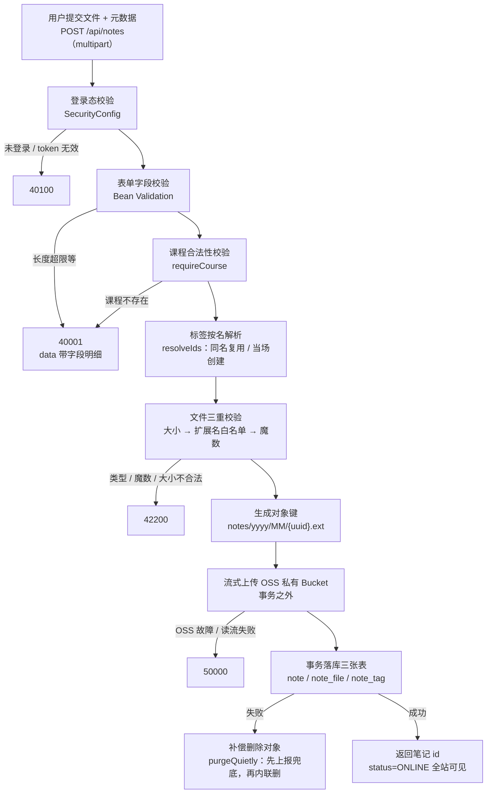
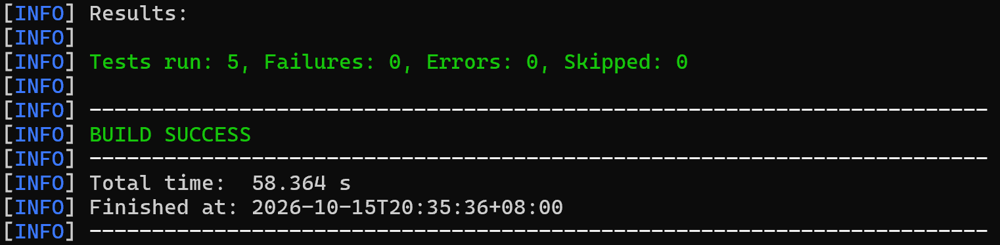
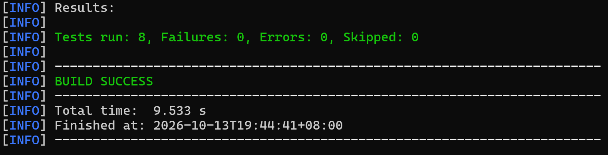

# 功能说明：笔记上传

> **接口**：`POST /api/notes` · **模块**：`note`（主）+ `storage` + `catalog`(标签)  
> **相关设计**：《概要设计》§6.1 上传流程、§5.4 接口、§3.2 表结构、§8.3 安全

---

## 1. 功能描述

已登录的用户提交一份文件与元数据（标题、简介、教师、课程、标签），服务端先做三重校验，再把文件**流式**写入 OSS 私有 Bucket，最后在一个事务里落 `note` / `note_file` / `note_tag` 三张表。提交即上架（`status=ONLINE`），全站立即可见。

### 1.1 请求

```
POST /api/notes
Authorization: Bearer <jwt>
Content-Type: multipart/form-data

title=期中复习提纲
summary=覆盖前三章
teacher=张老师
courseId=3
tags=高数
tags=期末
file=@笔记.png
```

### 1.2 处理流程



### 1.3 响应

成功（HTTP 200）：

```json
{ "code": 0, "message": "ok", "data": { "id": 123 } }
```

>只返回新笔记的 id，前端据此跳详情页。  

### 1.4 涉及文件

| 层 | 文件 |
|---|---|
| 接口层 | `note/NoteController.java` · `note/dto/NoteUploadRequest.java` · `note/dto/NoteCreatedResponse.java` |
| 业务层 | `note/NoteService.java` |
| 准入策略 | `note/NoteFilePolicy.java` · `note/FileDecision.java` |
| 存储抽象 | `storage/StorageService.java` · `storage/OssStorageService.java` · `storage/Bucket.java` · `storage/StoredObject.java` |
| 上游依赖 | `catalog/TagService.java`（标签按名解析）· `catalog/CourseService.java`（课程校验） |
| 持久层 | `note/NoteMapper.java` · `note/NoteFileMapper.java` · `note/NoteTagMapper.java` |
| 孤儿兜底通道 | `storage/OrphanObject.java` · `storage/OrphanObjectPublisher.java` · `storage/NoOpOrphanObjectPublisher.java` · `storage/QueuedOrphanObjectPublisher.java` · `storage/OrphanObjectConsumer.java` · `storage/OrphanObjectDlqMonitor.java` · `config/RabbitConfig.java` |

---

## 2. 核心逻辑及说明

### 2.1 upload 方法
```java
public NoteCreatedResponse upload(Long uploaderId, NoteUploadRequest request) {
        MultipartFile file = request.getFile();
        // 校验课程和标签合法性
        requireCourse(request.getCourseId());
        List<Long> tagIds = tagService.resolveIds(request.getTags());

        // 校验文件合法性
        FileDecision decision = inspect(file, uploaderId);
        // 上传到 OSS
        StoredObject stored = store(file, decision, uploaderId);

        // 事务落库三张表
        try {
            NoteCreatedResponse created = transactionTemplate.execute(
                    status -> insertNote(uploaderId, request, decision, stored, tagIds)
            );
            // 新 id 可能已经被负缓存占住了
            evictMeta(created.id());
            return created;
        } catch (RuntimeException e) {
            // 补偿删除对象
            purgeQuietly(stored.key());
            throw e;
        }
    }
```

1. **OSS 上传放在事务之外** —— 上传的文件可能比较大。把这样的网络传输圈进数据库事务，会让一个数据库连接被占住整个上传时长，连接池很快就被拖垮。所以事务边界只包住写三张表这一步，用 `TransactionTemplate` 显式控制。
2. **为什么不先落库再上传文件？** 落库 和 上传OSS 这个顺序无论怎么排，两步之间总会出现一个“完成一半”的窗口，根本原因是**数据库和OSS没有共同的事务**（这个问题在删除笔记时还会出现）。
- 先落库，再传OSS：如果传OSS失败，就会出现库里有引用，但无真对象，这个后果是**用户可见**的；
- 先传OSS，再落库：如果落库失败，只会出现有对象，但库里无引用，这个后果是**用户不可见**的。
（这个后果最后由补偿删除兜住）


### 2.2 `Content-Type` 由服务端按扩展名查白名单表判定

multipart 请求里浏览器会带一个 Content-Type 头，指定文件的类型。但客户端的请求是可篡改的 ；而阿里云OSS自 2025-01-20 起禁止签名URL覆盖`response-content-type` ，意味着上传时写入对象元数据的值就是预览时浏览器拿到的最终值 ，读取侧无从纠正，放进来一个声称自己是图片的html，它就会在 OSS 域名下被内联渲染（预览型 XSS）；所以类型必须由服务端唯一裁决。

类型由扩展名查表确定：
```java
String extension = extensionOf(safeName);
Format format = FORMATS.get(extension);
if (format == null) {
    throw new BusinessException(ErrorCode.FILE_INVALID, "不支持的文件类型：." + extension);
}
```
查表通过后再靠魔数做一致性校验。

### 2.3 md/txt没有魔数，降级为UTF-8全量校验

md/txt没有可验的文件头，所以走另一条路：整份内容必须是可解码的UTF-8，且不含NUL字节（NUL是合法的UTF-8）。

这一步的目的**不是防 XSS**——`/raw` 代理接口固定返回 `text/plain` 并带 `nosniff`，本就不给浏览器解析的机会。它的目的是把「二进制文件改个 .txt 后缀」挡在门外，免得代理接口去流式转发一堆乱码。


### 2.4 存储抽象

`StorageService` 只提供“存 / 读 / 签 / 删”四件原语，**不含任何业务策略**。  
这样切分之后，`NoteServiceTest` 可以直接把 `StorageService` 换成 mock，而不碰 OSS SDK、也不需要网络，方便测试。（同时也为后续替换为其他存储服务做准备）

### 2.5 补偿删除：投一条 MQ 消息

定时对账救不了。入库失败、`note` 与 `note_file` 里都没有行。`OrphanObjectSweeper`扫不到它。

**改头像那条补偿路径是同一个缺陷**（`UserService#purgeQuietly`：用户行上的 `avatar` 还指着旧键，新对象没有库行），所以共用一个发布口、一条队列、一个消费者。这也是载荷要带 `bucket` 的原因——消费者只照载荷里的桶去删，自己不做任何假设。

失败的几条去路：

1. **投递时 Broker 不可达**：`convertAndSend` 抛异常。此时删除请求早已提交、不可能反过来报错，只能吞掉记日志——**退化成今天的样子**。这是本轮不消掉的残余风险；要彻底堵住得把「删不掉的 key」也落库（tombstone 表），那是另一次改动。
2. **消费重试耗尽 → 死信队列**：对象留在桶里，等人工按队列里的记录去删。不再自动重试，所以不会自愈。（死信队列当前没有监控，所以配套的是一个最低限度的东西：`OrphanObjectDlqMonitor` 每 30 分钟看一眼深度，**非 0 才打 WARN**）

---

## 3. 测试过程与结果

### 3.1 运行前置

| 项 | 值 |
|---|---|
| JDK | 21（`java.specification.version=21`） |
| 数据库 | **本机 MySQL 8.x**，测试激活 `local` profile，连 `application-local.yaml` 的库 |
| 建表与初始数据 | 随应用启动自动执行 `schema.sql` + `data.sql`（均幂等） |
| 网络 | **不需要**——存储层全程 mock |

### 3.2 用例覆盖层次

| 测试类 | 用例数 | 覆盖层次 |
|---|---|---|
| `NoteFilePolicyTest` | 26 | 准入判定与对象键（纯单元测试，无 Spring 上下文） |
| `NoteServiceTest`（上传相关） | 10 | 上传编排、落库对账与补偿删除（含上报其中一步，mock 掉存储层） |
| `NoteControllerTest`（上传相关） | 5 | HTTP 层：鉴权、字段校验、错误码（起真库，mock 存储层） |
| `NoteMultipartConfigTest` | 1 | multipart 配置 |
| `RabbitConfigTest`（整类 8 条，其中 3 条是这一节的） | 8 | 拓扑常量与队列参数——尤其「孤儿对象队列**没有** TTL 与长度上限」那两条（纯单元测试） |
| `QueuedOrphanObjectPublisherTest` | 3 | 发到哪条 exchange/路由键、持久化模式、异常外抛（mock `RabbitTemplate`） |
| `OrphanObjectConsumerTest` | 3 | 按载荷里的桶去删、删除失败原样外抛（mock 存储层） |
| `OrphanObjectDlqMonitorTest` | 2 | 看的是哪条队列、查询失败不把调度器打挂（mock `AmqpAdmin`） |
| `OrphanObjectMqTest`（`@Tag("mq")`） | 2 | **真 Broker**：消费闭环、重试耗尽落死信队列 |

> `view_count` 的并发自增由 `NoteViewCountConcurrencyTest` 覆盖（32 线程并发自增，计数必须正好 +32）。它打的是详情页的读路径，不属于上传链路，故未列入上表。
>
> 头像那侧的同一个通道由 `UserAvatarCompensationTest`（2 条）覆盖——它验的是「报的是 `AVATAR` 桶」，属于头像流程，故未列入上表。

### 3.3 运行命令与结果

```bash
mvnw test -Dtest=NoteFilePolicyTest,NoteServiceTest,NoteControllerTest,NoteMultipartConfigTest,\RabbitConfigTest,QueuedOrphanObjectPublisherTest,OrphanObjectConsumerTest,OrphanObjectDlqMonitorTest
```


队列链路的真 Broker 那层单独跑（需要 `docker compose up -d`）：

```bash
mvnw test -DexcludedGroups= "-Dtest=OrphanObjectMqTest"
```


 **真实 OSS 端到端不在默认套件内。** 相关测试类带 `@Tag("oss")`，pom 里通过 `excludedGroups=oss` **默认排除**。它依赖网络与有效 AccessKey，离线或 CI 上必然失败。需要单独跑：

   ```bash
   mvnw test -DexcludedGroups= -Dgroups=oss
   ```

   这条命令跑的是整个 `oss` 组，共8条：
   - `OrphanObjectSweeperOssTest` ：2 条，对象真的从桶里消失、在线笔记的对象一个都不被碰。（走的是《笔记删除》的对账链路）
   - `OssStorageServiceTest`：6 条，含上传—签名—删除闭环。

测试结果：

