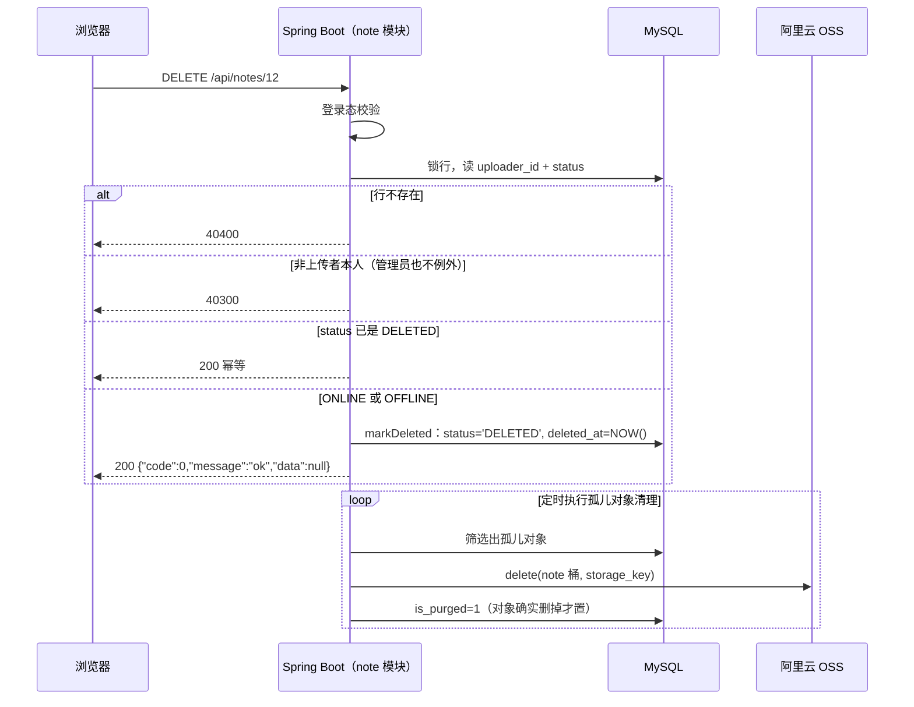

# 功能说明：笔记删除

> **接口**：`DELETE /api/notes/{id}` · **模块**：`note`（主）+ `storage`（对象回收，走定时路径）+ `favorite`（占位联动）
> **相关设计**：《概要设计》§5.4 删除接口、§4.1 状态机、§3.3 OSS 物理清理、§6.5 收藏与占位、§7.3 孤儿对象对账、§8.4 已知限制第 11 条

---

## 1. 功能描述

上传者本人把自己的笔记**软删除**：`note.status` 置 `DELETED`、写下 `deleted_at`。不碰 OSS（对象由定时对账在一个对账周期内回收）、**不碰收藏关系**（收藏列表保留"已删除"占位）。`DELETED` 是终态、不可恢复。

### 1.1 请求

```
DELETE /api/notes/12
Authorization: Bearer <jwt>
```

### 1.2 处理流程



两点说明：

1. **「锁行 → 判归属 → 写状态」三步同事务**（§2.2），`FOR UPDATE` 保证提交前状态不会被别人改掉。事务里只有几次读 + 一次写、没有任何 I/O。
2. **下半段是异步的定时对账**，不在请求链路上。删除请求返回时对象还在桶里，最长滞留「一个对账周期 + 积压」（§8.4）。

### 1.3 响应

成功（HTTP 200）

```json
{ "code": 0, "message": "ok", "data": null }
```


| code | 场景 |
|---|---|
| 40100 | 未登录 / token 无效 |
| 40400 | 笔记不存在 |
| 40300 | 非上传者本人（**管理员也不行**） |


### 1.4 涉及文件

| 层 | 文件 |
|---|---|
| 接口层 | `note/NoteController.java`（`delete`） |
| 业务层 | `note/NoteService.java`（`delete` · `sweepOrphanObjects` · `purgeObjectThenMark`） |
| 状态机 | `note/NoteStateMachine.java`（管理员的下架 / 恢复，本流程不经过） |
| 定时对账 | `note/OrphanObjectSweeper.java` · `config/SchedulingConfig.java`（`@EnableScheduling`） |
| 持久层 | `note/NoteMapper.java`（`selectOwnershipForUpdate` · `markDeleted` · `selectPendingPurge`）· `mapper/NoteMapper.xml` |
| 上游依赖 | `storage/StorageService.java#delete` · `note/NoteStatus.java` · `note/NoteOwnershipRow.java` · `note/PendingPurgeRow.java` |
| 错误码 | `common/ErrorCode.java`（`40300` / `40400`） |
| 配置 | `application.yaml` 的 `jotang.purge.*` |

---

## 2. 核心逻辑及说明

### 2.1 锁行，读数据

**锁行 → 判存在、归属、状态 → 写状态**不是三个独立动作，是**一次决策**。  
第三步写下的值的合法性，来自第一步读到的值。事务 + `FOR UPDATE` 消除的正是这两者之间的时间差。

如果不加排他锁，可能出现以下问题：
```
上传者：删除                          管理员：下架
SELECT status → ONLINE
                                    SELECT status → ONLINE
UPDATE status='DELETED'，提交
                                    UPDATE status='OFFLINE'，提交
```

`DELETED` 这个终态被**复活**。

**代价：锁持到提交，所以事务里不能有 I/O。** X 锁一直持到 commit，期间同一行的浏览量自增、收藏、编辑都在排队。这也是 §2.1 那次改口真正的理由：按上传场景配的 OSS 客户端有 60s socket 超时，真挂在事务里，一次卡住的删除能把这行的浏览和收藏锁住一分钟。


### 2.2 OFFLINE 可删、DELETED 是终态

- **`OFFLINE→DELETED` 是状态图里的合法边**：管理员下架过的笔记，上传者仍然有权把它删掉。
- **本流程不问状态机**：`from == DELETED` 在 `delete` 里已经先收掉， `requireTransition` 当前永远不会抛。代码中注释保留了这一行，是为了应对后续笔记状态枚举可能的增加。
- **`DELETED` 是终态，不能恢复**

### 2.3 孤儿对象对账：先删对象、后置标记

删除不碰 OSS，所以对象回收全靠 `OrphanObjectSweeper` 定时补做：`is_purged = 0` 就是待办清单。

```java
public int sweepOrphanObjects(int limit) {
    List<PendingPurgeRow> pending = noteMapper.selectPendingPurge(NoteStatus.DELETED.name(), limit);
    int purged = 0;
    for (PendingPurgeRow row : pending) {
        if (purgeObjectThenMark(row.getNoteId(), row.getStorageKey())) {
            purged++;
        }
    }
    return purged;
}
```

- **先删对象、后置标记**。先置 1 再删，一旦删除失败这一行就谎称"已清理"；先删后标最坏只是"对象删了、标记没写上"，重跑一次即可（`StorageService#delete` 对不存在的对象是 no-op，所以重跑安全）
- **单条失败只记日志、不往外抛**，`is_purged` 留 0 等下一轮。
- **不需要开事务**：可能会发生：从OSS删了，但是没有标记`is_purged`。但是同上，再跑一遍就行了，no-op，重跑安全。

---

## 3. 测试过程与结果

### 3.1 运行前置

| 项 | 值 |
|---|---|
| JDK | 21（`java.specification.version=21`） |
| 数据库 | **本机 MySQL 8.0**，测试激活 `local` profile，连 `application-local.yaml` 的库 |
| 建表与初始数据 | 随应用启动自动执行 `schema.sql` + `data.sql`（均幂等） |
| 网络 | **不需要**——存储层全程 mock，真打 OSS 的用例（`@Tag("oss")`）被 pom 默认排除 |

### 3.2 用例覆盖层次


### 3.3 运行命令与结果


