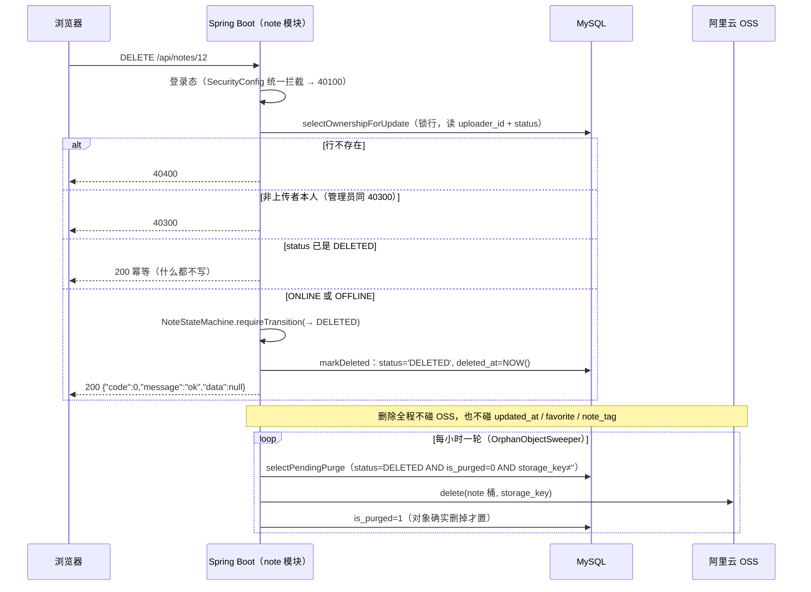

# 功能说明：笔记删除

> **接口**：`DELETE /api/notes/{id}` · **模块**：`note`（主）+ `storage`（对象回收，走定时路径）+ `favorite`（占位联动）
> **相关设计**：《概要设计》§5.4 删除接口、§4.1 状态机、§3.3 OSS 物理清理、§6.5 收藏与占位、§7.3 孤儿对象对账、§8.4 已知限制第 11 条

---

## 1. 功能描述

上传者本人把自己的笔记**软删除**：`note.status` 置 `DELETED`、写下 `deleted_at`。不碰 OSS（对象由定时对账在一个对账周期内回收）、**不碰收藏关系**（收藏列表保留"已删除"占位）。`DELETED` 是终态、不可恢复。

### 1.1 请求

```
DELETE /api/notes/12
Authorization: Bearer <jwt>
```
**删除者取自 JWT**，否则可以删别人的笔记。管理员也不例外（管理员可以下架、恢复）

### 1.2 处理流程



两点说明：

1. **「锁行 → 判归属 → 写状态」三步同事务**，`FOR UPDATE` 保证提交前状态不会被别人改掉。事务里只有几次读 + 一次写、没有任何 I/O。
2. **下半段是异步的定时对账**，不在请求链路上。删除请求返回时对象还在桶里，最长滞留「一个对账周期 + 积压」（§8.4）。

### 1.3 响应

成功（HTTP 200）——**无数据的成功**，同退出登录：

```json
{ "code": 0, "message": "ok", "data": null }
```

失败错误码见《概要设计》§5.7：

| code | 场景 |
|---|---|
| 40100 | 未登录 / token 无效 |
| 40400 | 笔记不存在 |
| 40300 | 非上传者本人（**管理员也不行**） |

> **本接口不返回 40301**。那个码管的是预览 / 下载 / 收藏 / 编辑；删除对 `OFFLINE` 放行（§4.1 的图里有 `OFFLINE→DELETED` 这条边），对 `DELETED` 是幂等 200，两种情形都够不着它。


### 1.4 涉及文件

| 层 | 文件 |
|---|---|
| 接口层 | `note/NoteController.java`（`delete`） |
| 业务层 | `note/NoteService.java`（`delete` · `softDelete` · `sweepOrphanObjects` · `purgeObjectThenMark`） |
| 状态机 | `note/NoteStateMachine.java` |
| 定时对账 | `note/OrphanObjectSweeper.java` · `config/SchedulingConfig.java`（`@EnableScheduling`） |
| 持久层 | `note/NoteMapper.java`（`selectOwnershipForUpdate` · `markDeleted` · `selectPendingPurge`）· `mapper/NoteMapper.xml` |
| 上游依赖 | `storage/StorageService.java#delete` · `note/NoteStatus.java` · `note/NoteOwnershipRow.java` · `note/PendingPurgeRow.java` |
| 错误码 | `common/ErrorCode.java`（`40300` / `40400`） |
| 配置 | `application.yaml` 的 `jotang.purge.*`（§7.1） |

---

## 2. 核心逻辑及说明

### 2.1 删除不碰OSS，只改 status 与 deleted_at

```java
@Transactional
public void delete(Long noteId, Long uploaderId) {
    softDelete(noteId, uploaderId);   // 只改状态，不调存储层
}
```
这一条经历过两次改口：原方案写"异步清理"，第二次改成"提交后同步做"，第三次才看清那次同步调用并不划算：  
它挂在请求链路上，用的是按上传场景配的 OSS 客户端：socket 超时60s、刻意不设 `requestTimeout`，为的是不误杀慢网络下的大文件上传。所以一次被挂住的调用能让一个本该瞬间返回的 DELETE 陪它等到 60 秒，SDK 重试还会叠加。（而对象清没清掉，其实对用户看到的结果毫无影响：`status=DELETED` 之后不再签发任何 URL，已签发的按 TTL 失效。）

```java
@Update("UPDATE note SET status = #{status}, deleted_at = NOW() WHERE id = #{id}")
int markDeleted(@Param("id") Long id, @Param("status") String status);
```
- **不碰 `favorite_count` 与 `favorite` 行**——§6.5 要求删除后收藏关系仍在（收藏列表渲染占位）。顺手减一的写法看起来合理（笔记没了收藏自然没了），但那会让收藏数比 `favorite` 表的实际行数少，而那张表的行还在。
- **不碰 `note_tag`**——标签关联是「用户当时打的标」，不是可回收的东西；`tag` 表只增不删（§3.2）。
- **`note` 行永不物理删除**——外键不悬空，收藏列表读得到 `status=DELETED` 来渲染占位，无需在 `favorite` 里存标题快照（D4）。


### 2.3 幂等 200 与「先存在、后归属」的顺序

```java
private void softDelete(Long noteId, Long uploaderId) {
    NoteOwnershipRow row = noteMapper.selectOwnershipForUpdate(noteId);
    if (row == null) {
        throw new BusinessException(ErrorCode.NOT_FOUND);          // 先判存在
    }
    if (!Objects.equals(row.getUploaderId(), uploaderId)) {
        throw new BusinessException(ErrorCode.FORBIDDEN);          // 再判归属
    }
    NoteStatus from = NoteStatus.valueOf(row.getStatus());
    if (from == NoteStatus.DELETED) {
        return;                                                     // 幂等：什么都不写
    }
    stateMachine.requireTransition(from, NoteStatus.DELETED);
    noteMapper.markDeleted(noteId, NoteStatus.DELETED.name());
}
```

- **幂等 200 是 DELETE 的本义**：前端连点两次不该有一次报错，与取消收藏同口径。幂等那一次**真的什么都不做**——不写库、不碰 `updated_at`、不再触发清理（回收按 `is_purged=0` 扫，与删过几次无关）。只有笔记不存在才是 40400。
- **存在性先于归属**：id 不存在报 40400 而不是 40300。这不泄露新信息——详情接口对任何存在的笔记都返回 200，存在性本来就是登录用户可探测的（反过来报 40300 才会让人分不清「不存在」和「不是我的」）。
- **归属校验是全项目第一处 40300**，且**不看 `role`**：管理员删别人的笔记走的是同一条 40300。他该用下架 / 恢复（§5.6）——那是可逆的，删除是不可逆的，两种权力不该混在一个接口里。

### 2.4 OFFLINE 可删、DELETED 是终态

- **`OFFLINE→DELETED` 是状态图里的合法边**：管理员下架过的笔记，上传者仍然有权把它删掉。这也是本流程绝不返回 40301 的原因。
- **状态机是安全网，不是判门**：不存在 / 已删除 / 幂等三种情形都在 `softDelete` 里先收掉了，走到 `requireTransition` 的必然是一次真实的 `ONLINE|OFFLINE → DELETED` 迁移。它再抛 `IllegalStateException` 就一定是代码缺陷（§5.6 管理员那组对三种边界有同样的收口纪律）。
- **`DELETED` 是终态，不能恢复**——与管理员下架正相反：下架只改 `status`、对象必须留着（恢复之后还要打开）；删除把对象也回收了，恢复它需要把对象变回来，而那是不可逆的（§5.6 明写"不能复活已删除的笔记"）。
- **迁移表一次写全四条边**（删除用两条、管理员用另两条），`DELETED` 的出边是**空集而不是省掉这一项**——「终态没有出边」与「这张表漏配了 DELETED」必须是两件看起来不一样的事。

### 2.5 孤儿对象对账：先删对象、后置标记

删除不碰 OSS，所以对象回收全靠 `OrphanObjectSweeper` 定时补做：`is_purged = 0` 就是待办清单。

```java
public int sweepOrphanObjects(int limit) {
    List<PendingPurgeRow> pending = noteMapper.selectPendingPurge(NoteStatus.DELETED.name(), limit);
    int purged = 0;
    for (PendingPurgeRow row : pending) {
        if (purgeObjectThenMark(row.getNoteId(), row.getStorageKey())) {
            purged++;
        }
    }
    return purged;
}
```

- **先删对象、后置标记**。先置 1 再删，一旦删除失败这一行就谎称"已清理"；先删后标最坏只是"对象删了、标记没写上"，重跑一次即可（`StorageService#delete` 对不存在的对象是 no-op，所以重跑安全）
- **单条失败只记日志、不往外抛**，`is_purged` 留 0 等下一轮。
- **不开事务**：每清理一条就是一次 OSS 网络调用，圈进事务只会让连接被网络等待占住；单条失败也因此不影响其余各行。一轮做 `limit` 条（默认 100），没做完的下一轮自然接上——判据在库里，不需要游标或分页状态。
- **用 `fixedDelay` 而非 `fixedRate`**（默认每小时一轮、首轮延迟 1 小时）：对账耗时取决于积压里要打多少次 OSS，后者会让慢的轮次排队、延迟越积越多。初始延迟留长还有个附带作用：测试上下文里的调度器整个用例期间都不会触发。
- **它是唯一的回收路径**（单点，§8.4 第 11 条）：`jotang.purge.enabled` 关掉或调度器失效，删除**不会变慢也不会报错**，只是被删对象永久留在桶里，且没有任何迹象。将来引入 MQ 做快路径时本类应当保留——MQ 解决"快"，它解决"漏了能发现"。

---

## 4. 测试过程与结果

### 4.1 运行前置

| 项 | 值 |
|---|---|
| JDK | 21（`java.specification.version=21`） |
| 数据库 | **本机 MySQL 8.x**，测试激活 `local` profile，连 `application-local.yaml` 的库 |
| 建表与初始数据 | 随应用启动自动执行 `schema.sql` + `data.sql`（均幂等） |
| 网络 | **不需要**——存储层全程 mock，真打 OSS 的用例（`@Tag("oss")`）被 pom 默认排除（见 §4.4） |

### 4.2 结果

```
Tests run: 324, Failures: 0, Errors: 0, Skipped: 0
```

**与本功能直接相关的 28 条，全部通过**：

| 测试类 | 用例数 | 覆盖层次 |
|---|---|---|
| `NoteDeleteServiceTest` | 12 | 删除语义：状态、列清单、幂等、归属（起真库，mock 存储层） |
| `OrphanObjectSweeperTest` | 8 | 对账候选集选取与 `is_purged` 标记（起真库，mock 存储层） |
| `NoteStateMachineTest` | 3 | 状态迁移表（纯单元，无 Spring 上下文） |
| `NoteControllerTest`（删除相关） | 5 | HTTP 层：鉴权、错误码映射、幂等 |

### 4.3 用例明细

**A. 删除语义（`NoteDeleteServiceTest`，12 条）**

| 分组 | 用例 |
|---|---|
| 正常路径 | `deletingMarksTheNoteDeletedAndLeavesTheObjectToTheSweeper` · `anOfflineNoteCanStillBeDeletedByItsUploader` · `deletingTwiceIsIdempotent` |
| 与 OSS 解耦 | `deletingSucceedsEvenWhenTheStorageLayerIsBroken` · `deletingSucceedsWhenTheFileRowIsMissing` |
| 不该被碰的列 | `deletingDoesNotTouchUpdatedAt` · `deletingKeepsTheFavoriteRelationshipAndItsCount` · `aDeletedNoteShowsUpAsAPlaceholderInTheFavoritesList` · `deletingKeepsTheTagRows` |
| 归属与存在性 | `deletingSomebodyElsesNoteIsForbidden` · `deletingIsNotAllowedForAnAdminEither` · `deletingAnUnknownNoteIsNotFound` |

几条值得单独说的：

- `deletingDoesNotTouchUpdatedAt` 用的是**哨兵写法**：先把 `updated_at` 设成 2020 年再操作。它是秒精度的 `DATETIME`，「操作一次比较前后」在同秒内根本发现不了问题；这样若哪天有人给这一列加回 `ON UPDATE CURRENT_TIMESTAMP` 或顺手写个 `NOW()`，断言随即失败。
- `aDeletedNoteShowsUpAsAPlaceholderInTheFavoritesList` 把「删除」与「我的收藏」第一次真正接上——此前 `FavoriteListServiceTest` 只能靠直接改库制造 `DELETED`。
- `deletingIsNotAllowedForAnAdminEither` 把「管理员与陌生人走同一条 40300」钉死：本接口不看 `role`。

**B. 对账（`OrphanObjectSweeperTest`，8 条）**

`sweepsWhatTheDeletePathLeavesBehind` · `theScheduledEntryPointDelegatesToTheSameSweep` · `onlineNotesAreNeverSwept` · `offlineNotesAreNeverSwept` · `skipsNotesThatWereAlreadyPurged` · `aRowWithABlankStorageKeyIsNotSwept` · `oneRoundStopsAtTheBatchLimitAndTheNextRoundPicksUpTheRest` · `aFailedOssDeleteLeavesTheMarkUnsetForTheNextRound`

重点全在**「它不该碰什么」**：`onlineNotesAreNeverSwept` / `offlineNotesAreNeverSwept` 冲着 §2.5 那条最重要的候选集条件去写——少了 `status = DELETED`，对账会变成把站上所有文件删光，而这个错误不报异常、不留日志。`aFailedOssDeleteLeavesTheMarkUnsetForTheNextRound` 则钉住「先删后标」：失败时 `is_purged` 必须停在 0，否则下一轮再也救不回来。

**C. 状态机（`NoteStateMachineTest`，3 条）**

`theFourDocumentedEdgesAreAllowed` · `deletedIsTerminal` · `stayingInPlaceIsNotATransition`

删除只用四条边里的两条，但迁移表一次写全——管理员切片直接复用，不必再定一次形状。

**D. HTTP 层（`NoteControllerTest`，删除相关 5 条）**

`deleteRequiresLogin` · `deleteReturnsNoDataAndTheNoteStaysReadableAsDeleted` · `deletingTwiceIsStillOk` · `deleteRejectsSomebodyElseWithForbidden` · `deletingAnUnknownNoteIsNotFound`

第二条顺带验了联动口径：删完之后**详情页照常 200**，`status=DELETED`、`file=null`、标题照常返回——详情要把状态带出去让前端渲染提示，不是「禁止访问」。

### 4.4 未覆盖的部分（如实记录）

1. **真实 OSS 删除不在默认套件内。** `OrphanObjectSweeperOssTest`（2 条：对象真的从桶里消失、在线笔记的对象一个都不被碰）带 `@Tag("oss")`，pom 里通过 `excludedGroups=oss` **默认排除**，理由是它依赖网络与有效 AccessKey。需要单独跑：

   ```bash
   ./mvnw test -DexcludedGroups= -Dgroups=oss
   ```

   「桶里的东西真的没了」这半边是 mock 永远验不到的，而这条链路断了不报错、只表现为存储慢慢涨。
2. **定时调度本身没有测试。** 验过 `sweep()` 只是转发到 `sweepOrphanObjects`，但 `fixedDelay` 节奏、`initial-delay`、`jotang.purge.enabled` 开关没有被执行过——初始延迟 1 小时恰好让测试上下文里的调度器整个用例期间都不触发，这是刻意的，也意味着调度这条腿只有代码层面的推理。
3. **并发没有测试。** 两个人同时删同一篇、删除与浏览量自增并发，`FOR UPDATE` 的锁行为（包括「X 锁持到提交、期间自增会等」）没有并发用例兜底。
4. **回收延迟无从端到端验证。** 「对象最长滞留一个对账周期 + 积压」是纸面账（§8.4 第 11 条），真实滞留取决于生产积压；`oneRoundStopsAtTheBatchLimit…` 只验了分批机制本身。
5. **前端不在本仓库。** 删除按钮的可见性（仅本人可见）、二次确认、删除后的跳转与列表刷新属于前端实现，本文档只约定后端契约——后端以 40300 / 40400 兜底，前端控可见性、后端控可行性。
