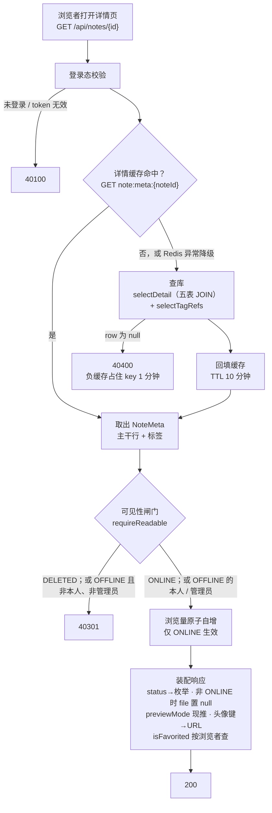

# 功能说明：笔记详情查询

> **接口**：`GET /api/notes/{id}` · **模块**：`note`（主）+ `favorite`（收藏态）+ `catalog`(课程/标签) + `config`(Redis 缓存)\
> **相关设计**：《概要设计》§5.4 详情接口、§4.1 状态可见性、§6.5 收藏与占位、§6.2 预览判定、§6.7 头像链路、§3.3 计数；《技术选型》§5（V2 缓存条目）

***

## 1. 功能描述

已登录的用户打开任意一篇笔记的详情页。服务端取回主干 + 标签，这一步走 **Redis读缓存**（TTL 10 分钟）：`ONLINE` 放行全体登录用户；`OFFLINE` 只放行上传者本人与管理员；`DELETED` 对谁都不放。ONLINE笔记浏览量自增。

### 1.1 请求

```
GET /api/notes/12
Authorization: Bearer <jwt>
```

### 1.2 处理流程



### 1.3 响应

成功（HTTP 200）：

```json
{
  "code": 0,
  "message": "ok",
  "data": {
    "id": 12,
    "title": "第一章 绪论",
    "summary": "简介",
    "teacher": "张老师",
    "status": "ONLINE",
    "course": { "id": 3, "name": "离散数学" },
    "uploader": {
      "id": 7,
      "nickname": "小明",
      "avatarUrl": "https://jotang-avatar.oss-cn-chengdu.aliyuncs.com/avatars/7/abc.png",
      "collegeName": "计算机学院"
    },
    "tags": [
      { "id": 3, "name": "复习" },
      { "id": 8, "name": "期末" }
    ],
    "viewCount": 43,
    "downloadCount": 3,
    "favoriteCount": 5,
    "createdAt": "2026-10-01T10:00:00",
    "updatedAt": "2026-10-02T09:30:00",
    "file": {
      "originalName": "课件.png",
      "size": 1048576,
      "contentType": "image/png",
      "previewMode": "IMAGE_INLINE"
    },
    "isFavorited": true
  }
}
```

失败：

| code | HTTP | 场景 |
|---|---|---|
| 40100 | 401 | 未登录 / token 无效或过期 |
| 40400 | 404 | id 不存在（**先于闸门判定**，故不存在的 id 恒为 40400） |
| 40301 | 403 | 可见性闸门拒绝：`DELETED`（对所有人）； `OFFLINE` 对既非上传者本人也非管理员 |

### 1.4 涉及文件

| 层    | 文件                                                                                                                                         |
| ---- | ------------------------------------------------------------------------------------------------------------------------------------------ |
| 接口层  | `note/NoteController.java`（`detail`）                                                                                                       |
| 业务层  | `note/NoteService.java`（`detail` · `loadMeta` · `fileInfoOf` · `avatarUrl`）                                                                |
| 缓存   | `note/NoteMeta.java`（缓存载荷）· `config/RedisConfig.java`（键 String / 值 JSON 的序列化）                                                              |
| 查询投影 | `note/NoteDetailRow.java`                                                                                                                  |
| 出参   | `note/dto/NoteDetailResponse.java` · `note/dto/UploaderResponse.java` · `catalog/dto/CourseResponse.java` · `catalog/dto/TagResponse.java` |
| 上游依赖 | `favorite/FavoriteService.java`（`isFavorited`）· `storage/StorageService.java`（头像键拼 URL）· `note/NoteStatus.java` · `note/PreviewMode.java` · `common/AuthenticatedUser.java`（`isAdmin`，角色来自 JWT 的 `role` claim） |
| 持久层  | `note/NoteMapper.java`（`incrementViewCount` · `selectDetail` · `selectTagRefs`）· `mapper/NoteMapper.xml`                                   |


***

## 2. 核心逻辑及说明

### 2.1 不缓存整个 `NoteDetailResponse`

缓存的边界画在 `NoteMeta`：

```java
public record NoteMeta(NoteDetailRow row, List<TagResponse> tags) { }
```

缓存装的是库里拿回来的东西。`noteMapper.selectDetail(noteId)`、`noteMapper.selectTagRefs(noteId)`。  
响应体那层的**策略**：非 ONLINE 置空 `file`、现推`previewMode` 、头像键转 URL、`status` 转枚举一概不进缓存，而且它们就是纯内存计算，放进缓存收益几乎为 0。

另外， `NoteDetailResponse`里有一个 `isFavorited` 依赖浏览者，一旦把它也存进去，用户 A 的收藏状态就会被回给用户B。

### 2.2 缓存穿透的处理（不存在的 id 也缓存）

不存在的 id 也进缓存：库查回来是 null 时就往 key 里写一条占位值`NoteMeta(null, List.of())`，挡的是反复刷同一个不存在的id。没有它，这类请求每次都绕开缓存摸一次库。
```java
if (redisTemplate.opsForValue().get(key) instanceof NoteMeta cached) {
        return cached.row() == null ? null : cached;
}
```
- 占位值是 `NoteMeta` 实例，不能是 `null`：因为是否命中的判断是 `instanceof NoteMeta`。
```java
private static final NoteMeta ABSENT = new NoteMeta(null, List.of());
// 笔记不存在，写负缓存
cacheQuietly(key, ABSENT, ABSENT_CACHE_TTL);
```
- TTL 取 1 分钟而不是正常 10 分钟：要挡的重复请求间隔是秒级，**短TTL把万一判错的窗口压小**。
- 注意笔记上传成功后要**删掉新 id 的 key**：新 id 可能被负缓存占住。

### 2.3 缓存一致性

策略是 **Cache-Aside + 写后删 key**（不是写后改 key），且删除发生在**事务提交之后**：

```java
public void update(...) {
    transactionTemplate.executeWithoutResult(status -> applyUpdate(...));
    evictMeta(noteId);   // 提交之后才删
}
```

四条写路径都删同一把 key：编辑、删除、管理员下架 / 恢复、上传（上传是删新 id 的 key，防负缓存占位）。

- **为什么删而不是改**：改要把整份 `NoteMeta` 重新拼出来（还得再查一次标签），且并发写会互相覆盖成旧值；删掉之后下一次读自然去查库，收敛方向永远是对的——代价只是多一次库查询。
- **为什么删在提交之后**：提交前删，删完到提交之间还有一段窗口，别的请求会读到**旧值**再把它回填进缓存，那份旧值就赖到 TTL 才走。提交后删把这个窗口收窄成「读者在提交前读库、删除后才写缓存」——详情读路径本身不开事务，每次读都是新连接，所以不存在快照读到的旧值。
- **删失败靠 TTL 兜底**。后果：
  1. 元数据与标签显示滞后，最长 10 分钟；
  2. 下架 / 删除之后他人最长 10 分钟内仍按旧状态放行，这是一条越权读窗口。
- **刻意不失效缓存的写**：
  - `view_count`：详情接口每次都自增，挂上去等于每次读都失效一次缓存，缓存就永远不命中；
  - `favorite_count`：收藏 / 取消收藏直接改库`favorite`，不碰这把 key，
  - 这两个计数与 `download_count` 一起按近似口径对待，不追求与库实时一致。
- 没做：延迟双删、binlog / MQ 订阅失效。单实例、写少读多，TTL 兜底已经够了。


***

## 3. 测试过程与结果

### 3.1 运行前置

| 项 | 值 |
|---|---|
| JDK | 21（`java.specification.version=21`） |
| 数据库 | **本机 MySQL 8.0**，测试激活 `local` profile，连 `application-local.yaml` 的库 |
| Redis | **本机 Redis**。只有 `NoteDetailServiceTest` 的三条用得到（`viewCountIsServedFromCacheWithinTtl` 要清缓存、要有确定的冷启动；`rejectedRequestDoesNotIncrementViewCount` 要一条陈旧的缓存条目；`unknownNoteIsNegativelyCached` 要靠缓存挡住库里已有的那一行），其余用例不碰——详情对 Redis 故障是降级的 |
| 建表与初始数据 | 随应用启动自动执行 `schema.sql` + `data.sql`（均幂等） |
| 网络 | **不需要**——存储层全程 mock，真打 OSS 的用例（`@Tag("oss")`）被 pom 默认排除 |

### 3.2 用例覆盖层次

| 测试类 | 用例数 | 覆盖层次 |
|---|---|---|
| `NoteDetailServiceTest` | 13 | 装配与策略：**可见性闸门（下架放行本人 / 管理员、他人 40301；删除对谁都不开）**、缓存滞后、**自增排在闸门之后（被拒的请求不计数）**、**负缓存（库里补上那一行之后仍回 40400）**、收藏按浏览者、头像空值、404、自增不碰 `updated_at`（起真库，mock 存储层） |
| `NoteDetailResponseTest` | 3 | 序列化形状：`isFavorited` 的 JSON 键名、枚举名、非 ONLINE 时 `file` 为 null（裸 Jackson） |
| `PreviewModeTest` | 6 | `contentType` → 渲染意图的映射与兜底方向（纯单元测试） |
| `NoteControllerTest`（详情相关） | 6 | HTTP 层：鉴权、40400、**本人看已下架的 200 + `file: null`、管理员看已下架的 200、他人看已下架的 40301、已删除对三种身份的 40301** |
| `NoteViewCountConcurrencyTest` | 1 | 浏览量并发自增：32 线程同时打同一条，计数必须正好 +32 |

闸门用例的**身份取自 `@AuthenticationPrincipal`，不是查库**——`NoteDetailServiceTest` 直接传 `viewerIsAdmin` 布尔值，`NoteControllerTest` 则签三种角色的 token（上传者 `USER` / 管理员 `ADMIN` / 毫不相干的第三人）走完整 HTTP 链路，这样「角色 claim → `isAdmin()` → 闸门」这条缝两端都被钉住。

### 3.3 运行命令与结果

```bash
mvnw test -Dtest=NoteDetailServiceTest,NoteDetailResponseTest,PreviewModeTest,NoteControllerTest,NoteViewCountConcurrencyTest
```


### 3.4 未覆盖的部分

1. **Redis 故障降级分支没有直接用例。** `loadMeta` 的两处 `catch (RuntimeException)`（读失败降级直查库、回填失败不影响本次请求）只有代码层面的推理。现有用例要么让 Redis 正常工作，要么根本不碰它，没有一条让 `redisTemplate` 抛异常。要补得另起一个把 `RedisTemplate` 换成 `@MockitoBean` 的用例类——`NoteDetailServiceTest` 刻意用真 Redis（`viewCountIsServedFromCacheWithinTtl` 需要真的清缓存）。
2. **头像 URL 的真拼接在默认套件之外，且与详情链路没有一条用例串起来。** 拼接本身（桶名 + 公网 Endpoint）与「头像桶确实公共读」由 `OssStorageServiceTest` 的两条覆盖（`publicUrlPointsAtAvatarBucketOnPublicEndpoint` · `avatarUploadCarriesImmutableCacheControl`），它们带 `@Tag("oss")`、默认排除，要手动跑 `./mvnw test -DexcludedGroups= -Dgroups=oss` 才执行。而默认套件里 `avatarUrl` 的用例把 `StorageService` 换成了 mock——于是「详情接口拿真的 `publicUrl` 拼出头像地址」这条缝（HTTP → detail → StorageService）两端各自被覆盖，却没有一条用例把二者串起来。
3. **「JOIN 不上就整行消失」这一失败模式没有用例。** `selectDetail` 是五张表 INNER JOIN（`mapper/NoteMapper.xml` 里写了理由：五条连接关系都有外键兜着）。代价是数据一旦损坏，该笔记会**整个查不出来**、表现为 40400，而不是露出异常列。构造它需要先破坏外键，现实里撞不到，故只作记录。
4. **缓存陈旧窗口的「放行」方向没有用例。** 闸门读缓存里的 `status`，而下架 / 恢复 / 删除都不失效缓存，于是「刚下架、缓存里还是 `ONLINE`、他人仍拿到 200」这条路径真实存在却测不到：本类用例要么是冷缓存，要么自己清过缓存，而 `@Transactional` 的回滚管不到 Redis。构造它要先 `detail` 一次把 `ONLINE` 灌进缓存、再改库成 `OFFLINE`、再 `detail` 一次——用例写得出来，但它固化的是被接受的缺陷，故只作记录（§8.4 第 19 条）。反方向的「拒绝」（缓存还是 `OFFLINE`、库里已 `ONLINE`、陌生人 40301）不固化缺陷，`rejectedRequestDoesNotIncrementViewCount` 就建在这个窗口上。
5. **闸门与 `40400` 的先后没有专门用例。** 闸门排在 `loadMeta` 之后，所以不存在的 id 恒为 40400（`unknownNoteIsNotFound` 覆盖了这一半）；「不存在的 id 会走哪条分支」的另一半不是分支问题。
6. **「上传后清掉新 id 的负缓存」没有用例。** 要构造它得预判 `auto_increment` 的下一个值（拿 `information_schema` 读出来再灌一条负缓存），而自增值在回滚后仍会前进，用例会随库状态飘。它挡的是「有人提前探过 max+1、这条新笔记随后 1 分钟内查不出来」，只有代码层面的推理。
