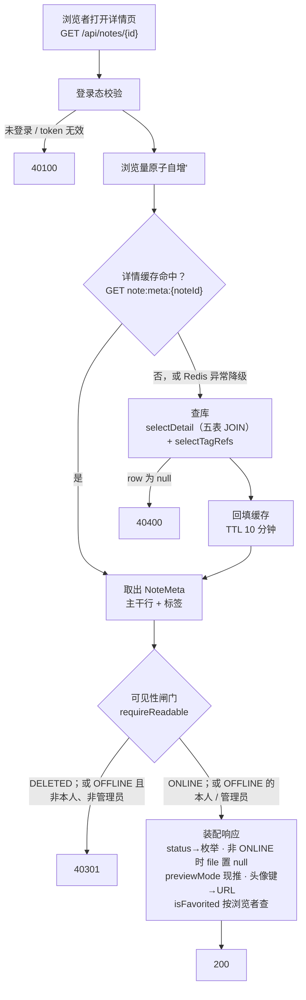

# 功能说明：笔记详情查询

> **接口**：`GET /api/notes/{id}` · **模块**：`note`（主）+ `favorite`（收藏态）+ `catalog`(课程/标签) + `config`(Redis 缓存)\
> **相关设计**：《概要设计》§5.4 详情接口、§4.1 状态可见性、§6.5 收藏与占位、§6.2 预览判定、§6.7 头像链路、§3.3 计数；《技术选型》§5（V2 缓存条目）

***

## 1. 功能描述

已登录的用户打开任意一篇笔记的详情页。服务端先对 `note` 行做一次**浏览量原子自增**（仅 `ONLINE` 生效），再取回主干 + 标签——这一步走 **Redis 读缓存**（TTL 10 分钟）：未命中则查库并回填，Redis 故障则降级直查库。装配响应之前先过一道**可见性闸门**：`ONLINE` 放行全体登录用户；`OFFLINE` 只放行**上传者本人与管理员**，其余人 40301；`DELETED` 对**谁都不开**，本人与管理员一并 40301。放行时元数据一条不少，已下架的只丢文件字段。

### 1.1 请求

```
GET /api/notes/12
Authorization: Bearer <jwt>
```

### 1.2 处理流程



### 1.3 响应

成功（HTTP 200）：

```json
{
  "code": 0,
  "message": "ok",
  "data": {
    "id": 12,
    "title": "第一章 绪论",
    "summary": "简介",
    "teacher": "张老师",
    "status": "ONLINE",
    "course": { "id": 3, "name": "离散数学" },
    "uploader": {
      "id": 7,
      "nickname": "小明",
      "avatarUrl": "https://jotang-avatar.oss-cn-chengdu.aliyuncs.com/avatars/7/abc.png",
      "collegeName": "计算机学院"
    },
    "tags": [
      { "id": 3, "name": "复习" },
      { "id": 8, "name": "期末" }
    ],
    "viewCount": 43,
    "downloadCount": 3,
    "favoriteCount": 5,
    "createdAt": "2026-10-01T10:00:00",
    "updatedAt": "2026-10-02T09:30:00",
    "file": {
      "originalName": "课件.png",
      "size": 1048576,
      "contentType": "image/png",
      "previewMode": "IMAGE_INLINE"
    },
    "isFavorited": true
  }
}
```

失败：

| code | HTTP | 场景 |
|---|---|---|
| 40100 | 401 | 未登录 / token 无效或过期 |
| 40400 | 404 | id 不存在（**先于闸门判定**，故不存在的 id 恒为 40400） |
| 40301 | 403 | 可见性闸门拒绝：`DELETED`（对所有人），或 `OFFLINE` 且浏览者既非上传者本人也非管理员 |

> **能拿到 200 的 `status` 只有两个取值**：`ONLINE`（全体登录用户），以及 `OFFLINE`（仅上传者本人与管理员）。`DELETED` 的请求在装配之前就变成 40301 了，前端不必为它写分支——「这篇笔记已被删除」由收藏列表的占位项承担（§6.5）。

### 1.4 涉及文件

| 层    | 文件                                                                                                                                         |
| ---- | ------------------------------------------------------------------------------------------------------------------------------------------ |
| 接口层  | `note/NoteController.java`（`detail`）                                                                                                       |
| 业务层  | `note/NoteService.java`（`detail` · `loadMeta` · `fileInfoOf` · `avatarUrl`）                                                                |
| 缓存   | `note/NoteMeta.java`（缓存载荷）· `config/RedisConfig.java`（键 String / 值 JSON 的序列化）                                                              |
| 查询投影 | `note/NoteDetailRow.java`                                                                                                                  |
| 出参   | `note/dto/NoteDetailResponse.java` · `note/dto/UploaderResponse.java` · `catalog/dto/CourseResponse.java` · `catalog/dto/TagResponse.java` |
| 上游依赖 | `favorite/FavoriteService.java`（`isFavorited`）· `storage/StorageService.java`（头像键拼 URL）· `note/NoteStatus.java` · `note/PreviewMode.java` · `common/AuthenticatedUser.java`（`isAdmin`，角色来自 JWT 的 `role` claim） |
| 持久层  | `note/NoteMapper.java`（`incrementViewCount` · `selectDetail` · `selectTagRefs`）· `mapper/NoteMapper.xml`                                   |


***

## 2. 核心逻辑及说明

### 2.1 自增先于读取,且不开事务

```java
public NoteDetailResponse detail(Long noteId, Long viewerId) {
    noteMapper.incrementViewCount(noteId, NoteStatus.ONLINE.name());

    NoteMeta meta = loadMeta(noteId);
    if (meta == null) {
        throw new BusinessException(ErrorCode.NOT_FOUND);
    }
```

```sql
UPDATE note SET view_count = view_count + 1 WHERE id = #{id} AND status = #{status}
```

- **先自增、后读取**，所以返回的 `viewCount` 含本次浏览。
- id不存在时这条 UPDATE 影响 0 行，无害；真正的 404 判定交给下面的`loadMeta`。
- **本方法不开事务**。 把那条UPDATE圈进事务后，`note` 那一行的排他锁会一直持到方法返回。而中间还夹着标签查询、收藏查询与响应装配。详情页是最热的读接口，为一个view_count的计数把行锁按住整个请求时长，代价远大于收益。  
不圈事务则 UPDATE 立即提交、锁立即释放；代价是自增与读取之间可能插进别人的自增，返回的 `viewCount` 可能略大于自己那一次+1。但最初对于浏览和下载这些字段的设计就是做近似口径。

### 2.2 缓存只装「库查回来的东西」，不装响应体

缓存的边界画在 `NoteMeta`：

```java
public record NoteMeta(NoteDetailRow row, List<TagResponse> tags) { }
```

`row` 是 `selectDetail` 的原始投影，`tags` 是 `selectTagRefs` 的结果。响应体那层的**策略**——非 ONLINE 置空 `file`、`previewMode` 现推、头像键转 URL、`status` 转枚举——一概不进缓存，每次在 `detail` 里现算：它们是纯内存计算，且正是应当留在 Service 里可读可测的那部分。

**为什么不缓存整个 `NoteDetailResponse`：** 那个记录里有一个 `isFavorited` 依赖**浏览者**，而缓存 key 只有 `noteId`。一旦把它也存进去，用户 A 的收藏状态就会被回给用户 B——那不是「缓存陈旧」，是**串号**。剔掉它再缓存整个响应，又等于再造一个与响应几乎同形、将来加字段要改两处的类型，得不偿失。

### 2.3 读穿 + 降级：不防穿透，也不防击穿

`loadMeta`（`NoteService.java:245-271`）有两件事刻意不做：**不缓存 null**——笔记不存在时直接返回 `null` 交给上层抛 40400，不让空值占住 key；**不防击穿**——热点 key 失效的瞬间，并发请求会一起查库。

读与回填各包一层 `catch (RuntimeException)` 是**降级**，不是防错：

```java
if (redisTemplate.opsForValue().get(key) instanceof NoteMeta cached) {
    return cached;
}
```

用 `instanceof` 而不是「先取出来再强转」：缓存里若混进别的类型（换过实现、被手工塞过脏数据），强转会抛 `ClassCastException` 把请求打死；而它本该被当成「没命中」——下面照样查库救得回来，下次回填也就覆盖掉了。读失败与回填失败都只 `log.warn`：**Redis 只影响快慢，不影响这个接口能不能用**。

### 2.4 可见性闸门：下架对本人与管理员「提示」，对其余人「禁止」

§4.1 那张表里「详情页」一列与预览 / 下载 / 收藏的分歧在于：**这三个动作对 OFFLINE 一视同仁地禁止，详情则多给两个人开一扇门**——上传者本人与管理员。理由是这两个人正是「处置这篇被下架笔记」的人：本人要能确认它为什么不可见，管理员要能按到页面上那颗下架 / 恢复按钮（§5.6）。已删除的没这扇门——`DELETED` 是终态，读到它也没有任何动作可以接上。

| 情形 | 详情 | 预览 / 下载 / 收藏 |
|---|---|---|
| ONLINE | 200，含 `file` | 放行 |
| OFFLINE · 本人 / 管理员 | 200，元数据一条不少，只丢 `file` | 40301 |
| OFFLINE · 其余登录用户 | 40301 | 40301 |
| DELETED · 任何人 | **40301** | 40301 |

**五处 40301 的分歧写进了 `ErrorCode#NOTE_UNAVAILABLE` 的注释**，因为「非 ONLINE 一律 40301」这句在详情和编辑上都是错的。

闸门收在一个方法里（`NoteService#requireReadable`），判据只有三样：状态、上传者 id、浏览者是不是管理员。**管理员身份取自上一步的 JWT 而非查库**——`AuthenticatedUser#isAdmin` 读的就是 token 里的 `role` claim，多一次 `SELECT` 换不来任何东西。

**判门顺序是有意的**：先 `DELETED`（无条件拒），再 `OFFLINE` × 身份。反过来写会漏掉「管理员看已删除」，而那条恰恰是要拒的。

**闸门读的是缓存里的 `status`**（`NoteMeta` 里带着它），而写路径不失效缓存：下架 / 删除之后最长 10 分钟内，闸门仍按旧状态放行（§8.4 第 19 条）。**内容本身不受影响**——预览 / 下载走 `readableOnlineFile`，每次都查库，下架立即生效。

把 `OFFLINE` 当正常业务值返回的接口还剩「我的上传」（前端给卡片加「已下架」角标）与收藏列表（占位项）；**`DELETED` 只剩收藏列表**——§6.5 的占位项保留 `title` 与 `course`，是「这篇笔记已被删除」唯一还能被读到的地方。

### 2.5 三个「读取侧现推」的字段

1. **`previewMode` 不落库**（`PreviewMode.of`，`NoteService.java:282`）：它是 `contentType` 的纯函数。落库等于把函数值再抄一份，还多一处可能与 `contentType` 不一致的地方。
2. **`avatarUrl` 空值必须短路**（`NoteService.java:293`）：`StorageService#publicUrl` 是裸字符串拼接，喂 `null` 会拼出一个以 `/null` 结尾、看着像 URL 的东西——前端会安心地塞进 ``，然后拿到 404。
3. **学院挂在 `uploader` 下而不是顶层**（D8）：`note` 表不存学院，读的是上传者的 `user.college_id`。所以 `collegeName` 与浏览者无关——`NoteDetailServiceTest` 特意把浏览者放在**另一个学院**，断言才有判别力。

***

## 3. 测试过程与结果

### 3.1 运行前置

| 项 | 值 |
|---|---|
| JDK | 21（`java.specification.version=21`） |
| 数据库 | **本机 MySQL 8.0**，测试激活 `local` profile，连 `application-local.yaml` 的库 |
| Redis | **本机 Redis**。只有 `NoteDetailServiceTest#viewCountIsServedFromCacheWithinTtl` 用得到（它要清缓存、要有确定的冷启动），其余用例不碰——详情对 Redis 故障是降级的 |
| 建表与初始数据 | 随应用启动自动执行 `schema.sql` + `data.sql`（均幂等） |
| 网络 | **不需要**——存储层全程 mock，真打 OSS 的用例（`@Tag("oss")`）被 pom 默认排除 |

### 3.2 用例覆盖层次

| 测试类 | 用例数 | 覆盖层次 |
|---|---|---|
| `NoteDetailServiceTest` | 11 | 装配与策略：**可见性闸门（下架放行本人 / 管理员、他人 40301；删除对谁都不开）**、缓存滞后、收藏按浏览者、头像空值、404、自增不碰 `updated_at`（起真库，mock 存储层） |
| `NoteDetailResponseTest` | 3 | 序列化形状：`isFavorited` 的 JSON 键名、枚举名、非 ONLINE 时 `file` 为 null（裸 Jackson） |
| `PreviewModeTest` | 6 | `contentType` → 渲染意图的映射与兜底方向（纯单元测试） |
| `NoteControllerTest`（详情相关） | 6 | HTTP 层：鉴权、40400、**本人看已下架的 200 + `file: null`、管理员看已下架的 200、他人看已下架的 40301、已删除对三种身份的 40301** |
| `NoteViewCountConcurrencyTest` | 1 | 浏览量并发自增：32 线程同时打同一条，计数必须正好 +32 |

闸门用例的**身份取自 `@AuthenticationPrincipal`，不是查库**——`NoteDetailServiceTest` 直接传 `viewerIsAdmin` 布尔值，`NoteControllerTest` 则签三种角色的 token（上传者 `USER` / 管理员 `ADMIN` / 毫不相干的第三人）走完整 HTTP 链路，这样「角色 claim → `isAdmin()` → 闸门」这条缝两端都被钉住。

### 3.3 运行命令与结果

```bash
mvnw test -Dtest=NoteDetailServiceTest,NoteDetailResponseTest,PreviewModeTest,NoteControllerTest,NoteViewCountConcurrencyTest
```


### 3.4 未覆盖的部分

1. **Redis 故障降级分支没有直接用例。** `loadMeta` 的两处 `catch (RuntimeException)`（读失败降级直查库、回填失败不影响本次请求）只有代码层面的推理。现有用例要么让 Redis 正常工作，要么根本不碰它，没有一条让 `redisTemplate` 抛异常。要补得另起一个把 `RedisTemplate` 换成 `@MockitoBean` 的用例类——`NoteDetailServiceTest` 刻意用真 Redis（`viewCountIsServedFromCacheWithinTtl` 需要真的清缓存）。
2. **头像 URL 的真拼接在默认套件之外，且与详情链路没有一条用例串起来。** 拼接本身（桶名 + 公网 Endpoint）与「头像桶确实公共读」由 `OssStorageServiceTest` 的两条覆盖（`publicUrlPointsAtAvatarBucketOnPublicEndpoint` · `avatarUploadCarriesImmutableCacheControl`），它们带 `@Tag("oss")`、默认排除，要手动跑 `./mvnw test -DexcludedGroups= -Dgroups=oss` 才执行。而默认套件里 `avatarUrl` 的用例把 `StorageService` 换成了 mock——于是「详情接口拿真的 `publicUrl` 拼出头像地址」这条缝（HTTP → detail → StorageService）两端各自被覆盖，却没有一条用例把二者串起来。
3. **「JOIN 不上就整行消失」这一失败模式没有用例。** `selectDetail` 是五张表 INNER JOIN（`mapper/NoteMapper.xml` 里写了理由：五条连接关系都有外键兜着）。代价是数据一旦损坏，该笔记会**整个查不出来**、表现为 40400，而不是露出异常列。构造它需要先破坏外键，现实里撞不到，故只作记录。
4. **缓存陈旧的窗口没有用例。** 闸门读缓存里的 `status`，而下架 / 恢复 / 删除都不失效缓存，于是「刚下架、缓存里还是 `ONLINE`、他人仍拿到 200」这条路径真实存在却测不到：本类用例要么是冷缓存，要么自己清过缓存，而 `@Transactional` 的回滚管不到 Redis。构造它要先 `detail` 一次把 `ONLINE` 灌进缓存、再改库成 `OFFLINE`、再 `detail` 一次——用例写得出来，但它固化的是被接受的缺陷，故只作记录（§8.4 第 19 条）。
5. **闸门与 `40400` 的先后没有专门用例。** 闸门排在 `loadMeta` 之后，所以不存在的 id 恒为 40400（`unknownNoteIsNotFound` 覆盖了这一半）；「不存在的 id 会走哪条分支」的另一半不是分支问题。
