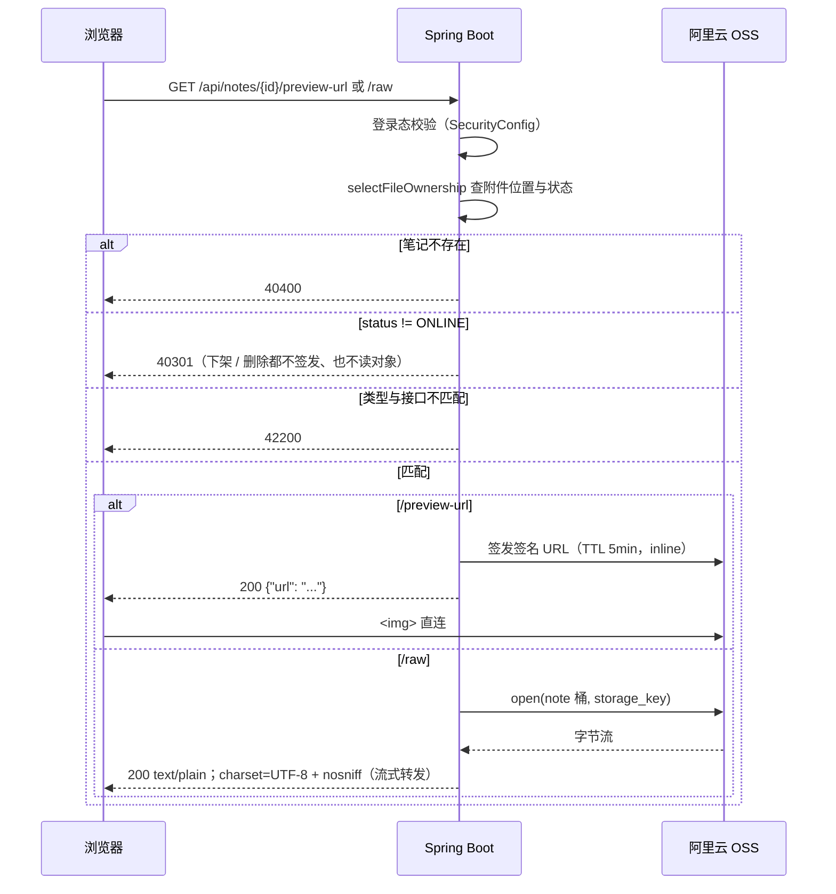

# 功能说明：笔记预览

> **接口**：`GET /api/notes/{id}/preview-url` · `GET /api/notes/{id}/raw` · **模块**：`note`（主）+ `storage`（签名 / 读 OSS）\
> **相关设计**：《概要设计》§5.4 接口、§6.1 类型白名单、§6.2 预览 / 下载鉴权、§4.1 状态可见性、§8.3 安全、§8.4 已知限制

***

## 1. 功能描述

已登录用户打开一篇 ONLINE 笔记的详情页，浏览器根据`GET /api/notes/{id}`接口返回的 `previewMode`，二选一发请求来实现文件预览：IMAGE_INLINE 打 /preview-url，TEXT_PROXY 打 /raw。

### 1.1 请求

```
GET /api/notes/12/preview-url
Authorization: Bearer <jwt>
```

```
GET /api/notes/12/raw
Authorization: Bearer <jwt>
```

### 1.2 处理流程



### 1.3 响应

`/preview-url` 成功（HTTP 200）：

```json
{
  "code": 0,
  "message": "ok",
  "data": {
    "url": "https://jotang-note.oss-cn-chengdu.aliyuncs.com/notes/2026/10/2f1a….png?Expires=…&OSSAccessKeyId=…&Signature=…"
  }
}
```

`/raw` 成功（HTTP 200）——**响应体是文件原文本身，不是** **`ApiResponse`** **信封**：

```
Content-Type: text/plain;charset=UTF-8
X-Content-Type-Options: nosniff
Content-Length: 4096

# 第一章 绪论
……
```

> 失败时仍是 JSON 信封。

失败错误码（两个接口同口径）：

| 场景             | code  | HTTP |
| -------------- | ----- | ---- |
| 未登录 / token 无效 | 40100 | 401  |
| id 不存在         | 40400 | 404  |
| 笔记已下架或已删除      | 40301 | 403  |
| 附件类型与接口不匹配     | 42200 | 422  |

### 1.4 涉及文件

| 层    | 文件                                                                                                                 |
| ---- | ------------------------------------------------------------------------------------------------------------------ |
| 接口层  | `note/NoteController.java`（`previewUrl` · `raw`）                                                                   |
| 业务层  | `note/NoteService.java`（`previewUrl` · `openRaw` · `readableOnlineFile`）                                           |
| 类型判定 | `note/PreviewMode.java`（`of`）                                                                                      |
| 出参   | `note/dto/NotePreviewUrlResponse.java`                                                                             |
| 交付载体 | `note/NoteRawContent.java`                                                                                         |
| 上游依赖 | `storage/StorageService.java`（`presignedUrl` · `open`）· `note/NoteFileOwnershipRow.java` · `common/ErrorCode.java` |
| 持久层  | `note/NoteMapper.java`（`selectFileOwnership`）· `mapper/NoteMapper.xml`                                             |
| 鉴权   | `config/SecurityConfig.java`（`anyRequest().authenticated()`）                                                       |

## 2. 核心逻辑及说明

### 2.3 `/raw` 流式转发，不在后端读成 byte\[]

文本上限 100MB（`NoteFilePolicy.MAX_SIZE_BYTES`），`AiService` / `NoteTools` 里那种 `readAllBytes()` 写法在这里会把整份文件拉进堆。`openRaw` 把 `StorageService#open` 返回的流**原样交出**，由 Spring 的 `ResourceHttpMessageConverter` 用 8KB 缓冲边读边写，`Content-Length` 取自 `note_file.size`（`NOT NULL`）。

**流在 Service 层同步打开**，这一步决定了失败路径的形状：对象缺失 / OSS 故障时 `open` 抛 50000，此时响应头还没提交，`GlobalExceptionHandler` 能正常写出 JSON 信封。若改用 `StreamingResponseBody`，开流会被推到 commit 之后，50000 就兜不住了。关闭责任在写出方（Spring 的消息转换器），与 `StorageService#open` 的「调用方关流」约定一致。

映射上**不写** **`produces`**：闸门报错时要让异常处理器写出 `application/json`，`produces` 会让 406 先挡上来。类型只在 `ResponseEntity` 上设。


## 3. 测试过程与结果


