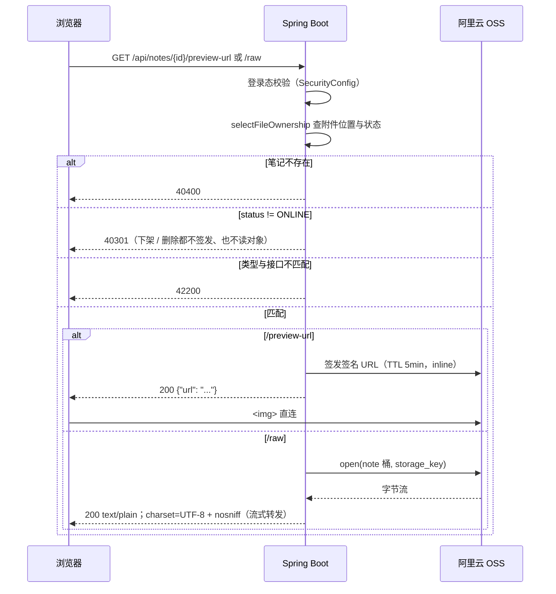

# 功能说明：笔记预览

> **接口**：`GET /api/notes/{id}/preview-url` · `GET /api/notes/{id}/raw` · **模块**：`note`（主）+ `storage`（签名 / 读 OSS）\
> **相关设计**：《概要设计》§5.4 接口、§6.1 类型白名单、§6.2 预览 / 下载鉴权、§4.1 状态可见性、§8.3 安全、§8.4 已知限制

***

## 1. 功能描述

已登录用户打开一篇 ONLINE 笔记的详情页，浏览器根据`GET /api/notes/{id}`接口返回的 `previewMode`，二选一发请求：IMAGE_INLINE 打 /preview-url，TEXT_PROXY 打 /raw。

### 1.1 请求

```
GET /api/notes/12/preview-url
Authorization: Bearer <jwt>
```

```
GET /api/notes/12/raw
Authorization: Bearer <jwt>
```

### 1.2 处理流程



### 1.3 响应

`/preview-url` 成功（HTTP 200）：

```json
{
  "code": 0,
  "message": "ok",
  "data": {
    "url": "https://jotang-note.oss-cn-chengdu.aliyuncs.com/notes/2026/10/2f1a….png?Expires=…&OSSAccessKeyId=…&Signature=…"
  }
}
```

`/raw` 成功（HTTP 200）——**响应体是文件原文本身，不是** **`ApiResponse`** **信封**：

```
Content-Type: text/plain;charset=UTF-8
X-Content-Type-Options: nosniff
Content-Length: 4096

# 第一章 绪论
……
```

> `/raw` 是全仓唯一不套 `ApiResponse` 的成功响应：它要交付的就是文件字节，包一层要么 base64 要么转义，前端还得解回来。**失败时仍是 JSON 信封**——闸门与模式校验都在开流之前，`GlobalExceptionHandler` 照常写回。前端因此不能拿读 `ApiResponse` 的同一个 Axios 实例去读它（见 §10 的待办）。

> 签名 URL 的 TTL 是 **5 分钟**，`Content-Disposition` 声明为 `inline`。**OSS 默认域名会给响应强制附加** **`attachment`（显式请求** **`inline`** **也压不过）**，但该策略只作用于「导航」场景，浏览器加载 `` 子资源时忽略它，**图片预览不受影响**（§6.2）。绑定自定义域名后这条才真正生效。

失败错误码（两个接口同口径）：

| 场景             | code  | HTTP |
| -------------- | ----- | ---- |
| 未登录 / token 无效 | 40100 | 401  |
| id 不存在         | 40400 | 404  |
| 笔记已下架或已删除      | 40301 | 403  |
| 附件类型与接口不匹配     | 42200 | 422  |

### 1.4 涉及文件

| 层    | 文件                                                                                                                 |
| ---- | ------------------------------------------------------------------------------------------------------------------ |
| 接口层  | `note/NoteController.java`（`previewUrl` · `raw`）                                                                   |
| 业务层  | `note/NoteService.java`（`previewUrl` · `openRaw` · `readableOnlineFile`）                                           |
| 类型判定 | `note/PreviewMode.java`（`of`）                                                                                      |
| 出参   | `note/dto/NotePreviewUrlResponse.java`                                                                             |
| 交付载体 | `note/NoteRawContent.java`                                                                                         |
| 上游依赖 | `storage/StorageService.java`（`presignedUrl` · `open`）· `note/NoteFileOwnershipRow.java` · `common/ErrorCode.java` |
| 持久层  | `note/NoteMapper.java`（`selectFileOwnership`）· `mapper/NoteMapper.xml`                                             |
| 鉴权   | `config/SecurityConfig.java`（`anyRequest().authenticated()`）                                                       |

## 2. 核心逻辑及说明

### 2.1 状态闸门复用 `readableOnlineFile`：预览与「AI 读正文」同口径

`readableOnlineFile` 原是 ai 模块读附件的入口，本次直接复用——两者对可见性的要求一字不差：**任何登录用户可读任何 ONLINE 笔记的附件，不做归属判定**（§4.1 的「预览 / 下载」列）。它已经是「不存在 → 40400、非 ONLINE → 40301」的完整闸门，预览再写一份只会多一处要同步的地方。

对照着看：`requireOwnFile`（**本人**，且 OFFLINE 放行）是给编辑 / 摘要的，**不适用**于此——预览对 OFFLINE 一律禁止，上传者本人也不例外。

### 2.2 模式校验不是冗余：挡的是存量行

**`DOWNLOAD_ONLY`** **对 ONLINE 笔记是可达的。** 上传白名单现已收窄为文本与图片，但更早的存量行里还有 pdf / Office / 压缩包（§6.9；`NoteTools` 也为这批行单留了一条「不支持读取正文」的分支）。写入侧白名单是**准入闸门**，管不了历史行：

- 无校验的 `/preview-url` 会把一条 `image/svg+xml` / `text/html` 的存量行签成**以该** **`Content-Type`** **交付的直连 URL**——正是 §8.3 要挡的存储型 XSS，而且发生在 OSS 域名下。
- 无校验的 `/raw` 会把同一个对象按 `text/plain` 代理出去（有 `nosniff`，不构成渲染，但对图片 / PDF 而言只是乱码）。

所以两个接口各自用 `PreviewMode.of(contentType)` 校一次：`/preview-url` 只收 `IMAGE_INLINE`，`/raw` 只收 `TEXT_PROXY`，其余 42200。**读取侧的执行者是** **`PreviewMode.of`，不是** **`NoteFilePolicy.FORMATS`**——后者是写入侧准入门，拿它做读取侧推导会在摘除某类型后让历史行读不出来（`PreviewMode` 的类注释已否决过一次这条路）。

错误码选 42200 而不是别的：`40301` 事实就不对（笔记是在线的），它的文案会让前端弹出「已下架」的提示；`40300` 管的是「你是谁」，与文件类型无关。`42200`（文件类型不合法）的语义与 HTTP 422 的归属都对得上，故复用它而不新增码。

### 2.3 `/raw` 流式转发，不在后端读成 byte\[]

文本上限 100MB（`NoteFilePolicy.MAX_SIZE_BYTES`），`AiService` / `NoteTools` 里那种 `readAllBytes()` 写法在这里会把整份文件拉进堆。`openRaw` 把 `StorageService#open` 返回的流**原样交出**，由 Spring 的 `ResourceHttpMessageConverter` 用 8KB 缓冲边读边写，`Content-Length` 取自 `note_file.size`（`NOT NULL`）。

**流在 Service 层同步打开**，这一步决定了失败路径的形状：对象缺失 / OSS 故障时 `open` 抛 50000，此时响应头还没提交，`GlobalExceptionHandler` 能正常写出 JSON 信封。若改用 `StreamingResponseBody`，开流会被推到 commit 之后，50000 就兜不住了。关闭责任在写出方（Spring 的消息转换器），与 `StorageService#open` 的「调用方关流」约定一致。

映射上**不写** **`produces`**：闸门报错时要让异常处理器写出 `application/json`，`produces` 会让 406 先挡上来。类型只在 `ResponseEntity` 上设。

### 2.4 本切片不做的事

- **不做下载**（`/download`）：那是 §6.2 的另一行，需要 `selectFileOwnership` 补 `original_name` 列与 `download_count` 自增，另开一刀。
- **不设缓存头**：§6.2 未规定 `/raw` 的 `Cache-Control`；签发 URL 本身有 5 分钟 TTL 兜底。
- **不做前端**：详情页与 marked + DOMPurify 渲染另开一刀，届时 `frontend/package.json` 要补这三个依赖。
- **不处理 HEAD**：`@GetMapping` 同时匹配 HEAD，请求进来会照常打开 OSS 并拷贝整份内容，只是容器丢弃 body——一个已登录用户就能用它强制整对象读取。要挡得在 handler 里判方法、跳过 `open`；当前接受。

## 3. 测试过程与结果


