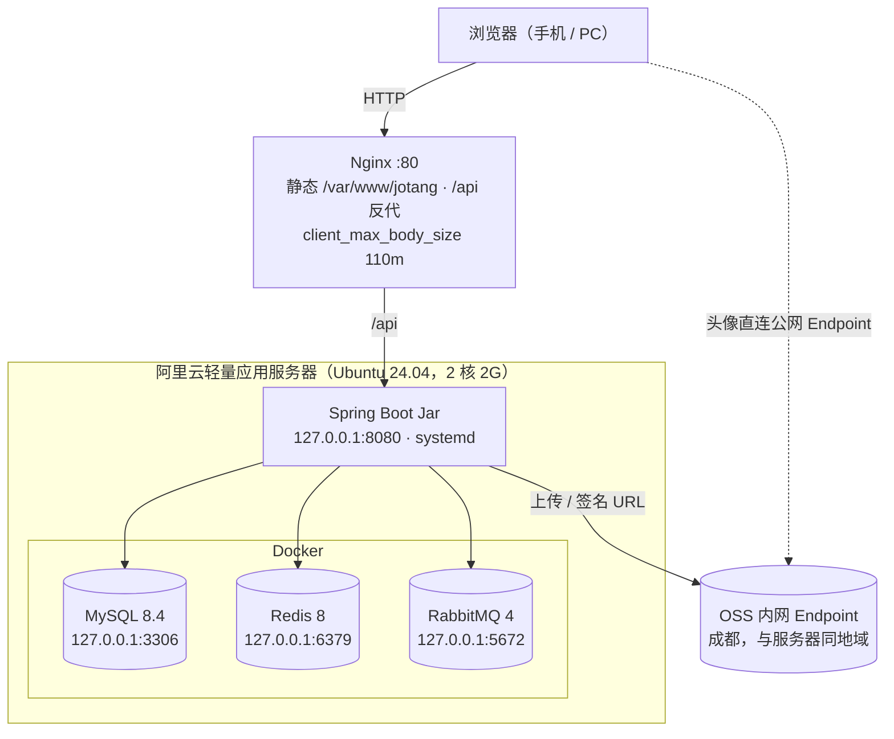

# Jotang Note 技术选型报告（MVP）

> 选型原则：单体优先、轻量运维，与「单台阿里云 ECS、数千注册用户」的规模匹配；同时为 V2（缓存、异步任务、对象存储）预留演进接口，不提前引入用不到的中间件。

## 1. 技术栈总览

| 分层 | 选型 | 说明 |
|---|---|---|
| 运行环境 | Java 21（LTS） | Spring Boot 4 的最低基线为 Java 17 |
| 后端框架 | Spring Boot 4.0.8 | 单体应用，controller/service/mapper 分层 |
| 构建工具 | Maven | 依赖管理与打包 |
| 安全框架 | Spring Security + JWT（jjwt） | 无状态登录态，接口统一鉴权 |
| 持久层 | MyBatis-Plus（基于 MyBatis） | 通用 CRUD + 分页插件，复杂 SQL 写 XML |
| 数据库 | MySQL 8.x（InnoDB / utf8mb4） | 模糊查询 + 索引分页满足 MVP 搜索 |
| 消息队列 | RabbitMQ（**已引入**，当前唯一用途是密码找回的重置邮件） | 由 `deploy/docker-compose.prod.yml` 起 `rabbitmq:4-management`；由 `jotang.mail.mode` 门控，`smtp` 时不注册任何队列 Bean，见 §5 |
| 缓存 | Redis（**已引入**） | 用于笔记详情读缓存 `note:meta:{noteId}`，见 §5；登录限频仍用本地内存实现 |
| 前端框架 | Vue 3 + Vite + TypeScript | Composition API，前后端分离 |
| UI 组件库 | Element Plus | 配合栅格/断点做移动端响应式，一套页面覆盖手机与 PC |
| 前端基础库 | Vue Router 4、Pinia、Axios | 路由、状态管理、HTTP 客户端 |
| 文件存储 | 阿里云 OSS（笔记私有 Bucket + 头像公共读 Bucket） | 阿里云 OSS SDK for Java 读写，统一 StorageService 接口封装；后端经**内网 Endpoint** 访问 |
| 文件预览 | 浏览器原生（图片/文本）+ marked/DOMPurify/highlight.js（Markdown） | 只预览图片与 Markdown / 文本 |
| 邮件 | Spring Boot Mail + QQ 邮箱 SMTP | 用于密码找回 |
| AI 能力 | Spring AI + DeepSeek（OpenAI 兼容接口，`deepseek-flash`） | 上传/编辑页「自动生成摘要」：图片走多模态、md / txt 走纯文本调用，见 §2 |
| 接口文档 | Apifox | 接口设计、文档与联调；IDEA 插件从代码同步 |
| 部署 | Nginx + 可执行 Jar（systemd 托管） | Nginx 托管前端静态资源并反向代理后端 |

## 2. 后端选型

- **Spring Boot 4.0.8 + Java 21**：需求规模下单体足以承载，不做微服务拆分。
- **MyBatis-Plus**：单表 CRUD、条件构造、分页由框架提供，减少样板代码；多表关联与复杂检索保留 MyBatis XML 手写，SQL 可控。
- **Spring Security + JWT**：
  - 登录成功签发 JWT，前端通过 `Authorization` 请求头携带；服务端无 Session，重启不丢登录态；
  - 无状态过滤链统一拦截「全部内容需登录」的接口，管理员角色（USER/ADMIN）走同一套鉴权；
  - 密码使用 BCrypt 加密存储。
- **Bean Validation**：入参校验（标题、文件大小等）注解化。
- **Spring Boot Mail**：对接 `3053998186@qq.com` 的 SMTP，发送密码找回邮件。发信本身收敛在 `MailService` 一个接口后面（`mail` 模块只出原语，主题正文由 `auth` 组装）；**生产走 RabbitMQ 异步投递**，见 §5。
- **登录限频**：本地内存实现（同一账号连续失败 5 次锁定 10 分钟），不依赖额外中间件。
- **Apifox**：作为唯一的接口文档与联调工具，后端通过 Apifox IDEA 插件将接口定义自动同步到 Apifox 项目；前端按 Apifox 上的文档联调。
- **Spring AI + DeepSeek**：
  - 依赖 `spring-ai-starter-model-openai`（DeepSeek 提供 OpenAI 兼容接口），模型 `deepseek-flash`。
  - **版本兼容性已实测**：Spring AI 2.0.1 在本项目的 Boot 4.0.8 上编译、启动、跑测试均通过。注意它自己声明的是 Boot 4.1.1，实际被本项目 parent 的 dependencyManagement 压回 4.0.8

## 3. 前端选型

- **Vue 3 + Vite + TypeScript**：Composition API + 类型约束，Vite 承担开发热更新与生产构建。
- **Element Plus**：组件覆盖上传、列表、分页、详情、表单等页面场景；移动端优先适配，不单独开发小程序/App。
- **Vue Router 4**：路由守卫在进入页面前校验登录态。
- **Pinia**：管理登录用户信息与 Token。
- **Axios**：统一请求拦截器注入 JWT，响应拦截器统一处理 401 跳转登录与错误提示。
- **预览能力**：
  - 图片、文本：浏览器原生能力直接渲染；
  - Markdown：marked 解析 + DOMPurify 防 XSS + highlight.js 代码高亮。

## 4. 文件上传与存储

- 上传走后端 multipart 接口，Nginx `client_max_body_size` 调至 **110m**（须 ≥ 后端 `max-request-size`）；经 **OSS 内网 Endpoint** 流式上传，ECS 本地不落盘。
- **两个 Bucket**：笔记文件 → 私有读写；头像 →公共读 / 私有写（浏览器直连读取，免签名）。后续可平替 MinIO 等。

## 7. 部署形态

