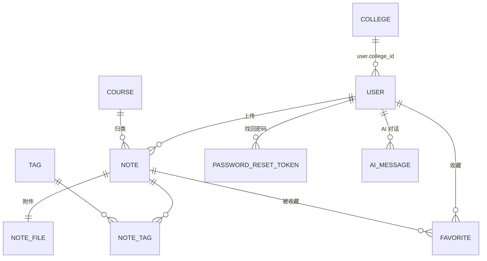

# Jotang Note 数据库设计（MVP）

本文说明 Jotang Note 的库表结构、字段语义、索引取舍与应用侧读写方式。

## 1. 运行环境与初始化

| 项 | 取值 |
|---|---|
| 数据库 | 生产镜像为 `mysql:8.4` |
| 存储引擎 | InnoDB |
| 字符集 / 排序规则 | `utf8mb4`；生产排序规则为 `utf8mb4_general_ci`（由 `deploy/mysql/conf.d/jotang.cnf` 设定），开发库沿用实例默认（MySQL 8 通常为 `utf8mb4_0900_ai_ci`） |
| 库名 | `jotang_note`|
| 时区 | 连接串固定 `serverTimezone=Asia/Shanghai`，时间统一由数据库生成 |
| 初始化 | `spring.sql.init.mode=always`，每次启动执行 `schema.sql` 与 `data.sql` |
| 建库 | JDBC 参数 `createDatabaseIfNotExist=true`，首次启动自动建库 |
| 迁移工具 | Flyway|

## 2. 统一约定

| 约定 | 说明 |
|---|---|
| 命名 | 表名、列名一律 `snake_case`；表名用单数 |
| 主键 | `BIGINT UNSIGNED AUTO_INCREMENT`；关联列同类型 |
| 外键 | 真实外键约束，命名 `fk_<表>_<目标>`；索引命名 `idx_*`；唯一键命名 `uk_*` |
| 时间 | `DATETIME`，秒精度，默认值取数据库 `CURRENT_TIMESTAMP` |
| 布尔 | `TINYINT` 存 `0/1`，Java 侧用 `Integer`（避免 Lombok/Jackson 对 `boolean` 的属性名处理差异） |
| 文本 | 一律存**原文**，输出时转义；不在入库时做 HTML 转义 |
| 字符集 | 所有表显式 `DEFAULT CHARSET=utf8mb4` |
| 保留字 | `user` 是 MySQL 关键字，SQL 与实体映射中一律加反引号 |
| 删除策略 | 仅 `note` 软删除（`status=DELETED`）；其余表物理删除或只增不删 |

时间字段的秒精度会带来并列：同一秒内创建的多行 `created_at` 相同。所有分页排序都必须再带 `id` 作次级键，否则翻页会出现重复或漏项。

## 3. 实体关系

关系要点：

- `note_file` 通过 `uk_note_id` 与 `note` 保持 **1:1**；独立成表是为 V2 多附件留余地。
- `note_tag` 是 `note` 与 `tag` 的多对多关联表，没有顺序列。
- `favorite` 同时指向 `user` 与 `note`，`(user_id, note_id)` 唯一。
- `password_reset_token` 与 `ai_message` 都只挂在 `user` 上；`ai_message` 没有独立的「会话表」，`conversation_id` 只是消息上的 UUID。
- 笔记的学院**不建列**：学院挂在上传者 `user.college_id` 上，读取时 JOIN `user` 推导。

## 4. 表清单

| 分组 | 表 | 用途 |
|---|---|---|
| 账号 | `college` | 学院字典，注册必选，预置只读 |
| 账号 | `user` | 用户账号、资料、角色 |
| 账号 | `password_reset_token` | 密码找回令牌，一次性消费 |
| 内容 | `course` | 课程字典，预置只读 |
| 内容 | `note` | 笔记元数据与状态、计数 |
| 内容 | `note_file` | 笔记附件在 OSS 的位置与元信息 |
| 内容 | `tag` | 标签字典，可随上传按名创建 |
| 内容 | `note_tag` | 笔记与标签的多对多关联 |
| 互动 | `favorite` | 收藏关系 |
| AI | `ai_message` | AI 对话消息，服务端保存多轮历史 |

## 5. 表结构

### 5.1 `college` — 学院

| 列 | 类型 | NULL | 默认 | 说明 |
|---|---|---|---|---|
| `id` | BIGINT UNSIGNED | 否 | AUTO_INCREMENT | 主键 |
| `name` | VARCHAR(128) | 否 | | 学院名，唯一 |

- 索引：`uk_name (name)`
- 写入路径：仅 `data.sql` 预置 20 个学院；应用内没有增删改入口。
- 读取路径：注册页下拉、`CatalogController` 列表、笔记列表 / 详情 / 收藏列表 JOIN 出学院名。
- 展示顺序按 `id` 升序，即 `data.sql` 的录入顺序。

### 5.2 `user` — 用户

| 列 | 类型 | NULL | 默认 | 说明 |
|---|---|---|---|---|
| `id` | BIGINT UNSIGNED | 否 | AUTO_INCREMENT | 主键 |
| `username` | VARCHAR(32) | 否 | | 登录名，唯一 |
| `email` | VARCHAR(128) | 否 | | 邮箱，密码找回用，唯一 |
| `password_hash` | VARCHAR(100) | 否 | | BCrypt 哈希，绝不外传 |
| `nickname` | VARCHAR(32) | 否 | | 昵称；注册时默认取用户名 |
| `college_id` | BIGINT UNSIGNED | 否 | | 所属学院，注册时必选 |
| `avatar` | VARCHAR(255) | 是 | NULL | 头像在头像 Bucket 的**对象键**，不是完整 URL |
| `role` | VARCHAR(16) | 否 | `'USER'` | `USER` / `ADMIN` |
| `status` | TINYINT | 否 | `1` | `1` 正常 / `0` 禁用（预留，当前无写入路径） |
| `created_at` | DATETIME | 否 | CURRENT_TIMESTAMP | 注册时间 |
| `updated_at` | DATETIME | 否 | CURRENT_TIMESTAMP ON UPDATE | 最后修改时间 |

- 索引 / 约束：`uk_username`、`uk_email`、`idx_college`、`fk_user_college`。
- 注册时先查重再插入，并发下的重复由两个唯一键兜底。
- `avatar` 只存对象键；对外输出时由 `StorageService.publicUrl(Bucket.AVATAR, key)` 拼成公网 URL。
- 用户没有软删除：删除账号会直接破坏其笔记、收藏、AI 消息的外键，当前不支持。
- MySQL 默认排序规则大小写不敏感，`username` / `email` 的唯一性实际上**不区分大小写**。

### 5.3 `course` — 课程

| 列 | 类型 | NULL | 默认 | 说明 |
|---|---|---|---|---|
| `id` | BIGINT UNSIGNED | 否 | AUTO_INCREMENT | 主键 |
| `name` | VARCHAR(128) | 否 | | 课程名，唯一 |
| `is_other` | TINYINT | 否 | `0` | `1` = 内置「其他」，上传时的兜底项 |

- 索引：`uk_name (name)`。
- 写入路径：`data.sql` 预置 9 门课程 + 一条 `is_other=1` 的「其他」；应用内只读。
- 展示顺序：`is_other ASC, id ASC`，「其他」固定压到末位。
- `course` **没有** `college_id`：笔记的学院由上传者推导（D8）。

### 5.4 `note` — 笔记

| 列 | 类型 | NULL | 默认 | 说明 |
|---|---|---|---|---|
| `id` | BIGINT UNSIGNED | 否 | AUTO_INCREMENT | 主键 |
| `uploader_id` | BIGINT UNSIGNED | 否 | | 上传者 |
| `course_id` | BIGINT UNSIGNED | 否 | | 所属课程 |
| `title` | VARCHAR(128) | 否 | | 标题 |
| `summary` | VARCHAR(512) | 是 | NULL | 简介，存原文 |
| `teacher` | VARCHAR(64) | 是 | NULL | 教师 |
| `status` | VARCHAR(16) | 否 | `'ONLINE'` | `ONLINE` / `OFFLINE` / `DELETED` |
| `view_count` | INT UNSIGNED | 否 | `0` | 浏览量（近似值，见 §6.2） |
| `download_count` | INT UNSIGNED | 否 | `0` | 下载量（近似值） |
| `favorite_count` | INT UNSIGNED | 否 | `0` | 收藏量 |
| `created_at` | DATETIME | 否 | CURRENT_TIMESTAMP | 上传时间 |
| `updated_at` | DATETIME | 否 | CURRENT_TIMESTAMP | **用户最后编辑时间**，无 `ON UPDATE` |
| `deleted_at` | DATETIME | 是 | NULL | `status=DELETED` 时写入 |

- 外键：`fk_note_uploader`、`fk_note_course`。
- `updated_at` 的语义是「用户最后编辑元数据的时间」，不是行更新时间。管理员下架 / 恢复、计数自增、软删除都**不**改它；全系统只有 `NoteMapper#updateMetadata` 显式写入。这正是列表 `sort=latest` 的排序键。
- 软删除：`status=DELETED` + `deleted_at`，行不物理删除。收藏、标签、附件的外键因此永不悬空。状态流转见《系统设计》§4.1。
- 三个计数列是 `INT UNSIGNED`（上界 4294967295），Java 侧用 `Long` 承接；增减一律走 `SET x = x ± 1` 的原子 UPDATE，不做「读出来加一再写回」。
- 笔记的学院不存：列表 / 详情 / 收藏查询都 JOIN `user` → `college`。改学院会回溯改变该用户全部历史笔记的学院归属（D8 的已知影响）。

列表与热度相关的索引以 `status` 打头，对应「列表与搜索只出 ONLINE」的读口径；课程页与「我的上传」两个索引按各自的前导列打头：

| 索引 | 支撑的查询 |
|---|---|
| `idx_status_created (status, created_at)` | 最新发布口径 |
| `idx_status_updated (status, updated_at)` | 默认列表 / `sort=latest` |
| `idx_status_view (status, view_count)` | 热门·浏览 |
| `idx_status_download (status, download_count)` | 热门·下载 |
| `idx_course_status (course_id, status)` | 课程页 |
| `idx_uploader_status (uploader_id, status)` | 我的上传 |

InnoDB 二级索引的叶子节点隐含主键 `id`，所以 `(status, updated_at)` 可以直接支撑「`status` 等值 + `updated_at DESC, id DESC`」的倒序扫描，不需要额外 filesort。分页查询都显式带 `id DESC` 作次级键（见 §6.4）。

### 5.5 `note_file` — 笔记附件

| 列 | 类型 | NULL | 默认 | 说明 |
|---|---|---|---|---|
| `id` | BIGINT UNSIGNED | 否 | AUTO_INCREMENT | 主键 |
| `note_id` | BIGINT UNSIGNED | 否 | | 所属笔记，唯一 |
| `storage_key` | VARCHAR(255) | 否 | | OSS 对象键：`notes/yyyy/MM/{uuid}.{ext}` |
| `original_name` | VARCHAR(255) | 否 | | 原始文件名（已清洗路径），预览 / 下载时用于还原 |
| `size` | BIGINT UNSIGNED | 否 | | 文件大小（字节） |
| `content_type` | VARCHAR(128) | 否 | | 服务端判定的 MIME 类型 |
| `is_purged` | TINYINT | 否 | `0` | `1` = OSS 对象已物理清理 |
| `created_at` | DATETIME | 否 | CURRENT_TIMESTAMP | 上传时间 |

- 索引 / 约束：`uk_note_id`（保证一份笔记一个附件）、`uk_storage_key`（同一对象不会被两条记录引用）、`fk_file_note`。
- `original_name` 入库前已清洗客户端可能送来的路径；预览时用它还原文件名，将来的下载链路也依赖它。
- `content_type` 由服务端判定，上传时同时写入 OSS 对象元数据；读取时不再覆写。
- 删除笔记时只置 `note.status=DELETED`，对象由孤儿对象对账清理；清理成功后置 `is_purged=1`。因此「`note.status=DELETED` 且 `is_purged=0` 且 `storage_key` 非空」才是待清理对象清单。
- V2 支持多附件时，表结构上只需去掉 `uk_note_id`。

### 5.6 `tag` — 标签

| 列 | 类型 | NULL | 默认 | 说明 |
|---|---|---|---|---|
| `id` | BIGINT UNSIGNED | 否 | AUTO_INCREMENT | 主键 |
| `name` | VARCHAR(32) | 否 | | 标签名，唯一 |

- 索引：`uk_name (name)`。
- 写入路径：`data.sql` 预置 4 个标签；上传 / 编辑笔记时按名复用，不存在则当场创建（`TagService#resolveIds`）。
- 并发创建同名标签由 `uk_name` 兜底，撞键后回查已有行。
- 标签只增不删。目前**没有**清理无人引用标签的路径（§10）。
- 候选标签按 `note_tag` 行数倒序取前 20 个（`TagMapper#selectMostUsed`），不区分笔记状态。

### 5.7 `note_tag` — 笔记标签关联

| 列 | 类型 | NULL | 默认 | 说明 |
|---|---|---|---|---|
| `note_id` | BIGINT UNSIGNED | 否 | | 笔记 |
| `tag_id` | BIGINT UNSIGNED | 否 | | 标签 |

- 主键：`(note_id, tag_id)`；`idx_tag (tag_id)`；外键 `fk_nt_note`、`fk_nt_tag`。
- **没有顺序列**：标签不保证用户输入顺序，读取按 `tag.id` 升序。
- 编辑笔记时标签是**全量替换**：先删该笔记的全部关联，再批量插入新集合。
- 上传时标签解析在事务之外；若入库事务失败，会留下无人引用的标签行（§10）。
- 列表 / 搜索按标签筛选时，`note_tag` 通过 `idx_tag` 反查，再回表 `note`。

### 5.8 `favorite` — 收藏

| 列 | 类型 | NULL | 默认 | 说明 |
|---|---|---|---|---|
| `id` | BIGINT UNSIGNED | 否 | AUTO_INCREMENT | 主键 |
| `user_id` | BIGINT UNSIGNED | 否 | | 收藏者 |
| `note_id` | BIGINT UNSIGNED | 否 | | 被收藏笔记 |
| `created_at` | DATETIME | 否 | CURRENT_TIMESTAMP | 收藏时间 |

- 索引 / 约束：`uk_user_note (user_id, note_id)`、`idx_user_created (user_id, created_at)`、`idx_note (note_id)`、外键 `fk_fav_user`、`fk_fav_note`。
- 重复收藏不做「先查再插」，直接依赖 `uk_user_note` 兜底，撞键转为错误码 40902。
- 取消收藏幂等：本来没收藏也返回成功；只有确实删掉行时才把 `note.favorite_count` 减一。
- 收藏时先 `SELECT ... FOR UPDATE` 锁 `note` 行，再插 / 删 `favorite`，最后更新计数。锁顺序固定为 `note → favorite`，收藏与取消收藏共用同一顺序以避免死锁。
- 笔记被下架 / 删除**不解除收藏关系**，收藏列表按 `note.status` 渲染「已下架 / 已删除」占位；恢复上架后自动正常展示。
- 「我的收藏」按 `f.created_at DESC, f.id DESC` 分页，`idx_user_created` 支撑。

### 5.9 `password_reset_token` — 密码找回令牌

| 列 | 类型 | NULL | 默认 | 说明 |
|---|---|---|---|---|
| `id` | BIGINT UNSIGNED | 否 | AUTO_INCREMENT | 主键 |
| `user_id` | BIGINT UNSIGNED | 否 | | 令牌归属 |
| `token_hash` | CHAR(64) | 否 | | `SHA-256(原始令牌)` 的小写 hex，不存明文 |
| `expires_at` | DATETIME | 否 | | 签发时间 + 30 分钟，由数据库 `NOW()` 计算 |
| `used_at` | DATETIME | 是 | NULL | 非空 = 已消费，一次性判据 |
| `created_at` | DATETIME | 否 | CURRENT_TIMESTAMP | 签发时间 |

- 索引 / 约束：`uk_token_hash`、`idx_user`、`fk_prt_user`。
- 原始令牌是 32 字节 `SecureRandom` 的 URL-safe Base64，只出现在邮件里；库里只有哈希。
- 一次性消费是一条带条件的 UPDATE：`used_at IS NULL AND expires_at > NOW()`，受影响行数为 0 即视为无效。
- 重新申请时，在同一事务内先把该用户全部未消费令牌置为已消费，再写入新令牌；改密成功后同样作废其余未消费令牌。
- 所有时间判断都用数据库时钟，避免应用机器与数据库时钟不一致。
- 过期行目前没有定时清理任务（§10）。

### 5.10 `ai_message` — AI 对话消息

| 列 | 类型 | NULL | 默认 | 说明 |
|---|---|---|---|---|
| `id` | BIGINT UNSIGNED | 否 | AUTO_INCREMENT | 主键，也是消息顺序 |
| `user_id` | BIGINT UNSIGNED | 否 | | 消息归属者，冗余在此避免取历史时 JOIN |
| `conversation_id` | CHAR(36) | 否 | | 服务端生成的 UUID，同一会话的消息共用 |
| `role` | VARCHAR(16) | 否 | | `USER` / `ASSISTANT` |
| `content` | TEXT | 否 | | 消息正文 |
| `created_at` | DATETIME | 否 | CURRENT_TIMESTAMP | 写入时间 |

- 索引 / 约束：`idx_conversation (conversation_id, id)`、`idx_user_created (user_id, created_at)`、`fk_am_user`。
- 一轮问答写两行（USER + ASSISTANT），在同一事务内插入。
- 历史按 `id` 正序读出就是模型需要的顺序；
- 落库不裁剪，只有送模型的那份经过滑动窗口。
- 最近一次会话靠 `idx_user_created` 取 `created_at DESC, id DESC LIMIT 1`。