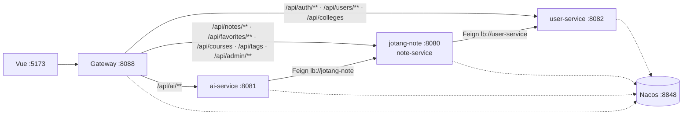

# 架构设计

本文定服务边界、服务内部结构与拆分顺序。《系统设计》描述当前实现，二者冲突时以本文的边界规则为准。

## 1. 原则

| 原则 | 含义 |
|---|---|
| 按业务能力拆 | 依据变更频率、扩缩容 / 故障特征、数据归属；不按表、不按包拆 |
| 演进式拆分 | 先模块化单体（编译期边界），再逐个外提为进程（运行期边界） |
| 服务自治 | 服务之间不共享 Maven 契约模块、不共享表；跨域只走 HTTP |
| 消费方定义契约 | 跨服务端口由消费方定义，适配器负责模型转换（ACL） |
| DDD 分层 | 每个服务内部按 interfaces / application / domain / infrastructure 分层 |
| 数据私有 | 一个服务一个 schema，禁止跨服务 JOIN、禁止写别人的表 |

## 2. 服务划分

| 服务 | 限界上下文 | 拥有的表 | 拆分理由 |
|---|---|---|---|
| user-service | Identity / Profile / Social | `user`、`college`、`password_reset_token`、`user_follow` | 安全边界独立，故障影响面大，变更少 |
| note-service | Catalog / Note / Favorite / Comment | `note`、`note_file`、`note_tag`、`tag`、`course`、`favorite`、`comment` | 核心域；列表与搜索需要本地 JOIN |
| ai-service | Assistant / Knowledge | `ai_message`、`knowledge_doc`（MySQL）；分块与向量（pgvector） | 调用慢，需独立限频 / 超时 / 扩缩容，技术栈不同 |
| im-service | Messaging | `conversation`、`message` | 长连接、有状态、多实例扇出 |

不拆的部分：

| 能力 | 归属 | 理由 |
|---|---|---|
| 评论 | note-service | 可见性依赖 `note.status`，列表页要评论数；拆开形成双向调用 |
| 关注 | user-service | 用户图；影响主页计数、关注流、聊天权限 |
| 学院 | user-service | 用户属性，只被注册、改资料、上传者展示使用 |
| 课程 / 标签 | note-service | 笔记分类，只被笔记筛选与上传使用 |
| storage | 公共库 | 零业务依赖；做成服务会让文件流多跳一次 |
| mail | user-service 内 | 无领域状态，只是发信原语 |
| admin | note-service | 只是带角色校验的笔记操作 |
| RAG | ai-service 内 | 与现有会话共用模型、限频、会话历史 |

## 3. 服务内部结构（DDD）

每个服务统一四层，依赖只能向内：

| 层 | 职责 | 允许依赖 |
|---|---|---|
| interfaces | 入站适配器：Controller、WebSocket、请求 / 响应 DTO、Assembler | application |
| application | 用例编排、事务边界、调用出站端口 | domain、端口 |
| domain | 聚合、实体、值对象、领域服务、领域事件、Repository 接口 | 无（不依赖 Spring / MyBatis） |
| infrastructure | 出站适配器：MyBatis、Feign、OSS、Redis、MQ、配置 | domain、application 端口 |

规则：

- 聚合是唯一的一致性边界；跨聚合通过应用服务或领域事件，不直接注入对方仓储。
- 写路径走聚合 + Repository；读路径（列表 / 搜索 / 详情）用 QueryDao 直接返回 DTO，不强行经过聚合。
- 持久化对象（PO）与领域对象分离，转换在 infrastructure；纯字典表（`college` / `course` / `tag`）可直接用 PO。
- `jotang-common` 只给 interfaces / infrastructure 用；domain 抛领域异常，由 interfaces 统一映射为响应体。

### 3.1 user-service

```
com.wlf.user
├── interfaces/web/          # AuthController / UserController / FollowController + dto
├── application/
│   ├── identity/            # 注册、登录、退出、密码找回
│   ├── profile/             # 资料、头像
│   ├── social/              # 关注、取关、关注列表
│   └── port/out/            # MailSender、LoginAttemptLimiter、AvatarStorage
├── domain/
│   ├── user/                # User 聚合、值对象、UserRepository、PasswordPolicy
│   ├── college/             # College 参照数据
│   ├── social/              # Follow 关系、FollowRepository
│   └── event/               # UserProfileUpdated
└── infrastructure/
    ├── persistence/         # PO / Mapper / Repository 实现 / Converter
    ├── mail/                # SMTP / 队列实现
    ├── cache/               # 登录限频
    └── config/
```

- 聚合：`User`（账号 + 资料 + 角色）、`Follow`（followerId / followeeId）。
- 认证与资料共用 `User` 聚合，避免两个聚合之间的一致性成本。

### 3.2 note-service

```
com.wlf.note
├── interfaces/web/          # Note / Catalog / Favorite / Admin Controller + dto
├── application/
│   ├── note/                # 上传、编辑、删除、详情、列表、搜索、上下架
│   ├── favorite/            # 收藏 / 取消 / 我的收藏
│   ├── catalog/             # 课程、标签
│   ├── comment/             # 评论（后续）
│   └── port/out/            # UserProfileReader、NoteFileStorage、FavoriteReader、NoteVisibilityReader
├── domain/
│   ├── note/                # Note 聚合、NoteFile、NoteTag、NoteStatus、状态机
│   ├── favorite/            # Favorite 聚合
│   ├── catalog/             # Course、Tag
│   ├── comment/             # Comment 聚合（后续）
│   └── event/               # NotePublished / NoteDeleted / CommentCreated
└── infrastructure/
    ├── persistence/
    ├── storage/             # 对接 jotang-storage
    ├── client/user/         # Feign 适配器 + 消费方自有 DTO
    └── config/
```

- 聚合：`Note`（含 NoteFile、NoteTag、状态与计数）、`Favorite`、`Comment`。
- 领域服务：`NoteStateMachine`、`NoteAccessPolicy`、`TagNormalizer`。
- 同服务跨上下文也走端口：note 读收藏状态走 `FavoriteReader`，favorite 读笔记可见性走 `NoteVisibilityReader`。

### 3.3 ai-service

```
com.wlf.ai
├── interfaces/web/          # AiController / KnowledgeAdminController
├── application/
│   ├── assistant/           # 摘要、对话
│   ├── knowledge/           # 摄取、检索、问答
│   └── port/out/            # ChatModel、EmbeddingModel、VectorStore、NoteContentReader
├── domain/
│   ├── assistant/           # Conversation 聚合、Message、SummaryPolicy
│   ├── knowledge/           # KnowledgeDocument 聚合、Chunk、RetrievalPolicy
│   └── event/
└── infrastructure/
    ├── llm/                 # Spring AI 适配（chat / embedding）
    ├── vector/              # pgvector 适配
    ├── client/note/         # Feign 适配器
    ├── persistence/         # MySQL 关系数据
    └── config/
```

- 聚合：`Conversation`（多轮消息）、`KnowledgeDocument`（元数据 + 分块）。
- 领域服务：`ConversationWindowPolicy`、`ChunkingPolicy`、`RetrievalPolicy`（阈值、引用、无召回拒答）。
- 两个上下文共用 `infrastructure/llm`，不跨服务共享模型配置。

### 3.4 im-service

```
com.wlf.im
├── interfaces/ws/           # WebSocket 入站
├── interfaces/web/          # 历史消息 REST
├── application/
│   ├── chat/                # 发消息、拉历史、已读、建会话
│   └── port/out/            # UserProfileReader、SocialGraphReader、PresenceRegistry、MessageDelivery
├── domain/chat/             # Conversation 聚合、Message、ReadCursor
└── infrastructure/
    ├── persistence/
    ├── redis/               # 在线状态、跨实例 pub/sub
    ├── client/user/         # Feign 适配器
    └── config/
```

- 聚合：`Conversation`（参与者、消息、已读游标）。
- 领域服务：`MessageOrdering`、`DeliveryPolicy`；跨实例投递经 Redis pub/sub。

### 3.5 jotang-gateway

- 职责：按路径路由、校验 JWT、注入身份头、剥离客户端伪造头；业务鉴权仍在各服务。
- 结构：`config/`（路由与 JWT Bean）、`filter/AuthGlobalFilter`。

### 3.6 取舍

- 只对写路径和核心规则建聚合；列表 / 搜索 / 详情用 QueryDao，不套聚合。
- 不为每个上下文建 Maven 模块，包级隔离即可；模块拆分按服务，不按上下文。
- PO 与领域对象分离只用于有行为 / 不变量的聚合，避免全面映射的空转成本。
- 过渡期实体暂保留 MyBatis-Plus 注解，限频器暂留 application，读模型分页暂用 `IPage`；需要替换实现时再抽端口与 PO。
- 暂不引入 ArchUnit：跨服务零依赖已由 Maven 模块图在编译期强制；模块内部的层间规则等 PO / 分页清理后再补，否则例外会淹没规则。

## 4. 模块结构

```
jotang-note (parent, packaging=pom)
├── jotang-common        # 响应体 / 异常 / JWT / 身份头 / 分页 / 通用工具
├── jotang-storage       # StorageService + OSS，纯库
├── jotang-user          # user-service 业务库
├── jotang-user-app      # user-service 启动 / 装配
├── jotang-note          # note-service 业务库
├── jotang-note-app      # note-service 启动 / 装配
├── jotang-ai            # ai-service 业务库
├── jotang-ai-app        # ai-service 启动 / 装配
├── jotang-im            # im-service
└── jotang-gateway       # Spring Cloud Gateway：路由 + JWT 校验
```

> 每个外提的服务 = `<svc>` 业务库 + `<svc>-app` 启动/装配；`@SpringBootApplication` 只出现在 `-app`。

依赖规则：

| 规则 | 说明 |
|---|---|
| 服务模块互不依赖 | `user` / `note` / `ai` / `im` 之间零 Maven 依赖 |
| 不建契约模块 | 不建 `-api` / `-contract`；跨服务 DTO 由消费方自持 |
| 端口在消费方 | 出站端口放消费方 `application/port/out`，适配器放 `infrastructure/client` |
| 装配根唯一 | 未拆的域用本地适配器，已拆的域用 Feign 适配器，都由 `jotang-<svc>-app` 装配 |
| 禁跨域访问 | 不得 import 其他服务的任何类；由 Maven 模块图在编译期强制 |
| 暂不写 ArchUnit | 跨服务规则与 Maven 重复；模块内层间规则等 PO / 分页清理后再补 |
| 启动类独立 | 每个服务外提时新建 `jotang-<svc>-app`，不在业务模块里放 `@SpringBootApplication` |

## 5. 数据边界

- 同一 MySQL 实例，每个服务独立 schema、独立账号；不做分布式数据库。
- ai-service 是唯一的双存储服务：关系数据在 MySQL，知识库分块与向量在 PostgreSQL + pgvector。
- 每个模块只读写自己的表；跨域只读走端口，不 JOIN。
- note 列表装配：先查本域分页 → 收集 `uploaderId` → `UserProfileReader.batchGet` → 本地拼装。上传者与学院不是筛选条件，分页与排序不受影响。
- 跨域一致性走 MQ 事件，不做分布式事务。现有事件：孤儿对象清理。新增：用户资料变更（缓存失效）、评论创建（通知）。

## 6. 跨服务接口

| 消费方端口 | 消费方 | 提供方 | 用途 |
|---|---|---|---|
| `UserProfileReader` | note、im | user-service | 批量取昵称 / 头像 / 学院 |
| `SocialGraphReader` | note、im | user-service | 关注列表 / 关系判断 |
| `NoteContentReader` | ai、im | note-service | 鉴权后取文件键、按标题检索、笔记可见性 |

- 提供方只暴露 HTTP 接口，不发布 jar、不共享 DTO；接口挂在 `/internal/**`，网关不暴露，用服务令牌鉴权。
- 网关校验 JWT 后注入 `X-User-Id` / `X-User-Role` / `X-Gateway-Token`；下游 `IdentityFilter` 验网关令牌后采信。
- 服务间调用由 Feign 的 `UserContextFeignInterceptor` 透传 `X-User-*`；内部接口另用 `X-Internal-Token` 鉴权。
- note 的 `UserProfileReader` Feign 适配器在 `jotang-note/infrastructure/client/user`，由 `jotang-note-app` 开启 `@EnableFeignClients`。
- 消费方在 `application/port/out` 定义端口，在 `infrastructure/client/<provider>` 放 Feign 接口、消费方自有 DTO 与适配器；适配器负责模型转换。
- 远程调用统一用 **OpenFeign**（HTTP/JSON），服务名由 Nacos 解析。
- `@EnableFeignClients` 只在拆出的 `jotang-<svc>-app` 上开启。
- 外提的 `-app` 直接启用 Feign；未外提的服务仍用本地适配器。
- 代价：DTO 与 Feign 接口在消费方重复，提供方改字段时消费方需同步。用消费方契约测试或 OpenAPI 校对兜底，不靠共享 jar 强绑定。

## 7. 部署

当前本地拓扑：



- 网关：**Spring Cloud Gateway 5.0**，按路径前缀路由到 `lb://<service>`，实例由 Nacos 提供。
- Nacos：Docker Compose 单机模式；阶段 1 只启用注册发现，配置中心后续再接。
- 鉴权：网关校验 JWT，注入 `X-User-Id` / `X-User-Role` / `X-Gateway-Token`，不再转发 `Authorization`；服务端 `IdentityFilter` 验网关令牌后采信，直连 JWT 作兜底。
- 服务间：note 读上传者资料走 Feign `lb://user-service`（`/internal/users/batch`）；`/internal/**` 由 `X-Internal-Token` 鉴权，网关不暴露。
- 目标拓扑仍是 Nginx（静态 + TLS）→ Gateway → 各服务；Nginx 不再按业务前缀分发。
- PostgreSQL + pgvector 仅 ai-service 使用，后续 RAG 阶段再加。

## 8. 演进路线

| 阶段 | 内容 | 完成标准 |
|---|---|---|
| 0 模块化单体 | 建父 POM 与模块；按 DDD 四层搬迁；跨域调用改端口；去掉跨服务 JOIN | `mvn test` 全绿；仍是单 jar；接口行为不变 |
| 1 抽 ai-service | `ai_message` 独立 schema，引入 Flyway；`NoteContentReader` 走 OpenFeign；引入 Nacos、Gateway 与网关鉴权 | ai 可独立启停；网关统一入口并拒绝无效 token；note 不可用时有可观测错误 |
| 2 抽 user-service | `UserProfileReader` 走 OpenFeign；用户资料缓存待补 | 注册 / 登录 / 列表展示行为不变 |
| 3 抽 note-service | note 从过渡单体外提；`UserProfileReader` 适配器归位到 note；删除单体模块 | note 独立启停；网关路由与 AI 的 `NoteContentReader` 不变；`mvn test` 全绿 |
| 4 新功能 | 评论落 note，关注落 user，聊天独立 im-service | 见 §9 |
| 5 RAG | ai-service 内新增 Knowledge 上下文；pgvector 存储与检索；摄取独立进程 | 问答带引用；无召回时明确拒答 |

阶段 0 的搬迁顺序：模块骨架 → DDD 分层 → 端口替换 → JOIN 拆除。

## 9. 新功能落位

| 功能 | 落点 | 关键表 | 跨服务调用 |
|---|---|---|---|
| 评论 | note-service | `comment` | 通知事件 → user-service 消费 |
| 关注 | user-service | `user_follow` | note-service 查 followee ids；im-service 判关系 |
| 聊天 | im-service | `conversation`、`message` | 取用户资料、判关注关系 |
| RAG | ai-service | `knowledge_doc`（MySQL）；分块与向量（pgvector） | 无；笔记检索仍走 `NoteContentReader` |

## 10. 未决项

- **embedding 提供方**：DeepSeek 无 embedding 接口，需另配（百炼 `text-embedding-v3` 或自托管 bge-m3）。
- **pgvector 部署**：PostgreSQL 镜像与 pgvector 扩展版本待定；仅 ai-service 使用，独立于 MySQL。
- **启动依赖**：打开 embedding 模态后，缺凭据会拦住整个应用，需做条件装配。
- **聊天范围**：仅文本 / 是否离线拉取、未读、内容治理，待单独定义。
- **JWT 兜底清理**：下游 `IdentityFilter` 仍接受直连 Bearer JWT；确认没有直连需求后删除。
- **用户资料缓存**：`UserProfileReader` 已走 Feign，Redis 缓存未加；笔记列表每次会批量调 user-service。
- **note 测试夹具**：`jotang-note-app` 以 test scope 依赖 `jotang-user`，`jotang_note` 里保留 user/college 表给 note 测试；运行时不使用，后续改成 stub 后清理。
