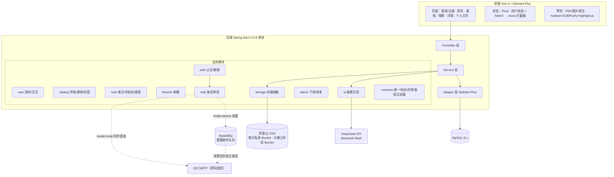
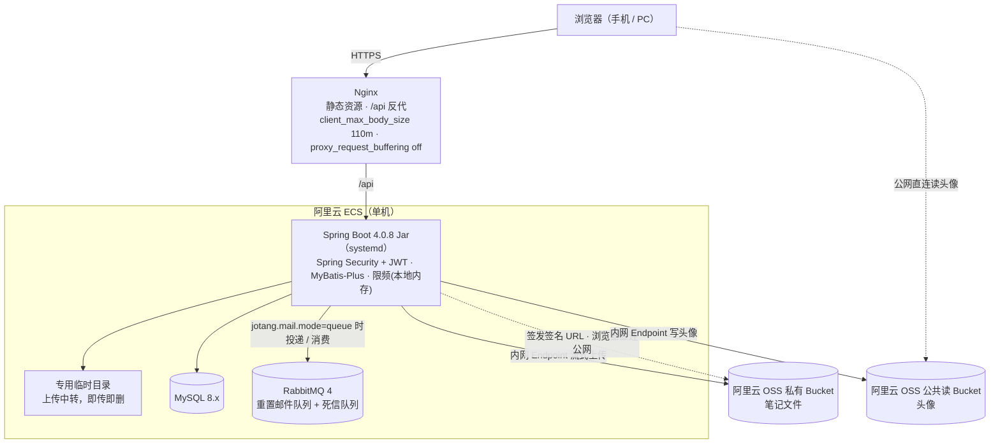
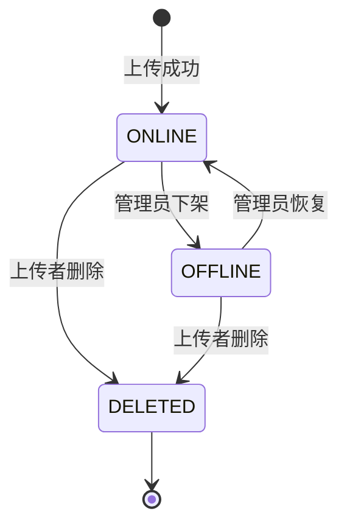
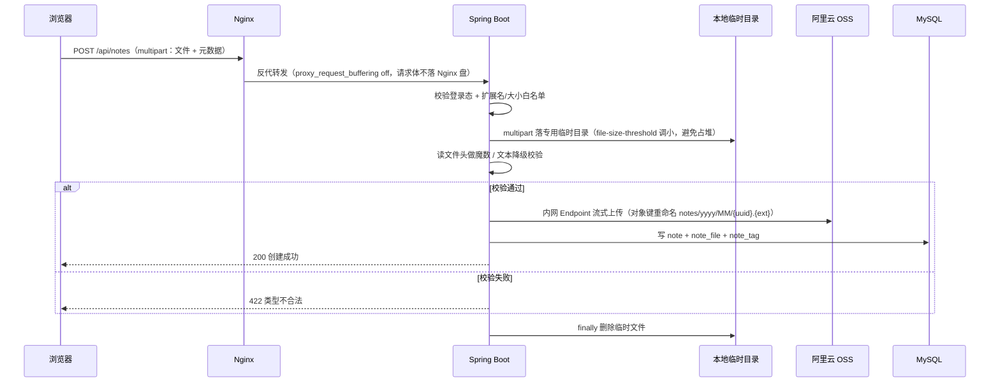
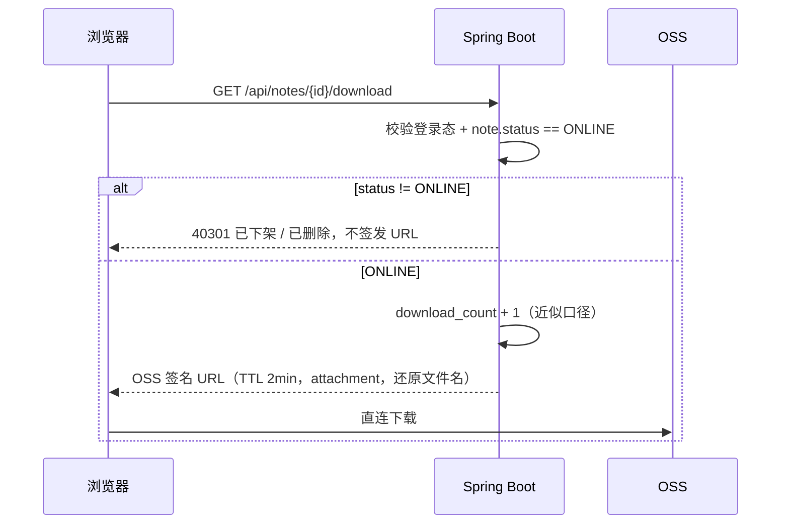
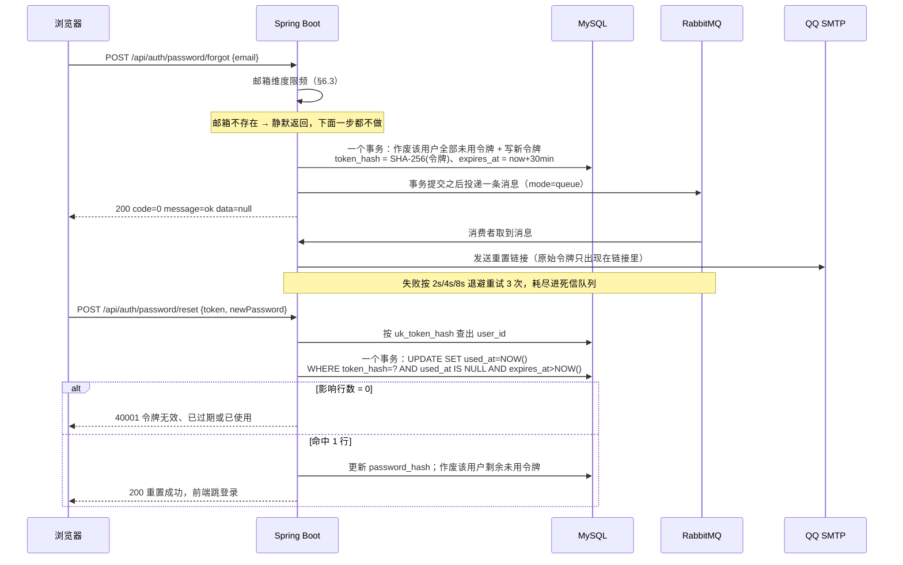
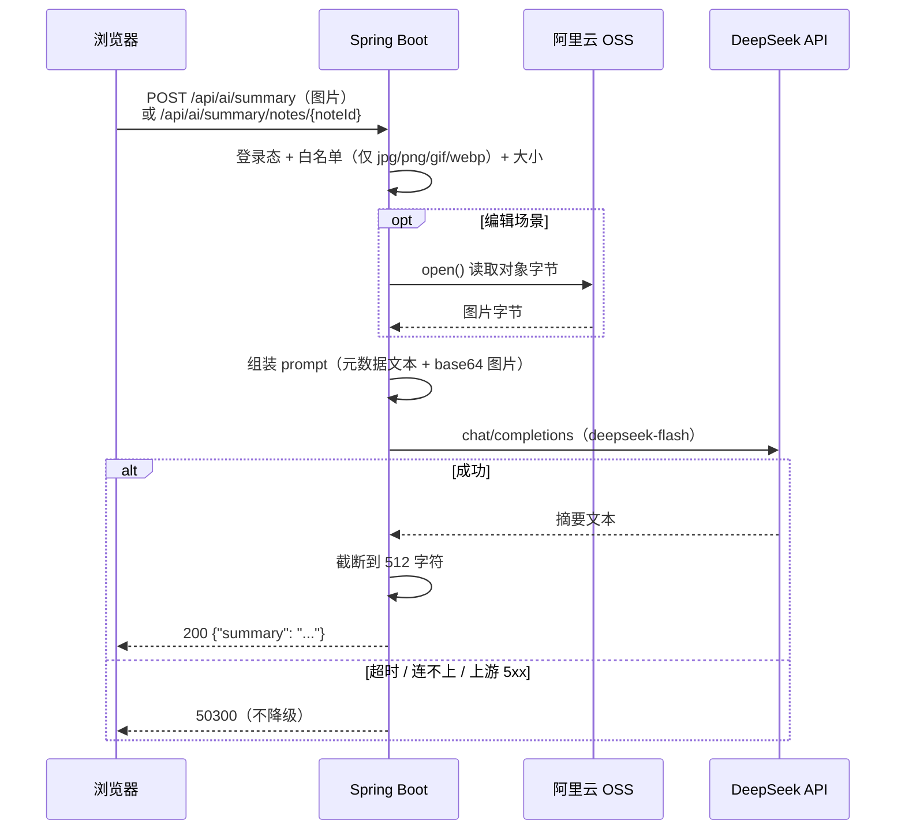

# Jotang Note 概要设计（MVP）

> 承接《需求分析》与《技术选型》，定「**怎么落地**」：架构、模块、数据模型、状态机、接口清单、关键机制。
> **类设计、方法签名、SQL 明细以代码为权威**（建表脚本 `src/main/resources/schema.sql`，接口出入参见 Apifox，§9），本文档不重复。
> 本文档只保留**结论与契约**；推导过程、取舍论证与实测过程不在此展开。所有小节编号被代码引用，**不可重编号**。

## 0. 设计决策

| 编号 | 决策点 | 结论 | 影响 |
|---|---|---|---|
| D1 | 退出/改密后的 token 失效 | 不做服务端即时失效，用 2h 短 TTL 缓解；前端删 token 即退出 | 不引入 Redis；见 §8.4 第 1 条 |
| D2 | 下载量口径 | 按「签发下载签名 URL 的次数」**近似**计数 | 计数可能偏高 |
| D3 | 登录限频维度 | **仅账号维度**：5 次失败锁 10 分钟 | 避免误伤同校园网出口的整批用户 |
| D4 | 笔记删除 | **软删除**：`note.status` 扩为 `ONLINE/OFFLINE/DELETED`，行不物理删除 | 收藏占位可渲染；外键永不悬空 |
| D5 | 标签关联 | 新增 `note_tag` 关联表 | |
| D6 | 密码找回令牌 | **落库** `password_reset_token`（SHA-256 哈希、一次性消费、TTL 30min） | 应用重启不失效；不引入 Redis |
| D7 | 头像访问 | 头像存**独立公共读 Bucket**（公共读 / 私有写），接口返回完整公网 URL | 免签名、浏览器直连；与笔记私有 Bucket 隔离 |
| D8 | 学院归属 | 学院独立成表；`user.college_id` **必填**，`course` **去掉** `college` 列。笔记的学院 = **上传者的学院**，`note` 不冗余存、靠 JOIN `user` 推导 | 上传表单只需选课程；改学院**回溯改变**全部历史笔记归属；**不做按院隔离** |
| D9 | AI 摘要范围 | 只做「用户点按 → 读图片 → 生成摘要填入简介框」：仅光栅图笔记、同步一次性 JSON、用户可改且**不自动保存**、结果**不落库** | 新增 `ai` 模块与 2 个接口（§5.8）；不引入 chat-memory |
| D10 | 重置邮件投递 | **引入 RabbitMQ**：请求链路只「写令牌 + 投消息」，发信由消费者做；**事务提交后**投递；1 次初始 + 3 次重试（2s/4s/8s），耗尽进死信队列（TTL 1h）。由 `jotang.mail.mode` 切换，默认 `smtp` | 动机是**防枚举**而非性能；新增 `mail` 模块与 Broker。代价：Broker 是新单点、明文令牌也进 Broker（§6.6.2、§8.3） |

表数：**9 张**。

## 1. 系统架构

### 1.1 分层与模块



- **模块边界**：Controller 只做参数校验与编排；业务规则全部落在 Service；跨表/复杂检索走 MyBatis XML，单表 CRUD 走 MyBatis-Plus。
- **跨模块访问**：跨模块的**业务操作**走对方 Service。**但检索侧的多表 JOIN 不受此限**——列表 / 搜索 / 详情都需匹配课程名 / 标签名 / 上传者，`NoteMapper.xml` 可直接 JOIN `course`、`tag`、`user`、`college`（判定依据是**读路径**，`GET /api/notes/{id}` 同此办理）。
- **跨模块写对方单表列**：仅当对方没有能承接该写的 Service、或注入它会形成构造器循环依赖时，允许直接注入对方 Mapper，**且必须在类注释写明理由**。现有两处：`AuthService` → `UserMapper`（`UserService` 无建用户入口）；`FavoriteService` → `NoteMapper`（维护 `note.favorite_count`，反向注入成环）。`com.wlf.entity` 是共享包，引用实体不算跨模块。
- **`ai` 读笔记只经 `NoteService`，不注入 `NoteMapper`**：它要的是纯读路径，依赖方向单向往 `AiSummaryService → NoteService`，不成环。
- **存储抽象**：所有 OSS 操作（**流式上传、读取、签名 URL 签发、删除对象**）收敛在 `StorageService` 接口，OSS 为首个实现，V2 可平替 MinIO。接口只提供这四件原语，**不含业务策略**（对象键拼法、TTL、白名单由调用方决定）。
- **`mail` 与 `auth` 是单向的 `auth → mail`**：`mail` 只提供「发一封邮件」这一个原语，主题与正文由 `auth` 组装；发信时机（同步 / 队列）收拢在同一个接口的实现上。
- **鉴权**：`common` 内的无状态 JWT 过滤器统一拦截，`admin` 模块通过角色规则保护。

### 1.2 部署拓扑



- **RabbitMQ 单机**（`docker compose` 起 `rabbitmq:4-management`），当前只服务密码找回的重置邮件一条链路，因此是该链路的**新单点**（§8.4 第 13 条）。它是**可选的**：`jotang.mail.mode` 默认 `smtp` 时队列相关 Bean 一个都不注册。
- **OSS 两个访问面**：ECS 与 OSS 同 Region，后端上传 / 写头像一律走 `oss-<region>-internal.aliyuncs.com`；签发给浏览器的签名 URL 与头像公网直读走公网 Endpoint。**二者必须是两个客户端**——签名 URL 的主机名取自签发时所用客户端的 Endpoint。
- 「用哪个 Endpoint」是**环境差异而非代码差异**：本机开发数据面也走公网，由 `application-local.yaml` 覆写。
- **两个 Bucket**：笔记文件→私有；头像→公共读（§6.7）。
- 开发期可先用 IP 访问，但 JWT/密码为明文传输，仅限自测。

## 2. 模块职责

| 模块 | 职责 | 关键类（示例） |
|---|---|---|
| auth | 注册、登录、退出、密码找回（令牌签发/校验/消费）、登录与找回限频 | `AuthController` / `AuthService` / `PasswordResetService` / `LoginAttemptLimiter` |
| user | 资料维护、头像上传（写公共读 Bucket）、个人主页统计 | `UserController` / `UserService` |
| catalog | 学院/课程查询、标签查询与**按名创建**。学院与课程预置只读；标签有写路径（同名复用，§3.2） | `CatalogController` / `CollegeService` / `CourseService` / `TagService` |
| note | 笔记 CRUD、列表/热门/课程/标签聚合、搜索、状态机、**孤儿对象对账**（§7.3） | `NoteController` / `NoteService` / `NoteStateMachine` / `OrphanObjectSweeper` |
| favorite | 收藏/取消收藏、我的收藏（含占位） | `FavoriteController` / `FavoriteService` |
| storage | 流式上传、读取、签名 URL 签发、对象删除 | `StorageService` / `OssStorageService` |
| mail | 发信。只出原语，时机（同步 / 队列）收在实现上（§6.6） | `MailService` / `SmtpMailService` / `QueuedMailService` / `MailDispatchConsumer` |
| ai | AI 摘要：读笔记图片、调 DeepSeek 出建议文本。**只读不写，不碰任何库表**（§6.8） | `AiSummaryController` / `AiSummaryService` |
| admin | 下架 / 恢复上架 | `AdminNoteController` |
| common | 统一响应体、全局异常、JWT 签发与校验、参数校验 | `ApiResponse` / `GlobalExceptionHandler` / `JwtAuthFilter` / `JwtTokenProvider` |

## 3. 数据库设计

统一约定：`InnoDB` + `utf8mb4`；主键 `BIGINT UNSIGNED` 自增；时间字段 `DATETIME`；**文本一律存原文，输出时转义**。

### 3.1 表清单（9 张）

- **账号**：`user` · `college` · `password_reset_token`
- **内容**：`note` · `note_file` · `course` · `tag` · `note_tag`
- **互动**：`favorite`

### 3.2 表结构要点

**建表脚本以 `src/main/resources/schema.sql` 为唯一权威**，本节只记**读列定义读不出来的约束**。库表变更的迁移流程见 §7.4。

| 表 | 关键约束 | 要点 |
|---|---|---|
| `college` | `uk_name` | 预置数据，应用内只读；注册时必选（D8） |
| `user` | `uk_username`、`uk_email`；`college_id` **NOT NULL** + `fk_user_college` | `avatar` 存**对象键**而非完整 URL（§6.7）；`status` 预留，MVP 不实现禁用 |
| `course` | `uk_name`；`is_other` | 预置数据 + 一条固定的「其他」；D8 后**不含 `college` 列** |
| `note` | `fk_note_uploader`、`fk_note_course`；`status` 三值；**`updated_at` 无 `ON UPDATE`**；6 个索引 | 软删除，行不物理删除（D4）；`deleted_at` 仅在 `status=DELETED` 时写入 |
| `note_file` | `uk_note_id`（一份笔记一个文件）、`uk_storage_key` | `storage_key` 格式 `notes/yyyy/MM/{uuid}.{ext}`；`is_purged=1` 表示对象已物理清理（§3.3） |
| `tag` | `uk_name` | 目录侧唯一写路径：上传时按名复用或当场创建 |
| `note_tag` | 复合主键 `(note_id, tag_id)` | **无顺序列**，读取按 `tag.id` 升序（§5.4） |
| `favorite` | `uk_user_note` | 重复收藏由它兜底（40902）；`note_id` 指向软删除的 `note`，外键永不悬空 |
| `password_reset_token` | `uk_token_hash`；`used_at IS NULL` 为一次性判据 | 只存 `SHA-256(令牌)`；`expires_at` = 签发 + 30 分钟（§6.6） |

**`note` 的六个索引**（§8.2 的三种排序都走这些索引，删掉任一个都会让对应排序退化成 filesort）：

| 索引 | 支撑 |
|---|---|
| `idx_status_created` (`status`, `created_at`) | 最新发布 |
| `idx_status_updated` (`status`, `updated_at`) | 最近更新，`sort=latest` 的排序键 |
| `idx_status_view` (`status`, `view_count`) | 热门·浏览 |
| `idx_status_download` (`status`, `download_count`) | 热门·下载 |
| `idx_course_status` (`course_id`, `status`) | 课程页 |
| `idx_uploader_status` (`uploader_id`, `status`) | 我的上传 |

### 3.3 设计要点

- **软删除闭环（D4）**：`note` 行永不物理删除 → 收藏列表能读到 `DELETED` 渲染"笔记已删除"、读到 `OFFLINE` 渲染"已下架"，外键不悬空。**无需**在 `favorite` 里存标题快照。
- **计数并发**：`view_count/download_count/favorite_count` 一律 `UPDATE note SET x = x + 1 WHERE id = ?` 原子自增；收藏重复性由 `uk_user_note` 兜底（40902）。
- **浏览计数不包事务**：详情接口的自增与随后的读取刻意不同事务，避免 `note` 行锁持有到请求结束。「只有 ONLINE 才计数」由语句内 `WHERE ... AND status = ?` 承担。
- **`note.updated_at` 语义 = 用户最后编辑笔记的时间**，故 `note` 刻意**不带** `ON UPDATE CURRENT_TIMESTAMP`（`user.updated_at` 带）；**只有编辑接口显式写 `updated_at = NOW()`**，浏览量自增、下架/恢复一律不碰它。
- **计数器一致性**：`favorite_count` 为派生值，提供一条离线校准 SQL（`UPDATE note SET favorite_count = (SELECT COUNT(*) FROM favorite WHERE note_id = note.id)`）用于对账，不进入主链路。
- **搜索策略**：MVP 用 `LIKE '%kw%'` 覆盖标题/简介/教师/课程名/标签，**接受全表扫描**，分页深度最多 50 页 / 前 1000 条；预留 `FULLTEXT ... WITH PARSER ngram` 作 V2 开关。
- **分页深度上限对所有列表/搜索统一**：`page × size > 1000` 报 40001（带 `field: page`），**不是截断成空页**；单页大小另有 `size ≤ 50` 守卫（参数校验），**页码上界只能在 Service 里查**（§8.2）。
- **OSS 物理清理**：用户删除笔记后清理 OSS 对象并置 `note_file.is_purged=1`，**不可恢复**；管理员的下架/恢复只改 `status`，不动对象。
  - **删除不碰 OSS**：`NoteService#delete` 只做「锁行 → 校验归属 → 走状态机 → 写 `status`」，对象由 §7.3 定时对账回收，`is_purged` 留在 0 就是待办清单。取此方案的理由是：同步清理挂在请求链路上不划算（用的是给大文件上传配的客户端，最坏陪等到 60s），而清没清掉不影响用户所见结果。**代价是回收有延迟**（§8.4 第 11 条）。
  - **顺序是先删对象、后置标记**，不能反：先置 1 再删，删除失败那一行就谎称"已清理"，而对账判据正是这一列。先删后标最坏只是"对象删了、标记没写上"，重跑即可（`StorageService#delete` 对不存在的对象是 no-op）。
  - **重复删除不再顺带清理**：幂等 200 就真的什么都不做；对账按 `is_purged = 0` 扫，与"删过几次"无关。
  - **删除不碰**：`note.updated_at`、`favorite_count` 与 `favorite` 行（§6.5 不解除收藏关系）、`note_tag` 行。
- **密码找回令牌（D6）**：只存 `SHA-256(令牌)`，明文仅出现在邮件链接；`used_at IS NULL` 为一次性判据；重新申请即作废全部未用令牌。详见 §6.6。
- **头像对象键版本化（D7）**：`avatars/{userId}/{uuid}.{ext}`，换头像即换键，旧键不覆盖 → 可对公共读 Bucket 配长 `max-age` 强缓存而不串图。详见 §6.7。
- **学院归属（D8）**：学院挂 `user` 而非 `course`，`note` 也不冗余存——笔记的学院 = **上传者的学院**，读取时 JOIN `user` 推导。三处后果：①**改学院会回溯改变该用户全部历史笔记的归属**；②上传表单只需选课程；③学院**只作分类维度，不做按院隔离**（公共课笔记归到上传者所在学院是刻意的）。另：`course.name` 因此可加 `uk_name` 唯一约束。

## 4. 状态机

### 4.1 笔记状态（`note.status`）



| 状态 | 列表/搜索 | 详情页 | 预览/下载/收藏 | 编辑 | 我的上传 | 收藏列表 |
|---|---|---|---|---|---|---|
| ONLINE | 可见 | 正常 | 允许 | 允许 | 正常 | 正常 |
| OFFLINE | 不可见 | 提示"已下架" | 禁止 | **允许**（改完仍是下架） | 可见并标注 | 占位"已下架" |
| DELETED | 不可见 | 提示"已删除" | 禁止 | 禁止 | **不可见** | 占位"已删除" |

- **恢复**只允许 `OFFLINE → ONLINE`；`DELETED` 是终态，无出边。
- 状态迁移合法性集中在 `NoteStateMachine` 判（`requireTransition(from, to)`，表驱动覆盖四条边）；**禁止 Controller 直接改 status**。
- **详情页对非 ONLINE 笔记照常返回 200，不抛 40301**——它的职责是把状态带出去让前端渲染提示；「我的收藏」列表同理（§5.5）。这是仅有的两处。返回内容按「元数据照常、文件字段整体置空」处理（§5.4）。
- **编辑不是一次状态迁移**，不走 `NoteStateMachine`；状态门只是前置判断：`DELETED` 才拒（40301），`OFFLINE` 放行。**「非 ONLINE 一律拒」在编辑这一列上是错的**（§5.4）。
- **「我的上传」对 `DELETED` 不可见、对 `OFFLINE` 可见并标注**，与「收藏列表」刻意相反：前者问「我还在维护哪些」，后者问「我曾经收藏过什么」。
- **浏览量只在 `ONLINE` 时 +1**，由 `WHERE status = 'ONLINE'` 同时完成守卫与计数。

### 4.2 用户角色

`USER` / `ADMIN` 二值，存 `user.role`，签发时写入 JWT claim（§5.6 管理员接口据此判权限）。

**MVP 无后台、无自助提权**，管理员账号只能预先造好。`data.sql` 目前只播了学院 / 课程 / 标签，**没有管理员账号**，需补上（§10）；当前手工改库（`UPDATE user SET role='ADMIN' WHERE ...`），改完该用户重新登录一次即可（权限来自 JWT claim）。

## 5. 接口设计

统一前缀 `/api`，统一响应体 `{ "code": 0, "message": "ok", "data": ... }`；鉴权走 `Authorization: Bearer <jwt>`。完整出入参与示例同步至 Apifox。

### 5.1 认证

| 方法 | 路径 | 说明 |
|---|---|---|
| POST | `/api/auth/register` | 注册（用户名/邮箱/密码/学院）；学院取自 `GET /api/colleges`，必填（D8） |
| POST | `/api/auth/login` | 登录，成功返回 JWT + 用户信息 |
| POST | `/api/auth/logout` | 退出（前端清 token；服务端空实现） |
| GET | `/api/auth/me` | 当前登录用户 |
| POST | `/api/auth/password/forgot` | 发送重置邮件（邮箱维度限频；响应不区分邮箱是否存在，§6.6） |
| POST | `/api/auth/password/reset` | 凭邮件令牌重置密码（一次性、TTL 30 分钟，§6.6） |

### 5.2 用户与资料

| 方法 | 路径 | 说明 |
|---|---|---|
| GET | `/api/users/{id}` | 个人主页（昵称/学院/`avatarUrl`/上传数/累计浏览下载） |
| PUT | `/api/users/me` | 改昵称 / 改学院，**PUT 全量替换**（两字段都必填）。出参 `ApiResponse<UserInfo>` |
| POST | `/api/users/me/avatar` | 上传头像（≤2MB，仅 jpg/png/webp，写公共读 Bucket，§6.7）。出参 `ApiResponse<UserInfo>` |

**`PUT /api/users/me`**——只改 `user` 表两列，**不级联写任何东西**：

- **`note` 不冗余存学院**，所以「改学院回溯改变历史笔记归属」没有任何级联代码。写入方只有两列，影响面覆盖全部历史笔记。
- **列清单钉死为 `nickname` / `college_id`**，其余列一个都不能出现（写成「实体整体写回」会覆盖并发改动，且因显式赋值 `updated_at` 而抑制 `ON UPDATE`，此后真实修改也不再推进它）。守卫用例见 `UserProfileServiceTest#updatedAtAdvancesWhenAValueChanges`。
- **`updated_at` 不手写**，交给 `user.updated_at` 的 `ON UPDATE`。
- **出参回显资源**（与 `PUT /api/notes/{id}` 回 `data:null` 不同）：前端要立刻覆盖 Pinia 里的昵称与学院。出参复用 `auth` 的 `UserInfo`。
- **`UserInfo` 只给 `collegeId`、不给 `collegeName`**；`avatarUrl` 由 `user.avatar` 对象键现拼成公网 URL（§6.7），没设过为 `null`。装配收口在 `UserInfo.from(User, StorageService)`，**刻意不保留不带 `StorageService` 的重载**。
- **本接口不失效详情缓存**，后果见 §8.4 第 9 条。

**`POST /api/users/me/avatar`**——multipart 单文件，只写 `user.avatar` 一列：

- **出参回显整个 `UserInfo`**：头像是服务端生成的对象键，前端推不出 URL。
- **只在 `user.avatar` 一列上写**，守卫用例见 `UserAvatarServiceTest#onlyAvatarColumnIsWritten` 与 `#updatedAtAdvancesWhenAvatarChanges`。
- **旧头像对象不删**（§8.4 第 8 条），清理挂在 §7.3。
- **更新失败要补偿删除**刚传上去的对象。

### 5.3 课程与标签

| 方法 | 路径 | 说明 |
|---|---|---|
| GET | `/api/colleges` | 学院列表（注册表单与筛选的下拉数据源） |
| GET | `/api/courses` | 课程列表，支持按名称搜索 |
| GET | `/api/tags` | 标签列表 |

### 5.4 笔记

| 方法 | 路径 | 说明 |
|---|---|---|
| POST | `/api/notes` | 上传（multipart：文件 + 元数据）。标签按**名称**提交而非 id，由 `TagService` 同名复用或当场创建（§3.2）；校验后流式传 OSS 并落库（§6.1） |
| GET | `/api/notes` | 列表：`sort=latest\|hot_view\|hot_download`，`courseId`/`tagId` 筛选，分页 `page`/`size`。**只出 ONLINE**；超深分页报 40001 |
| GET | `/api/notes/search` | 关键词搜索（标题/简介/教师/课程名/标签） |
| GET | `/api/notes/{id}` | 详情。非 ONLINE 也返回 **200**（§4.1）；**仅 ONLINE 时浏览量 +1**，返回已含本次的值；`isFavorited` 如实查 `favorite` 表 |
| PUT | `/api/notes/{id}` | 编辑元数据（上传者本人，**JSON 而非 multipart**）。**全量替换**（见下）。出参 `{"code":0,"message":"ok","data":null}` |
| DELETE | `/api/notes/{id}` | 软删除（上传者本人，`→DELETED`）。**已删除时幂等 200**；`OFFLINE` 亦可删。出参同上 |
| GET | `/api/notes/{id}/preview-url` | 图片/PDF 预览：返回 OSS 签名 URL（§6.2） |
| GET | `/api/notes/{id}/raw` | MD/文本预览：后端代理返回原文（§6.2） |
| GET | `/api/notes/{id}/download` | 返回下载签名 URL，`download_count+1`（近似口径 D2） |
| GET | `/api/users/me/notes` | 我的上传，按上传时间倒序分页。**只出 ONLINE / OFFLINE，`DELETED` 无条件排除**（§4.1）；不含 `uploader` 与 `isFavorited` |

> 列表 / 搜索 / 详情 / 收藏等只要展示上传者信息，一律返回 **`avatarUrl`**（完整公网 URL，§6.7），**不返回 OSS 对象键**；前端直接 ``，无需二次请求签名或代理。

**详情响应体**（`NoteDetailResponse`）——一次请求读七个数据源：`note` / `note_file` / `course` / `user` / `college` 全是 to-one，一条 JOIN 出一行；标签（`note_tag`⋈`tag`）与笔记成 to-many，另查一条；收藏是与当前登录者相关的旁路判断，走 `FavoriteService`。共三次查询。

- **非 ONLINE 时 `file` 整体为 `null`**，其余元数据一条不少（§4.1）。ONLINE 笔记必有且只有一个文件（`uk_note_id` 保证），故 `file == null` 无歧义。
- **不返回 `storageKey`**；`previewMode` 由读取侧从 `content_type` 现推（§6.2），不是库里的字段。
- **课程与标签都用 `{id, name}`**，形状复用 §5.3 的 `CourseResponse` / `TagResponse`。
- **学院嵌在 `uploader` 下层而不是顶层**（它不是笔记的属性，D8）。
- **标签按 `tag.id` 升序**（`note_tag` 无顺序列）；没有标签时返回**空数组**而不是 `null`。
- `status` 与 `previewMode` 按**枚举名**输出（`"ONLINE"` / `"PDF_INLINE"`）；`createdAt` / `updatedAt` 是 ISO-8601 无时区串。

**列表响应体**（`PageResponse<NoteListItemResponse>`）——外壳固定 `items` / `total` / `page` / `size`；`total` 是**真实总数不封顶**。列表项比详情少 `status` / `summary` / `teacher` / `createdAt` / `file`。

- **一页固定四次数据库交互，与页大小无关**：主干分页 + MP count + 标签批量查询 + 收藏批量查询（后两条对「这一页的 id」做一次 `IN`，不是逐条查）。
- **标签绝不能 JOIN 进分页查询**——`LIMIT` 切的是 JOIN 之后的行，会静默切错页。**筛选**用的 JOIN（`tag_id = ?` 等值）是安全的。
- **`sort` 走白名单，全程不出现 `${}`**：排序键来自 `NoteListQuery.Sort` 枚举，XML 用 `<choose>` 映射；非法取值在绑定阶段拦下（40001 + `field: sort`）。
- **每个排序都带 `id DESC` 作次级键**（`view_count` / `download_count` 大面积并列时翻页会重复或漏项）。
- **列表只出 ONLINE**，`total` 同样是筛过的数。
- 列表项带 `isFavorited`，故**必须知道「谁在看」**，`userId` 取自 JWT。

**`PUT /api/notes/{id}`**——只改元数据与标签，**整条链路不碰 OSS，也不碰 `note_file`**：

- **请求体是 JSON 而非 multipart**（编辑不能增删附件，请求里没有文件部分）。
- **是 PUT 全量替换，不是 PATCH**：没传的字段等于**清空**——`summary` / `teacher` 传 `null` 抹掉，`tags` 传 `null` 或空数组**清空全部标签**。
- **回显复用 `GET /api/notes/{id}`**；**回显必须完整**——正因「没传 = 清空」，表单必须把全部可编辑字段填进去（`tags` 漏回填最危险）。
- **读写形状不对称，前端必须映射**：`tags` 详情出 `[{id, name}]`、`PUT` 收**名称数组**；`course` 详情出 `{id, name}`、`PUT` 收 `courseId`。
- **「该不该显示编辑按钮」由前端判断**（比 `uploader.id` 与登录态，看 `status` 是否为 `DELETED`）；后端只在提交时用 40300 / 40301 兜底。
- **边界**：`OFFLINE` 放行、`DELETED` 报 40301；非本人 40300、id 不存在 40400。
- **`updated_at` 是全系统唯一由本接口写入的时间戳**（§3.3）；UPDATE 列清单钉死为 `title / summary / teacher / course_id / updated_at`。
- **标签全量替换落在 `note_tag` 上是「先删净再插回」**（删的是**关联**不是标签本身）。
- **状态门用普通比较判 `DELETED`，不走 `NoteStateMachine`**（编辑不发生迁移）。
- **「锁行 → 读归属与状态 → 再写」三步同事务**，复用 `NoteMapper#selectOwnershipForUpdate`；锁序 note 在前，第二张表是 `tag`。
- **标签解析放在事务内**（与上传刻意放在事务外相反——这里没有 OSS）。
- **出参是「无数据的成功」**。

**我的上传**（`GET /api/users/me/notes`）：

- **只出 `ONLINE` 与 `OFFLINE`，`DELETED` 无条件排除**（§4.1）。
- **排除落在 SQL，不在 Service 里过滤**（否则 count 把被排除的也数进去）。要排除的状态由调用方传入。
- **必须带 `status`**（它是变量）——这正是不复用 `NoteListItemResponse` 的原因。
- **不含 `uploader`**（恒等于当前登录用户）、**不含 `isFavorited`**。
- **排序固定 `created_at DESC`，不开放 `sort` 参数**；次级键 `id DESC` 仍必需。
- **响应体只给 `createdAt`，不给 `updatedAt`**。
- **后果需接受**：删除后笔记从本列表消失，用户再无入口看到自己删过的笔记。

### 5.5 收藏

| 方法 | 路径 | 说明 |
|---|---|---|
| POST | `/api/notes/{id}/favorite` | 收藏。仅 ONLINE（否则 40301）；重复 40902；笔记不存在 40400。出参 `{favoriteCount}` |
| DELETE | `/api/notes/{id}/favorite` | 取消收藏。**幂等**：没收藏过也回 200 与当前计数，只有笔记不存在才是 40400。**非 ONLINE 也放行**（§6.5）。出参同 `{favoriteCount}` |
| GET | `/api/users/me/favorites` | 我的收藏，分页 `page`/`size`，按**收藏时间倒序**，含占位项。只查登录者自己的 |

- **两个写接口都回最新 `favoriteCount`**（读值与自增同事务且已排他锁）。
- **取消收藏与收藏的状态规则刻意不对称**（收藏只允许 ONLINE，取消不限制，§6.5）。
- **重复收藏报 409 而不是静默成功**。
- **「我的收藏」的占位项保留 `title` 与 `course`，其余为空**——保留**身份**，隐去**内容**；`favoritedAt` 照常返回；三个计数用可空类型。
- **排序键是 `favorite.created_at`，次级键 `favorite.id`**（`idx_user_created` 支撑）。次级键必需：`created_at` 是秒精度。
- **本列表过滤条件只有 `favorite.user_id`，不含 `note.status`**（三种状态都要取回来渲染占位）。分页深度上限与其他列表一致（§3.3）。

### 5.6 管理员

| 方法 | 路径 | 说明 |
|---|---|---|
| POST | `/api/admin/notes/{id}/offline` | 下架（`ONLINE→OFFLINE`）。**幂等**：已是 `OFFLINE` 返回 200 且不写库；已删除报 40301、不存在报 40400。出参 `{"code":0,"message":"ok","data":null}` |
| POST | `/api/admin/notes/{id}/online` | 恢复（`OFFLINE→ONLINE`）。规则与下架对称。**不能复活已删除的笔记**（`DELETED` 是终态，且其 OSS 对象已清理） |

需 `role=ADMIN`；详情页对管理员显示"下架/恢复"按钮，前端依据 JWT 的 role 判断。

- **鉴权在过滤器链上判，不在 Controller 里**：`SecurityConfig` 给 `/api/admin/**` 配 `hasRole("ADMIN")`；未登录走 `AuthenticationEntryPoint` 出 40100，非管理员走 `AccessDeniedHandler` 出 40300（§5.7）。
- **这两个动作不做归属校验**（管理员下架的是**别人的**笔记，故方法名带 `admin` 前缀）。
- **只改 `status` 一列，不动 OSS 对象，也不碰 `updated_at`**。
- **三种边界在服务层各自收口**：不存在 → 40400、已删除 → 40301、已在目标状态 → 幂等 200 不写库。三支收掉后，走到状态机的必然是一次真实迁移，`requireTransition` 退化成安全网。
- **不记录操作者**（无 `offlined_by` / `offlined_at`，无审计表），见 §10。
- **本组是「下架」第一次变得可达**。

### 5.7 统一错误码

| code | 含义 | HTTP |
|---|---|---|
| 0 | 成功 | 200 |
| 40001 | 参数校验失败（`data` 携带字段级明细 `[{field, message}]`） | 400 |
| 40100 | 未登录 / token 无效或过期 | 401 |
| 40101 | 用户名或密码错误（登录表单内提示，**不跳转**） | 401 |
| 40300 | 无权限（非本人 / 非管理员） | 403 |
| 40301 | 笔记已下架或已删除（禁止预览 / 下载 / 收藏）。**编辑只在一半上用它**——`DELETED` 报 40301，`OFFLINE` 放行（§4.1、§5.4） | 403 |
| 40400 | 资源不存在 | 404 |
| 40901 | 用户名已被占用 | 409 |
| 40902 | 重复收藏 | 409 |
| 40903 | 邮箱已被注册 | 409 |
| 42200 | 文件类型 / 大小不合法 | 422 |
| 42300 | 账号已锁定（`data` 携带剩余锁定秒数） | 423 |
| 42900 | 摘要生成过于频繁（按用户限频，§6.8） | 429 |
| 50000 | 服务器内部错误 | 500 |
| 50300 | AI 摘要服务暂不可用（模型超时 / 上游失败，§6.8） | 503 |

> **业务码与 HTTP 状态码非一一对应**：HTTP 状态码供传输层粗粒度分流，业务码供应用层精确分支。同一 HTTP 状态可承载多个业务码（如 `40300` / `40301` 同为 403），前端据此区分，**无需解析 `message` 文案**。

### 5.8 AI 辅助摘要（D9）

> 本节编号排在错误码之后是**刻意的**：§5.7 已被全仓引用（`ErrorCode`、`GlobalExceptionHandler`、`SecurityConfig` 的类注释），重编号会把那些引用全部指错。

| 方法 | 路径 | 说明 |
|---|---|---|
| POST | `/api/ai/summary` | **上传场景**。multipart，字段 `file`（图片），可选 `title` / `teacher` 作上下文 |
| POST | `/api/ai/summary/notes/{noteId}` | **编辑场景**。文件已在 OSS，服务端自取。仅**上传者本人**（否则 40300）；`DELETED` 报 40301、`OFFLINE` 放行（与 §5.4 编辑同一口径）；id 不存在 40400 |

出参统一为 `{"code":0,"message":"ok","data":{"summary":"..."}}`。

- **两个接口的差别是文件位置**：上传时对象还不存在（文件只在前端手里），编辑时对象已在 OSS。
- **一次「生成摘要」+ 一次「提交」，图片各上行一次**（是两个用户动作各一次）；本接口收到的那份**读完即弃**，是纯函数。**不落暂存区、不建草稿**（会引入中间态与无凭据的孤儿，§7.3 的对账够不着）。
- **AI 请求里的图照样先过 Spring multipart 解析**（超过 `file-size-threshold` 先落临时目录才判 10MB），与 §6.7 头像同形。
- **白名单只有四种光栅图**（jpg/jpeg/png/gif/webp），是 §6.1 `FORMATS` 表的**子集**；字节判定复用 `common/FileMagic`。非图片一律 42200。
- **`summary` 是建议不是结果**：接口**不写任何库表**，存不存由随后的 `POST /api/notes` 或 `PUT /api/notes/{id}` 决定。
- **上传场景的文件校验复用 `NoteFilePolicy.inspect`，但不沿用 100MB 上限**（AI 另设更小上限，§7.1）。
- **`OFFLINE` 放行是刻意的**（与 §4.1 的「编辑」列一致）。

## 6. 关键机制设计

### 6.1 上传流程（后端中转 + 流式传 OSS）



**三重校验规则**：

| 扩展名 | 魔数 / 判定 | 预览方式 |
|---|---|---|
| pdf | `%PDF-` | 签名 URL 内联 |
| jpg/png/gif/webp | `FF D8 FF` / `89 50 4E 47` / `GIF8` / `RIFF....WEBP` | 签名 URL 内联 |
| docx/xlsx/pptx | `PK\x03\x04`（与 zip 同族） | 仅下载 |
| zip/rar/7z | `PK\x03\x04` / `Rar!` / `37 7A BC AF 27 1C` | 仅下载 |
| md/txt | **无魔数** → 降级为「扩展名 + UTF-8 可解码 + 无 NUL 字节」 | 后端代理 |

- **拒绝 `svg`/`html`/`js`/可执行文件**（避免在 OSS 域上的存储型 XSS）。
- 魔数与扩展名不一致 → 拒绝。
- 表中「预览方式」一列是**类型的属性**而非行的状态，**不落库**，读取侧由 `content_type` 推导（§6.2）。
- 对象键重命名 `notes/yyyy/MM/{uuid}.{ext}`，不使用原始文件名；`original_name` 入库，下载时还原。
- 体积、缓冲与临时目录参数的权威出处是 §7.1。

### 6.2 预览 / 下载鉴权



| 场景 | 方式 | 关键约束 |
|---|---|---|
| 图片预览 | 签名 URL，前端 `` 直出 | TTL **5min**；仅光栅图白名单；`Content-Type` 取自对象元数据，读取时**不覆写** |
| PDF 预览 | 签名 URL（**方案待定**，见 §10） | 默认域名会强制下载，而 PDF 只能走 `<iframe>` |
| MD / 文本预览 | 后端代理 `/raw` | `Content-Type: text/plain; charset=utf-8` + `X-Content-Type-Options: nosniff`；前端再走 marked+DOMPurify |
| 下载（全部类型） | 签名 URL | TTL **2min**；`response-content-disposition=attachment; filename*=UTF-8''...` |

- 所有入口先校验登录态与笔记状态，**下架/删除后不再签发新 URL**。
- **`previewMode` 由 `content_type` 推导，不落库**：`PreviewMode.of(contentType)` 现推；认不出来的一律落「仅下载」；**不查写入侧白名单**（那是准入闸门）。新增受支持类型须同步这条映射，漏改只降级为仅下载。
- **预览的 `Content-Type` 不通过签名 URL 覆写**（OSS 自 2025-01-20 起禁止 `response-content-type` 覆写）：类型在上传时按魔数判定并写进对象元数据，入口即钉死。**类型一旦入库便不可修改**（上传之后没有任何接口能替换文件）。下载用的 `response-content-disposition` 不受此限。
- **默认域名强制下载**：OSS 默认域名会给响应附加 `Content-Disposition: attachment`，**显式请求 `inline` 也压不过**。只作用于「导航」场景，浏览器加载 `` 子资源时忽略此头，**图片预览不受影响**；受影响的是必须走 `<iframe>` 的 PDF 预览。绑定自定义域名可绕开。
- **已知限制**：URL 在其 TTL 内可被转发给未登录者，下架前已签发的 URL 在到期前仍可用（§8.4 第 2 条）。

### 6.3 登录限频（D3）

- **仅账号维度**：`login:fail:{username}`，失败 +1，累计 5 次锁 10 分钟；成功清零。避免误伤同校园网出口的整批用户。存储用本地内存（`ConcurrentHashMap` + 惰性过期，不引入中间件）。
- 锁定返回 `42300` + 剩余秒数。
- **找回接口限频**：`/api/auth/password/forgot` 同一邮箱 5 分钟 1 次，超限 `42300`，防止被用来轰炸邮箱、打爆 QQ SMTP 配额。
- **已知限制**：应用重启后锁定状态丢失（§8.4 第 4 条）。

### 6.4 认证与 JWT（D1）

- 算法 HS256，密钥走环境变量；Claims：`sub(userId)`、`role`、`username`、`iat`、`exp`、`jti`。
- **TTL 2 小时**；前端存 Pinia + `localStorage`，Axios 拦截器注入、401 统一跳登录。
- **已知限制**：退出/改密/找回后旧 token 在 TTL 内仍有效，服务端不维护失效名单（§8.4 第 1 条）；V2 引入 Redis 后可用 `jti` 黑名单或改 refresh token。
- 前端**禁止 `v-html` 渲染任何用户输入**；MD 预览必须经 DOMPurify。

### 6.5 收藏与占位（D4）

- 收藏前校验 `note.status == ONLINE`，否则 40301。
- 收藏列表查询 `favorite JOIN note`，按 `note.status` 渲染占位；`OFFLINE→ONLINE` 恢复后自动正常展示。
- 占位项不可预览/下载，但**不解除收藏关系**。
- **取消收藏不限制状态，且幂等**（「没收藏过也返回 200 与当前计数」，只有笔记本身不存在才是 40400）。
- **计数维护落在 `NoteMapper`，由 `FavoriteService` 直接注入**（§1.1 的跨模块写例外）。
- **锁序：收藏与取消收藏都先锁 `note` 行，再碰 `favorite`**——唯一的死锁防线（InnoDB 检查 `fk_fav_note` 时对父行取隐式共享锁，直觉写法会在并发收藏同一篇时死锁）。
- **计数器的三处不变量**：重复收藏不多加（`uk_user_note` + 回滚）；取消两次不多减（`deleted > 0` 才减）；漂移成 0 时不减成负数（`AND favorite_count > 0`）。

### 6.6 密码找回（令牌落库，D6）

令牌**不放内存**：落 `password_reset_token` 表，应用重启不失效，且靠单条 UPDATE 原子保证一次性消费。



- **令牌生成**：`SecureRandom` 32 字节 → URL-safe Base64；只存 **SHA-256** 哈希（BCrypt 用不上）。
- **一次性消费**：`used_at IS NULL` 是唯一判据，成败由**单条 UPDATE 的受影响行数**决定（天然抗重放，无需加锁）。
- **TTL 30 分钟**；重新申请作废全部旧未用令牌（至多一个有效）；改密成功后剩余未用令牌一并作废。
- **过期行清理**：`DELETE FROM password_reset_token WHERE expires_at < NOW() - INTERVAL 7 DAY`，**尚未落地**（§10）。
- **限频**见 §6.3。
- **防枚举**：`/forgot` 不登录即可调，两条分支现在返回同一个 200，耗时在 `mode=queue` 下也天然对齐（§8.4 第 12 条）。成功响应 `message` 恒为 `ok`、`data` 为 `null`，「若邮箱存在…」是前端写死的文案。
- **旧令牌是「作废」而不是物理删除**（置 `used_at` 保留痕迹）。
- **新密码长度约束与注册逐字相同**（`@Size(min = 8, max = 64)`）。
- **`expires_at` 由数据库时钟写入**（`TIMESTAMPADD(MINUTE, 30, NOW())`），消费时也拿 `NOW()` 比。
- 实现与用例详见 `docs/功能说明/auth/密码找回.md`。

#### 6.6.1 发布边界

令牌落库与投递消息之间必然有缝隙。选**提交后投递**：提交成功、投递失败时令牌在库里、邮件没发出，**用户可自愈**（重新申请会作废旧令牌、投新消息）。在事务内投递会让回滚后邮件指向不存在的令牌；事务性 outbox 能消除缝隙，但要多一张待投递表 + 投递器 + 轮询。判据是「失败之后用户能不能自己走出来」。

#### 6.6.2 明文令牌现在也存在于 Broker 里

邮件正文必须含明文令牌，而正文现在是消息载荷。四层缓解：①**消息非持久化**（不落 Broker 磁盘）；②工作队列 `x-message-ttl` = 10 分钟；③死信队列 `x-message-ttl` = 1 小时（两个 TTL 相加 = 最长驻留 **70 分钟**，§8.3）；④**Broker 不对公网开放**——这是整套缓解里**唯一的硬边界**。**刻意不做**正文加密（解密方与加密方同机同配置，净增复杂度）。

#### 6.6.3 重试与死信

消费端失败的处置全部由配置表达（§7.1）：

- **`default-requeue-rejected: false`**（Spring 默认 `true`，**必须显式改掉**，否则毒消息无退避地重投）。
- **`max-retries: 3`**（1 次初始 + 3 次重试），退避 2s → 4s → 8s，最坏占住消费者约 14 秒。⚠ 键名是 `max-retries` 不是 `max-attempts`。
- **耗尽后进死信队列**（`x-dead-letter-exchange` + `x-dead-letter-routing-key`，与上一条是一对，少了它们就变成**直接丢消息**）；死信队列**不挂消费者**。处置见 §7.3。

两处行为细节：容器内的重试不离开消费者，Broker 只看到一次投递（死信 `x-death` 计数是 1）；正文不是合法 JSON 的消息不被重试，直接进死信队列。

**消费端幂等**：at-least-once 下「发信成功但 ack 前崩」必然重投，用户可能收到两封一样的邮件——**接受它**（令牌一次性，点哪封都一样）。做 exactly-once 的代价大于收益。

### 6.7 头像访问链路（独立公共读 Bucket，D7）

笔记文件必须私有，头像则是"给所有人看"的公开资源，故独立成**第二个 Bucket：公共读、私有写**。

| 项 | 设计 |
|---|---|
| Bucket | `jotang-avatar`（**公共读 / 私有写**），与笔记私有 Bucket 物理隔离 |
| 对象键 | `avatars/{userId}/{uuid}.{ext}`——**版本化**，换头像即换键 |
| 上传 | 仍经后端 `POST /api/users/me/avatar`（≤2MB，仅 jpg/png/webp，经**内网 Endpoint** 写对象） |
| 读取 | 业务接口返回**完整公网 URL**，浏览器 `` 直连 OSS |
| 对象元数据 | `Cache-Control: public, max-age=31536000, immutable` |
| 安全 | 严格类型白名单，**拒绝 `svg`/`html` 等可注入类型**；`Content-Type` 以服务端判定为准 |

- **`Cache-Control` 经 `StorageService#upload` 的 `cacheControl` 参数写入对象元数据**（存储层不内置缓存策略）：头像传长缓存，笔记对象传 `null`。
- **体积上限是两层，且外层先执行**：策略层的 2MB 在控制器里判，但要先被 Spring 的 multipart 解析完（`max-file-size` 100MB）。
- **类型白名单各持一份，「字节是什么类型」共用** `common/FileMagic`；**头像白名单是 note 那张表的子集**（gif / pdf 在笔记里合法、在头像里不合法）。
- 业务接口统一返回 `avatarUrl`；后端**既不为读头像签发 URL，也不经 ECS 转发**（不占 ECS 带宽）。
- **代价**：URL 永久公开、不可撤回，换头像后旧 URL 在缓存过期前仍可访问（§8.4 第 8 条）。

### 6.8 AI 摘要调用（D9）

本项目**第一次调用外部付费服务**，故超时、失败、限频、密钥、费用五件事都得现定。



- **同步、一次性 JSON，不做流式**（D9）。
- **图片走 base64 内联，不走 §6.2 的签名 URL**（不把私有 Bucket 地址与 TTL 交给第三方）；代价是请求体膨胀约 4/3，故上限必须显著小于 §6.1 的 100MB（§7.1）。
- **编辑场景复用 `StorageService#open`**（与 §6.2 的 `/raw` 是同一类需求）。
- **prompt 里除图片外还带上用户已填的 `title` / `teacher`**。
- **超时必须显式写出来**（`spring.ai.openai.chat.timeout`）；**只有这一条 request timeout，没有独立的连接超时开关**（实测修正）。
- **上游失败报 `50300`，不是 `50000`**（超时、连接失败、上游 4xx/5xx 一律归 50300）。
- **不做降级**（白名单里只有图片，要么能读要么报错）。
- **按用户限频，超出报 `42900`**（每次调用都计费，实现沿用 `LoginAttemptLimiter` 的本地内存做法）。
- **输出截断到 512**（不能指望模型守约，否则用户点保存会撞上 §5.4 的 `@Size(max = 512)`）。
- **结果不落库、也不缓存**（§10）。
- **starter 会把六种模态全注册，必须显式关掉用不到的五个**：`spring.ai.model.<模态>` 默认值都是 `openai`，那五个模态各自在启动时构造客户端并校验凭据，没配 key 会让**整个应用起不来**。取值只能是 `openai` / `none`。
- **chat 这一条不同：不在启动时校验凭据**（key 传空串也能构造成功），故把那五个关掉后**完全没有 key 也能正常启动**；代价是「没配 key」从启动期错误变成运行期错误（报 50300）。
- **API Key 走环境变量但带空默认值**（`${JOTANG_AI_API_KEY:}`）：与 `jwt.secret`、OSS AccessKey 那种**无默认值**的写法刻意不同（AI 没有只是少一个可选功能）；**默认值不能省**，否则属性缺失反而在启动期报错。**刻意不用通用的 `OPENAI_API_KEY`**（避免被机器上同名变量静默顶替）。

## 7. 部署与运维

### 7.1 配置基线

所有可调参数集中在此，别处只讲机制、不再重复列值。**改之前先读「说明」列**——其中几条之间是有约束关系的。

| 项 | 值 | 说明 |
|---|---|---|
| Nginx `client_max_body_size` | `110m` | **必须 ≥ 后端 `max-request-size`**，否则请求在 Nginx 就被 413 拦下（§6.1） |
| Nginx `proxy_request_buffering` | `off` | 请求体不落 Nginx 临时盘 |
| Nginx `proxy_read_timeout` / `proxy_send_timeout` | 放宽 | 上传大文件耗时较长 |
| Spring `max-file-size` | `100MB` | 单文件上限 |
| Spring `max-request-size` | `110MB` | 与 Nginx 体积上限配对的另一半 |
| Spring `file-size-threshold` | `1MB` | 超过即落专用临时目录，避免占堆 |
| 上传临时目录 | 专用路径 + 定期清理残留 | 上传成功或失败的 `finally` 中删除（§6.1） |
| 笔记 Bucket | **私有读写** | 鉴权后签发签名 URL |
| 头像 Bucket | **公共读 / 私有写** | 免签名，浏览器直连（D7、§6.7） |
| OSS Endpoint（后端读写） | `oss-<region>-internal.aliyuncs.com` | 同 Region 内网，流量免费 |
| OSS Endpoint（签名 URL / 头像直读） | 公网 Endpoint | **与上一条必须是两个客户端**（§1.2） |
| JWT 密钥 | 环境变量 | 不入库、不进仓库（§6.4） |
| AI API Key | 环境变量 `JOTANG_AI_API_KEY`，**可留空**（`${JOTANG_AI_API_KEY:}`） | 留空时应用照常启动，只有 AI 调用失败（50300）；**默认值不能省**（§6.8）；**刻意不用 `OPENAI_API_KEY`** |
| AI base-url | `https://api.deepseek.com` | DeepSeek 的 OpenAI 兼容入口 |
| AI 模型 | `deepseek-flash` | 同时收文本与光栅图 |
| 启用的 AI 模态 | `spring.ai.model.chat` = `openai`，其余五个 = `none` | 不关掉用不到的五个会凭空多五个客户端（§6.8） |
| AI 请求超时 | `60s`（框架默认值） | **全项目只有这一个超时**，无独立连接超时开关（§6.8） |
| AI 摘要图片大小上限 | `10MB`（建议值，待实测） | 显著小于 §6.1 的 100MB（§6.8） |
| AI 摘要限频 | 每用户 `10 次 / 小时`（建议值，待实测） | 每次调用都计费（§6.8） |
| SMTP 主机 | `spring.mail.host` = `smtp.qq.com` | **必须配**：少了它 `JavaMailSender` Bean 不创建，整个上下文（含全部测试）起不来 |
| SMTP 端口与加密 | `465`，`mail.smtp.ssl.enable` = `true` | QQ 的 465 是**隐式 SSL**，不是 STARTTLS |
| SMTP 超时 | `connectiontimeout` / `timeout` / `writetimeout` = `5s` | **三个都要显式设**（JavaMail 默认无限等待） |
| SMTP 账号 | `username` / `password` | 密码是 **QQ 的 SMTP 授权码**；真值只进 `application-local.yaml` 与环境变量 |
| 发件人 | `jotang.mail.from`，默认取自 `spring.mail.username` | 必须与已认证账号一致，否则 QQ 拒收 |
| 重置链接前缀 | `jotang.mail.reset-link-base` = `http://localhost:5173/reset-password` | 后端只拼 `?token=…`（§6.6）；前端路由未定（§10） |
| 发信通道 | `jotang.mail.mode` = `smtp`（**生产置 `queue`**） | **唯一切换开关**；默认 `smtp` 是为了「新克隆的仓库不装中间件就能 `./mvnw test` 全绿」。**生产必须置 `queue`**，见 §8.4 第 12 条 |
| RabbitMQ 连接 | `localhost` / `5672` / `admin` / 空 | 环境变量用**裸名** `RABBITMQ_*`（`docker-compose.yml` 的 `RABBITMQ_DEFAULT_USER/PASS` 是唯一真源）。⚠ Compose 自动加载同目录 `.env`，**Spring Boot 不会** |
| 监听器重试 | `retry.enabled` = `true`、`max-retries` = `3`、`initial-interval` = `2s`、`multiplier` = `2.0` | 最多投递 4 次，退避 2s→4s→8s。⚠ 键名是 `max-retries` 不是 `max-attempts`（§6.6.3） |
| 拒绝是否重新入队 | `default-requeue-rejected` = `false` | **Spring 默认 `true`，必须显式改掉**；与队列的 `x-dead-letter-exchange` 是一对（§6.6.3） |
| 预取与确认 | `acknowledge-mode` = `auto`、`prefetch` = `1` | 一次只预取一条 |
| 不可路由消息 | `template.mandatory` = `true` | 路由不到时让 Broker 退回而不是静默丢弃（`RabbitConfig#mailReturnsLogger`） |
| 队列参数 | 工作队列 `x-message-ttl` = 10min / `x-max-length` = 10000；死信队列 `x-message-ttl` = 1h | 定义在**代码**里（`RabbitConfig`）——拓扑名与参数是代码契约。⚠ **创建即固定**，改动要先删旧队列（§7.4） |
| 孤儿对象对账开关 | `jotang.purge.enabled` = `true` | 关掉则 `OrphanObjectSweeper` Bean 不注册（§7.3） |
| 对账首次延迟 | `jotang.purge.initial-delay` = `1h` | 避开启动期抢资源 |
| 对账间隔 | `jotang.purge.fixed-delay` = `1h` | **是 `fixedDelay` 而不是 `fixedRate`**（保证同任务不重叠、慢轮次不排队积压） |
| 对账单轮上限 | `jotang.purge.batch-size` = `100` | `@Scheduled` 默认线程池只有**一条**线程 |

### 7.2 数据初始化

- **学院/课程/标签**：上线前用初始化脚本导入学院名单、课程名单与一批常用标签，并内置一条 `is_other=1` 的"其他"课程；管理员账号同脚本创建（`user.college_id` 非空，须一并指定）。学院与课程**只能**由脚本维护；标签是「脚本预置常用项 + 用户打标时按名创建」并存。

### 7.3 备份与日常维护

- **备份**：MySQL 每日 `mysqldump` 定时备份；OSS 侧可选生命周期规则（本项目因软删除不做自动过期）。
- **孤儿对象对账**：`OrphanObjectSweeper` 定时扫 `status = DELETED AND note_file.is_purged = 0` 的行，删除对应 OSS 对象并置 `is_purged = 1`。它是**应用内的 `@Scheduled` 任务**（判据就在库里，无需外部游标；可与清理动作共用幂等规则；单实例部署）。
  - 覆盖分两层：`OrphanObjectSweeperTest`（mock 存储层）与 `OrphanObjectSweeperOssTest`（`@Tag("oss")`，打真桶验「对象真的从 OSS 消失了」）。**后一层是必须的**——对账成为唯一回收路径后，「桶里的东西真的没了」这半边是 mock 验不到的。
  - 两点后果：①回收延迟 = 对账周期 + 积压（§8.4 第 11 条）；②`jotang.purge.enabled` 一旦关掉或调度器失效，被删对象**再没有任何机制会回收**。
- **旧头像清理（仍未落地）**：换头像即换键，旧对象不再被引用。要做只能扫头像桶，而 `StorageService` **没有 list**（加 `list` 是一次需单独决策的接口扩张）。见 §10。
- **每日维护（已名存实亡）**：原「每日维护脚本」从未存在过；还挂在它名下的只剩 `password_reset_token` 过期行清理（§6.6），同样尚未落地（§10）。
- **重置邮件的死信队列非空时怎么办**：意味着**有用户申请了重置但没收到邮件**。处置：去管理台看 `x-death`（`reason` 为 `rejected` 说明重试确实用尽）；正文里的链接已过期，**不需要补发**，让用户重新申请即可。真正要做的是**查明原因**（看应用日志里 `MailDispatchConsumer` 的异常；SMTP 授权码失效、发件人与认证账号不一致、QQ 配额耗尽是三种最常见的）。**目前没有任何监控盯着这一点**（§8.4 第 15 条）。
- **改了队列参数要先删旧队列**：`RabbitConfig` 里的队列参数**创建即固定**，改完直接重启会得到 `PRECONDITION_FAILED`，失败的是**监听容器**。开发期先删：
  ```bash
  docker exec rabbitmq rabbitmqctl delete_queue jotang.mail.password-reset.q
  ```

### 7.4 库表变更要手工迁移

- 不引入 Flyway / Liquibase，建表脚本是 `src/main/resources/schema.sql`，全部 `CREATE TABLE IF NOT EXISTS`——**对已存在的表是空操作**。任何 DDL 改动光改 `schema.sql` 不生效，必须对已有库**手工执行对应的 `ALTER`**。
- 改列定义可写成幂等形式（`MODIFY COLUMN` 重跑无害）；**加索引不能**——MySQL 8 没有 `ADD INDEX IF NOT EXISTS`，重跑报 1061。
- 已发生两次：`note.updated_at` 摘掉 `ON UPDATE`（§3.3），以及新增 `idx_status_updated`。
- `NoteDetailServiceTest#viewingDoesNotTouchUpdatedAt` 兼作第一个迁移的哨兵。
- **同一类坑在 Broker 上也有一份**：队列与交换机的参数是**创建即固定**的（§7.3）。

## 8. 非功能设计的落地

### 8.1 容量

容量同《需求分析》§7。**上传虽经 ECS 中转，但 ECS→OSS 走内网 Endpoint**，不占公网出带宽，故无需按峰值上传规划公网出口，只需关注 ECS **公网入站**带宽与本地临时目录磁盘；下载与头像均由浏览器直连 OSS，**不经 ECS**。

### 8.2 性能

列表/搜索 P95 < 500ms 为**目标而非承诺**；搜索走全表扫并限制分页深度（§3.3）。列表的三种排序各有对应索引：`latest` → `idx_status_updated`、`hot_view` → `idx_status_view`、`hot_download` → `idx_status_download`。三者均已用 `EXPLAIN` 在 3000 行数据上实测，结果都是 `Backward index scan; Using index`（无 filesort）。

### 8.3 安全

- BCrypt 存密码；无状态 JWT 统一鉴权；所有内容接口要求登录。
- 上传三重校验与对象键重命名见 §6.1；**输出转义**（非入库转义），MD 走 DOMPurify，下载强制 `attachment`，拒收可注入类型。
- **预览类型在入口钉死**：预览响应的 `Content-Type` 取自上传时写入对象元数据的服务端判定值，签名 URL 无法在读取时覆写（§6.2）。因此 §6.1 的「扩展名 + 魔数」白名单是预览型 XSS 的**唯一**防线，必须严格执行。
- 登录限频见 §6.3；密码找回令牌见 §6.6。
- **重置令牌的明文在 Broker 内驻留 ≤ 70 分钟**（§6.6.2）。**该风险的唯一硬边界是「5672 / 15672 不得对公网开放」**——本机开发用 `docker compose` 起的实例只监听本机，符合这条；**生产部署时必须复核**。
- **RabbitMQ 的消息转换器用 `INFERRED` 类型优先级**（不让数据自己声明要变成什么，同 `RedisConfig` 关掉 default typing、`JwtAuthFilter` 不信任客户端声明的角色）。
- 头像落公共读 Bucket，故类型白名单必须严格执行（§6.7）。

### 8.4 已知限制（明确接受）

1. token 在 TTL 内无法即时失效（改密/退出后旧 token 仍可用）。
2. 已签发的签名 URL 在 TTL 内可绕过登录访问，且下架不即时生效（最长滞后 = URL TTL）。
3. 下载量为近似值。
4. 账号锁定状态在应用重启后丢失。
5. 搜索为全表扫描；列表与搜索的分页深度都限制在前 1000 条，超出报 40001（§3.3）。
6. 上传经 ECS 中转，单文件上限 100MB；占用 ECS 公网**入站**带宽，依赖本地临时目录磁盘与清理。
7. 密码找回依赖 QQ SMTP 的发送配额与到达率；过期令牌行**当前没有任何清理机制**（§6.6、§10）；重新申请时旧令牌是**作废**而非删除，故这张表只会单向增长。
8. 头像 Bucket 公共读：头像 URL 永久公开、不可撤回，换头像后旧 URL 在其缓存有效期内仍可访问（§6.7）。
9. 改昵称 / 改学院之后，笔记详情缓存 `note:meta:{noteId}` 最长 10 分钟内仍返回**旧的上传者信息**——它是「写路径一律不失效缓存」的直接后果，改学院的归属回溯因此最长滞后 ≤ 10 分钟（§3.3、D8）。
10. **AI 摘要每次调用都产生费用，且没有总量预算**；结果不缓存，同一张图重复点按钮就重复计费。模型输出质量不受控，故接口定位始终是**建议**，落库前必须经用户确认（§5.8）。
11. **删除笔记后，OSS 对象最长滞留「一个对账周期 + 积压」**（§7.3），只影响存储成本、不影响用户可见行为。**注意反面**：对账是唯一回收路径，把 `jotang.purge.enabled` 关掉（或调度器失效）不会让删除变慢或报错，只会让被删对象永久留在桶里且没有任何迹象。
12. **密码找回的「防枚举」：响应层无条件成立，耗时层只在 `mode=queue` 下成立。**
    - **响应层**（两条分支返回逐字相同的 200）**任何模式下都成立**，代码写死。
    - **耗时层**只在 `mode=queue` 下成立，且**即使在 queue 模式下也不相等**（命中分支多两次 DB 写和一次投递，只是把差距从几百毫秒压到几毫秒，是**更难利用**而非**不可利用**）；靠代码形状一致与 review 维持，没有也不该有计时断言。
    - **⚠ 默认的 `smtp` 模式下时间侧信道仍然存在**：命中分支同步等一次 SMTP 往返。**因此「生产必须设 `jotang.mail.mode=queue`」不只是性能选择，而是这条防枚举成立的前提。** 启动横幅是提醒，但忘了不会报错——**这是本项目里少有的「配置错了不报错、只悄悄削弱一个安全属性」的地方**。
    - 探测速率另有限制：同一邮箱 5 分钟 1 次（§6.3），**只降低速度、不消除差异**。
13. **RabbitMQ 成为重置邮件链路的单点，且失败是静默的**：Broker 不可达时异常被 `PasswordResetService` 咽掉（记 error 日志，请求仍返回 200）。用户看到「已发送」而邮件根本没发出，排障只能靠看日志。选此失败形态是刻意的：让接口失败会打破 §6.6 的防枚举。
14. **「提交后投递」有一个窄窗口：令牌已入库、消息没投出去**（§6.6.1）。可接受是因为**用户可自愈**，而非因为它不会发生。**没有任何对账机制去发现它**。
15. **死信队列非空没有任何监控**——没有 Actuator、没有告警、没有定时检查；1 小时 TTL 还让消息到点自灭，第二天看队列是空的，什么痕迹都没留下。这是「引入一个中间件」在可观测性上真实欠下的债。

## 9. 接口与本文档的交付衔接

- 本文档 §5 的接口清单为**契约基线**，详细出入参同步至 Apifox；后端通过 Apifox IDEA 插件从代码反向同步。
- 前端按 Apifox 契约联调，`ApiResponse` 与错误码由 `common` 统一产出。

## 10. 待确认项

- **管理员的下架 / 恢复没有审计**（无 `offlined_at` / `offlined_by`、无审计表）。候选：①`note` 上加两列；②一张 `note_status_log` 表；③只记结构化日志、接受查不了历史。
- **PDF 预览怎么落地？** 默认域名强制下载，而 PDF 只能走 `<iframe>`/`<embed>`。候选：①面向浏览器的签名 URL 改走已绑定的自定义域名（需 ICP 备案且 DNS 生效）；②前端改用 pdf.js（需给 Bucket 配 CORS）；③后端代理转发（大流量压 ECS 出口，与 §8.1、§6.7 相悖）。**图片预览已可用、不受影响。**
- 笔记列表/搜索要不要支持按**学院**筛选（`collegeId`）？D8 只定了归属、没定筛选，待定。
- 公开侵权投诉邮箱建议与 SMTP 发件邮箱解耦。
- `note.summary` 长度上限（现定 512）与前端展示截断策略。
- **重置链接的前端地址**：`jotang.mail.reset-link-base` 目前是本机开发占位，前端实际路由定了之后要覆盖它。
- **AI 摘要的 prompt 与参数未定稿**；§7.1 里那几项（超时、图片上限、限频）目前是**建议值**，需实测后钉死。
- **图片的 token 上限两处口径不一致**（「384」vs「1024」），**以官方文档为准，待实测**。
- **Spring AI 2.0.1 跑在 Boot 4.0.8 上是「降级运行」**：编译通过、上下文能起、全量测试通过，**当前可用**；但 HTTP 客户端在真实调用下的行为（超时、重试、异常映射）**尚未验证**。两条路：保持现状，或把 Boot 升到 4.1.1 对齐（影响全项目）。
- **AI 摘要没有结果缓存**（§6.8）。要做需先有「图片内容 → 摘要」的键（内容哈希列或按 `storage_key` 做键），上传场景因还没有 id 只能落在编辑场景。
- **补偿删除留下的孤儿对象，对账扫不到**（无数据库行即无从发现）。要覆盖得在补偿路径上留一个痕迹，代价是多一张表或一次额外写。当前接受。
- **旧头像清理仍缺一个前置件**（§7.3）：`StorageService` 没有 `list`，加它是一次需单独拍板的接口扩张。**本轮没做。**
- **`password_reset_token` 的过期行清理尚未落地**（§6.6）：`@EnableScheduling` 已就位，挪进来只是加一个定时方法。要么做，要么明确接受过期行长期堆积。
- **OSS 客户端没有 `requestTimeout`，`maxErrorRetry` 默认值也没实测过**：它决定了**对账一轮能跑多久**（`batch-size` = 100，每条都撞超时再乘重试次数可跑很久）。候选：给对账单独一个 timeout 有界的客户端，或把 `batch-size` 调小。
- **`DELETE /api/notes/{id}` 不再有"提交后清理"**，故也没有"失败了怎么办"这一层；删除现在完全不依赖 OSS 可用性（§8.4 第 11 条的代价）。
- **要不要用事务性 outbox 替掉「提交后投递」？**（§6.6.1）当前按「缝隙可自愈」判为不值得；**哪天邮件的失败不再可自愈**（如做「注册验证邮件」），这笔账要重算。
- **`/forgot` 的邮箱维度限频在多实例下会失效**（本地内存，两个实例各算各的）。MVP 单实例不构成问题；多实例时这条与登录限频、AI 限频要一起挪到 Redis。
- **死信队列没有任何监控**（§8.4 第 15 条）。三个层次：最低是定时打日志报队列深度；中间是 `/actuator/health` 的 `HealthIndicator`（本项目**尚未引入 Actuator**）；最高是接告警通道。本轮一件都没做。
- **发布确认（publisher confirm）没有开**：`convertAndSend` 返回只代表「写进了 socket」。要真知道得开 `publisher-confirm-type=correlated` + `ConfirmCallback`，但**绝不能在请求链路上等它**（会把 §6.6 刚消掉的耗时差搬回来），只能做成异步打日志。
