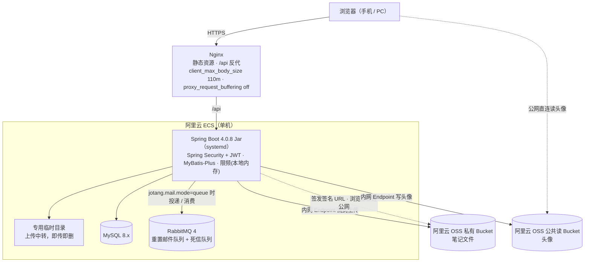
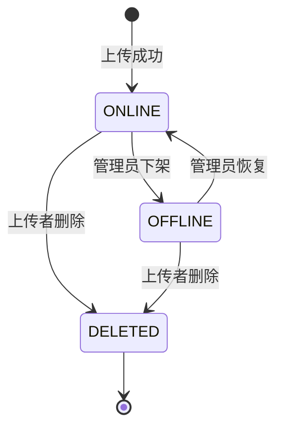

# Jotang Note 概要设计（MVP）

> **类设计、方法签名、SQL 明细以代码为权威**（建表脚本 `src/main/resources/schema.sql`，接口出入参见 Apifox，§9），本文档不重复。

## 0. 设计决策

| 编号 | 决策点 | 结论 | 影响 |
|---|---|---|---|
| D1 | 退出/改密后的 token 失效 | 不做服务端即时失效，用 2h 短 TTL 缓解；前端删 token 即退出 | 暂不引入 Redis |
| D2 | 下载量口径 | **近似**计数 | 计数可能偏高 |
| D3 | 登录限频维度 | **仅账号维度**：5 次失败锁 10 分钟 | 避免误伤同校园网出口的整批用户 |
| D4 | 笔记删除 | **软删除**：`note.status` 扩为 `ONLINE/OFFLINE/DELETED`，行不物理删除 | 收藏占位可渲染；外键永不悬空 |
| D5 | 标签关联 | 新增 `note_tag` 关联表 | |
| D6 | 密码找回令牌 | **落库** `password_reset_token`（SHA-256 哈希、一次性消费、TTL 30min） | 应用重启不失效；暂不引入 Redis |
| D7 | 头像访问 | 头像存**独立公共读 Bucket**（公共读 / 私有写），接口返回完整公网 URL | 免签名、浏览器直连；与笔记私有 Bucket 隔离 |
| D8 | 学院归属 | 学院独立成表；`user.college_id` **必填**，`course` **去掉** `college` 列。笔记的学院 = **上传者的学院**，`note` 不冗余存、靠 JOIN `user` 推导 | 上传表单只需选课程；改学院**回溯改变**全部历史笔记归属；**不做按院隔离** |
| D9 | AI 摘要范围 | 只做「用户点按 → 读附件 → 生成摘要填入简介框」：**光栅图走多模态、md / txt 走纯文本调用**（§5.8）、同步一次性 JSON、用户可改且**不自动保存**、结果**不落库** | 新增 `ai` 模块；PDF / Office 仍需先抽文本，列为 V2 |
| D10 | 重置邮件投递 | **引入 RabbitMQ**：请求链路只「写令牌 + 投消息」，发信由消费者做；**事务提交后**投递；1 次初始 + 3 次重试（2s/4s/8s），耗尽进死信队列（TTL 1h）。由 `jotang.mail.mode` 切换，默认 `smtp` | 动机是**防枚举**而非性能；新增 `mail` 模块与 Broker。代价：Broker 是新单点、明文令牌也进 Broker |

表数：**9 张**。

## 1. 系统架构

### 1.1 分层与模块

- **模块边界**：Controller 只做参数校验与编排；业务规则全部落在 Service；跨表/复杂检索走 MyBatis XML，单表 CRUD 走 MyBatis-Plus。
- **跨模块访问**：跨模块的**业务操作**走对方 Service。**但检索侧的多表 JOIN 不受此限**——列表 / 搜索 / 详情都需匹配课程名 / 标签名 / 上传者，`NoteMapper.xml` 可直接 JOIN `course`、`tag`、`user`、`college`。
- **跨模块写对方单表列**：仅当对方没有能承接该写的 Service、或注入它会形成构造器循环依赖时，允许直接注入对方 Mapper，**且必须在类注释写明理由**。
- **鉴权**：`common` 内的无状态 JWT 过滤器统一拦截，`admin` 模块通过角色规则保护。

### 1.2 部署拓扑

- **RabbitMQ 单机**（`docker compose` 起 `rabbitmq:4-management`）
- **OSS 两个访问面**：ECS 与 OSS 同 Region，后端上传 / 写头像一律走 `oss-<region>-internal.aliyuncs.com`；签发给浏览器的签名 URL 与头像公网直读走公网 Endpoint。**二者必须是两个客户端**——签名 URL 的主机名取自签发时所用客户端的 Endpoint。
- 「用哪个 Endpoint」是**环境差异而非代码差异**：本机开发数据面也走公网，由 `application-local.yaml` 覆写。
- **两个 Bucket**：笔记文件→私有；头像→公共读。
- 开发期可先用 IP 访问，但 JWT/密码为明文传输，仅限自测。

## 2. 模块职责

| 模块 | 职责 | 关键类（示例） |
|---|---|---|
| auth | 注册、登录、退出、密码找回（令牌签发/校验/消费）、登录与找回限频 | `AuthController` / `AuthService` / `PasswordResetService` / `LoginAttemptLimiter` |
| user | 资料维护、头像上传（写公共读 Bucket）、个人主页统计 | `UserController` / `UserService` |
| catalog | 学院/课程查询、标签查询与**按名创建**。学院与课程预置只读；标签有写路径（同名复用，§3.2） | `CatalogController` / `CollegeService` / `CourseService` / `TagService` |
| note | 笔记 CRUD、列表/热门/课程/标签聚合、搜索、状态机、**孤儿对象对账** | `NoteController` / `NoteService` / `NoteStateMachine` / `OrphanObjectSweeper` |
| favorite | 收藏/取消收藏、我的收藏（含占位） | `FavoriteController` / `FavoriteService` |
| storage | 流式上传、读取、签名 URL 签发、对象删除 | `StorageService` / `OssStorageService` |
| mail | 发信。只出原语，时机（同步 / 队列）收在实现上 | `MailService` / `SmtpMailService` / `QueuedMailService` / `MailDispatchConsumer` |
| ai | AI 摘要：读笔记图片或 md / txt 正文、调 DeepSeek 出建议文本（**只读不写**）；AI 对话：多轮问答，可调用工具按标题检索笔记并读其正文 | `AiController` / `AiService` / `AiSummaryFilePolicy` / `NoteTools` |
| admin | 下架 / 恢复上架 | `AdminNoteController` |
| common | 统一响应体、全局异常、JWT 签发与校验、参数校验 | `ApiResponse` / `GlobalExceptionHandler` / `JwtAuthFilter` / `JwtTokenProvider` |

## 3. 数据库设计

统一约定：`InnoDB` + `utf8mb4`；主键 `BIGINT UNSIGNED` 自增；时间字段 `DATETIME`；**文本一律存原文，输出时转义**。

### 3.1 表清单（10 张）

- **账号**：`user` · `college` · `password_reset_token`
- **内容**：`note` · `note_file` · `course` · `tag` · `note_tag`
- **互动**：`favorite`
- **AI**：`ai_message`

### 3.2 表结构要点

**建表脚本以 `src/main/resources/schema.sql` 为唯一权威**，本节只记**读列定义读不出来的约束**。库表变更的迁移流程见 §7.4。

| 表 | 关键约束 | 要点 |
|---|---|---|
| `college` | `uk_name` | 预置数据，应用内只读；注册时必选（D8） |
| `user` | `uk_username`、`uk_email`；`college_id` **NOT NULL** + `fk_user_college` | `avatar` 存**对象键**而非完整 URL（§6.7）；`status` 预留，MVP 不实现禁用 |
| `course` | `uk_name`；`is_other` | 预置数据 + 一条固定的「其他」；D8 后**不含 `college` 列** |
| `note` | `fk_note_uploader`、`fk_note_course`；`status` 三值；**`updated_at` 无 `ON UPDATE`**；6 个索引 | 软删除，行不物理删除（D4）；`deleted_at` 仅在 `status=DELETED` 时写入 |
| `note_file` | `uk_note_id`（一份笔记一个文件）、`uk_storage_key` | `storage_key` 格式 `notes/yyyy/MM/{uuid}.{ext}`；`is_purged=1` 表示对象已物理清理（§3.3） |
| `tag` | `uk_name` | 目录侧唯一写路径：上传时按名复用或当场创建 |
| `note_tag` | 复合主键 `(note_id, tag_id)` | **无顺序列**，读取按 `tag.id` 升序（§5.4） |
| `favorite` | `uk_user_note` | 重复收藏由它兜底（40902）；`note_id` 指向软删除的 `note`，外键永不悬空 |
| `password_reset_token` | `uk_token_hash`；`used_at IS NULL` 为一次性判据 | 只存 `SHA-256(令牌)`；`expires_at` = 签发 + 30 分钟（§6.6） |
| `ai_message` | `fk_am_user`；`idx_conversation` | 一轮问答两行（USER / ASSISTANT）。**`conversation_id` 是全库唯一非 `BIGINT` 的主键类型**（`CHAR(36)` 的 UUID），因为它不对应任何一张实体表——本轮不做会话列表，没有值得单开一张表的会话元数据 |

**`note` 的六个索引**（§8.2 的三种排序都走这些索引，删掉任一个都会让对应排序退化成 filesort）：

| 索引 | 支撑 |
|---|---|
| `idx_status_created` (`status`, `created_at`) | 最新发布 |
| `idx_status_updated` (`status`, `updated_at`) | 最近更新，`sort=latest` 的排序键 |
| `idx_status_view` (`status`, `view_count`) | 热门·浏览 |
| `idx_status_download` (`status`, `download_count`) | 热门·下载 |
| `idx_course_status` (`course_id`, `status`) | 课程页 |
| `idx_uploader_status` (`uploader_id`, `status`) | 我的上传 |

### 3.3 设计要点

- **软删除闭环**：`note` 行永不物理删除 → 收藏列表能读到 `DELETED` 渲染"笔记已删除"、读到 `OFFLINE` 渲染"已下架"，外键不悬空。**无需**在 `favorite` 里存标题快照。
- **计数并发**：`view_count/download_count/favorite_count` 一律 `UPDATE note SET x = x + 1 WHERE id = ?` 原子自增；收藏重复性由 `uk_user_note` 兜底（40902）。
- **`note.updated_at` 语义 = 用户最后编辑笔记的时间**，只有编辑接口显式写 `updated_at = NOW()`，浏览量自增、下架/恢复一律不碰它。
- **计数器一致性**：`favorite_count` 为派生值，提供一条离线校准 SQL（`UPDATE note SET favorite_count = (SELECT COUNT(*) FROM favorite WHERE note_id = note.id)`）用于对账，不进入主链路。
- **搜索策略**：MVP 用 `LIKE '%kw%'` 覆盖标题/简介/教师/课程名/标签，**接受全表扫描**，分页深度最多 50 页 / 前 1000 条；预留 `FULLTEXT ... WITH PARSER ngram` 作 V2 开关。
- **OSS 物理清理**：用户删除笔记后清理 OSS 对象并置 `note_file.is_purged=1`，**不可恢复**；管理员的下架/恢复只改 `status`，不动对象。
- **密码找回令牌**：只存 `SHA-256(令牌)`，明文仅出现在邮件链接；`used_at IS NULL` 为一次性判据；重新申请即作废全部未用令牌。详见 §6.6。
- **头像对象键版本化**：`avatars/{userId}/{uuid}.{ext}`，换头像即换键，旧键不覆盖 → 可对公共读 Bucket 配长 `max-age` 强缓存而不串图。详见 §6.7。
- **学院归属**：学院挂 `user` 而非 `course`。改学院会回溯改变该用户全部历史笔记的归属；上传表单只需选课程；笔记不做按院隔离。

## 4. 状态机

### 4.1 笔记状态（`note.status`）

| 状态 | 列表/搜索 | 详情页 | 预览/下载/收藏 | 编辑 | 我的上传 | 收藏列表 |
|---|---|---|---|---|---|---|
| ONLINE | 可见 | 正常 | 允许 | 允许 | 正常 | 正常 |
| OFFLINE | 不可见 | **本人 / 管理员可看**，他人 40301 | 禁止 | **允许**（改完仍是下架） | 可见并标注 | 占位"已下架" |
| DELETED | 不可见 | **40301（所有人）** | 禁止 | 禁止 | **不可见** | 占位"已删除" |

- **恢复**只允许 `OFFLINE → ONLINE`；`DELETED` 是终态，无出边。
- 状态迁移合法性集中在 `NoteStateMachine` 判（`requireTransition(from, to)`，表驱动覆盖四条边）。

### 4.2 用户角色

`USER` / `ADMIN` 二值，存 `user.role`，签发时写入 JWT claim。
**MVP 无后台、无自助提权**，管理员账号只能预先造好。

## 5. 接口设计

统一前缀 `/api`，统一响应体 `{ "code": 0, "message": "ok", "data": ... }`；鉴权走 `Authorization: Bearer <jwt>`。完整出入参与示例同步至 Apifox。

### 5.1 认证

| 方法 | 路径 | 说明 |
|---|---|---|
| POST | `/api/auth/register` | 注册（用户名/邮箱/密码/学院）；学院取自 `GET /api/colleges`，必填 |
| POST | `/api/auth/login` | 登录，成功返回 JWT + 用户信息 |
| POST | `/api/auth/logout` | 退出（前端清 token；服务端空实现） |
| GET | `/api/auth/me` | 当前登录用户 |
| POST | `/api/auth/password/forgot` | 发送重置邮件（邮箱维度限频；响应不区分邮箱是否存在） |
| POST | `/api/auth/password/reset` | 凭邮件令牌重置密码（一次性、TTL 30 分钟） |

### 5.2 用户与资料

| 方法 | 路径 | 说明 |
|---|---|---|
| GET | `/api/users/{id}` | 个人主页（昵称/学院/`avatarUrl`/上传数） |
| PUT | `/api/users/me` | 改昵称 / 改学院，**PUT 全量替换**（两字段都必填）。出参 `ApiResponse<UserInfo>` |
| POST | `/api/users/me/avatar` | 上传头像（≤2MB，仅 jpg/png/webp，写公共读 Bucket）。出参 `ApiResponse<UserInfo>` |

**`POST /api/users/me/avatar`**——multipart 单文件，只写 `user.avatar` 一列：

- **出参回显整个 `UserInfo`**：头像是服务端生成的对象键，前端推不出 URL。
- **旧头像对象不删**，清理挂在 §7.3。

### 5.3 课程与标签

| 方法 | 路径 | 说明 |
|---|---|---|
| GET | `/api/colleges` | 学院列表（注册表单与筛选的下拉数据源） |
| GET | `/api/courses` | 课程列表，支持按名称搜索 |
| GET | `/api/tags` | 标签列表 |

### 5.4 笔记

| 方法 | 路径 | 说明 |
|---|---|---|
| POST | `/api/notes` | 上传（multipart：文件 + 元数据） |
| GET | `/api/notes` | 。**只出 ONLINE**；超深分页报 40001 |
| GET | `/api/notes/search` | 关键词搜索（标题/简介/教师/课程名/标签） |
| GET | `/api/notes/{id}` | 详情。`isFavorited` 查 `favorite` 表 |
| PUT | `/api/notes/{id}` | 编辑元数据（上传者本人，JSON 而非 multipart） |
| DELETE | `/api/notes/{id}` | 软删除（上传者本人，`→DELETED`）。`OFFLINE` 亦可删 |
| GET | `/api/notes/{id}/preview-url` | 图片预览：返回 OSS 签名 URL |
| GET | `/api/notes/{id}/raw` | MD/文本预览：后端代理返回原文 |
| GET | `/api/notes/{id}/download` | 返回下载签名 URL，`download_count+1`（近似口径） |
| GET | `/api/users/me/notes` | 我的上传，按上传时间倒序分页。**只出 ONLINE / OFFLINE；不含 `uploader` |

> 列表 / 搜索 / 详情 / 收藏等只要展示上传者信息，一律返回 **`avatarUrl`**（完整公网 URL），前端直接 ``，无需二次请求签名或代理。

- **非 ONLINE 时 `file` 整体为 `null`**，其余元数据一条不少。**这条现在只在「本人 / 管理员看一篇已下架的笔记」这一种情形下可见**。

- 前端不需要为 `DELETED` 写分支。
- `status` 与 `previewMode` 按**枚举名**输出（`"ONLINE"` / `"IMAGE_INLINE"`）；`createdAt` / `updatedAt` 是 ISO-8601 无时区串。

**列表响应体**（`PageResponse<NoteListItemResponse>`）——外壳固定 `items` / `total` / `page` / `size`；`total` 是**真实总数不封顶**。列表项比详情少 `status` / `summary` / `teacher` / `createdAt` / `file`。

- **列表只出 ONLINE**，`total` 同样是筛过的数。
- 列表项带 `isFavorited`。

**`PUT /api/notes/{id}`**——只改元数据与标签，不碰 `note_file`：

- **请求体是 JSON 而非 multipart**（编辑不能增删附件）。
- **回显复用 `GET /api/notes/{id}`**。
- **该不该显示编辑按钮由前端判断**。
- **边界**：`OFFLINE` 放行、`DELETED` 报 40301；非本人 40300、id 不存在 40400。
- **状态门用普通比较判 `DELETED`，暂不走 `NoteStateMachine`**。

**我的上传**（`GET /api/users/me/notes`）：

- **只出 `ONLINE` 与 `OFFLINE`，`DELETED` 无条件排除**。
- **带 `status`**，这正是不复用 `NoteListItemResponse` 的原因。
- **不含 `uploader`**（恒等于当前登录用户）

### 5.5 收藏

| 方法 | 路径 | 说明 |
|---|---|---|
| POST | `/api/notes/{id}/favorite` | 收藏。仅 ONLINE（否则 40301）；重复 40902；笔记不存在 40400。出参 `{favoriteCount}` |
| DELETE | `/api/notes/{id}/favorite` | 取消收藏。**幂等**：没收藏过也回 200 与当前计数，只有笔记不存在才是 40400。**非 ONLINE 也放行**。 |
| GET | `/api/users/me/favorites` | 我的收藏，分页 `page`/`size`，按**收藏时间倒序**，含占位项。 |

### 5.6 管理员

| 方法 | 路径 | 说明 |
|---|---|---|
| POST | `/api/admin/notes/{id}/offline` | 下架（`ONLINE→OFFLINE`）。**幂等**：已是 `OFFLINE` 返回 200 且不写库；已删除报 40301、不存在报 40400。 |
| POST | `/api/admin/notes/{id}/online` | 恢复（`OFFLINE→ONLINE`）。规则与下架对称。**不能复活已删除的笔记** |

- 需 `role=ADMIN`；详情页对管理员显示"下架/恢复"按钮，前端依据 JWT 的 role 判断。管理员用的是普通用户的详情接口
- **只改 `status` 一列，不动 OSS 对象，也不碰 `updated_at`**。

### 5.7 统一错误码

| code | 含义 | HTTP |
|---|---|---|
| 0 | 成功 | 200 |
| 40001 | 参数校验失败（`data` 携带字段级明细 `[{field, message}]`） | 400 |
| 40100 | 未登录 / token 无效或过期 | 401 |
| 40101 | 用户名或密码错误（登录表单内提示，**不跳转**） | 401 |
| 40300 | 无权限（非本人 / 非管理员） | 403 |
| 40301 | 笔记已下架或已删除。**五点用法各有各的口径**：**详情**对非本人 / 非管理员的 `OFFLINE` 与对所有人的 `DELETED`；**预览 / 下载 / 收藏**对所有非 `ONLINE`；**编辑**只在 `DELETED` 上用它（`OFFLINE` 放行）。见 §4.1、§5.4 | 403 |
| 40400 | 资源不存在 | 404 |
| 40901 | 用户名已被占用 | 409 |
| 40902 | 重复收藏 | 409 |
| 40903 | 邮箱已被注册 | 409 |
| 42200 | 文件类型 / 大小不合法（含摘要的正文超长）。上传准入（§6.1）与预览的模式校验（§6.2）共用 | 422 |
| 42300 | 账号已锁定（`data` 携带剩余锁定秒数） | 423 |
| 42900 | 摘要生成过于频繁（按用户限频，§6.8） | 429 |
| 50000 | 服务器内部错误 | 500 |
| 50300 | AI 摘要服务暂不可用（模型超时 / 上游失败，§6.8） | 503 |

> HTTP 状态码供传输层分流，业务码供应用层精确分支。同一 HTTP 状态可承载多个业务码（如 `40300` / `40301` 同为 403），前端据此区分，无需解析 `message` 文案。

### 5.8 AI 辅助摘要

> 本节编号排在错误码之后是**刻意的**：重编号会把那些引用全部指错。

| 方法 | 路径 | 说明 |
|---|---|---|
| POST | `/api/ai/summary` | **上传场景**。multipart，字段 `file`，可选 `title` / `teacher` 作上下文 |
| POST | `/api/ai/summary/notes/{noteId}` | **编辑场景**。文件已在 OSS，服务端自取。`DELETED` 报 40301、`OFFLINE` 放行；id 不存在 40400 |

出参统一为 `{"code":0,"message":"ok","data":{"summary":"..."}}`。

- **两个接口的差别是文件位置**：上传时对象还不存在（文件只在前端手里），编辑时对象已在 OSS。
- **支持的附件分两档**：光栅图（jpg / jpeg / png / gif / webp）以 base64 进多模态输入；`md` / `txt` 按 UTF-8 解成正文、原样进纯文本调用，不剥 Markdown 语法。其余类型（含 pdf / Office）报 42200。
- **正文超限直接拒**（42200），不截断：按 code point 计上限 2 万字，另有一道字节预筛防堆（§6.1）。
- **`summary` 是建议不是结果**：接口**不写任何库表**，存不存由随后的 `POST /api/notes` 或 `PUT /api/notes/{id}` 决定。

### 5.9 AI 对话

| 方法 | 路径 | 说明 |
|---|---|---|
| POST | `/api/ai/chat` | 一问一答。`message` ≤ 2000 字符；可选 `conversationId`，留空即开一段新会话 |

出参 `{"code":0,"message":"ok","data":{"reply":"…","conversationId":"…"}}`。

- **`conversationId` 由服务端生成并回显**，前端续聊时原样带回。
- **消息落 `ai_message`，一轮两行（USER / ASSISTANT）**。
- **历史全量重发且不裁剪**
- **模型可调用工具**：按标题精确检索在线笔记、读某篇笔记的附件正文。
- **按用户限频，超出报 `42900`**，额度与摘要**各自独立**。

## 6. 部署与运维

### 6.1 配置基线

| 项 | 值 | 说明 |
|---|---|---|
| Nginx `client_max_body_size` | `110m` | **必须 ≥ 后端 `max-request-size`**，否则请求在 Nginx 就被 413 拦下（§6.1） |
| Nginx `proxy_request_buffering` | `off` | 请求体不落 Nginx 临时盘 |
| Nginx `proxy_read_timeout` / `proxy_send_timeout` | 放宽 | 上传大文件耗时较长 |
| Spring `max-file-size` | `100MB` | 单文件上限 |
| Spring `max-request-size` | `110MB` | 与 Nginx 体积上限配对的另一半 |
| Spring `file-size-threshold` | `1MB` | 超过即落专用临时目录，避免占堆 |
| 上传临时目录 | 专用路径 + 定期清理残留 | 上传成功或失败的 `finally` 中删除（§6.1） |
| 笔记 Bucket | **私有读写** | 鉴权后签发签名 URL |
| 头像 Bucket | **公共读 / 私有写** | 免签名，浏览器直连（D7、§6.7） |
| OSS Endpoint（后端读写） | `oss-<region>-internal.aliyuncs.com` | 同 Region 内网，流量免费 |
| OSS Endpoint（签名 URL / 头像直读） | 公网 Endpoint | **与上一条必须是两个客户端**（§1.2） |
| JWT 密钥 | 环境变量 | 不入库、不进仓库（§6.4） |
| AI API Key | 环境变量 `JOTANG_AI_API_KEY`，**可留空**（`${JOTANG_AI_API_KEY:}`） | 留空时应用照常启动，只有 AI 调用失败（50300）；**默认值不能省**（§6.8）；**刻意不用 `OPENAI_API_KEY`** |
| AI base-url | `https://api.deepseek.com` | DeepSeek 的 OpenAI 兼容入口 |
| AI 模型 | `deepseek-flash` | 同时收文本与光栅图 |
| 启用的 AI 模态 | `spring.ai.model.chat` = `openai`，其余五个 = `none` | 不关掉用不到的五个会凭空多五个客户端（§6.8） |
| AI 请求超时 | `60s`（框架默认值） | **全项目只有这一个超时**，无独立连接超时开关（§6.8）。实测 4 次调用耗时 2.5–4.8s，尚宽裕（见《功能说明：AI 自动生成摘要》§4.2.1） |
| AI 摘要附件大小上限 | `10MB`（建议值，待实测） | 显著小于 §6.1 的 100MB（§6.8）。图片与文本共用这一个上限 |
| AI 摘要正文上限 | `20000` 字（建议值，待实测） | 按 **code point** 计，超了直接 42200、不截断（§5.8）。另有一道字节预筛 = 上限 × 4，只防「把大对象读进堆」，不是真闸门 |
| AI 摘要限频 | 每用户 `10 次 / 小时`（建议值，待实测） | 每次调用都计费（§6.8）。由 `AiConfig#aiSummaryRateLimiter` 装配 |
| AI 对话限频 | 每用户 `30 次 / 小时`（建议值，待实测） | 计数单位是「一轮问答」而不是「一次上游调用」——后者要等调用结束才知道，而限频必须在花钱**之前**生效。最坏情况一个用户一小时能花掉 30×6 次调用（§6.9）。由 `AiConfig#aiChatRateLimiter` 装配，**与摘要各持一个实例** |
| AI 工具调用上限 | `spring.ai.tools.limits`：`max-calls-per-tool-default` = `4`、`max-total-tool-calls` = `6`、`on-limit-exceeded` = `return-error-response` | **默认的 `THROW` 会把英文超限文案当成助手回答落进 `ai_message`**，必须显式改（§6.9） |
| AI 工具的资源上限 | 单份附件 `10MB`、单轮 `2` 份、单份正文 `4000` 字符、同名命中 `5` 条 | 编译期常量，落在 `NoteTools`——与 `AiService.MAX_SUMMARY_LENGTH` 同类：它们是设计常量而不是环境配置（§6.9） |
| SMTP 主机 | `spring.mail.host` = `smtp.qq.com` | **必须配**：少了它 `JavaMailSender` Bean 不创建，整个上下文（含全部测试）起不来 |
| SMTP 端口与加密 | `465`，`mail.smtp.ssl.enable` = `true` | QQ 的 465 是**隐式 SSL**，不是 STARTTLS |
| SMTP 超时 | `connectiontimeout` / `timeout` / `writetimeout` = `5s` | **三个都要显式设**（JavaMail 默认无限等待） |
| SMTP 账号 | `username` / `password` | 密码是 **QQ 的 SMTP 授权码**；真值只进 `application-local.yaml` 与环境变量 |
| 发件人 | `jotang.mail.from`，默认取自 `spring.mail.username` | 必须与已认证账号一致，否则 QQ 拒收 |
| 重置链接前缀 | `jotang.mail.reset-link-base` = `http://localhost:5173/reset-password` | 后端只拼 `?token=…`（§6.6）；前端路由未定（§10） |
| 发信通道 | `jotang.mail.mode` = `smtp`（**生产置 `queue`**） | **唯一切换开关**；默认 `smtp` 是为了「新克隆的仓库不装中间件就能 `./mvnw test` 全绿」。**生产必须置 `queue`**，见 §8.4 第 12 条 |
| RabbitMQ 连接 | `localhost` / `5672` / `admin` / 空 | 环境变量用**裸名** `RABBITMQ_*`（`docker-compose.yml` 的 `RABBITMQ_DEFAULT_USER/PASS` 是唯一真源）。⚠ Compose 自动加载同目录 `.env`，**Spring Boot 不会** |
| 监听器重试 | `retry.enabled` = `true`、`max-retries` = `3`、`initial-interval` = `2s`、`multiplier` = `2.0` | 最多投递 4 次，退避 2s→4s→8s。⚠ 键名是 `max-retries` 不是 `max-attempts`（§6.6.3） |
| 拒绝是否重新入队 | `default-requeue-rejected` = `false` | **Spring 默认 `true`，必须显式改掉**；与队列的 `x-dead-letter-exchange` 是一对（§6.6.3） |
| 预取与确认 | `acknowledge-mode` = `auto`、`prefetch` = `1` | 一次只预取一条 |
| 不可路由消息 | `template.mandatory` = `true` | 路由不到时让 Broker 退回而不是静默丢弃（`RabbitConfig#mailReturnsLogger`） |
| 队列参数 | 工作队列 `x-message-ttl` = 10min / `x-max-length` = 10000；死信队列 `x-message-ttl` = 1h | 定义在**代码**里（`RabbitConfig`）——拓扑名与参数是代码契约。⚠ **创建即固定**，改动要先删旧队列（§7.4） |
| 孤儿对象对账开关 | `jotang.purge.enabled` = `true` | 关掉则 `OrphanObjectSweeper` Bean 不注册（§7.3） |
| 对账首次延迟 | `jotang.purge.initial-delay` = `1h` | 避开启动期抢资源 |
| 对账间隔 | `jotang.purge.fixed-delay` = `1h` | **是 `fixedDelay` 而不是 `fixedRate`**（保证同任务不重叠、慢轮次不排队积压） |
| 对账单轮上限 | `jotang.purge.batch-size` = `100` | `@Scheduled` 默认线程池只有**一条**线程 |
| 补偿删除上报开关 | `jotang.purge.mode` = `none`（**生产建议置 `queue`**） | 只影响「上传入库失败后的补偿删除」这一条链路：`none` 只内联删一次，`queue` 额外投 MQ 兜底。默认 `none` 的理由同 `jotang.mail.mode`——新克隆的仓库不装中间件也能 `./mvnw test` 全绿。与上面的 `purge.enabled` 互不相干（§7.3） |
| 孤儿对象队列参数 | 工作队列 `x-message-ttl` / `x-max-length` **均不设**；死信队列 **无 TTL** | 与邮件那两行**刻意相反**：那边要压明文令牌的驻留时间，这边消息是孤儿唯一的记录，丢一条就是永久泄漏。定义在 `RabbitConfig`，`RabbitConfigTest` 双向钉住（§7.3） |
| 死信队列深度巡检 | `jotang.purge.dlq-check.initial-delay` = `5m`、`fixed-delay` = `30m` | 非 0 才打 WARN（形状照对账：只在有事时记录）。只在 `mode=queue` 时有意义——没有「看得见」，投 MQ 的收益就是空的（§7.3） |

### 6.2 数据初始化

- **学院/课程/标签**：上线前用初始化脚本导入学院名单、课程名单与一批常用标签，并内置一条 `is_other=1` 的"其他"课程；管理员账号同脚本创建（`user.college_id` 非空，须一并指定）。学院与课程**只能**由脚本维护。

### 6.3 备份与日常维护

- **备份**：MySQL 每日 `mysqldump` 定时备份。
- **孤儿对象对账**：`OrphanObjectSweeper` 定时扫。
- **孤儿对象死信队列**：非 0 说明有对象没删掉（OSS 持续不可用、权限变了等），`OrphanObjectDlqMonitor` 会打 WARN；处置是照消息里的 bucket + key 人工删——队列里没有消费者，不会自愈。
- **旧头像清理（仍未落地）**。
- **重置邮件的死信队列非空时怎么办**

## 7. 待确认项

- **全文的章节号引用有漂移**：本文与各《功能说明》里引用的 §6.4–§6.10、§7.1–§7.4、§8.x、§9、§10 指向的是**裁剪前的版本**，现文只到 §7 为止、§6 只有 6.1–6.3。已知的对不上：配置基线实际是 **§6.1**（被引作 §7.1）、AI 调用机制的内容已并入 §6.1 的配置表（被引作 §6.8）。未做全量重编号——正确目标号已不可考，猜一个号比留一个错号更糟——只修了与 AI 摘要相关的那几处，其余待一次性梳理。
- **管理员的下架 / 恢复没有审计**
- 笔记列表/搜索要不要支持按**学院**筛选（`collegeId`）？D8 只定了归属、没定筛选，待定。
- 公开侵权投诉邮箱建议与 SMTP 发件邮箱解耦。
- **重置链接的前端地址**：前端路由已定为 **`/reset-password`**（`frontend/src/router/index.ts`），与 `jotang.mail.reset-link-base` 的当前默认值一致，**开发期不用改**；上线时须覆盖为正式域名。
- **Spring AI 2.0.1 跑在 Boot 4.0.8 上是降级运行**：编译通过、上下文能起、全量测试通过，**当前可用**；但 HTTP 客户端在真实调用下的行为（超时、重试、异常映射）**尚未验证**。两条路：保持现状，或把 Boot 升到 4.1.1 对齐（影响全项目）。
- **AI 对话的工具调用只由手工验证过，自动化测试覆盖不到**（§6.9）。工具执行发生在框架的 `ToolCallingAdvisor` 里，而测试里整条 `ChatClient` 是 mock，那个 advisor 不在链上。手工打真实 API 已确认模型会调工具、结果能回灌、Spring AI 生成的 schema（含 `$schema` / `additionalProperties: false` / `strict: false`）DeepSeek 端点照单全收。**待实测后钉死的是**：prompt 措辞在边界情形下的效果、§7.1 里那几个上限（尤其是对话限频 `30 次 / 小时`），以及真实时延与费用。
- **AI 摘要没有结果缓存**。要做需先有「附件内容 → 摘要」的键（内容哈希列或按 `storage_key` 做键），上传场景因还没有 id 只能落在编辑场景。
- ~~**补偿删除留下的孤儿对象，对账扫不到**（无数据库行即无从发现）。~~ **已解决**（笔记上传与换头像两处）：`jotang.purge.mode=queue` 时补偿删除会把这条待办投进 MQ，重试耗尽落死信队列、由深度巡检报出来。**残余**：投递那一刻 Broker 也不可用的话，仍然只剩一行日志——要彻底堵住得把「删不掉的 key」也落库（tombstone 表），本轮没做（《功能说明：笔记上传》§2.5）。
- **旧头像清理仍缺一个前置件**（§7.3）：`StorageService` 没有 `list`，加它是一次需单独拍板的接口扩张。**本轮没做。**
- **`password_reset_token` 的过期行清理尚未落地**：`@EnableScheduling` 已就位，挪进来只是加一个定时方法。要么做，要么明确接受过期行长期堆积。
- **死信队列的监控只做了一半**。三个层次：最低是定时打日志报队列深度；中间是 `/actuator/health` 的 `HealthIndicator`（本项目**尚未引入 Actuator**）；最高是接告警通道。**孤儿对象那条死信队列已做最低一档**（`OrphanObjectDlqMonitor`，非 0 打 WARN）——不做的话投 MQ 的收益就是空的（§7.3）。**重置邮件那条仍是一件都没做**：它的 DLQ 非空同样需要人看，但目前只有管理台能看见。
- **发布确认（publisher confirm）没有开**：`convertAndSend` 返回只代表「写进了 socket」。要真知道得开 `publisher-confirm-type=correlated` + `ConfirmCallback`，但**绝不能在请求链路上等它**（会把 §6.6 刚消掉的耗时差搬回来），只能做成异步打日志。
- **`/raw` 破了前端的响应信封约定**，前端那一刀要处理：`frontend/src/api/http.ts` 的响应拦截器假定响应体恒为 `{code,message,data}`，读到 `/raw` 的成功响应时会因 `body.code === undefined` 判成失败（`ApiError`）。两条路：绕开该实例另发一个带 `Authorization` 头的请求，或让拦截器按 `Content-Type` 分流。`/raw` 的**失败**响应仍是 JSON 信封，可照常分流。
- **`/raw` 对 HEAD 请求会白白读一遍对象**：`@GetMapping` 同时匹配 HEAD，处理器照常打开 OSS 并拷贝整份内容，只是容器把 body 丢弃。
