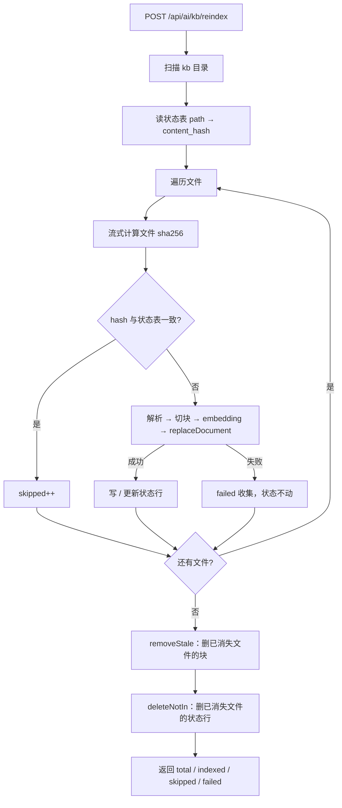

# 知识库增量索引设计

> 状态：已实现（2026-11-26）；影响服务 `jotang-ai`

## 1. 背景与目标

**现状**

| 项 | 现状 | 位置 |
|---|---|---|
| 触发入口 | 管理员手动 `POST /api/ai/kb/reindex`，同步执行 | `KbAdminController` |
| 扫描 | 每次遍历 kb 目录下全部文件 | `KbIngestionService.ingestAll` |
| 单文件 | Tika 解析 → 切块 → embedding → 按 `document_id` 先删后加 | `KbIngestionService.ingest`、`KbVectorStore.replaceDocument` |
| 删除清理 | 删掉 `document_path` 不在本次扫描结果里的点 | `KbVectorStore.removeStale` |

写入粒度已经是单文档覆盖：point id 由 `documentId + chunkIndex` 确定性生成，重复导入是覆盖而非重复插入。

**问题**：每次 reindex 都对所有文件重新解析、重新调用 embedding。成本几乎全在 embedding API，文件一个字没改也照付。

**目标**

| 目标 | 判定 |
|---|---|
| 未变文件零 embedding | 文件内容 sha256 与状态记录一致即跳过 |
| 三类变化语义正确 | 新增 `add`；修改 `replaceDocument`；删除 / 改名 `removeStale` |
| 失败可自愈 | 向量写入成功后才记录状态，失败下次自动重试 |
| 保留全量能力 | `force=true` 时忽略状态，强制全部重做 |

**非目标**：异步任务、并发锁、索引进度上报、失败告警、多实例调度。

## 2. 方案决策：MySQL 状态表

| | A. 向量库 payload | **B. MySQL 状态表（采用）** | C. 本地 manifest |
|---|---|---|---|
| 做法 | 每个块 payload 加 `content_hash`，`QdrantClient.scroll` 读回 | 新建 `kb_document_state`，一行一篇文档 | 索引成功后写 JSON 文件 |
| 部分写入失败 | **误判已索引，永久缺块** | 状态不更新，下次重试 | 状态不更新，下次重试 |
| 0 块文档 | 无点可写，无法记录 | `chunk_count = 0` | 可记录 |
| 文档级元信息 | 复制到每个块 | 独立列 | 可记录 |
| 与向量库同步 | 天然一致 | 需 `deleteNotIn` 清理 | 可能漂移（volume 被清） |
| 换向量库 | 适配器需重写 | 不受影响 | 不受影响 |

**不选 A 的核心原因**：向量库没有事务边界，"这篇文档索引完成了吗"只能从 N 个点推断。

失败场景：文件从 `H1` 改为 `H2`，5 个块，`add` 分批 upsert：


改成"先 add 再删多余块"也无法解决：新旧 hash 混在集合里，读回结果取决于遍历顺序。

## 3. 数据结构

```sql
CREATE TABLE kb_document_state
(
    id              BIGINT UNSIGNED NOT NULL AUTO_INCREMENT,
    document_path   VARCHAR(512)    NOT NULL COMMENT '知识库目录下的相对路径',
    document_id     CHAR(64)        NOT NULL COMMENT 'sha256(document_path)，与向量 payload 对应',
    content_hash    CHAR(64)        NOT NULL COMMENT '文件内容 sha256',
    chunk_count     INT UNSIGNED    NOT NULL COMMENT '切出的块数，0 也要记录',
    embedding_model VARCHAR(128)    NOT NULL COMMENT '索引时的 embedding 模型，变化即全量',
    chunk_config    VARCHAR(64)     NOT NULL COMMENT '切块参数快照，变化即全量',
    indexed_at      DATETIME        NOT NULL DEFAULT CURRENT_TIMESTAMP,
    PRIMARY KEY (id),
    UNIQUE KEY uk_document_path (document_path)
) ENGINE = InnoDB DEFAULT CHARSET = utf8mb4;
```

| 字段 | 作用 |
|---|---|
| `document_path` | 唯一键，增量比对的主键 |
| `content_hash` | 跳过未变文件的依据 |
| `chunk_count` | 记录 0 块结果；便于核对向量库中的点数 |
| `embedding_model` | 与当前配置不一致的行不参与跳过，等于全量 |
| `chunk_config` | 切块参数快照（`600x200x10x5000`），同上 |

写入用 `INSERT ... ON DUPLICATE KEY UPDATE`：一条语句完成新增/覆盖，`indexed_at` 显式取 `NOW()`（DEFAULT 只对 INSERT 生效）。

迁移脚本放 `jotang-ai-app/src/main/resources/db/migration/V2__kb_document_state.sql`，与已有的 `V1__ai_message.sql` 同一套 Flyway。

## 4. 增量流程



**变化分类**

| 文件状态 | 判定 | 动作 |
|---|---|---|
| 新文件 | 状态表无该路径 | `add`，写状态 |
| 内容变化 | hash 不同 | `replaceDocument`，更新状态 |
| 内容未变 | hash 相同 | 跳过（不解析、不 embedding） |
| 删除 / 改名 | 表里有、目录里没有 | 删块 + 删状态 |
| 换模型 / 改切块参数 | 读状态时按 `embedding_model`、`chunk_config` 过滤 | 过滤后无记录，全部按“新文件”重做 |

实测（2026-11-26，本地 11 个文件）：首次 `indexed=10, skipped=0, failed=1`（embedding 接口临时报 20015，未写状态），耗时 57s；重跑 `indexed=1, skipped=10, failed=0`，耗时 1.9s，失败文件自动补上。状态表 `chunk_count` 之和 1070 与 Qdrant 点数一致。

## 5. 失败语义

| 失败点 | 向量库 | 状态表 | 下次行为 |
|---|---|---|---|
| 解析失败 | 不变 | 不变 | hash 仍不同，重试 |
| embedding / 部分 upsert 失败 | 旧块已删，新块不全 | 不更新（仍旧 hash） | 重试并覆盖 |
| 状态写入失败 | 已更新 | 旧 hash | 重试，`replaceDocument` 幂等 |

原则：**先写向量库，成功后再写状态**。状态行是"提交标记"，不是预写标记。

## 6. 代码改动点

| 文件 | 改动 |
|---|---|
| `KbIngestionService` | `ingestAll(boolean force)` 增加指纹比对；新增流式 `contentHash`；`IngestReport` 加 `skipped`；`ingest` 不再因空块提前返回 |
| `KbDocumentStatePO / Mapper / Store` | 新增 `rag.ingest.persistence`，照 `AiMessagePO` 的 MyBatis-Plus 写法；Mapper 带 upsert |
| `AiApplication` | `@MapperScan` 加上 `com.wlf.ai.rag.ingest.persistence`，否则新 Mapper 不注册 |
| `KbVectorStore` | `replaceDocument` 空块时只删不加 |
| `KbAdminController` | 加 `@RequestParam(defaultValue = "false") boolean force` |
| `KbReindexResponse` | 加 `skipped` 字段（前端未使用，改动安全） |
| `V2__kb_document_state.sql` | 新表 |

embedding 模型名直接读已有配置 `spring.ai.openai.embedding.model`，不需要改 `ai-service.yaml`。

核心代码骨架：

```java
public IngestReport ingestAll(boolean force) {
    List<Resource> resources = loadResources();
    Set<String> currentPaths = resources.stream().map(this::relativePath).collect(Collectors.toSet());
    Map<String, String> indexedHashes = force
            ? Map.of()
            : stateStore.findHashes(embeddingModel, CHUNK_CONFIG);

    int indexed = 0;
    int skipped = 0;
    List<String> failed = new ArrayList<>();

    for (Resource resource : resources) {
        try {
            String path = relativePath(resource);
            String hash = contentHash(resource);       // 流式 SHA-256
            if (hash.equals(indexedHashes.get(path))) { // 未变：解析与 embedding 全省
                skipped++;
                continue;
            }
            int chunks = ingest(resource);              // 内部仍走 replaceDocument
            stateStore.save(path, sha256(path), hash, chunks, embeddingModel, CHUNK_CONFIG);
            indexed++;
        } catch (BusinessException e) {                 // 业务失败：warn
            failed.add(resource.getFilename() + "：" + e.getMessage());
        } catch (RuntimeException e) {                  // 其余异常：error
            failed.add(resource.getFilename() + "：" + e.getMessage());
        }
    }

    kbVectorStore.removeStale(currentPaths);
    stateStore.deleteNotIn(currentPaths);
    return new IngestReport(resources.size(), indexed, skipped, failed);
}
```

哈希用 `DigestInputStream` + `transferTo(nullOutputStream)` 边读边算，大 PDF 不进内存。哈希的是文件字节而不是解析后的文本：解析开销在 Tika 内部，先算字节哈希才能不解析就跳过。

注意哈希字节**看不到** Tika 升级导致的文本变化（同字节不同解析结果），这类升级要手动 `force=true`。`BusinessException` 是 `RuntimeException` 的子类，不能写在一个多 catch 里。

## 7. 边界与注意

| 场景 | 处理 |
|---|---|
| 换 embedding 模型 | 状态表 `embedding_model` 与当前配置不一致 → 全量；维度变化还需换 `collection-name` 或清空集合，`initialize-schema` 不改已有集合维度 |
| 改数字切块参数 | 快照 `CHUNK_CONFIG` 变化 → 全量 |
| 改解析器 / 标点表 / keepSeparator / 升 Tika | 不在快照里，需手动 `force=true` |
| 空块文件 | `replaceDocument` 空列表只删不加，旧块清掉；状态记 `chunk_count = 0` |
| 文件改名 | path 变 → 新 `document_id`；旧块由 `removeStale` 删，状态由 `deleteNotIn` 删 |
| 重复点击 | 未做；建议 `AtomicBoolean` 或分布式锁，后续与异步任务一起做 |
| 先删后加的空窗 | 未做；可改为"先 add 覆盖，再删 `chunk_index >= 新块数` 的多余点"，消除 embedding 失败导致文档暂时消失的问题 |
| 手动修复 | `force=true` 忽略所有状态，等价于当前行为 |

## 8. 后续

- 重建索引改为异步任务（已有待办），接口返回任务 id，前端轮询进度。
- 失败文件重试与告警。
- 触发方式扩展：定时扫描、文件监听。
