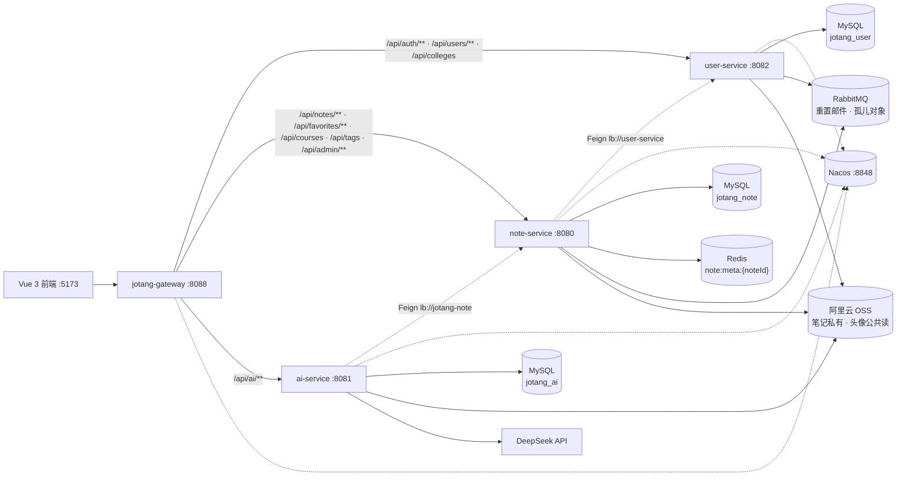
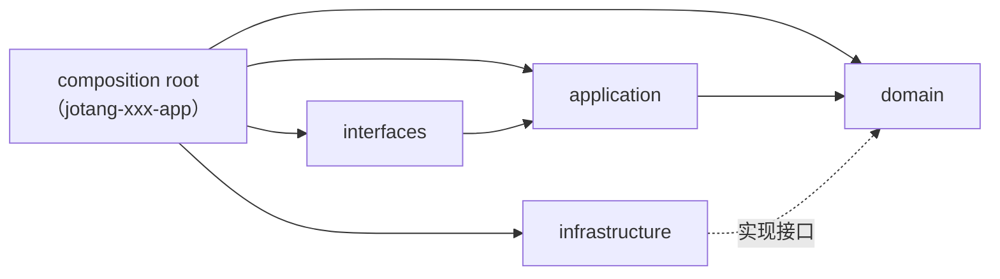
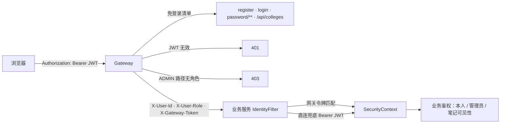
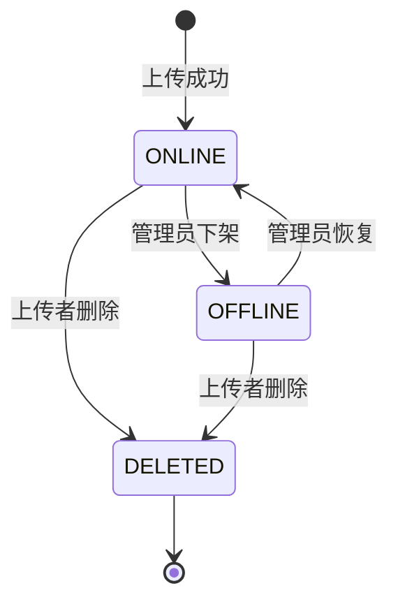

# 系统设计

## 1. 架构原则

| 原则 | 落地方式 |
|---|---|
| 按业务能力拆 | 按变更频率、故障特征、数据归属划分服务，不按表、不按包拆 |
| 服务自治 | 服务间不共享契约模块、不共享表，跨域只走 HTTP |
| 服务内分层 | interfaces / application / domain / infrastructure，依赖只能向内（AI服务例外） |
| 数据边界 | 一个 MySQL 实例，一个服务一个 schema；禁止跨服务 JOIN、禁止写别人的表 |

## 2. 服务划分与运行拓扑

### 2.1 服务清单

| 进程 | Maven 模块 | 端口 | 数据（schema） | 职责 |
|---|---|---|---|---|
| user-service | `jotang-user` / `jotang-user-app` | 8082 | `user`、`college`、`password_reset_token`（`jotang_user`） | 注册、登录、退出、密码找回、登录与找回限频、资料与头像、学院查询 |
| note-service | `jotang-note` / `jotang-note-app` | 8080 | `note`、`note_file`、`note_tag`、`tag`、`course`、`favorite`（`jotang_note`） | 笔记上传/编辑/删除、列表/搜索/详情/预览、收藏、课程与标签、管理员上下架、孤儿对象对账 |
| ai-service | `jotang-ai` / `jotang-ai-app` | 8081 | `ai_message`（`jotang_ai`） | AI 摘要、多轮问答、按标题检索笔记并读正文、会话历史 |
| 网关 | `jotang-gateway` | 8088 | — | 按路径路由、JWT 校验、身份头注入与伪造头剥离 |
| 公共库 | `jotang-common`、`jotang-storage` | — | — | 统一响应/异常/JWT/身份过滤器/分页；OSS 存储与孤儿对象队列 |

前端为 Vue 3 + Vite，开发端口 5173。

### 2.2 运行拓扑

## 3. 服务内部结构原则
依赖关系

### 3.1 接口层 Interface

职责：
- 接收外部请求：HTTP 接口、RPC、MQ 消费、定时任务、前端回调
- 参数格式校验
- 调用应用服务，不写业务规则
- 返回响应、包装结果、异常转译

典型组件：Controller、DTO、VO、Assembler

### 3.2. 应用层 Application

**业务编排层，薄薄一层，没有业务规则**。
职责：
- 应用服务（ApplicationService）：编排领域动作
- 事务控制（开启 / 提交事务）
- 组装领域对象、调用领域服务、调用仓储接口
- 协调多个聚合、触发领域事件

典型组件：ApplicationService、Command、Query

> 告诉领域要做什么，但不决定怎么做
### 3.3 领域层 Domain（DDD 核心）

**整个系统最核心、最稳定的一层，纯业务**
职责：
- 承载核心业务规则、业务校验、业务计算
- 包含：**聚合、聚合根、实体、值对象、领域服务 DomainService、领域事件、仓储接口（Repository 接口）**
- 所有业务约束（比如：库存不能负、订单状态流转规则、金额计算）

特点：可以单独单元测试，不依赖数据库

### 3.4 基础设施层 Infrastructure

**给领域层提供技术能力，技术实现层**
职责：
- 实现领域层定义的仓储接口（`OrderRepositoryImpl`，MyBatis/JPA 实现）
- 外部适配器：MySQL、Redis、RPC 调用第三方、MQ 发送、文件存储
- 防腐层：把外部数据转成领域对象，把领域对象转成外部存储模型（PO）

> ⚠️重点 ：基础设施层**实现领域层定义的接口**，而不是领域层去调用基础设施

| 后缀                           | 允许存在的层         | 语义                                |
| ---------------------------- | -------------- | --------------------------------- |
| `XxxRequest` / `XxxResponse` | interfaces     | HTTP 契约，字段由前端决定                   |
| `XxxVO`                      | interfaces     | 多消费方共用的展示结构（可省略）                  |
| `XxxCommand` / `XxxQuery`    | application    | 用例输入，字段由用例决定                      |
| `XxxResult`                  | application    | 用例输出                              |
| `XxxPO`                      | infrastructure | 表映射                               |
| `XxxAssembler`               | interfaces     | Request/Response ↔ Command/Result |
| `XxxConverter`               | infrastructure | PO ↔ 领域对象                         |

## 4.网关

- 网关做认证、路由；资源级鉴权（本人 / 管理员操作 / 笔记状态）在各服务。
- `GatewayConfig` 显式装配 `JwtTokenProvider`（网关只扫 `com.wlf.gateway`，common 中标 `@Component` 的 JWT 校验器不会被自动注册）
- 网关不转发 `Authorization`；客户端自带的身份头一律剥离，防止伪造。
- `AuthGlobalFilter`：免登录清单放行；其余校验 JWT；

- 直连 Bearer JWT 是兜底路径，后续确认没有直连需求后删除。

## 5. 状态与角色

### 5.1 笔记状态（`note.status`）

| 状态 | 列表 | 详情页 | 下载/收藏 | 编辑 | 我的上传 | 收藏列表 |
|---|---|---|---|---|---|---|
| ONLINE | 可见 | 正常 | 允许 | 允许 | 正常 | 正常 |
| OFFLINE | 不可见 | 仅本人/管理员可看 | 禁止 | 允许（改完仍是下架状态） | 可见并标注 | 占位"已下架" |
| DELETED | 不可见 | 所有人不可见 | 禁止 | 禁止 | 不可见 | 占位"已删除" |

- 恢复：只允许 `OFFLINE → ONLINE`；`DELETED` 是终态，无出边。

### 5.2 用户角色

- `USER` / `ADMIN` 二值，存 `user.role`，签发时写入 JWT claim。
- 当前管理员账号只能预先造好，没有页面或接口创建管理员。

