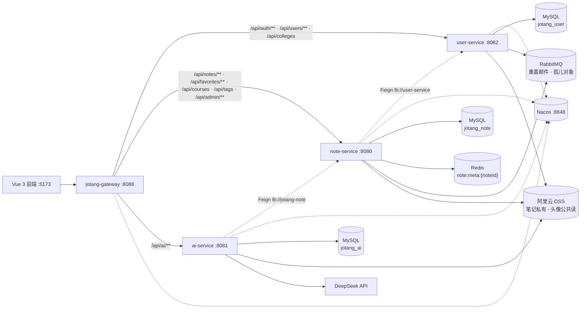
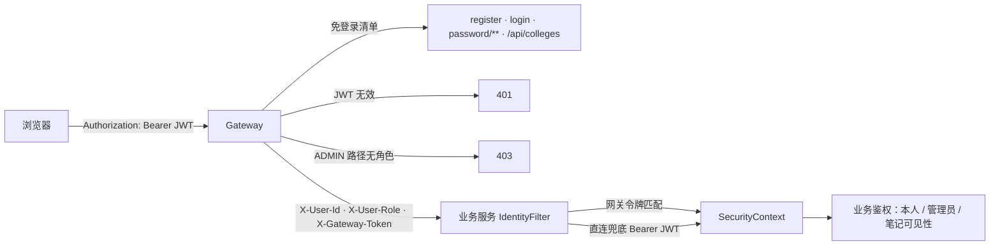
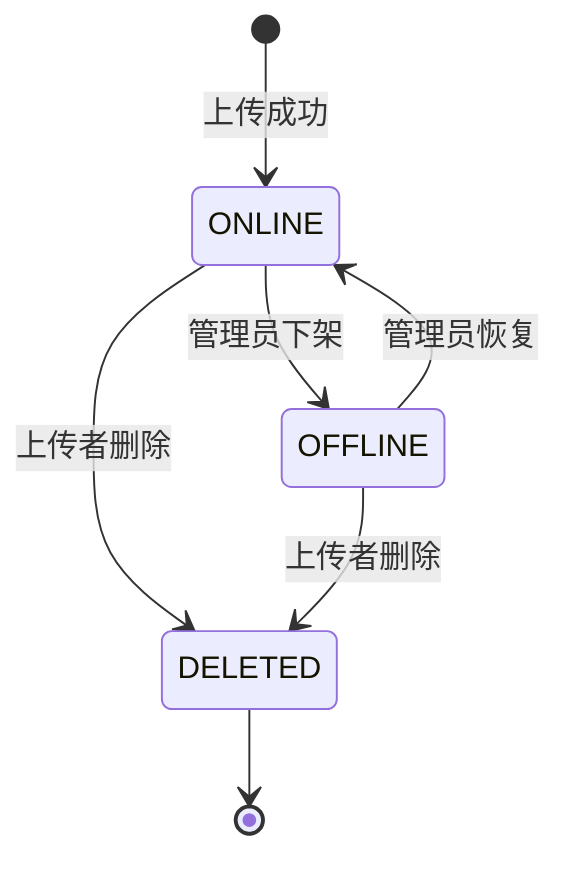

# 系统设计

## 1. 架构原则

| 原则 | 落地方式 |
|---|---|
| 按业务能力拆 | 按变更频率、故障特征、数据归属划分服务，不按表、不按包拆 |
| 服务自治 | 服务间零 Maven 依赖，不共享契约模块、不共享表，跨域只走 HTTP |
| 消费方定义契约 | 出站端口定义在消费方 `application/port/out`，适配器与自有 DTO 放 `infrastructure/client` |
| 服务内分层 | interfaces / application / domain / infrastructure，依赖只能向内 |
| 数据边界 | 一个 MySQL 实例，一个服务一个 schema；禁止跨服务 JOIN、禁止写别人的表 |

## 2. 服务划分与运行拓扑

### 2.1 服务清单

| 进程 | Maven 模块 | 端口 | 数据（schema） | 职责 |
|---|---|---|---|---|
| user-service | `jotang-user` / `jotang-user-app` | 8082 | `user`、`college`、`password_reset_token`（`jotang_user`） | 注册、登录、退出、密码找回、登录与找回限频、资料与头像、学院查询 |
| note-service | `jotang-note` / `jotang-note-app` | 8080 | `note`、`note_file`、`note_tag`、`tag`、`course`、`favorite`（`jotang_note`） | 笔记上传/编辑/删除、列表/搜索/详情/预览、收藏、课程与标签、管理员上下架、孤儿对象对账 |
| ai-service | `jotang-ai` / `jotang-ai-app` | 8081 | `ai_message`（`jotang_ai`） | AI 摘要、多轮问答、按标题检索笔记并读正文、会话历史 |
| 网关 | `jotang-gateway` | 8088 | — | 按路径路由、JWT 校验、身份头注入与伪造头剥离 |
| 公共库 | `jotang-common`、`jotang-storage` | — | — | 统一响应/异常/JWT/身份过滤器/分页；OSS 存储与孤儿对象队列 |

前端为 Vue 3 + Vite，开发端口 5173。

### 2.2 运行拓扑



## 3. 服务内部结构

### 3.1 四层与规则

| 层 | 职责 | 允许依赖 |
|---|---|---|
| interfaces | 入站适配器：Controller、请求/响应 DTO、Assembler | application |
| application | 用例编排、事务边界、调用出站端口 | domain、端口 |
| domain | 聚合、实体、值对象、领域服务、Repository 接口 | 无（不依赖 application / interfaces） |
| infrastructure | 出站适配器：MyBatis Mapper、Feign、OSS、Redis、MQ、配置 | domain、application 端口 |

- 依赖方向只能向内：`interfaces → application → domain`；infrastructure 反向实现 domain 的 Repository 与 application 的端口。
- 写路径走聚合 + Repository；读路径（列表 / 搜索 / 详情）用 QueryDao 直接返回行 DTO，不强行经过聚合。

### 3.2 user-service

```
com.wlf.user
├── interfaces/
│   ├── web/                # AuthController / UserController / CollegeController + dto
│   └── internal/           # InternalUserController / InternalTokenInterceptor
├── application/
│   ├── identity/           # 注册、登录、退出、密码找回、登录与找回限频
│   ├── profile/            # 资料、头像
│   ├── college/            # 学院查询
│   └── port/out/           # MailService
├── domain/
│   ├── user/               # User 聚合、UserRepository、AvatarFilePolicy
│   ├── identity/           # PasswordResetToken
│   └── college/            # College
└── infrastructure/
    ├── persistence/        # Mapper / Repository 实现
    ├── mail/               # SMTP / 队列实现
    └── config/             # RabbitConfig
```

- 聚合：`User`（账号 + 资料 + 角色）。认证与资料共用，避免两个聚合之间的一致性成本。
- 限频：登录连续失败 5 次锁 10 分钟；找回申请按固定窗口限流。两者都是进程内 `ConcurrentHashMap`，重启清零、多实例失效。
- 发信：`MailService` 只出原语，同步 / 队列由 `jotang.mail.mode` 选择。

### 3.3 note-service

```
com.wlf.note
├── interfaces/
│   ├── web/                # NoteController / CatalogController / FavoriteController / AdminNoteController
│   └── internal/           # NoteInternalController / InternalTokenInterceptor
├── application/
│   ├── note/               # NoteService / OrphanObjectSweeper
│   ├── favorite/           # FavoriteService
│   ├── catalog/            # CourseService / TagService
│   └── port/out/           # NoteDataAccess / FavoriteDataAccess / NoteMetaCache / UserProfileReader
├── domain/
│   ├── note/               # Note 聚合、NoteFile、NoteStatus、NoteStateMachine、NoteFilePolicy
│   ├── favorite/           # Favorite
│   └── catalog/            # Course、Tag
└── infrastructure/
    ├── persistence/        # Mapper / NoteDataAccess、FavoriteDataAccess 实现
    ├── cache/              # RedisNoteMetaCache
    └── client/user/        # UserClient + RemoteUserProfileReader
```

- 聚合：`Note`（含附件与状态）、`Favorite`；`Course` / `Tag` 是参照数据。
- 领域服务：`NoteStateMachine`（迁移表）、`NoteFilePolicy`（类型与大小）、`TagService`（按名复用）。
- 同一服务内共享数据库，`FavoriteService` 可直接使用 `NoteDataAccess`；与 user-service 之间不 JOIN，上传者信息经端口取回后本地装配。
- 孤儿对象：删除笔记只改状态；对象由补偿删除 + 定时 `OrphanObjectSweeper` 对账清理，成功后置 `is_purged`。

### 3.4 ai-service

```
com.wlf.ai
├── interfaces/web/         # AiSummaryController / AiChatController
├── application/
│   ├── assistant/          # AiService / AiRateLimiter / NoteTools / UntrustedContent
│   └── port/out/           # NoteContentReader
├── domain/assistant/       # AiMessage、AiMessageRepository、AiSummaryFilePolicy
└── infrastructure/
    ├── persistence/        # AiMessageMapper / Repository 实现
    ├── client/note/        # NoteClient + FeignNoteContentReader + 错误翻译
    └── config/             # ChatClient、两个限频器
```

- 没有独立会话表：`conversation_id` 是消息上的 UUID，历史按 `id` 正序读取；最近会话取 `created_at DESC, id DESC LIMIT 1`。
- 摘要只读不写：读笔记文件（图片走多模态、md / txt 走文本），生成摘要文本返回前端，由用户决定是否保存。
- 对话：模型可调用 `search_notes_by_title` / `read_note_content`（最多 5 条命中、单轮最多读 2 份附件）；文件由 ai-service 直接读 OSS，鉴权与可见性由 note-service 内部接口判定。
- 限频：摘要 20 次/小时/用户，对话 30 次/小时/用户；均为进程内存。

### 3.5 网关

- 网关做认证、路由；资源级鉴权（本人 / 管理员操作 / 笔记状态）在各服务。
- `GatewayConfig` 显式装配 `JwtTokenProvider`（网关只扫 `com.wlf.gateway`，common 中标 `@Component` 的 JWT 校验器不会被自动注册）
- 网关不转发 `Authorization`；客户端自带的身份头一律剥离，防止伪造。
- `AuthGlobalFilter`：免登录清单放行；其余校验 JWT；

- 直连 Bearer JWT 是兜底路径，后续确认没有直连需求后删除。

## 4. 状态与角色

### 4.1 笔记状态（`note.status`）



| 状态 | 列表 | 详情页 | 下载/收藏 | 编辑 | 我的上传 | 收藏列表 |
|---|---|---|---|---|---|---|
| ONLINE | 可见 | 正常 | 允许 | 允许 | 正常 | 正常 |
| OFFLINE | 不可见 | 仅本人/管理员可看 | 禁止 | 允许（改完仍是下架状态） | 可见并标注 | 占位"已下架" |
| DELETED | 不可见 | 所有人不可见 | 禁止 | 禁止 | 不可见 | 占位"已删除" |

- 恢复：只允许 `OFFLINE → ONLINE`；`DELETED` 是终态，无出边。

### 4.2 用户角色

- `USER` / `ADMIN` 二值，存 `user.role`，签发时写入 JWT claim。
- 当前管理员账号只能预先造好，没有页面或接口创建管理员。

## 5. 模块依赖规则

| 规则 | 说明 |
|---|---|
| 服务模块互不依赖 | `user` / `note` / `ai` 之间零 Maven 依赖，由模块图在编译期强制 |
| 端口在消费方 | 出站端口放消费方 `application/port/out`，适配器放 `infrastructure/client` |
| 装配根唯一 | 未拆的域用本地适配器，已拆的域用 Feign 适配器，都由 `jotang-<svc>-app` 装配 |
| 禁跨域访问 | 不得 import 其他服务的任何类 |
| 启动类独立 | `@SpringBootApplication` 只出现在 `-app`，业务模块不放开机类 |
| 共享库只放技术能力 | `jotang-common` / `jotang-storage` 可被各服务依赖，不放业务状态 |

- 测试例外：`jotang-note-app` 以 test scope 依赖 `jotang-user`，只为复用其测试夹具；运行时类路径不含该模块。

## 6. 跨服务接口

| 消费方端口 | 消费方 | 提供方 | 接口 | 用途 |
|---|---|---|---|---|
| `UserProfileReader` | note | user-service | `GET /internal/users/batch?ids=` | 批量取昵称 / 头像 / 学院 |
| `NoteContentReader` | ai | note-service | `GET /internal/notes/{id}/file?userId=` | 取上传者本人笔记的 OSS 对象元数据（摘要） |
| `NoteContentReader` | ai | note-service | `GET /internal/notes/search?title=&limit=` | 按标题精确检索 ONLINE 笔记 |
| `NoteContentReader` | ai | note-service | `GET /internal/notes/{id}/readable-file` | 取在线笔记对象元数据（对话读正文） |

- 提供方只暴露 HTTP，不发布 jar、不共享 DTO；接口统一挂 `/internal/**`，网关不路由，用 `X-Internal-Token` 鉴权。
- 调用统一用 OpenFeign（HTTP/JSON），服务名由 Nacos 解析。
- ai-service 额外装配 `UserContextFeignInterceptor`，把 `X-User-*` 透传给 note-service。
- 代价：DTO 与 Feign 接口在消费方重复，提供方改字段时消费方需同步。


