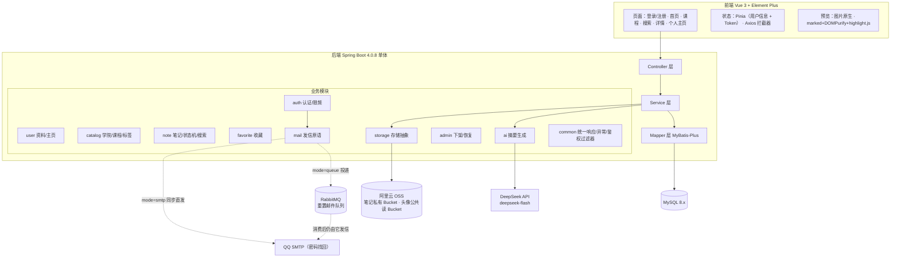
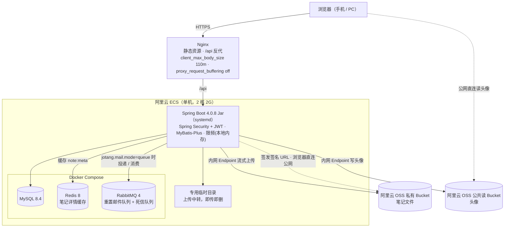
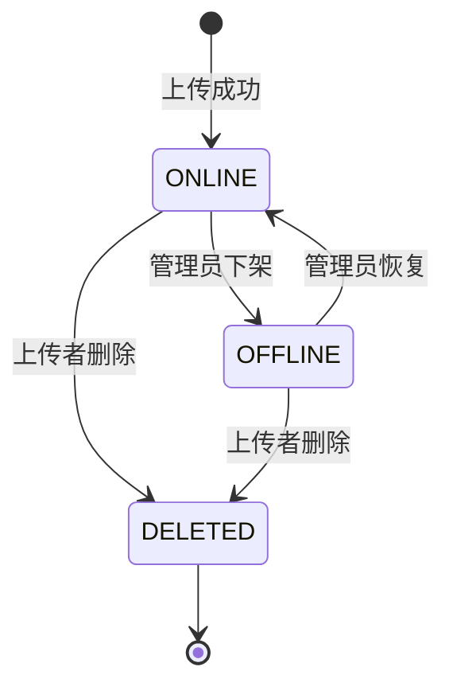

# 系统设计（MVP）

## 1. 系统架构

### 1.1 分层与模块

- **模块边界**：Controller 只做参数校验与编排；业务规则全部落在 Service；跨表/复杂检索走 MyBatis XML，单表 CRUD 走 MyBatis-Plus。
- **跨模块访问**：跨模块的**业务操作**走对方 Service。**但检索侧的多表 JOIN 不受此限**——列表 / 搜索 / 详情都需匹配课程名 / 标签名 / 上传者，`NoteMapper.xml` 可直接 JOIN `course`、`tag`、`user`、`college`。
- **跨模块写对方单表列**：仅当对方没有能承接该写的 Service、或注入它会形成构造器循环依赖时，允许直接注入对方 Mapper，**且必须在类注释写明理由**。
- **鉴权**：`common` 内的无状态 JWT 过滤器统一拦截，`admin` 模块通过角色规则保护。

### 1.2 部署拓扑

- **三个中间件都是单机容器**：MySQL 8.4、Redis 8、RabbitMQ 4 由 `deploy/docker-compose.prod.yml` 起
- **OSS 两个访问面**：ECS 与 OSS 同 Region，后端上传 / 写头像一律走 `oss-<region>-internal.aliyuncs.com`；签发给浏览器的签名 URL 与头像公网直读走公网 Endpoint。**二者必须是两个客户端**——签名 URL 的主机名取自签发时所用客户端的 Endpoint。
- **两个 Bucket**：笔记文件→私有；头像→公共读。
- 开发期可先用 IP 访问，但 JWT/密码为明文传输，仅限自测。

## 2. 模块职责

| 模块 | 职责 | 关键类（示例） |
|---|---|---|
| auth | 注册、登录、退出、密码找回（令牌签发/校验/消费）、登录与找回限频 | `AuthController` / `AuthService` / `PasswordResetService` / `LoginAttemptLimiter` |
| user | 资料维护、头像上传（写公共读 Bucket）、个人主页统计 | `UserController` / `UserService` |
| catalog | 学院/课程查询、标签查询与**按名创建**。学院与课程预置只读；标签有写路径（同名复用，§3.2） | `CatalogController` / `CollegeService` / `CourseService` / `TagService` |
| note | 笔记 CRUD、列表/热门/课程/标签聚合、搜索、状态机、**孤儿对象对账** | `NoteController` / `NoteService` / `NoteStateMachine` / `OrphanObjectSweeper` |
| favorite | 收藏/取消收藏、我的收藏（含占位） | `FavoriteController` / `FavoriteService` |
| storage | 流式上传、读取、签名 URL 签发、对象删除 | `StorageService` / `OssStorageService` |
| mail | 发信。只出原语，时机（同步 / 队列）收在实现上 | `MailService` / `SmtpMailService` / `QueuedMailService` / `MailDispatchConsumer` |
| ai | AI 摘要：读笔记图片或 md / txt 正文、调 DeepSeek 出建议文本（**只读不写**）；AI 对话：多轮问答，可调用工具按标题检索笔记并读其正文 | `AiController` / `AiService` / `AiSummaryFilePolicy` / `NoteTools` |
| admin | 下架 / 恢复上架 | `AdminNoteController` |
| common | 统一响应体、全局异常、JWT 签发与校验、参数校验 | `ApiResponse` / `GlobalExceptionHandler` / `JwtAuthFilter` / `JwtTokenProvider` |

## 3. 状态机

### 3.1 笔记状态（`note.status`）

| 状态 | 列表 | 详情页 | 下载/收藏 | 编辑 | 我的上传 | 收藏列表 |
|---|---|---|---|---|---|---|
| ONLINE | 可见 | 正常 | 允许 | 允许 | 正常 | 正常 |
| OFFLINE | 不可见 | 仅本人/管理员可看 | 禁止 | 允许（改完仍是下架状态） | 可见并标注 | 占位"已下架" |
| DELETED | 不可见 | 所有人不可见| 禁止 | 禁止 | 不可见 | 占位"已删除" |

- 恢复：只允许 `OFFLINE → ONLINE`；`DELETED` 是终态，无出边。

### 3.2 用户角色

- `USER` / `ADMIN` 二值，存 `user.role`，签发时写入 JWT claim
- MVP 阶段管理员账号只能预先造好。

