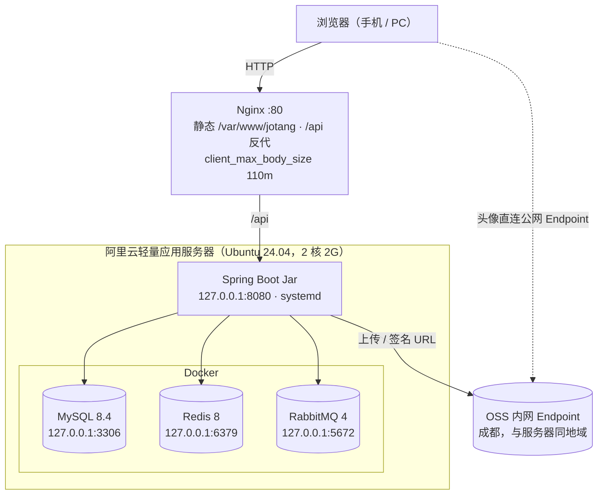

# Jotang Note 部署与运维

> 单台阿里云轻量应用服务器（Ubuntu 24.04，2 核 2G）上的单体部署：Nginx 托管前端产物并反向代理后端，Spring Boot Jar 交给 systemd，MySQL / Redis / RabbitMQ 三个中间件都走 Docker。
>
> 发布方式：本地 `git push`，服务器上以 **jotang** 账号登录后执行 `deploy/update.sh`，由服务器侧完成构建，不产出本地 jar。本文从一台**刚重置的空实例**写起。

## 1. 目标拓扑



三个中间件的端口在 compose 里都绑死 `127.0.0.1`，应用通过回环访问；**公网只放行 22 和 80**，3306 / 6379 / 5672 / 15672 / 8080 一律不开。

**当前阶段的约束**：没有域名、没有备案，只能走 `http://<公网IP>`，因此 JWT 与密码是明文传输，**仅限自测**（《概要设计》§1.2 已注明）。以后有备案域名时按 §11 补 HTTPS。

## 2. 内存账（2 核 2G 的现状）

这是本文档最重要的一节。2G 装得下这套东西，但**没有余量**，所有内存相关参数都是被这份账倒推出来的：

| 组件 | 预算 | 由什么控制 |
|---|---|---|
| MySQL 8.4 | ~350–450 MB | `--innodb-buffer-pool-size=128M`（**默认按宿主内存自算，不压会到 400MB+**）、`--performance-schema=OFF` |
| RabbitMQ 4（带管理台） | ~250–300 MB | Erlang VM，基本不可压；管理插件本身也占内存 |
| Redis 8 | ~20 MB | `--maxmemory 128mb --maxmemory-policy allkeys-lru` |
| JVM | ~700–800 MB | `-Xms256m -Xmx512m`，加上 metaspace / 线程栈 / 堆外 |
| 系统 + sshd + systemd + dockerd | ~250 MB | —— |
| **合计** | **~1.6–1.8 GB / 2 GB** | 剩不到 400MB 余量，所以下面两件事是硬要求 |

1. **2G swap 必须配**（§3.2）。它不是用来日常跑的，是构建期和流量尖峰时的保命垫。
2. **构建期必须停掉应用和容器**（`update.sh` 已内建）。`vite build` 打 element-plus 峰值要 1.0–1.5G、`mvn package` 要 600–800M，而三个容器常驻就要 700MB；不停掉的话必然打到 swap 抖动，甚至被 OOM Killer 干掉。

> 想把 JVM 堆调大、或者以后上更大的机器，改 `deploy/systemd/jotang-note.service` 的 `-Xmx` 并重新 `sudo systemctl daemon-reload`。**改动前先按上面的账算一遍**——堆顶穿的表现是整个机器假死，不只是这个应用崩。

---

## 3. 一次性初始化（root）

以下命令用 **root** 登录服务器执行（阿里云轻量应用服务器默认给 root 密码）。这一段只做一次。

### 3.1 系统软件

```bash
apt update

# 注意三个都必需：
#   openjdk-21-jdk-headless —— Ubuntu 24.04 的源里有这个包，但**不会预装**；
#                              漏装时 mvnw 会报 "JAVA_HOME ... not defined correctly"
#   nginx                  —— 静态托管 + 反向代理
#   git / rsync / curl     —— 拉代码、同步 dist
apt install -y git rsync curl nginx openjdk-21-jdk-headless

# Node.js 22（构建前端）
curl -fsSL https://deb.nodesource.com/setup_22.x | bash -
apt install -y nodejs

# Docker + compose v2 插件
curl -fsSL https://get.docker.com | sh

# JDBC URL 用 Asia/Shanghai，系统时区要与其对齐
timedatectl set-timezone Asia/Shanghai

# 验证
java -version && node -v && docker compose version
```

**不需要单独装 Maven**：`.mvn/wrapper/maven-wrapper.properties` 是 `distributionType=only-script`，`mvnw` 会自己下载 Maven 3.9.16。

### 3.2 加 2G swap

Swap 是拿硬盘空间临时充当内存。2G 内存的机器上这是安全垫，构建期尤其依赖它。

```bash
# 创建一个 2G 的文件 /swapfile，只有 root 能读写
fallocate -l 2G /swapfile && chmod 600 /swapfile

# 格式化成 swap 并立即启用
mkswap /swapfile && swapon /swapfile

# 写入 /etc/fstab，开机自动挂载
echo '/swapfile none swap sw 0 0' >> /etc/fstab

# 确认 Swap 一行是 2.0Gi
free -h
```

### 3.3 建 jotang 账号、设密码、分组

服务以专用账号运行，不跑在 root 下。**发布脚本也用它**，所以它需要能登录、能 sudo。

```bash
# -r 系统账号；-m 建家目录；-d 指定家目录；-s 指定登录 shell
useradd -r -m -d /opt/jotang -s /bin/bash jotang

# docker 组：update.sh 要以 jotang 身份跑 docker compose
usermod -aG docker jotang
# sudo 组：update.sh 要执行 systemctl stop/start（后面会解释这条的代价）
usermod -aG sudo jotang

# 设置登录密码 —— 这就是你以后 SSH 登录用的密码
passwd jotang
```

> **把 jotang 加进 sudo 组，等于给了它完整的 root 权限**（能 `sudo -i`）。这是为了"登录后在终端里直接跑 update.sh"付出的代价。如果你不想给完整 sudo，可以改用定向授权，只允许两条命令、且免密，见 §7 末尾。

建目录：

```bash
# 1. /opt/jotang/src              源码目录，git 工作区，git pull 与构建都在这里
# 2. /var/www/jotang              静态资源目录，前端打包产物，Nginx 对外提供
# 3. /var/lib/jotang/upload-tmp   上传中转目录，超过 1MB 的 multipart 部件落盘于此
# 4. /etc/jotang                  应用配置目录，放 jotang.env
mkdir -p /opt/jotang/src /var/www/jotang /var/lib/jotang/upload-tmp /etc/jotang

# 前面三处 jotang 要能写：git pull、rsync、multipart 落盘
chown jotang:jotang /opt/jotang/src /var/www/jotang /var/lib/jotang/upload-tmp
```

`/opt/jotang/src`（git 工作区）与 `/opt/jotang/app.jar`（构建产物）分开，是为了让 systemd 的路径不依赖构建目录结构。

### 3.4 确认 SSH 允许密码登录

```bash
# 看实际生效值
sshd -T | grep -i '^passwordauthentication'
```

输出应为 `passwordauthentication yes`。若为 `no`：

```bash
# 用 00- 前缀：sshd 对同一项取**第一个**读到的值，
# Ubuntu 的 sshd_config 在顶部 Include 了 /etc/ssh/sshd_config.d/*.conf（按文件名排序）
echo 'PasswordAuthentication yes' > /etc/ssh/sshd_config.d/00-password-auth.conf
systemctl restart ssh
sshd -T | grep -i '^passwordauthentication'    # 复查
```

### 3.5 Docker 镜像加速

```bash
vi /etc/docker/daemon.json
```

```json
{
  "registry-mirrors": [
    "https://docker.m.daocloud.io",
    "https://docker.1ms.run",
    "https://docker.1panel.live"
  ]
}
```

```bash
systemctl daemon-reload
systemctl restart docker
docker info | grep -A3 'Registry Mirrors'
```

到这里 root 的部分就结束了。后面全部以 **jotang** 身份操作。

---

## 4. 以 jotang 登录，完成部署

从本地 PowerShell 登录（密码是 §3.3 用 `passwd` 设的那个）：

```powershell
ssh jotang@<公网IP>
```

> 本机终端里也可以 `su - jotang` 切换过去，效果相同。

### 4.1 构建加速

`./mvnw` 和 `npm ci` 都要从境外拉依赖，不配镜像会非常慢。**必须在真正执行构建的账号（jotang）下配置**——Maven 读 `~/.m2/settings.xml`、npm 读 `~/.npmrc`，配在 root 家目录里构建时根本看不到。

```bash
mkdir -p ~/.m2
cat > ~/.m2/settings.xml <<'EOF'
<settings>
  <mirrors>
    <mirror>
      <id>aliyun</id>
      <mirrorOf>central</mirrorOf>
      <name>Aliyun Public</name>
      <url>https://maven.aliyun.com/repository/public</url>
    </mirror>
  </mirrors>
</settings>
EOF

npm config set registry https://registry.npmmirror.com
```

### 4.2 拉代码并起三个容器

```bash
git clone https://github.com/ShiwarHoufu/jotang-note.git /opt/jotang/src

cd /opt/jotang/src
cp deploy/.env.example deploy/.env
vi deploy/.env                     # 填四个强密码
chmod 600 deploy/.env

docker compose -f deploy/docker-compose.prod.yml up -d
docker compose -f deploy/docker-compose.prod.yml ps
```

先起容器、后起应用：两个模式开关的默认值都是 `queue`，应用启动时 `@RabbitListener` 就会去连 Broker。

**数据库和账号不用手工建。** compose 里的 `MYSQL_DATABASE` / `MYSQL_USER` / `MYSQL_PASSWORD` 会在 MySQL **首次启动、数据卷为空时**自动建好库与账号。应用那边 `spring.sql.init.mode=always`，且 `schema.sql` / `data.sql` 全部幂等，首次启动会自动建表并写入学院、课程、标签。

两个容易踩的坑：

- **那三项环境变量只在首次初始化生效。** 之后改 `deploy/.env` 不会同步到已有的库和账号上——要改得进容器执行 SQL，或者删掉数据卷重来（会丢数据）。
- **`MYSQL_USER` / `MYSQL_PASSWORD` 必须与 §4.3 里的 `DB_USERNAME` / `DB_PASSWORD` 完全一致**，两处描述的是同一个账号。

查证：

```bash
docker compose -f deploy/docker-compose.prod.yml logs mysql | tail -20
docker compose -f deploy/docker-compose.prod.yml ps      # 三个都要 Up (healthy)
```

### 4.3 应用环境变量（需要 sudo）

`deploy/jotang.env.example` 是完整模板，逐项都有注释。装到 `/etc/jotang/jotang.env`：

```bash
sudo cp /opt/jotang/src/deploy/jotang.env.example /etc/jotang/jotang.env
sudo vi /etc/jotang/jotang.env
sudo chown root:root /etc/jotang/jotang.env && sudo chmod 600 /etc/jotang/jotang.env
```

三类必须处理：

1. **必填三项**，缺任一项启动即失败（`JwtTokenProvider` / `OssConfig` 用的是无默认值的 `@Value`）：
   `JWT_SECRET`（`openssl rand -base64 48` 新生成）、`JOTANG_OSS_ACCESS_KEY_ID`、`JOTANG_OSS_ACCESS_KEY_SECRET`
2. **必须与 `deploy/.env` 对齐**：`DB_USERNAME` / `DB_PASSWORD`（对应 `MYSQL_USER` / `MYSQL_PASSWORD`）、`REDIS_PASSWORD`、`RABBITMQ_USER` / `RABBITMQ_PASSWORD`
3. **最容易漏的一项**：`JOTANG_MAIL_RESET_LINK_BASE=http://<公网IP>/reset-password`。默认值是 `http://localhost:5173/reset-password`，不改的话重置邮件里的链接用户打不开。

格式注意：**裸 `KEY=VALUE`，不写 `export`、不加引号、行尾不写注释**——systemd 的 `EnvironmentFile` 会把它们原样算进值里。

### 4.4 装 systemd unit（需要 sudo）

**先装 unit、后构建启动**——否则 `update.sh` 最后那步 `systemctl start` 会因为没有 unit 而失败。

```bash
sudo cp /opt/jotang/src/deploy/systemd/jotang-note.service /etc/systemd/system/
sudo systemctl daemon-reload
sudo systemctl enable jotang-note      # 只设开机自启，现在还不启动（jar 尚未构建）
```

unit 里 `After=docker.service` + `StartLimitIntervalSec=0` + `Restart=always` 是一组：**三个中间件都在容器里，开机时容器必然比应用起得晚**，应用第一次连不上库会启动失败，靠 systemd 无限重试直到容器就绪。日志只走 stdout，由 journald 接住，没有额外的日志文件要管。

### 4.5 首次构建与启动

先让 sudo 记住密码，避免脚本跑到一半停下来等输入：

```bash
sudo -v

cd /opt/jotang/src
bash deploy/update.sh
```

`update.sh` 做的事：`git pull` → **停应用与容器腾内存** → `bash mvnw clean package -DskipTests` → `npm ci && npm run build` → jar 拷到 `/opt/jotang/app.jar`、dist 同步到 `/var/www/jotang` → `docker compose up -d --wait` → 启动服务。日常发布也是它（§7）。

首次构建在 2 核上要 5–10 分钟，`mvnw` 第一次还要下载 Maven 3.9.16 和全部依赖。验证：

```bash
systemctl status jotang-note --no-pager
journalctl -u jotang-note -n 50 --no-pager
free -h      # 关注 available 还剩多少、swap 有没有被大量用掉
```

> **两个必须遵守的点**：
>
> - 用 `bash mvnw` 而不是 `./mvnw`：仓库在 Windows 上编辑，git 常常不保留 `mvnw` 的可执行位，直接执行会报 `Permission denied`。
> - **不要用 sudo 跑整个脚本**。它会以 root 身份生成 `target/`、`node_modules/`、`app.jar`，属主变成 root，下次 jotang 跑就写不进去。脚本内部只对那两条 `systemctl` 用了 sudo。

---

## 5. Nginx（需要 sudo）

```bash
sudo cp /opt/jotang/src/deploy/nginx/jotang.conf /etc/nginx/sites-available/jotang
sudo ln -sf /etc/nginx/sites-available/jotang /etc/nginx/sites-enabled/jotang
sudo rm -f /etc/nginx/sites-enabled/default
sudo nginx -t && sudo systemctl reload nginx
```

配置里有三处与后端是**成对**的，改一个必须改另一个：

| Nginx | 后端 | 关系 |
|---|---|---|
| `client_max_body_size 110m` | `spring.servlet.multipart.max-request-size: 110MB` | Nginx 侧必须 ≥ 后端，否则请求在 Nginx 就被 413 拦下，后端那个上限形同虚设 |
| `proxy_request_buffering off` | —— | 请求体不落 Nginx 临时盘，100MB 的文件直接流给后端 |
| `proxy_pass http://127.0.0.1:8080;` | 接口自带 `/api` 前缀 | **不带尾斜杠、也不 rewrite**。加了尾斜杠会把 `/api` 前缀吃掉，全部 404 |

## 6. 控制台防火墙

阿里云轻量应用服务器控制台 → 实例 → **防火墙**，入方向规则**只放行 22 和 80**。

排查阶段常有人顺手开 8080、3306、6379、15672，这些一律不要开：应用已通过 `SERVER_ADDRESS=127.0.0.1` 只监听回环，三个容器的端口在 compose 里也绑死了 `127.0.0.1`，公网本来就连不上——开了没有收益，只是多一个被扫的面。

---

## 7. 日常发布

```bash
# 1. 本地 PowerShell
git push

# 2. 登录服务器
ssh jotang@<公网IP>

# 3. 拉代码、构建、重启（一条命令）
cd /opt/jotang/src
bash deploy/update.sh
```

`update.sh` 会先停掉应用**和三个容器**再构建（§2 的内存账），构建完再一起拉起来。发布期间站点完全不可用，时长以构建耗时为下限——2 核上大约 3–6 分钟。

脚本里第一条 `sudo systemctl stop` 会要求输入密码，输 **jotang 的密码**即可；sudo 默认缓存 15 分钟，所以后面的 `start` 不会再问。想省掉这一次输入，可以提前 `sudo -v`。

> **可选：不给完整 sudo。** 如果不想让 jotang 能 `sudo -i`，可以把它从 sudo 组移除（`gpasswd -d jotang sudo`，需 root），改用定向免密授权——只放行 update.sh 真正需要的那两条：
>
> ```bash
> # root 下执行；内容由 sudoers 语法校验，写错会让整机 sudo 失效
> echo 'jotang ALL=(root) NOPASSWD: /usr/bin/systemctl start jotang-note, /usr/bin/systemctl stop jotang-note' > /etc/sudoers.d/jotang-deploy
> chmod 440 /etc/sudoers.d/jotang-deploy
> visudo -cf /etc/sudoers.d/jotang-deploy
> ```
>
> 两种方式二选一：留在 sudo 组就用密码，走定向授权就免密。

## 8. 验证清单

按顺序做一遍，每一条都对应一个真实存在的链路：

| # | 操作 | 预期 |
|---|---|---|
| 1 | `docker compose -f /opt/jotang/src/deploy/docker-compose.prod.yml ps` | 三个容器都是 `Up` 且带 `(healthy)` |
| 2 | `curl -s http://<IP>/api/colleges` | 返回学院列表。这个接口在 `SecurityConfig` 的放行名单里，**免登录**，所以能单独验证 Nginx → 后端 → MySQL 整条链 |
| 3 | 浏览器打开 `http://<IP>/`，注册 → 登录 | 首页正常、样式加载完整；注册成功并能登录（验证建表与种子数据已自动就位） |
| 4 | 上传一篇笔记，附件 > 1MB | 成功；预览页能拿到 OSS 签名 URL 并打开（验证内网 Endpoint 读写 + 公网 Endpoint 签名） |
| 5 | 上传一个 > 100MB 的文件 | 被拒（验证 `client_max_body_size` 生效） |
| 6 | 密码找回 → 发信 | 邮件收到，链接域名是 `<IP>` 而不是 localhost（验证 `JOTANG_MAIL_RESET_LINK_BASE` 与 MQ 消费） |
| 7 | `docker compose -f /opt/jotang/src/deploy/docker-compose.prod.yml exec rabbitmq rabbitmqctl list_queues name messages` | 工作队列与死信队列都回到 0，说明消息被正常消费 |
| 8 | AI 摘要 | 能出结果（验证 `JOTANG_AI_API_KEY`）；留空时应报 50300 而不是把服务打挂 |
| 9 | 改头像 | 浏览器直连 OSS 公网 Endpoint 能显示（头像桶须为**公共读**） |
| 10 | `free -h` | `available` 至少还剩 200–300MB，`swap` 没有持续被大量占用 |
| 11 | `sudo reboot` | 起来后 `systemctl status jotang-note` active、三个容器 Up、Nginx 正常，全站可用（验证 §4.4 那组重试配置） |
| 12 | `journalctl -u jotang-note -f` | 无异常堆栈；`ls /var/lib/jotang/upload-tmp` 无残留文件 |

## 9. 运维备忘

```bash
COMPOSE="docker compose -f /opt/jotang/src/deploy/docker-compose.prod.yml"

# 看应用日志
journalctl -u jotang-note -f

# 看容器日志
$COMPOSE logs -f mysql        # 同理 redis / rabbitmq

# 重启后端
sudo systemctl restart jotang-note

# 手动导一份数据库（备份还没自动化，见 §10）。用应用账号即可，不需要 root；
# 密码从 deploy/.env 里取，注意 -p 与密码之间不能有空格。
$COMPOSE exec -T mysql mysqldump -ujotang -p"$(sed -n 's/^MYSQL_PASSWORD=//p' /opt/jotang/src/deploy/.env)" \
  --single-transaction jotang_note > ~/jotang_note-$(date +%F).sql

# RabbitMQ 管理台（公网不开 15672，走 SSH 隧道）
# 在本地 PowerShell 里执行，然后浏览器开 http://localhost:15672
ssh -L 15672:127.0.0.1:15672 jotang@<公网IP>
```

**首次上手：造一个管理员账号。** `data.sql` 只种了学院、课程、标签，**没有任何 `user` 行**——《概要设计》§6.2 说的「管理员账号同脚本创建」目前没有对应的脚本。临时办法是先正常注册一个账号，再改角色（`user.role` 默认 `USER`）：

```bash
$COMPOSE exec mysql mysql -ujotang -p jotang_note \
  -e "UPDATE \`user\` SET \`role\` = 'ADMIN' WHERE \`username\` = '<你的账号>';"
```

之后才能访问 `/api/admin/**`（`SecurityConfig` 里要求 `ROLE_ADMIN`）。

## 10. 已知限制

1. **内存没有余量**（§2）。所有参数都是按 2G 倒推的，任何组件想涨内存都要先重新算账。
2. **发布期间站点完全不可用**（§7 停应用+容器再构建），2 核上约 3–6 分钟。
3. **无域名 → 全站 HTTP 明文**，JWT 与密码裸奔，仅限自测。
4. **限频是内存态**。AI 摘要/对话限频、登录失败锁定、重置邮件限频都是 `ConcurrentHashMap`，只在单实例下成立；重启会清空计数。多实例部署时会失效，届时要换 Redis 实现。
5. **登出与改密不会让已签发的 JWT 立即失效**（无状态、无黑名单），token 到期前仍然有效。这是已知取舍，不是部署缺陷。
6. **备份尚未配置**。《概要设计》§6.3 要求的 MySQL 每日 `mysqldump` 还没做，服务器一旦故障数据没有兜底。§9 里给了手工导出的命令。
7. **MySQL 的数据在 Docker 卷里**（`mysql-data`）。它的生命周期跟着卷走：`docker compose down -v` 或手工删卷都会连数据一起删，比裸机 MySQL 更容易误伤。
8. **RabbitMQ 未就绪时应用能否启动未实测**。靠 unit 里的无限重试兜底（§4.4），`update.sh` 里也用 `--wait` 做保障。
9. **jotang 能登录、能用 sudo**（§3.3）。这是为了"终端里直接跑 update.sh"的便利，代价是这个账号等同 root。密码泄漏的后果按 root 泄漏来对待。

## 11. 后续要补的事

- **HTTPS**：有备案域名后，`server_name` 换成正式域名，用 Let's Encrypt 签证书，加上 80→443 跳转与 HSTS。
- **MySQL 每日备份**：`mysqldump` + cron，保留若干天，并考虑异地存一份。注意容器化后要在宿主机上跑 `docker compose exec`，cron 需要能访问 docker。
- **监控内存**：2G 的机器值得加一个简单的内存告警（`free` 或 node_exporter），别等 OOM 才发现。
- **管理员初始化的正式脚本**：把 §9 那条手工 SQL 收敛成可重复执行的初始化脚本，与《概要设计》§6.2 对齐。
- **旧头像清理**（《概要设计》§6.3 里同样标为未落地）。
