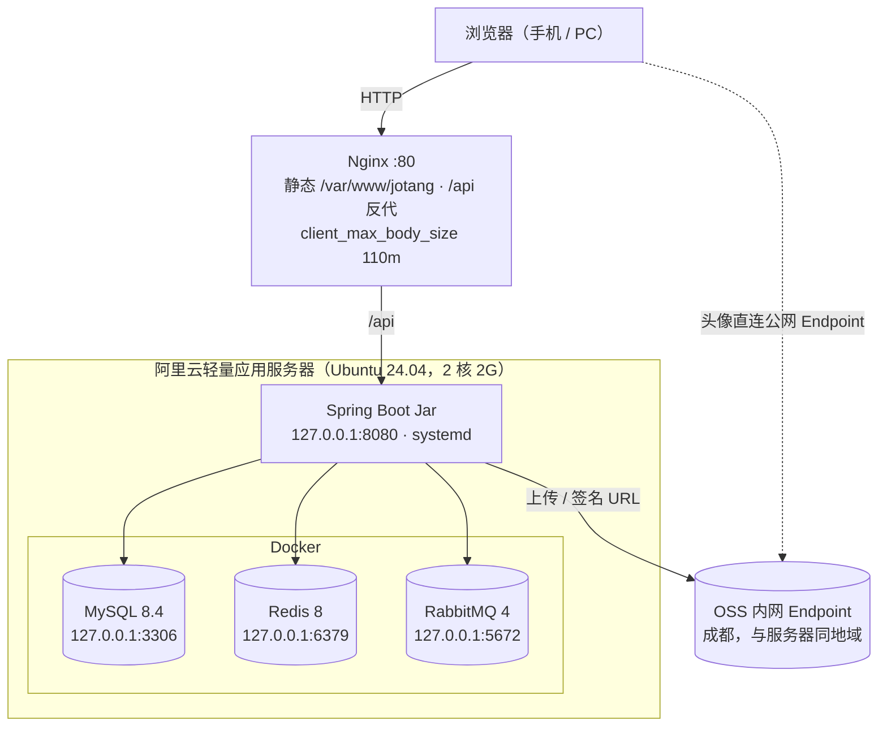
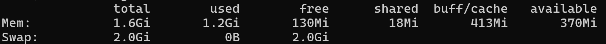

# Jotang Note 部署与运维

> 单台阿里云轻量应用服务器（Ubuntu 24.04，2 核 2G）上的单体部署：Nginx 托管前端产物并反向代理后端，Spring Boot Jar 交给 systemd，MySQL / Redis / RabbitMQ 三个中间件走 Docker。
>
> 发布方式：本地 `git push`，服务器上以 **jotang** 账号登录后执行 `deploy/update.sh`，由服务器侧完成构建。本文从一台空服务器写起。

## 1. 目标拓扑



三个中间件的端口在 compose 里都绑死 `127.0.0.1`，应用通过回环访问；**公网只放行 22 和 80**。

## 2. 内存账（2核 2G）

2G 装得下这套东西，但没有余量：

| 组件 | 预算 | 由什么控制 |
|---|---|---|
| MySQL 8.4 | ~350–450 MB | `--innodb-buffer-pool-size=128M`（**默认按宿主内存自算，不压会到 400MB+**）、`--performance-schema=OFF` |
| RabbitMQ 4（带管理台） | ~250–300 MB | Erlang VM，基本不可压；管理插件本身也占内存 |
| Redis 8 | ~20 MB | `--maxmemory 128mb --maxmemory-policy allkeys-lru` |
| JVM | ~700–800 MB | `-Xms256m -Xmx512m`，加上 metaspace / 线程栈 / 堆外 |
| 系统 + sshd + systemd + dockerd | ~250 MB | —— |
| **合计** | **~1.6–1.8 GB / 2 GB** | 剩不到 400MB 余量，所以下面两件事是硬要求 |

1. **2G swap 必须配**。
2. **构建期必须停掉应用和容器**（`update.sh` 已内建）。`vite build` 打 element-plus 峰值要 1.0–1.5G、`mvn package` 要 600–800M，而三个容器常驻就要 700MB；不停掉的话必然打到 swap 抖动，甚至被 OOM Killer 干掉。

部署完成后实际内存占用情况：

仅有 370mb 余量

---

## 3. 一次性初始化（root）

### 3.1 系统软件

```bash
apt update

apt install -y git rsync curl nginx openjdk-21-jdk-headless

curl -fsSL https://deb.nodesource.com/setup_22.x | bash -
apt install -y nodejs

# Docker + compose v2 用Ubuntu自带的包。
# 官方源 download.docker.com 在国内常被 reset
apt install -y docker.io docker-compose-v2
# 设置开启自启动
systemctl enable --now docker

# JDBC URL 用 Asia/Shanghai，系统时区要与其对齐
timedatectl set-timezone Asia/Shanghai

# 验证
java -version
node -v && npm -v        # 应为 v22.x
docker version --format '{{.Server.Version}}' && docker compose version
```

**不需要单独装 Maven**：`.mvn/wrapper/maven-wrapper.properties` 是 `distributionType=only-script`，`mvnw` 会自己下载 Maven 3.9.16。

> Ubuntu 源里的 Docker 版本略旧，但本项目只跑 MySQL / Redis / RabbitMQ 三个官方镜像；`docker compose up --wait` 需要 Compose v2.17+，24.04 的 `docker-compose-v2` 满足。

### 3.2 加 2G swap

Swap 是拿硬盘空间临时充当内存。2G 内存的机器上这是安全垫，构建期尤其依赖它。

```bash
# 创建一个 2G 的文件 /swapfile，只有 root 能读写
fallocate -l 2G /swapfile && chmod 600 /swapfile

# 格式化成 swap 并立即启用
mkswap /swapfile && swapon /swapfile

# 写入 /etc/fstab，开机自动挂载
echo '/swapfile none swap sw 0 0' >> /etc/fstab

# 查看内存（human-readable）
free -h
```

### 3.3 建 jotang 账号、设密码、分组

服务以专用账号运行，不跑在 root 下。**发布脚本也用它**，所以它需要能登录、能 sudo。

```bash
# -r 系统账号；-m 建家目录；-d 指定家目录；-s 指定登录 shell
useradd -r -m -d /opt/jotang -s /bin/bash jotang

# docker 组：update.sh 要以 jotang 身份跑 docker compose
usermod -aG docker jotang
# sudo 组：update.sh 要执行 systemctl stop/start
usermod -aG sudo jotang

# 设置登录密码 —— 以后 SSH 登录用的密码
passwd jotang
```

> **这样做 jotang 相当于有完整的 root 权限**。为了省事做的妥协。。

建目录：

```bash
# 1. /opt/jotang/src              源码目录，git 工作区，git pull 与构建都在这里
# 2. /var/www/jotang              静态资源目录，前端打包产物，Nginx 对外提供
# 3. /var/lib/jotang/upload-tmp   上传中转目录，超过 1MB 的 multipart 部件落盘于此
# 4. /etc/jotang                  应用配置目录，放 jotang.env
mkdir -p /opt/jotang/src /var/www/jotang /var/lib/jotang/upload-tmp /etc/jotang

# 前面三处 jotang 要能写：git pull、rsync、multipart 落盘
chown jotang:jotang /opt/jotang/src /var/www/jotang /var/lib/jotang/upload-tmp
```

`/opt/jotang/src`（git 工作区）与 `/opt/jotang/app.jar`（构建产物）分开，是为了让 systemd 的路径不依赖构建目录结构。

### 3.4 确认 SSH 允许密码登录

### 3.5 Docker 镜像加速

```bash
vi /etc/docker/daemon.json
```

```json
{
  "registry-mirrors": [
    "https://docker.m.daocloud.io",
    "https://docker.1ms.run",
    "https://docker.1panel.live"
  ]
}
```

```bash
systemctl daemon-reload
systemctl restart docker
# 验证
docker info | grep -A3 'Registry Mirrors'
```

到这里 root 的部分就结束了。后面全部以 **jotang** 身份操作。

---

## 4. 以 jotang 登录，完成部署

### 4.1 构建加速

`mvnw` 和 `npm ci` 都要从境外拉依赖，不配镜像会非常慢。  
**必须在真正执行构建的账号（jotang）下配置**——Maven 读 `~/.m2/settings.xml`、npm 读 `~/.npmrc`，配在 root 家目录里构建时根本看不到。

```bash
mkdir -p ~/.m2
cat > ~/.m2/settings.xml <<'EOF'
<settings>
  <mirrors>
    <mirror>
      <id>aliyun</id>
      <mirrorOf>central</mirrorOf>
      <name>Aliyun Public</name>
      <url>https://maven.aliyun.com/repository/public</url>
    </mirror>
  </mirrors>
</settings>
EOF

npm config set registry https://registry.npmmirror.com
```

### 4.2 拉代码并起三个容器

```bash
git clone https://github.com/ShiwarHoufu/jotang-note.git /opt/jotang/src
# 或者从 gitee 拉取
# git clone https://gitee.com/wang-houfu/jotang-note /opt/jotang/src

cd /opt/jotang/src
cp deploy/.env.example deploy/.env
vi deploy/.env                     # 填四个强密码
chmod 600 deploy/.env

docker compose -f deploy/docker-compose.prod.yml up -d
# 查看容器状态
docker compose -f deploy/docker-compose.prod.yml ps
```

先起容器、后起应用：两个模式开关的默认值都是 `queue`，应用启动时 `@RabbitListener` 就会去连 Broker。

- **那三项环境变量只在首次初始化生效。** 之后改 `deploy/.env` 不会同步到已有的库和账号上。要改得进容器执行 SQL，或者删掉数据卷重来（会丢数据）。
- **`MYSQL_USER` / `MYSQL_PASSWORD` 必须与 §4.3 里的 `DB_USERNAME` / `DB_PASSWORD` 完全一致**。

### 4.3 应用环境变量（root下操作）

`deploy/jotang.env.example` 是完整模板，逐项都有注释。装到 `/etc/jotang/jotang.env`：

```bash
cp /opt/jotang/src/deploy/jotang.env.example /etc/jotang/jotang.env
vi /etc/jotang/jotang.env
chown root:root /etc/jotang/jotang.env && sudo chmod 600 /etc/jotang/jotang.env
```

三类必须处理：

1. **必填三项**，缺任一项启动即失败（`JwtTokenProvider` / `OssConfig` 用的是无默认值的 `@Value`）：
   `JWT_SECRET`（`openssl rand -base64 48` 新生成）、`JOTANG_OSS_ACCESS_KEY_ID`、`JOTANG_OSS_ACCESS_KEY_SECRET`
2. **必须与 `deploy/.env` 对齐**：`DB_USERNAME` / `DB_PASSWORD`（对应 `MYSQL_USER` / `MYSQL_PASSWORD`）、`REDIS_PASSWORD`、`RABBITMQ_USER` / `RABBITMQ_PASSWORD`

### 4.4 装 systemd unit（root下操作）

**先装 unit、后构建启动**——否则 `update.sh` 最后那步 `systemctl start` 会因为没有 unit 而失败。

```bash
cp /opt/jotang/src/deploy/systemd/jotang-note.service /etc/systemd/system/
systemctl daemon-reload
systemctl enable jotang-note      # 只设开机自启，现在还不启动（jar 尚未构建）
```

unit 里 `After=docker.service` + `StartLimitIntervalSec=0` + `Restart=always` 是一组：**三个中间件都在容器里，开机时容器必然比应用起得晚**，应用第一次连不上库会启动失败，靠 systemd 无限重试直到容器就绪。日志只走 stdout，由 journald 接住，没有额外的日志文件要管。

### 4.5 首次构建与启动

```bash
cd /opt/jotang/src
bash deploy/update.sh
```

`update.sh` 做的事：
1. `git pull` 
2. 停应用与容器腾内存
3. `bash mvnw clean package -DskipTests` 
4. `npm ci && npm run build` 
5. jar 拷到 `/opt/jotang/app.jar`、dist 同步到 `/var/www/jotang` 
6. `docker compose up -d --wait` 
7. 启动服务

首次构建在 2 核上要 5–10 分钟，`mvnw` 第一次还要下载 Maven 3.9.16 和全部依赖。验证：

```bash
systemctl status jotang-note --no-pager
journalctl -u jotang-note -n 50 --no-pager
free -h      # 关注 available 还剩多少、swap 有没有被大量用掉
```

> - 用 `bash mvnw` 而不是 `./mvnw`：仓库在 Windows 上编辑，git 常常不保留 `mvnw` 的可执行位，直接执行会报 `Permission denied`。
> - **不要用 sudo 跑整个脚本**。它会以 root 身份生成 `target/`、`node_modules/`、`app.jar`，属主变成 root，下次 jotang 跑就写不进去。脚本内部只对那两条 `systemctl` 用了 sudo。

---

## 5. Nginx（root下操作）

```bash
cp /opt/jotang/src/deploy/nginx/jotang.conf /etc/nginx/sites-available/jotang
ln -sf /etc/nginx/sites-available/jotang /etc/nginx/sites-enabled/jotang
rm -f /etc/nginx/sites-enabled/default
nginx -t && systemctl reload nginx
```

配置里有三处与后端是成对的，改一个必须改另一个：

| Nginx | 后端 | 关系 |
|---|---|---|
| `client_max_body_size 110m` | `spring.servlet.multipart.max-request-size: 110MB` | Nginx 侧必须 ≥ 后端，否则请求在 Nginx 就被 413 拦下，后端那个上限形同虚设 |
| `proxy_request_buffering off` | —— | 请求体不落 Nginx 临时盘，100MB 的文件直接流给后端 |
| `proxy_pass http://127.0.0.1:8080;` | 接口自带 `/api` 前缀 | **不带尾斜杠、也不 rewrite**。加了尾斜杠会把 `/api` 前缀吃掉，全部 404 |

## 6. 控制台防火墙

阿里云轻量应用服务器控制台 → 实例 → 防火墙，入方向规则**只放行 22 和 80**。

---

## 7. 日常发布

```bash
# 1. 本地 PowerShell
git push

# 2. 登录服务器
ssh jotang@<公网IP>

# 3. 拉代码、构建、重启（一条命令）
cd /opt/jotang/src
bash deploy/update.sh
```

`update.sh` 会先停掉应用和三个容器再构建（因为内存账）。发布期间站点完全不可用。两个解决办法：
- 本地构建
- 升级服务器内存


> **可选：不给完整 sudo。** 如果不想让 jotang 能 `sudo -i`，可以把它从 sudo 组移除（`gpasswd -d jotang sudo`，需 root），改用定向免密授权——只放行 update.sh 真正需要的那两条：


## 8. 验证清单

| # | 操作 | 预期 |
|---|---|---|
| 1 | `docker compose -f /opt/jotang/src/deploy/docker-compose.prod.yml ps` | 三个容器都是 `Up` 且带 `(healthy)` |
| 2 | `curl -s http://<IP>/api/colleges` | 返回学院列表。这个接口在 `SecurityConfig` 的放行名单里，**免登录**，所以能单独验证 Nginx → 后端 → MySQL 整条链 |
| 3 | 浏览器打开 `http://<IP>/`，注册 → 登录 | 首页正常、样式加载完整；注册成功并能登录（验证建表与种子数据已自动就位） |
| 4 | 上传一篇笔记，附件 > 1MB | 成功；预览页能拿到 OSS 签名 URL 并打开（验证内网 Endpoint 读写 + 公网 Endpoint 签名） |
| 5 | 上传一个 > 100MB 的文件 | 被拒（验证 `client_max_body_size` 生效） |
| 6 | 密码找回 → 发信 | 邮件收到，链接域名是 `<IP>` 而不是 localhost（验证 `JOTANG_MAIL_RESET_LINK_BASE` 与 MQ 消费） |
| 7 | `docker compose -f /opt/jotang/src/deploy/docker-compose.prod.yml exec rabbitmq rabbitmqctl list_queues name messages` | 工作队列与死信队列都回到 0，说明消息被正常消费 |
| 8 | AI 摘要 | 能出结果（验证 `JOTANG_AI_API_KEY`）；留空时应报 50300 而不是把服务打挂 |
| 9 | 改头像 | 浏览器直连 OSS 公网 Endpoint 能显示（头像桶须为**公共读**） |
| 10 | `free -h` | `available` 至少还剩 200–300MB，`swap` 没有持续被大量占用 |
| 11 | `sudo reboot` | 起来后 `systemctl status jotang-note` active、三个容器 Up、Nginx 正常，全站可用（验证 §4.4 那组重试配置） |
| 12 | `journalctl -u jotang-note -f` | 无异常堆栈；`ls /var/lib/jotang/upload-tmp` 无残留文件 |

## 9. 运维备忘

```bash
COMPOSE="docker compose -f /opt/jotang/src/deploy/docker-compose.prod.yml"

# 看应用日志
journalctl -u jotang-note -f

# 看容器日志
$COMPOSE logs -f mysql        # 同理 redis / rabbitmq

# 重启后端
sudo systemctl restart jotang-note

# 手动导一份数据库（备份还没自动化，见 §10）。用应用账号即可，不需要 root；
# 密码从 deploy/.env 里取，注意 -p 与密码之间不能有空格。
$COMPOSE exec -T mysql mysqldump -ujotang -p"$(sed -n 's/^MYSQL_PASSWORD=//p' /opt/jotang/src/deploy/.env)" \
  --single-transaction jotang_note > ~/jotang_note-$(date +%F).sql

# RabbitMQ 管理台（公网不开 15672，走 SSH 隧道）
# 在本地 PowerShell 里执行，然后浏览器开 http://localhost:15672
ssh -L 15672:127.0.0.1:15672 jotang@<公网IP>
```

注意需要手动造一个管理员账号。之后才能访问 `/api/admin/**`。

## 10. 已知限制

1. **内存紧张**。
2. **发布期间站点完全不可用**
3. **无域名 → 全站 HTTP 明文**，JWT 与密码裸奔，仅限自测。
4. **限频是内存态**。重启会清空计数。多实例部署时会失效，届时要换 Redis 实现。
6. **MySQL 的数据采用 Volume 挂载，且数据备份尚未配置**。

