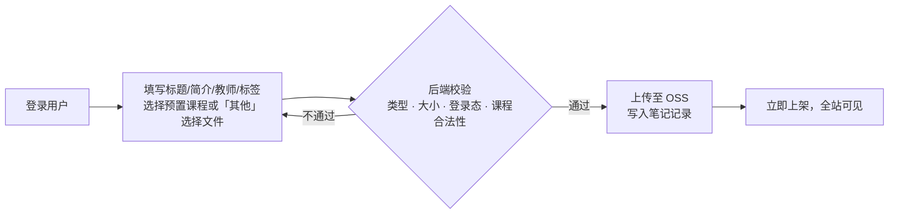
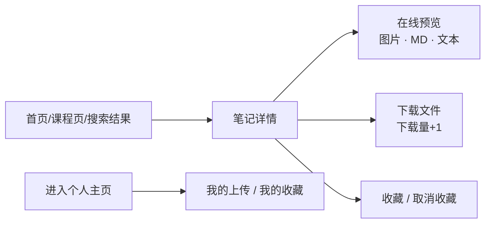

# Jotang Note 笔记托管平台 · 需求分析（MVP）

## 1. 项目背景与目标

- **定位**：面向学生的课程笔记文件托管与分享网站——学生上传笔记，其他人登录后浏览、预览、下载、收藏。
- **解决的问题**：优质笔记散落在群文件/网盘/朋友圈，难以按课程沉淀和检索；考完即丢，后人无法复用。
- **MVP 目标**：
  - 跑通「上传 → 被找到 → 预览/下载 → 收藏」的完整闭环；
  - 支撑数千注册用户、数百日活、数万份以内文件（单机即可承载的量级）；

## 2. 关键决策记录

| 决策点 | 选择 | 备注/代价 |
|---|---|---|
| 产品形态 | 文件托管分享为主 | 不做在线编辑器，开发量可控 |
| 注册方式 | 开放注册 | 无法保证都是本校学生；靠「全部内容需登录」降低公开外泄 |
| 内容审核 | 不设审核与举报，管理员可下架/恢复 | 侵权投诉走邮件、人工下架（见 §8） |
| 游客权限 | 全部内容需登录 | 分享链接也需登录才能看 |
| 前端载体 | 响应式 Web/H5 | 一套页面覆盖手机和 PC 浏览器 |
| 文件限制 | 文本与图片，单文件 ≤100MB | MD/txt + jpg/jpeg/png/gif/webp；**PDF、Office、压缩包一律不收**，见《概要设计》§6.1 |
| 课程分类 | 预置课程表，上传时选择或选「其他」 | 课程数据初始化导入，用户不能自建课程 |
| 标签 | 预置常用标签 + **用户可自由打标** | 上传时按名称打标，同名复用已有标签（`tag.name` 唯一），不存在则当场创建；因此标签表不是纯预置数据，见《概要设计》§3.2 |
| MVP 互动功能 | 仅收藏 + 个人主页 | 评论、评分、积分榜单全部后置 |
| 登录防护 | 做登录限频，不做图形验证码 | 同一账号连续失败 5 次锁定 10 分钟，防暴力破解（见 §7） |
| 部署资源 | 已有阿里云 ECS，单体部署 | 域名与备案待落实，开发期可先用 IP 访问 |
| 文件存储 | 阿里云 OSS（笔记私有 Bucket + 头像公共读 Bucket） | 笔记鉴权后签发临时签名 URL 预览/下载，头像公共读直连，见 §7 |
| AI 摘要 | Spring AI + DeepSeek，**对图片与 md / txt 笔记**生效；用户点按生成、可改、不自动保存 | 上传/编辑页的「自动生成摘要」按钮：图片走多模态读图、md / txt 走纯文本调用。PDF / Office 摘要列为 V2（前提是先放开这两类的上传）；不做对话问答。见《技术选型》§2、《概要设计》§5.8 |

## 3. 用户角色

- **游客**：只能看到登录/注册页，不能浏览任何笔记内容。
- **普通用户（学生）**：上传、浏览、搜索、预览、下载、收藏、维护自己的内容和主页。
- **管理员（你自己）**：拥有笔记下架/恢复权限。MVP 不做管理后台页面，只提供**管理员鉴权的下架/恢复接口**；为方便日常使用，在笔记详情页对管理员显示「下架 / 恢复」按钮（复用现有页面，不单独建后台）。无审核流程、无举报系统。

## 4. 功能范围

### 4.1 MVP 包含

1. **账号**：注册、登录、退出、基本资料（昵称、头像）、密码找回。
2. **上传**：填写标题/简介/教师/标签/课程，上传单文件，提交后立即对所有人可见。
3. **浏览与发现**：
   - 首页：最新上传、热门（按下载/浏览量）；
   - 课程页：按预置课程聚合浏览
   - 标签筛选。
4. **搜索**：按关键词匹配标题、简介、课程名、教师、标签。
5. **笔记详情**：元数据展示、在线预览、下载、收藏、浏览量/下载量计数。
6. **收藏与个人主页**：收藏/取消收藏、我的收藏、我的上传；主页展示昵称、头像、上传数量、累计浏览/下载量。**收藏的笔记被删除或下架时保留占位（「笔记已删除」/「已下架」），不解除收藏关系**，占位项不可预览下载；恢复上架后自动正常展示。
7. **我的内容管理**：编辑笔记元数据、删除自己的笔记（不支持替换文件，需要改文件就删了发新笔记）。
8. **管理员下架（最小管理能力）**：
   - 页面公布侵权投诉邮箱
   - 管理员鉴权接口：下架、恢复上架；详情页对管理员显示对应按钮，不做后台页面；
   - 下架后：笔记不出现在首页/课程页/搜索结果中；详情页对普通用户（含收藏者）提示「该笔记已下架」，禁止预览、下载、收藏；
   - 上传者本人在「我的上传」中仍可见该笔记并标注「已下架」状态；管理员可随时恢复，恢复后各项计数不变；
9. **AI 摘要**：上传或编辑笔记时，点自动生成摘要，由 AI 阅读笔记文件生成一段摘要，填入简介输入框。用户可自由修改、也可弃用。MVP **对图片（jpg/png/gif/webp）与 md / txt 笔记提供该按钮**，其余类型不显示。

### 4.2 MVP 明确不做（V2 候选）

- 评论、评分、点赞、关注/粉丝、私信
- 积分体系、贡献排行榜、消息通知
- 站内举报、审核工作流、运营管理后台（MVP 仅下架接口 + 详情页按钮）
- 在线 Markdown 编辑器、多人协同
- PDF / Office 在线预览（MVP 只支持图片与 Markdown / 文本预览）
- 课程的增删改管理之外，标签也**不设**重命名 / 合并 / 删除——标签只增不改，脏标签靠人工维护
- **AI 的其余形态**：基于全站笔记的检索问答（RAG）等。MVP 的 AI 只有点按生成摘要这一个动作
- **文档类笔记的摘要**（PDF / Word / Excel / PPT）：模型的多模态输入不收这几种格式，必须先抽文本（PDF reader / Tika）再走纯文本调用，且这几类文件本身已不在上传白名单内。**md / txt 的文本摘要已经做了**——它们本身已是纯文本，不需要抽文本这一层。

## 5. 核心业务流程

### 5.1 上传流程

### 5.2 浏览 / 下载 / 收藏

> 所有节点都要求登录态；预览和下载均走后端鉴权，由后端签发 OSS 临时签名 URL，不暴露对象永久地址。

## 6. 非功能需求

- **容量假设**：约 2~4 万在校生规模，MVP 按数千注册、日活数百、笔记总量数万份估算；单份均 5~10MB，OSS 存储空间按 200~500GB 规划。
- **性能**：常规列表/搜索接口 P95 < 500ms。
- **兼容性**：PC浏览器
- **安全**：
  - 密码 BCrypt 存储；登录态用 JWT，所有内容接口鉴权，防越权下载；
  - 文本输出转义防 XSS；
  - 登录限频：同一账号连续失败 5 次锁定 10 分钟；不做图形验证码。
- **存储与备份**：
  - 笔记文件与头像存阿里云 OSS（笔记私有 Bucket、头像公共读 Bucket），ECS 本地不落盘；
  - 预览/下载经后端鉴权后签发临时 URL，不暴露对象永久地址，下载时还原原始文件名；
  - MySQL 每日定时 dump。

### 7. 部署形态

见《部署运维》

## 8. 以后方向

1. 笔记详情接口引入redis；
2. 把增删改操作放进MQ；
3. AI 检索笔记

