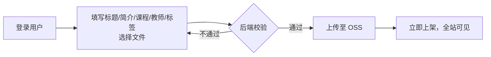
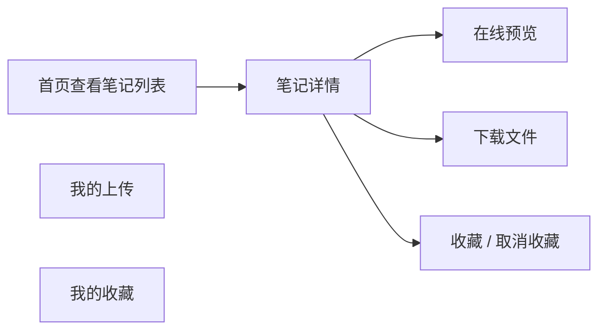

# Jotang Note 笔记托管平台 · 需求分析（MVP）

## 1. 项目背景与目标

- **定位**：面向学生的课程笔记文件托管与分享网站——学生上传笔记，其他人登录后浏览、预览、下载、收藏。
- **解决的问题**：优质笔记散落在群文件/网盘，难以沉淀和检索；
- **MVP 目标**：
  - 跑通「上传 → 被找到 → 预览/下载 → 收藏」的完整闭环；
  - 支撑数千注册用户、数百日活、数万份以内文件；

## 2. 关键决策记录

| 决策点 | 选择 | 备注/代价 |
|---|---|---|
| 注册方式 | 开放注册 | 无法保证都是本校学生；靠「全部内容需登录」降低公开外泄 |
| 内容审核 | 不设审核与举报，管理员可下架/恢复 | 侵权投诉走邮件、人工下架|
| 游客权限 | 全部内容需登录 | 分享链接也需登录才能看 |
| 前端载体 | 响应式 Web/H5 | 一套页面覆盖手机和 PC 浏览器 |
| 文件限制 | 文本与图片，单文件 ≤100MB | MD/txt + jpg/jpeg/png/gif/webp；**PDF、Office、压缩包暂不处理** |
| 课程分类 | 预置课程表 | 课程数据初始化导入，用户不能自建课程 |
| 标签 | 用户可自由打标 | 不存在则当场创建；下拉栏显示最常用的几个标签 |
| MVP 互动功能 | 仅收藏 + 个人主页 | 评论、评分、积分榜单全部后置 |
| 登录防护 | 做登录限频，不做图形验证码 | 同一账号连续失败 5 次锁定 10 分钟 |
| 部署资源 | 已有阿里云 ECS，单体部署 | 域名与备案待落实，开发期可先用 IP 访问 |
| 文件存储 | 阿里云 OSS（笔记私有 Bucket + 头像公共读 Bucket） | 笔记鉴权后签发临时签名 URL 预览/下载，头像公共读直连|
| AI 摘要 | Spring AI + DeepSeek，对图片与 md / txt 笔记生效；用户点按生成、可改、不自动保存 | 上传/编辑页的「自动生成摘要」按钮。PDF / Office 摘要列为 V2（前提是先放开这两类的上传）； |

## 3. 用户角色

- **游客**：只能看到登录/注册页，不能浏览任何笔记内容。
- **普通用户（学生）**：上传、浏览、搜索、预览、下载、收藏、维护自己的内容和主页。
- **管理员**：拥有笔记下架/恢复权限。MVP 不做管理后台页面；在笔记详情页对管理员显示「下架 / 恢复」按钮。无审核流程。

## 4. 功能范围

### 4.1 MVP 包含

1. **账号**：注册、登录、退出、基本资料（昵称、头像）、密码找回。
2. **上传**：填写标题/简介/教师/标签/课程，上传单文件，提交后立即对所有人可见。
3. **浏览与发现**：
   - 首页：最新上传、热门（按下载/浏览量）；
   - 检索：可以通过标题、课程、标签进行筛选
4. **笔记详情**：元数据展示、在线预览、下载、收藏、浏览量/下载量计数。
5. **收藏与个人主页**：收藏/取消收藏、我的收藏、我的上传；主页展示昵称、头像、上传数量、累计浏览/下载量。**收藏的笔记被删除或下架时保留占位（「笔记已删除」/「已下架」），不解除收藏关系**，占位项不可预览下载；恢复上架后自动正常展示。
6. **我的内容管理**：编辑笔记元数据、删除自己的笔记（不支持替换文件，需要改文件就删了发新笔记）。
7. **管理员下架**：
   - 管理员鉴权接口：下架、恢复上架；详情页对管理员显示对应按钮，不做后台页面；
   - 下架后：笔记不出现在首页/课程页/搜索结果中；详情页对普通用户（含收藏者）提示「该笔记已下架」，禁止预览、下载、收藏；
   - 上传者本人在「我的上传」中仍可见该笔记并标注「已下架」状态；管理员可随时恢复，恢复后各项计数不变；
8. **AI 摘要**：用户上传或编辑笔记时，点自动生成摘要，由 AI 阅读笔记文件生成一段摘要，填入简介输入框。用户可自由修改、也可弃用。

### 4.2 MVP 明确不做（V2 候选）

- 评论、评分、点赞、关注/粉丝、私信
- 站内举报、审核工作流、运营管理后台
- 在线 Markdown 编辑器
- PDF / Office 上传/在线预览
- AI 的其余形态：基于全站笔记的检索问答（RAG）等。

## 5. 核心业务流程

### 5.1 上传流程

### 5.2 浏览 / 下载 / 收藏

## 6. 非功能需求

- **容量假设**：不确定。
- **性能**：不确定。
- **兼容性**：PC浏览器
- **安全**：
  - 密码 BCrypt 存储；登录态用 JWT，所有内容接口鉴权，防越权下载；
  - 登录限频：同一账号连续失败 5 次锁定 10 分钟；不做图形验证码。
- **存储与备份**：
  - 笔记文件与头像存阿里云 OSS（笔记私有 Bucket、头像公共读 Bucket），ECS 本地不落盘；
  - 预览/下载经后端鉴权后签发临时 URL，不暴露对象永久地址，下载时还原原始文件名；

